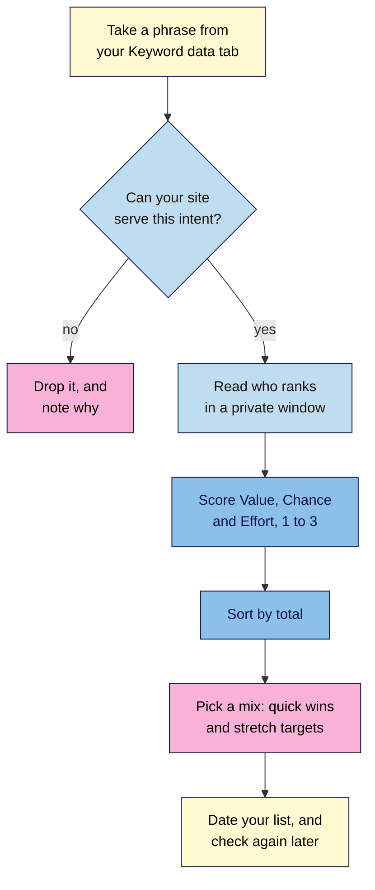

# M03.L04 — Realistic Targets: Choosing Keywords a New Site Can Win
> After this lesson you can size up who ranks for a phrase, weigh phrases by more than volume, and choose five first targets that your site has a real chance of winning.

**Time:** ~15 min reading + ~30 min hands-on + ~10 min exercise · **Level:** L1 Foundation (beginner) · **Prereqs:** M03.L01, M03.L03 · **Remediate to:** M03.L03
**Verified against:** Google "How Search Works" (ranking results); Google Search Central "SEO Starter Guide", "Do you need an SEO?", "Creating helpful, reliable, people-first content" and "Get on Google"; Ahrefs' own pages on keyword difficulty, all on 2026-11-06. Google doesn't publish a way to judge your chances for a phrase, so the reading method and the scoring in this lesson are observed practice and a course rule of thumb, labelled as such.

> ⚠️ **Freshness flag:** who ranks for a phrase changes all the time. A score is only true on the day you checked, so date it.

## Learning objectives
1. **Judge** who ranks for a phrase and whether your site could compete with them. *(O1)*
2. **Compare** phrases by intent, business value and effort, not volume alone. *(O2)*
3. **Prioritise** a short list of first targets for your project site. *(O3)*

## Why it matters
Kavya's first keyword list starts with "yoga", because it has the biggest number. The first page is full of huge health sites, national brands and video channels. A new site with six blog posts won't move them, and most people searching "yoga" don't want a class in Chennai anyway. Further down her list is "gentle yoga for beginners in adyar". It has far fewer searches, but the people searching it are the ones she can actually teach. Choosing that kind of target is the difference between a year of no results and a first real student from Google.

## Core concept
**Plain version:** a good first target is a phrase that you can serve, that's worth something to the business, and where the current results look beatable. The biggest number on your list is rarely the best place to start.

**Analogy:** a new café doesn't open by trying to beat a global chain on every high street. It starts by being the best coffee on one street, for the people who walk past. Once it's known there, it can grow.

### Reading who ranks
You don't need paid tools for this. Search the phrase in a private window, and look at the top five to ten organic results *(observed practice)*.

| Look at | Harder for a new site | More open to a new site |
|---|---|---|
| **Who they are** | Global brands, marketplaces, government sites, big publishers | Small businesses, personal sites, forums |
| **How well they fit** | Pages built exactly for this phrase | General pages that only partly answer it |
| **How good they are** | Detailed, current, written by someone with real experience | Thin, out of date, or written with no real experience |
| **What you can add** | You have nothing that they lack | You have first-hand knowledge, local detail or real examples |

Then give the phrase a **Chance** rating, from your own reading:
- **3 (open):** forums, small sites or weak pages in the top results.
- **2 (possible):** a mix, with at least a couple of pages you could beat.
- **1 (locked):** strong, well-fitted pages all the way down.

A difficulty score from Lesson 3.3 can help you to sort a list, but read the results anyway. Ahrefs says: "Keyword Difficulty doesn't take into account any on-page factors." So it can't tell you that the top pages are weak or off-topic.

### What Google says about quality
Google gives you two good questions to ask yourself. The first is about comparing: "Does the content provide substantial value when compared to other pages in search results?" The second is about you: "Does your content clearly demonstrate first-hand expertise and a depth of knowledge".

That's where small sites can be strong. Kavya has really taught beginners, and Tomás has really fixed taps. A big site may not have that.

Links also matter, and that's one reason established sites are hard to beat. Google says: "one of the factors used to determine quality is understanding if other prominent websites link or refer to the content." Module 9 covers links.

### Scoring a phrase
First comes one yes-or-no gate: **can your site serve this intent?** If the results want a product and you don't sell one, stop there. Otherwise, score each phrase from 1 to 3 *(course rule of thumb)*.

| Score | 1 | 2 | 3 |
|---|---|---|---|
| **Value** | Only loosely linked to what you offer | Brings in the right audience | Close to a sale, booking or sign-up |
| **Chance** | Locked | Possible | Open |
| **Effort** | A big new page or feature | A new page, or a major rewrite | A small improvement to a page you have |

Add them up for a total out of 9. If two tie, pick the one with higher Value.

Notice that volume isn't a score. Use it as a sense check: is there any sign of demand, from a tool or from your customers? A small number on a phrase worth a real sale can beat a big number that never pays.

### Choosing a mix
Don't just take the top five totals. Aim for a mix:
- **Quick wins:** high Chance and low Effort. Three or so, for early progress.
- **Stretch targets:** high Value, but harder. One or two, to work towards.

If you have Search Console data, look for phrases where you already appear on the second page. They're often the closest wins, because Google already connects your page with the phrase *(observed practice)*.

### What this does for search

| Claim | Verdict | What the source says |
|---|---|---|
| Someone can promise you first place | **False** | "No one can guarantee a #1 ranking on Google." |
| Results will show up within days | **False** | "Some changes might take effect in a few hours, others could take several months." |
| A new site is noticed straight away | **False** | "It can take a few weeks for Google to notice a new site, or any changes in your existing site." |
| Matching a competitor's links wins the spot | **False** | Even Ahrefs says that as many links or more "won't guarantee that you'll rank #1" |
| A low difficulty score means it's easy | **Unsupported** | It's a tool's estimate, and it ignores on-page factors. Read the results too |
| Small sites can never beat big ones | **False, for specific phrases** | Google's self-check asks about value "when compared to other pages in search results", not about site size. Big, broad phrases are a different story *(observed practice)* |
| A big volume is the best target | **Risky** | Volume says nothing about intent, value or your chances |

## How it works
Use this flow for each phrase on your list.

**In words:** take a phrase from your Keyword data tab. If your site can't serve its intent, drop it and note why. If it can, read who ranks in a private window, then score Value, Chance and Effort from 1 to 3. Sort by total, pick a mix of quick wins and stretch targets, and date your list so that you can check it again later.

> **Under the hood: why a total isn't a truth.** These scores are your judgement, written down. Two people can score a phrase differently, and that's fine. The value is that your reasons are visible, so that a client or a future you can question them. Anyone who gives you a formula that predicts rankings is claiming more than Google does.

## Hands-on walkthrough
You'll review the results for ten phrases, score them, and choose five first targets. You need a browser and your "SEO 101 project" sheet. Nila Coffee's values are illustrative.

**Before you start: which steps apply to you?**
- **Path A (your own site):** do every part, using what you know about your margins and customers.
- **Path B (practice site):** you have no sales to protect, so score Value by how well a phrase fits your blog's audience. Expect mostly low-Effort, specific phrases.
- **Path C (client site):** ask the client which products or services matter most before you score Value. It's their business decision.

**Part A — Set up (3 min)**
1. Add a tab called **Targets** to your "SEO 101 project" sheet, with these columns:

   | Phrase | Intent | Who ranks | Value | Chance | Effort | Total | Decision | Date |
   |---|---|---|---|---|---|---|---|---|
   | cold brew ratio for 1 litre | Informational | Small blogs, 1 forum | 2 | 3 | 2 | 7 | Quick win | 2026-11-06 |

2. Choose ten phrases from your **Keyword data** tab, with a mix of intents. Include customers' own wording, even if a tool shows no volume.

**Part B — Read who ranks (15 min)**
1. Open a private window, and search your first phrase. Ignore the ads.
2. Look through the top five results. Open two of them, and read them as a visitor would. You can skip this if the results are plainly locked.
   > 🖼️ **Image prompt:** Desktop Google results page (1280×900) for a specific long-tail search, with a forum thread among the top organic results. Highlight the forum result with a 3px #F9B2D7 outline; blur any personal details.
   > **Alt text:** A results page for a specific search, with a forum thread highlighted among the top results.
3. Ask: could I serve this intent? If not, write "Drop" in **Decision**, with the reason, and move on.
4. In **Who ranks**, write a short note, such as "2 big brands, 2 blogs, 1 forum".
5. Give it a **Chance** rating, using the table above.

   **Expected:** long, specific phrases tend to look more open than short ones. Some of your favourites may turn out to be locked, and that's useful to know now.

**Part C — Score (7 min)**
1. For each phrase you kept, fill in **Value** and **Effort**. Check your site: do you already have a page for this?
2. Add the three scores in **Total**, and sort the tab from high to low.

   **Expected:** a spread of totals. If everything scores 8 or 9, you're being too generous, so look again at Chance.

**Part D — Choose five (5 min)**
1. Pick your five first targets: around three quick wins, and one or two stretch targets.
2. Write "Quick win" or "Stretch" in **Decision**, and "Later" beside the rest.
3. Check the mix: can you explain each choice to the business owner in one sentence?
   > 🖼️ **Image prompt:** A Google Sheets tab called Targets (1200×500) with ten scored phrases sorted by total, and a Decision column showing Quick win, Stretch, Later and Drop. Highlight the Decision column with a 3px #F9B2D7 outline; blur any personal details.
   > **Alt text:** A spreadsheet of scored phrases sorted by total, with the Decision column highlighted.

**Expected output:** a dated **Targets** tab with ten phrases, each with a note on who ranks, scores and a decision, including five first targets.

## When to use / when not to
**Use this process** when you choose what to work on next, for a new site or an existing one.

**Go for broad phrases later.** You may reach them in time, once you've got good pages and links. They aren't where to begin.

**Don't drop a phrase only because it's hard** if it's central to the business. Keep it as a stretch target, and be honest about the timescale.

**Don't over-score.** A rough score in 30 minutes beats a perfect score you never finish.

**The trade-off:** easy targets give early progress, but they may bring less value. Stretch targets are worth more, but you may wait a long time. That's why you choose a mix.

## Use AI for this
**Example prompt:**
> "Here are my notes on who ranks for ten phrases, with my scores for Value, Chance and Effort: [paste]. Point out any scores that don't seem to match my notes, and tell me if my five picks are too similar. Use only my notes."

**What AI does well here:** spotting scores that don't match your notes, and helping you to explain your choices in plain words.
**Where it gets it wrong:** it can't see today's results for your location, and it doesn't know your margins. It may also say confidently that you can rank for something.
**How to check:** the results page and the business owner decide. Treat AI's comments as questions to look into.

## Common mistakes
- **Starting with the biggest number.** Start with what you can serve.
- **Trusting a difficulty score alone.** Read the results.
- **Scoring from the titles only.** Open a couple of pages.
- **Forgetting business value.** Traffic that never buys or books is a cost.
- **Picking only quick wins.** They might not grow the business.
- **Picking only stretch targets.** You could wait a long time with nothing to show.
- **Promising dates or positions.** No one can guarantee those.
- **Never rechecking.** Results change, so review your list.

## Troubleshooting
| Symptom | Likely cause | Fix |
|---|---|---|
| Every phrase looks locked | Your phrases are too broad | Add a place, a problem or a type of person |
| Every phrase scores 8 or 9 | You're being generous on Chance | Open two results, and compare them honestly with what you could write |
| Results are nothing like your phrase | Few pages target it | It may be open. Check that real people use it |
| You can't judge Value | You don't know what earns money | Ask the owner what they'd most like more of |
| All five picks are about one topic | Your seeds were too similar | Swap one or two, to spread your chances |
| A big brand ranks, but the page is weak | Its site is strong, not this page | Rate Chance as 2, and note the weak page |

## Exercise
**Task:** complete your **Targets** tab (Parts A–D). Then review this list for Nila Coffee, which sells beans and brewing gear online. The figures and notes are illustrative. Say which three you'd choose first, which one you'd keep as a stretch target, and which you'd drop. Give a reason for each.

| # | Phrase | Who ranks | Monthly searches | Note |
|---|---|---|---|---|
| 1 | coffee | Encyclopedias, global brands | 100K–1M | Very broad |
| 2 | best coffee beans for french press india | Comparison blogs, 2 weak lists | 100–1K | Nila sells these |
| 3 | how to clean a french press | Big guides, video | 1K–10K | Nila has a short guide to improve |
| 4 | buy iphone case | Marketplaces | 10K–100K | Nila doesn't sell these |
| 5 | cold brew ratio for 1 litre | Small blogs, 1 forum | 10–100 | A customer asked this last week |
| 6 | coffee subscription india | Big retailers, 3 roasters | 1K–10K | Nila's main goal. Sign-up page exists |

**Expected outcome:** a complete tab, and these answers, though your reasons matter more than an exact match:
- **First three:** phrases 2, 5 and 3. Phrase 2 is close to a sale and has weak competition. Phrase 5 is open, and real customers ask it. Phrase 3 is harder, but it needs only an improvement to a guide Nila already has.
- **Stretch:** phrase 6. It's the most valuable, but it's contested, so work on it over time.
- **Drop:** phrase 1 is too broad and locked. Phrase 4 is the wrong intent for this business, whatever its volume.

**Stretch goal:** find one phrase in your tab where you appear on the second page in Search Console. Note what you'd change on that page.

## Key takeaways
- A good first target is one you can serve, that's worth something, and where the results look beatable.
- Read who ranks yourself, because a difficulty score can't see weak pages.
- Score Value, Chance and Effort, and keep volume as a sense check.
- Choose a mix of quick wins and stretch targets, and write down your reasons.
- Nobody can guarantee rankings or dates, so date your list and review it.

## Teach it back
Explain to a friend in 3 sentences why a new site shouldn't start with the phrase that has the biggest search volume.

## Glossary terms added
- Quick win — added to `seo-101/glossary.md`
- Stretch target — added to `seo-101/glossary.md`
- Target phrase — added to `seo-101/glossary.md`

## Further reading
*All checked 2026-11-06. Vendor pages describe their own tools.*
- Google — How Search Works, ranking results: https://www.google.com/search/howsearchworks/how-search-works/ranking-results/
- Google Search Central — Creating helpful, reliable, people-first content: https://developers.google.com/search/docs/fundamentals/creating-helpful-content
- Google Search Central — SEO Starter Guide: https://developers.google.com/search/docs/fundamentals/seo-starter-guide
- Google Search Central — Do you need an SEO?: https://developers.google.com/search/docs/fundamentals/do-i-need-seo
- Google Search Central — Get on Google: https://developers.google.com/search/docs/fundamentals/get-on-google
- Ahrefs (vendor) — Keyword Difficulty: https://ahrefs.com/blog/keyword-difficulty/

> ⚠️ **May change:** who ranks for any phrase; how tools calculate difficulty.

## Refresher card
*Used by remediation when a learner fails a quiz twice on a later lesson that points back here.*
A good first target is one you **can serve**, that's **worth something**, and where the results look **beatable**. **Gate:** if your site can't serve the intent, drop the phrase. **Read who ranks** in a private window: big brands and exact pages are hard, while forums, small sites and weak pages are open. A difficulty score can't see on-page quality. **Score** Value, Chance and Effort from 1 to 3, and keep volume as a sense check. **Choose a mix** of about three quick wins and one or two stretch targets. Scores are your written judgement, not predictions. "No one can guarantee a #1 ranking on Google." Date your list, and check it again.
