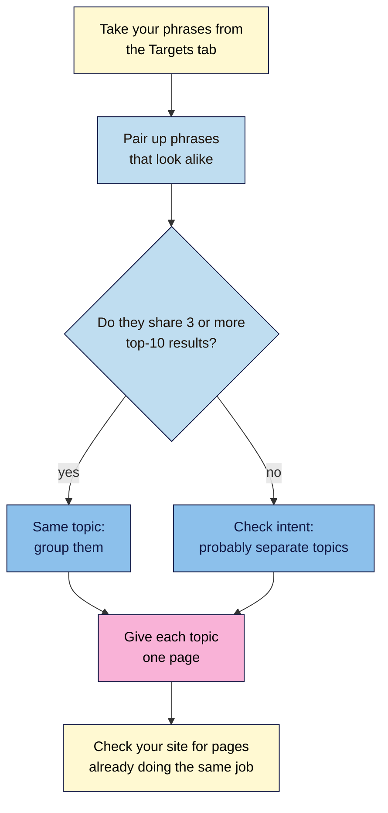
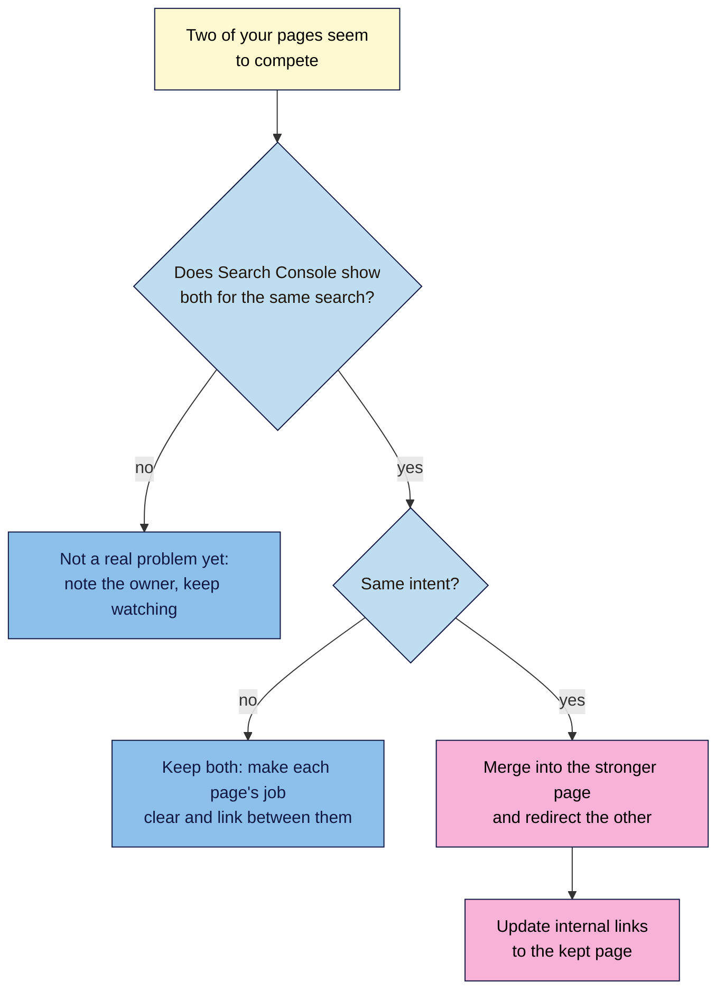

# M03.L05 — Keyword Maps: Grouping Topics and Spotting Cannibalisation
> After this lesson you can group phrases into topics using the results page, give each topic one page in a keyword map, and tell when two of your pages really are competing, and what to do about it.

**Time:** ~16 min reading + ~40 min hands-on + ~10 min exercise · **Level:** L1 Foundation (beginner) · **Prereqs:** M03.L04 · **Remediate to:** M03.L01, M03.L04
**Verified against:** Google Search Central "SEO Starter Guide", "Consolidate duplicate URLs", "What is canonicalization", "Site moves with URL changes", "`site:` search operator" and "Spam policies"; Search Console Help "Performance report (Search results)" (overview, dimensions, and filtering pages); Bing Webmaster Blog (19 Dec 2025); John Mueller's posts on Bluesky (20 Sep 2025); Google Sheets Help (COUNTIF, dropdowns), all on 2026-11-08. Search Console screens weren't tested live, so labels may differ slightly on yours.

> ⚠️ **Freshness flag:** "keyword cannibalisation" is an industry term. Google's documentation doesn't use it. Search Console's Performance report and its help pages were reorganised in 2025–26, so older tutorials may show different menus.

## Learning objectives
1. **Group** keywords into topics, using results-page overlap to decide what belongs on one page. *(O1)*
2. **Build** a keyword map that gives each topic one page. *(O2)*
3. **Spot** cannibalisation with `site:` searches and Search Console, and choose a fix. *(O3)*

## Why it matters
Kavya has two blog posts: "Yoga for Beginners" and "A Beginner's Guide to Yoga". She wrote the second because the first wasn't ranking. Now neither is. In Search Console, both appear for "beginner yoga", sometimes one and sometimes the other, both on the second page. Visitors who land on one don't know the other exists, and the links people give her are split between them. Google says that combining similar pages helps it "consolidate the signals they have for the individual URLs (such as links to them) into a single, preferred URL". Two weaker pages are doing one job. A keyword map would have stopped this before she wrote the second post, and this lesson also shows her how to fix it now.

## Core concept
**Plain version:** many phrases are really one question asked in different words. Group them into a **topic**, and give each topic **one page**. A **keyword map** is the table that records which page owns which topic. When two of your pages try to do the same job for the same searches, people call it **keyword cannibalisation**.

**Analogy:** imagine two staff in a shop both answering every question about French presses, with slightly different advice. Customers get confused, and neither builds a reputation. Give the topic to one person, and send everyone to them.

**Precise definitions:**
- A **topic** (or **keyword cluster**) is a group of phrases with the same intent that one page can fully answer.
- **Results-page overlap** (SERP overlap) means how many of the same pages appear in the top results for two phrases. If Google shows mostly the same pages, it probably sees the same need behind both *(observed practice)*.
- A **keyword map** gives each topic one URL, existing or planned. It's the course's non-negotiable #5 in table form: **one page per topic**.
- **Keyword cannibalisation** is an industry term for two or more of your pages competing for the same searches with the same intent. Google's documentation doesn't use the term.

### What Google says
Google doesn't write about "cannibalisation", but it does write about pages that repeat each other. The SEO Starter Guide says to "try to ensure that each piece of content on your site is only accessible through one individual URL", and gives the reason: two pages with the same information can be "a confusing user experience".

Google's John Mueller has warned against overreacting, though. On Bluesky, on 20 September 2025, he wrote that three pages from one site in the same results "doesn't seem problematic to me just because it's "more than 1"", and that "pages aren't duplicates just because they happen to appear in the same search results page."

So the test isn't "do two of my pages appear for one search?" It's: **do they serve the same intent, so that one strong page would serve people better?**

| Claim | Verdict | What the source says |
|---|---|---|
| Two of your pages in one set of results is always a problem | **False, by Google's public comment** | Mueller: "You need to look at the details, you need to know your site, and your potential users." |
| Duplicate pages on your site get you a penalty | **False** | "Having duplicate content on your site is not a violation of our spam policies, but it can be a bad user experience" |
| Merging pages and redirecting the old one is a recognised fix | **Documented** | "if you have consolidated content previously hosted on multiple pages to a new single page, you can redirect the older URLs to that new, consolidated page." |
| A canonical tag fixes any pair of competing pages | **Only for duplicates** | Canonical tags are for "duplicate or very similar pages", and they're "a hint, not a rule" |
| Add `noindex` to the weaker page | **Not recommended** | "We don't recommend using noindex to prevent selection of a canonical page within a single site, because it will completely block the page from Search." |
| Make a separate page for every variation of a phrase | **Risky** | Google's spam policies define doorway abuse as pages "created to rank for specific, similar search queries" |
| Keep separate pages only when the intent differs | **Bing's guidance** | "Only keep separate pages when intent clearly changes, such as seasonal offers, localized pricing, or comparison-focused content." |

## How it works
First you build the map, then you check your site against it.

**In words:** take your phrases from the Targets tab and pair up any that look alike. Search each one and compare the top ten results. If a pair shares three or more of the same pages, treat them as one topic. If they share fewer, check their intent, as they're probably separate topics. Give each topic one page, then check whether your site already has two pages doing the same job.

The "three or more" line is a common starting point in keyword tools *(observed practice)*, not a Google rule. Treat it as a guide, and use your judgement on intent, as in Lesson 3.1.

> **Under the hood: why Search Console's totals can look odd.** When two of your pages appear in the same results, the chart counts them as one: "if two results from the same site appear for one query, they count as a single impression in the chart total." On the **Pages** tab, each page is counted separately. So when you filter to one search, the page rows can add up to more than the chart. It's a sign two pages were shown, not a mistake.

### When pages compete, choose a fix

**In words:** first check that both pages are actually shown for the same search. Mueller notes that Search Console "shows data for when pages were actually shown", and if they aren't, the problem is theoretical. If they aren't, note in your map which page owns the topic, and keep watching. If both are shown but serve different intents, such as a product page and a how-to guide, keep both, make each page's job clear, and link between them. If they serve the same intent, move the best content into the stronger page, permanently redirect the other to it, and update your internal links. Module 6 shows how to set up redirects.

**How to pick the stronger page:** the one with more clicks and impressions in Search Console, more links from other sites, or the better content *(observed practice)*. If they're close, keep the one with the clearer URL.

## Hands-on walkthrough
You'll group your phrases, build a keyword map, and check your site for pages competing on one topic. Nila Coffee's values are illustrative. Results differ by country, device and day, so yours won't match these.

**Before you start: which steps apply to you?**
- **Path A (your own site):** do every part.
- **Path B (practice site):** do every part. Search Console may show little data for a new blog, which is normal, so lean on the `site:` check in Part D.
- **Path C (client site):** do every part. Part D needs the Search Console access the client gave you in Lesson 1.8.

**Part A — Pick your phrases (5 min)**
1. Copy 12 to 20 phrases into a new tab called **Overlap**: your five first targets from the **Targets** tab, plus related phrases from **Keyword data**.
2. Mark any pairs that look as if they ask the same thing, such as "french press ratio" and "how much coffee for a french press". You'll only compare these pairs, not every phrase with every other.

**Part B — Compare the results pages (15 min)**
1. Open a private window and search the first phrase of a pair. Copy the URLs of the top ten organic results, skipping ads, into one column of your **Overlap** tab. Do the same for the second phrase in the next column.
2. In the cell beside the first URL, count whether it also appears in the second list, for example with `=COUNTIF(C$2:C$11, B2)`. Copy the formula down and add up the column. COUNTIF counts how many cells match, and it ignores capital letters. It treats `?` and `*` as wildcards, so cut each URL off before any `?`. That also removes tracking codes.

   | | B: french press ratio | C: how much coffee for a french press | In both? |
   |---|---|---|---|
   | 2 | brewguide.example/french-press | brewguide.example/french-press | 1 |
   | 3 | coffeeforum.example/ratios | beansblog.example/french-press-ratio | 0 |
   | … | … | … | … |
   | | | **Shared** | **6** |

   **Expected:** pairs that ask the same thing usually share several results. A pair with very different results, such as "how to use a french press" and "best french press to buy", shares few, because one is a guide and the other is shopping.
   > 🖼️ **Image prompt:** Google Sheets tab called Overlap (1200×600) with two columns of ten URLs each for two similar coffee searches, a third column of 1s and 0s, and a total of 6 shared results. Highlight the shared total with a 3px #F9B2D7 outline; blur any personal details.
   > **Alt text:** A spreadsheet comparing the top ten results for two searches, with the count of shared results highlighted.
3. Repeat for each marked pair. Group pairs that share three or more results, and check the intent of the rest.

**Part C — Build the keyword map (12 min)**
1. Add a tab called **Keyword map** with these columns:

   | Topic | Main phrase | Other phrases | Intent | Page type | URL | Existing or new | Priority | Used twice? |
   |---|---|---|---|---|---|---|---|---|
   | French press ratio | french press ratio | how much coffee for a french press; french press coffee to water ratio | Informational | Guide | /french-press-ratio | Existing | Quick win | FALSE |
   | French press (buy) | french press | buy french press india | Transactional | Product page | /shop/french-press | Existing | Stretch | FALSE |

2. Use **Insert > Dropdown** for the **Intent**, **Page type**, **Existing or new** and **Priority** columns, so the values stay consistent.
3. Take **Priority** from your **Targets** tab (Quick win, Stretch or Later). For a topic with no page yet, choose **New** and write the URL you'd give it.
4. In **Used twice?**, enter `=COUNTIF(F:F, F2)>1` and copy it down. It shows **TRUE** if a URL is given to more than one topic.
   **Expected:** no TRUE values. If one appears, either the topics belong together or one needs a new page.

**Part D — Check your site for competing pages (8 min)**
1. For each main phrase, search Google for `site:yourdomain.com` followed by the topic, such as `site:nilacoffee.example french press ratio`. Google documents this pattern: it "Shows which URLs on the site can show up for the term".
   **Expected:** a list of your pages that mention the term. It's a quick sample, not a full list, as Google says `site:` "doesn't necessarily return all the URLs that are indexed".
2. In Search Console, open **Performance > Search results**. On the **Queries** tab, click the phrase, or use **+ Add filter > Queries > Queries containing**. Then open the **Pages** tab.
   **Expected:** one page for most phrases. Two or more pages with impressions for the same phrase deserve a closer look. A new site may see few rows: Google leaves out rare searches ("anonymized queries") and keeps only "the most important data rows".
   > 🖼️ **Image prompt:** Search Console Performance report (1280×800) filtered to one query, with the Pages tab open and two URLs from the same site listed, each with clicks and impressions. Highlight the two page rows with a 3px #F9B2D7 outline; blur any personal details.
   > **Alt text:** Search Console showing two pages from one site with impressions for the same search, highlighted.
3. For each pair of competing pages, use the fix flowchart and write your decision in a **Notes** column: Keep both, Merge into [URL], or Watch. **Don't change your site yet.** Module 6 covers redirects, and Module 7 covers merging content.

**Expected output:** an **Overlap** tab with your compared pairs, a **Keyword map** with each topic on one page and no TRUE in **Used twice?**, and a decision for each competing pair.

## When to use / when not to
**Build or update the map** before you write any new page. It's the cheapest moment to prevent two pages doing one job.

**Check for competing pages** when two of your pages swap places for the same search, when a new post seems to pull traffic from an old one, or before a content audit.

**Don't merge pages just because both appear** for one search. A product page and a how-to guide often appear together because people want both. That's fine.

**The trade-off:** one strong page per topic is simpler for visitors and keeps your links together. But merging is hard to undo and needs a redirect, so check the intent, and both pages' data, first.

## Use AI for this
**Example prompt:**
> "Here are 20 search phrases for a coffee shop's website: [paste]. Suggest groups of phrases that probably share one intent. For each group, say what kind of page would answer it. Mark any group you're unsure about. I will check every group against the real search results."

**What AI does well here:** a fast first sort of a long list, suggesting names for topics, and spotting phrases you missed.
**Where it gets it wrong:** it groups by shared words, not by what Google shows. It may put "french press" (shopping) with "how to use a french press" (a guide), or split two phrases that Google treats as the same.
**How to check:** compare the top results for any group you're unsure about, as in Part B. The results page decides.

## Common mistakes
- **Writing a new post instead of improving the old one.** Check the map first.
- **Grouping by shared words.** "French press" and "french press ratio" share words but not intent.
- **Treating every overlap as a problem.** Two pages for different intents can sit together happily.
- **Using `noindex` to hide the weaker page.** Google doesn't recommend it for this, and the page drops out of Search.
- **Adding a canonical tag to pages that aren't duplicates.** Canonicals are for near-identical pages.
- **Merging without a redirect.** The old URL then shows an error, and its links are wasted.
- **Making a page for every spelling and word order.** That leans towards doorway pages.

## Troubleshooting
| Symptom | Likely cause | Fix |
|---|---|---|
| COUNTIF says 0, but the same page is in both lists | The URLs differ slightly, such as a trailing `/` or `www` | Trim them to the same form |
| COUNTIF counts a match that isn't there | A `?` in a URL acts as a wildcard | Cut each URL off before the `?` |
| Every pair shares lots of results | Your phrases are only small word changes | That's useful: they're one topic, so group them |
| No pair shares any results | Results are personalised, or the phrases really differ | Use a private window, and check intent by eye |
| Search Console shows no rows for a phrase | Too few searches, or your site isn't shown for it | Use the `site:` check, and try a broader filter with **Queries containing** |
| The Pages tab totals are bigger than the chart | Two pages appeared for the same search | Expected: the chart counts one impression per search |
| `site:` misses a page you know exists | `site:` returns a sample | Use **URL Inspection** in Search Console for that page |

## Exercise
**Task:** complete your **Overlap** and **Keyword map** tabs (Parts A–D). Then decide what to do in each case for Nila Coffee. All details are illustrative.
1. Two posts, "French Press Ratio Guide" and "How Much Coffee for a French Press", both appear in Search Console for "french press ratio", swapping places on the second page.
2. The product page "Nila French Press" and the guide "How to Use a French Press" both appear for "french press".
3. "cold brew ratio" and "cold brew coffee ratio" share 7 of their top 10 results.
4. "how to make cold brew" and "best beans for cold brew" share 1 of their top 10 results.
5. A freelancer offers to write one page for each of "cold brew india", "cold brew in india" and "india cold brew".

**Expected outcome:** a complete pair of tabs, and these answers:
- **1** Same intent, and both are shown: merge into the stronger page, permanently redirect the other to it, and update internal links.
- **2** Different intents, shopping and learning: keep both, and link the guide to the product page.
- **3** One topic: one page, with both phrases in the map.
- **4** Separate topics: a guide for one, and a buying guide or product page for the other.
- **5** No: those phrases are one topic. Separate near-identical pages lean towards doorway abuse.

**Stretch goal:** in Search Console, use **Compare** to put two competing pages side by side for one search, and write one sentence on which you'd keep and why.

## Key takeaways
- Group phrases by what Google shows for them, not by shared words. Three or more shared top-10 results is a useful starting rule.
- A keyword map gives each topic one page. Check it before you write anything new.
- Two pages appearing for one search is only a problem when they serve the same intent.
- To fix real competition, merge into the stronger page, redirect the other, and update internal links.
- Don't use `noindex` to pick a winner, and use canonical tags only for near-duplicates.

## Teach it back
Explain to a friend in 3 sentences why two pages about the same thing can do worse than one, and why two pages showing for one search isn't always a problem.

## Glossary terms added
- Keyword cannibalisation — added to `seo-101/glossary.md`
- Keyword map — added to `seo-101/glossary.md`
- Results-page overlap (SERP overlap) — added to `seo-101/glossary.md`
- Topic (keyword cluster) — added to `seo-101/glossary.md`

## Further reading
*All checked 2026-11-08.*
- Google Search Central — SEO Starter Guide: https://developers.google.com/search/docs/fundamentals/seo-starter-guide
- Google Search Central — Consolidate duplicate URLs: https://developers.google.com/search/docs/crawling-indexing/consolidate-duplicate-urls
- Google Search Central — What is canonicalization: https://developers.google.com/search/docs/crawling-indexing/canonicalization
- Google Search Central — Site moves with URL changes: https://developers.google.com/search/docs/crawling-indexing/site-move-with-url-changes
- Google Search Central — `site:` search operator: https://developers.google.com/search/docs/monitor-debug/search-operators/all-search-site
- Google Search Central — Spam policies (doorway abuse): https://developers.google.com/search/docs/essentials/spam-policies
- Search Console Help — Performance report (Search results): https://support.google.com/webmasters/answer/7576553
- Search Console Help — Dimensions and data groupings: https://support.google.com/webmasters/answer/17011259
- Search Console Help — Advanced filtering and comparison: https://support.google.com/webmasters/answer/17011165
- Bing Webmaster Blog — Does duplicate content hurt SEO and AI search visibility? (19 Dec 2025): https://blogs.bing.com/webmaster/December-2025/Does-Duplicate-Content-Hurt-SEO-and-AI-Search-Visibility
- John Mueller on Bluesky (20 Sep 2025): https://bsky.app/profile/johnmu.com/post/3lzars4xums2d
- Google Sheets Help — COUNTIF: https://support.google.com/docs/answer/3093480
- Google Sheets Help — Create a dropdown list: https://support.google.com/docs/answer/186103
- *Industry source, for the overlap threshold:* Keyword Insights — keyword grouping accuracy (default of 3 shared URLs): https://docs.keywordinsights.ai/learning-center/the-features/keyword-clustering/the-advanced-settings/keyword-grouping-accuracy

> ⚠️ **May change:** Search Console's menus and filters; the results pages behind every overlap count. The "3 or more shared results" rule is an industry convention, so other tools use other numbers.

## Refresher card
*Used by remediation when a learner fails a quiz twice on a later lesson that points back here.*
**Topic** = phrases with one intent that one page can answer. **Group** phrases by comparing their top ten results: three or more shared pages suggests one topic (industry rule of thumb), then check intent. **Keyword map** = one row per topic, one URL per topic (non-negotiable #5). **Cannibalisation** (industry term) = two of your pages competing for the same searches with the same intent. Two pages in one set of results isn't a problem by itself (Mueller, 2025). **Check:** `site:yourdomain.com topic`, then Search Console **Performance > Search results > Queries** → click the phrase → **Pages**. **Fix:** same intent → merge into the stronger page, redirect the other, update links. Different intents → keep both and link them. Don't use `noindex`; canonicals are for near-duplicates only.
