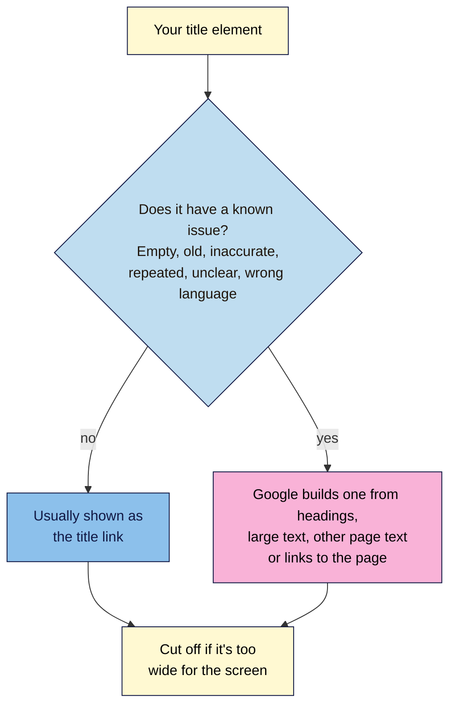
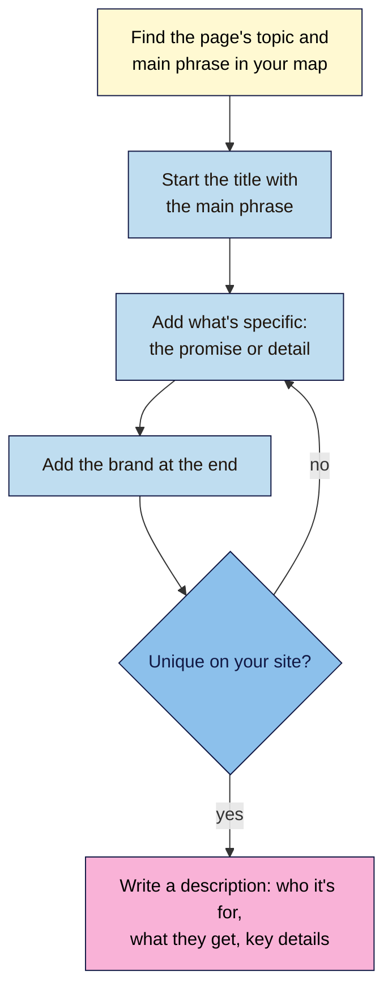

# M04.L01 — Title Tags and Meta Descriptions: What Searchers See First
> After this lesson you can write a clear, unique title and an honest description for any page, explain why Google sometimes shows something else, and tell a real problem from a harmless rewrite.

**Time:** ~16 min reading + ~35 min hands-on + ~10 min exercise · **Level:** L1 Foundation (beginner) · **Prereqs:** M02.L03, M03.L05 · **Remediate to:** M02.L03
**Verified against:** Google Search Central "Influencing your title links in search results" (updated 2025-12-10), "Control your snippets in search results" (updated 2026-04-20), "Pagination, incremental page loading" and "SEO Starter Guide"; Search Central blog posts of 21 Sep 2009, 24 Aug 2021 and 17 Sep 2021; Blogger Help "Help people find your blog on search engines"; Search Engine Roundtable (23 Mar 2026), all on 2026-11-09. Plugin and Blogger screens weren't tested live, so labels may differ slightly on yours.

> ⚠️ **Freshness flag:** in March 2026, Google confirmed a "small" and "narrow" test of AI-written title links, according to industry reports. Google's documentation doesn't mention it yet. Expect more rewriting, not less, and recheck this before you rely on it.

## Learning objectives
1. **Write** a unique, descriptive title for each page type (home, guide, product, category), with the brand placed concisely. *(O1)*
2. **Explain** why Google rewrites title links and snippets, and spot a rewrite on a real results page. *(O2)*
3. **Write** meta descriptions that pitch the page honestly, knowing they aren't a ranking factor. *(O3)*

## Why it matters
Tomás runs a hardware shop in Lisbon. His online shop has 140 product pages, and every one of them is titled "Ferragens Tomás | Loja Online". When someone searches for a drill and two of his pages appear, the results look identical, so people skip both. His homepage is simply titled "Home".

Fixing this takes an afternoon, and nothing else on the page needs to change. Google says of the title link: "It's often the primary piece of information people use to decide which result to click". It's the first thing a searcher reads about your page, and often the only thing.

## Core concept
**Plain version:** the **title** (the `<title>` element you met in Lesson 2.3) names the page. Google usually uses it as the blue, clickable line in the results, called the **title link**. The **meta description** is a short summary, and Google sometimes uses it for the grey text under the title, called the **snippet**. You write the title and description. Google decides what to show.

**Analogy:** your title is the name on a shop sign, and the description is the line in the window that says what's inside. A passer-by decides in a second whether to come in. If the sign is blank or misleading, the street council (Google) may paint its own words over it.

**Precise definitions:**
- **Title element:** `<title>…</title>` in the page's `<head>`. It also names the browser tab.
- **Title link:** "the title of a search result on Google Search … that links to the web page." Google's choice of title link "is completely automated".
- **Meta description:** `<meta name="description" content="…">`. Google calls it "like a pitch that convince[s] the user that the page is exactly what they're looking for".
- **Snippet:** the text under a result. Google "primarily uses the content on the page" for it, and may use the meta description "when it describes the page better".
- **Title rewrite:** when the title link differs from your `<title>`, because Google built it from other parts of the page.

### What Google says
| Claim | Verdict | What the source says |
|---|---|---|
| Every page needs its own title | **Documented** | Avoid "repeated or boilerplate text"; titling every shop page "Cheap products for sale" "makes it impossible for users to distinguish between two pages" |
| Google usually uses your `<title>` | **Documented (2021 figures)** | Title elements were used "around 87% of the time, rather than around 80% before" (Sep 2021). The figure is five years old |
| Titles must be under 60 characters | **Rule of thumb** | "there's no limit on how long a `<title>` element can be", but the title link "is truncated … as needed, typically to fit the device width". Blogger's help suggests under 60 |
| Repeating keywords in the title helps | **False** | "there's no reason to have the same words or phrases appear multiple times", and it can "look spammy to Google and to users" |
| Put your brand in every title | **Documented, briefly** | Consider "just your site name at the beginning or end of each `<title>` element, separated … with a delimiter such as a hyphen, colon, or pipe" |
| Write the title in the page's language | **Documented** | "if a page is written in Hindi, make sure to also write the `<title>` element in Hindi" |
| Paginated pages need unique titles | **Exception** | "pages in a paginated sequence don't need to follow this recommendation. You can use the same titles and descriptions for all pages in the sequence." |
| The meta description is a ranking factor | **False, by Google's 2009 statement** | "we still don't use the description meta tag in our ranking" (2009). Google hasn't said otherwise since |
| Google always shows your description | **False** | Google "might show different snippets for different searches" |
| Every page needs a unique description | **Documented, with priorities** | "Identical or similar descriptions on every page of a site aren't helpful". If you're short of time, "at the very least, create a description for the critical URLs like your home page and popular pages" |

This is the course's non-negotiable #6 in action: **every indexable page has a unique, descriptive title**. "Indexable page" matters: page 2 of a category list can share page 1's title.

### Title formulas
These patterns are a starting point *(course rule of thumb)*, not Google rules. Put the words people search for first, because the end may be cut off.

| Page type | Pattern | Nila Coffee example |
|---|---|---|
| Home | Brand: what you offer, and where | Nila Coffee: Fresh-Roasted Indian Coffee Beans, Delivered |
| Guide | Topic: the specific promise \| Brand | Cold Brew at Home: A Simple 12-Hour Guide \| Nila Coffee |
| Product | Product name, key detail \| Brand | Chikmagalur Medium Roast, 250 g Whole Beans \| Nila Coffee |
| Category | What's in it \| Brand | Single-Origin Coffee Beans \| Nila Coffee |

Write titles for people. If you'd be embarrassed to read it aloud to a customer, rewrite it.

## How it works
Google starts from your `<title>`, but it checks it first.


**In words:** Google starts from your `<title>` element and checks it for known issues. If there are none, it usually shows your title. If there's a problem, Google may build a title link from your headings, other large text, other text on the page, or the words other pages use to link to it. Either way, a long title is cut off to fit the screen.

### The seven reasons Google documents
Google lists the issues it adjusts for. The names are Google's, and the examples are Nila's.

| Google's name | What it means | Nila example of the problem |
|---|---|---|
| Half-empty `<title>` elements | Part of the title is missing | `<title>\| Nila Coffee</title>` |
| Obsolete `<title>` elements | An old date never updated | "Diwali Gift Boxes 2024" on the 2026 page |
| Inaccurate `<title>` elements | The title doesn't match the page | "Coffee Beans, Grinders, Mugs, Gifts" on a page that sells only beans |
| Micro-boilerplate text | A group of pages shares one title | Every brew guide titled "Brew Guide \| Nila Coffee" |
| No clear main title | Several headings look equally important | Three headings in the same large font at the top |
| Mismatch of writing system or language | The title's language differs from the page | An English title on a Tamil page |
| Duplication of the site name | The site name repeats what's already shown | Google may drop "\| Nila Coffee", because the result already shows the site name |

The last one isn't a problem for you to fix. Google shows a site name above the title link, so it may trim a repeated brand.

> **Under the hood: titles stay put, snippets move.** Since August 2021, Google says title links "generally will no longer" change with the search. Snippets still do. One page can show different grey text for "cold brew ratio" and "how long does cold brew last", because Google picks the part of the page that best matches each search.

### Write a title and description


**In words:** look up the page's topic and main phrase in your keyword map. Start the title with that phrase, add what's specific about this page, and put the brand at the end. If another page on your site has a similar title, make this one more specific. Then write a description that says who the page is for, what they'll get, and any key details.

**A good description** is "short, unique to one particular page, and includes the most relevant points of the page", as Google's Starter Guide puts it. For a product, bring together details that are spread around the page:

```html
<meta name="description" content="Medium roast from a family estate in Chikmagalur. Notes of cocoa and jaggery. 250 g whole beans, roasted to order, ₹480 with free shipping over ₹999.">
```

## Hands-on walkthrough
You'll check how Google shows your pages now, then rewrite the titles and descriptions for three pages from your keyword map. Results differ by country, device and day, so yours won't match these examples.

**Before you start: which steps apply to you?**
- **Path A (your own site):** do every part, and make the changes in Part D.
- **Path B (Blogger practice site):** do every part. A new blog may have few pages in Google yet, so check your published posts in Part A and write the rest from your map.
- **Path C (client site):** do Parts A–C. In Part D, give the client your table and let them make the changes, or make them only with written permission.

**Part A — See how Google shows your pages (10 min)**
1. In a private window, search `site:yourdomain.com`. Google documents this operator in Lesson 3.5's sources.
2. For your first ten results, copy the title link and the snippet into a new tab called **Titles**, with these columns: **URL**, **Title link (Google)**, **Snippet (Google)**, **`<title>` (page)**, **Meta description (page)**, **Rewritten?**, **Likely reason**.
   > 🖼️ **Image prompt:** A Google results page (1280×800) for a site: search showing several results from one small coffee website, with title links and snippets. Highlight one title link that differs from its page title with a 3px #F9B2D7 outline; blur any personal details.
   > **Alt text:** Search results for one website, with a rewritten title link highlighted.
3. Open each page, press **Ctrl+U** (Mac: **Cmd+Option+U**) for View Source, and find `<title` and `name="description"` with **Ctrl+F**. Copy both into the sheet.
   **Expected:** most title links match your `<title>`, apart from a trimmed brand or a cut-off end. A missing description is common.

**Part B — Classify any rewrites (5 min)**
1. Mark **Rewritten?** as Yes where the words differ, not just where the end is cut off.
2. For each Yes, choose a **Likely reason** from the seven in this lesson. If none fits, write "Better fit for the search?", as Google suggests you "consider whether the title link in search results is a better fit for the query".
   **Expected:** on most small sites, rewrites come from empty, repeated or vague titles, such as "Home" or one title used across many posts.

**Part C — Rewrite three pages (15 min)**
1. Pick three pages from your **Keyword map**: ideally a home or category page, a guide, and a product or service page.
2. For each, write a new title using the formulas above, and a new description of one or two sentences. Add columns **New title** and **New description**, and note today's date in **Before recorded**.
3. Check each one:
   - Does the title start with the topic's main phrase, or a close variant?
   - Is it different from every other title in your sheet?
   - Is the brand at the end, once?
   - Does the description say who it's for, what they get, and at least one specific detail?
   - Would it still make sense if the end were cut off?
4. Ask a friend or colleague to read just the title and description, and say what the page is about. If they get it wrong, rewrite it.

**Part D — Make the change (5 min)**
1. Change the title and description on your platform. Use your **SEO access** tab from Lesson 2.2:
   - **WordPress:** in your SEO plugin's panel on the post or page (WordPress 101 Module 5 sets this up), edit the **SEO title** and **Meta description**.
   - **Blogger:** the post title becomes the page title, and your theme decides how the blog name is added. Turn on **Enable search description** in **Settings**, then write each post's description in the post settings.
   - **Other platforms:** look for a "search" or "SEO" setting on each page.
2. Open the live page, view its source, and check that there's exactly one `<title>` and one description, both with your new text.
   **Expected:** one of each. Two titles or two descriptions mean a theme and a plugin are both adding them (see Troubleshooting).
3. Google won't show the change straight away. It "has to recrawl and reprocess the page … which may take a few days to a few weeks". You can ask for a recrawl with **URL Inspection** in Search Console (Lesson 1.8).
   > 🖼️ **Image prompt:** View Source of a blog post (1280×600) showing exactly one title element and one meta description in the head. Highlight both lines with a 3px #F9B2D7 outline; blur any personal details.
   > **Alt text:** A page's source code with one title and one meta description highlighted.

**Expected output:** a **Titles** tab with ten pages checked, any rewrites classified, and three pages with dated before and after titles and descriptions, changed on paths A and B. You'll compare their Search Console data in the Module 4 capstone.

## When to use / when not to
**Rewrite a title** when it's missing, vague ("Home"), repeated across pages, out of date, or doesn't match the page. Start with your most important and most visited pages.

**Leave a title alone** when Google's rewrite only trims your brand or cuts the end off. That's normal.

**Write a description** for your home page, category pages and popular pages first. Google suggests starting there if you're short of time. A page without one is fine: Google will use the page's text.

**The trade-off:** a title that's clear to people is also clear to Google. Chasing an exact length or repeating keywords makes titles worse for both.

## Use AI for this
**Example prompt:**
> "Here is a page's main phrase, its opening paragraph and three facts about it: [paste]. Suggest three titles that start with the main phrase, say what's specific about this page, and end with ' | Nila Coffee'. Then suggest one meta description of one or two sentences that says who it's for and what they get. Don't use the main phrase more than once in each title, and don't make claims that aren't in what I pasted."

**What AI does well here:** quick drafts, varied wording across many similar pages, and spotting a vague title.
**Where it gets it wrong:** it repeats keywords, adds hype ("Ultimate", "Best ever"), invents details such as prices or awards, and may claim that descriptions help rankings or have a fixed character limit.
**How to check:** compare every word with the page itself, read it aloud, and check that it's unique in your **Titles** tab.

## Common mistakes
- **The same title on every page,** or one title for a whole group of posts.
- **"Home" as the home page title.** Google calls it a "vague descriptor".
- **Keyword stuffing,** such as "Cold Brew, Cold Brew Coffee, Best Cold Brew".
- **An old year left in the title** of a page you update every year.
- **Treating the description as a ranking factor.** It's a pitch to help people choose.
- **Copying one description across many pages.**
- **Promising what the page doesn't deliver.** Google may rewrite it, and visitors will leave.

## Troubleshooting
| Symptom | Likely cause | Fix |
|---|---|---|
| Google still shows the old title | The page hasn't been recrawled yet | Wait a few weeks, or request indexing in **URL Inspection** |
| Google shows a different title, and your title looks fine | Google thinks another heading fits better, or the title doesn't match the page | Make sure the H1 and title agree, and the title describes the page |
| Two `<title>` elements in the source | The theme and an SEO plugin both add one | Turn off one of them, usually in the theme or plugin settings |
| The brand appears twice in the title link | Your title template adds the site name, and so does your text | Remove it from the text, or from the template |
| The snippet isn't your description | Google chose page text that better matches that search | Normal. Make sure the opening of the page is a good summary too |
| The description never shows anywhere | It's not in the page source, or it's empty | Check View Source for `name="description"` and its text |

## Exercise
**Task:** complete your **Titles** tab (Parts A–D). Then fix these titles and descriptions from Nila Coffee's draft site. All details are illustrative. Say what's wrong with each, and write a better version.
1. Home page: `<title>Home</title>`
2. Every brew guide: `<title>Brew Guide | Nila Coffee</title>`
3. A product page: `<title>Coffee Beans, Best Coffee Beans, Buy Coffee Beans Online India | Nila Coffee</title>`
4. The gift page, in November 2026: `<title>Diwali Coffee Gift Boxes 2024 | Nila Coffee</title>`
5. Every product page has the description "Nila Coffee sells the best coffee in India."
6. A guide's description: "cold brew, cold brew ratio, cold brew recipe, iced coffee, cold coffee".
7. Page 2 of the "Single-Origin Coffee Beans" category has the same title as page 1. Should you change it?

**Expected outcome:** a complete **Titles** tab, and these answers:
- **1** Vague. Try "Nila Coffee: Fresh-Roasted Indian Coffee Beans, Delivered".
- **2** Boilerplate across a group. Give each guide its own topic, such as "French Press Ratio: How Much Coffee to Use | Nila Coffee".
- **3** Keyword stuffing. Try "Chikmagalur Medium Roast, 250 g Whole Beans | Nila Coffee".
- **4** Obsolete. Update the year each season, or drop it if the page is used every year.
- **5** Identical descriptions. Write one per product, with its origin, roast, size and price.
- **6** A list of keywords. Write a summary, such as "Make smooth cold brew at home with a 1:8 ratio and 12 hours in the fridge. No special equipment needed."
- **7** No. Google says pages in a paginated sequence can share titles and descriptions.

**Stretch goal:** find a result for your site where Google rewrote the title, and decide whether Google's version is a better fit for the search. Write one sentence on whether you'd change your title to match it.

## Key takeaways
- Every indexable page needs a unique, descriptive title. Paginated pages are the documented exception.
- Put the main phrase first, add what's specific, and end with the brand once.
- Google may rewrite titles that are empty, old, inaccurate, repeated, unclear or in the wrong language.
- The meta description is a pitch that may become the snippet. It isn't a ranking factor.
- Google needs to recrawl a page before changes show, which can take a few weeks.

## Teach it back
Explain to a friend in 3 sentences what a title and a meta description are for, and why Google doesn't always show the one you wrote.

## Glossary terms added
- Title rewrite — added to `seo-101/glossary.md`
- Boilerplate title — added to `seo-101/glossary.md`
- *Already in the glossary from Lesson 2.3:* Title link, Meta description, Snippet

## Further reading
*All checked 2026-11-09.*
- Google Search Central — Influencing your title links in search results: https://developers.google.com/search/docs/appearance/title-link
- Google Search Central — Control your snippets in search results: https://developers.google.com/search/docs/appearance/snippet
- Google Search Central — Pagination, incremental page loading, and their impact on Google Search: https://developers.google.com/search/docs/specialty/ecommerce/pagination-and-incremental-page-loading
- Google Search Central — SEO Starter Guide: https://developers.google.com/search/docs/fundamentals/seo-starter-guide
- Search Central blog — An update to how we generate web page titles (24 Aug 2021): https://developers.google.com/search/blog/2021/08/update-to-generating-page-titles
- Search Central blog — More information on how Google generates titles for web page results (17 Sep 2021): https://developers.google.com/search/blog/2021/09/more-info-about-titles
- Search Central blog — Google does not use the keywords meta tag in web ranking (21 Sep 2009): https://developers.google.com/search/blog/2009/09/google-does-not-use-keywords-meta-tag
- Blogger Help — Help people find your blog on search engines: https://support.google.com/blogger/answer/41373
- *Industry report:* Search Engine Roundtable — Google using AI to create title links (23 Mar 2026): https://www.seroundtable.com/google-tests-ai-to-create-title-links-on-serp-41088.html
- WordPress 101, Module 5, Lesson 2 — setting up an SEO plugin: `wordpress-101/lessons/m05-l02-seo-plugin-setup.md`

> ⚠️ **May change:** how Google builds title links (including the 2026 AI test); the 2021 usage figures; plugin and Blogger setting names. The only statement that descriptions don't affect ranking dates from 2009.

## Refresher card
*Used by remediation when a learner fails a quiz twice on a later lesson that points back here.*
**Title** (`<title>`) names the page and usually becomes the **title link** in results, but Google's choice is "completely automated". **Write it:** main phrase first, what's specific, then the brand once at the end. Unique on every indexable page (non-negotiable #6), except pages in a paginated sequence. No stuffing, no "Home". **Google may rewrite** titles that are half-empty, obsolete, inaccurate, boilerplate, unclear or in the wrong language, and may trim a repeated site name. **Meta description** = "a pitch", short and unique to the page. Google "primarily uses the content on the page" for the **snippet**, which can change by search. Not a ranking factor (Google, 2009). Changes show only after Google recrawls the page: "a few days to a few weeks".
