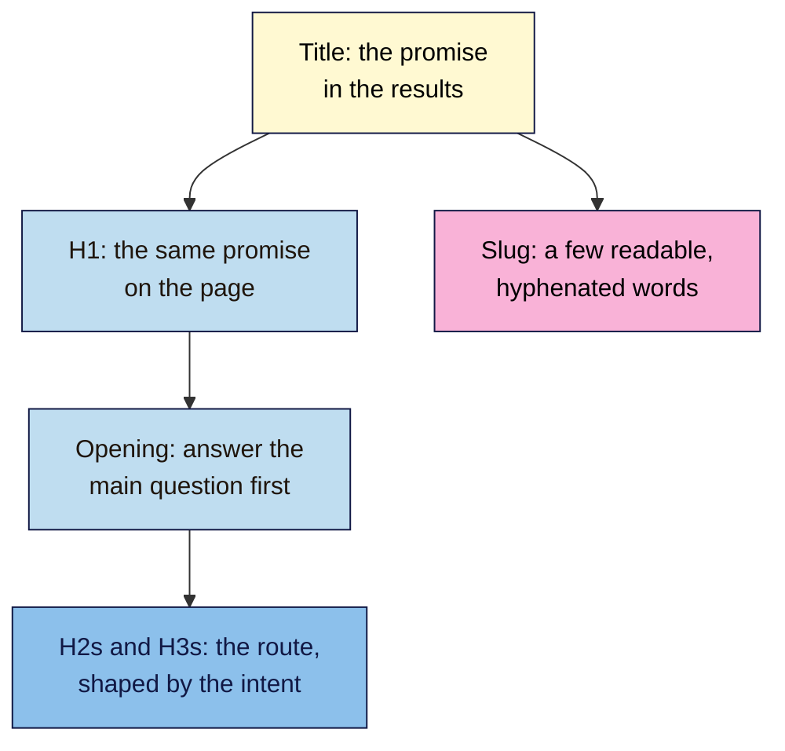
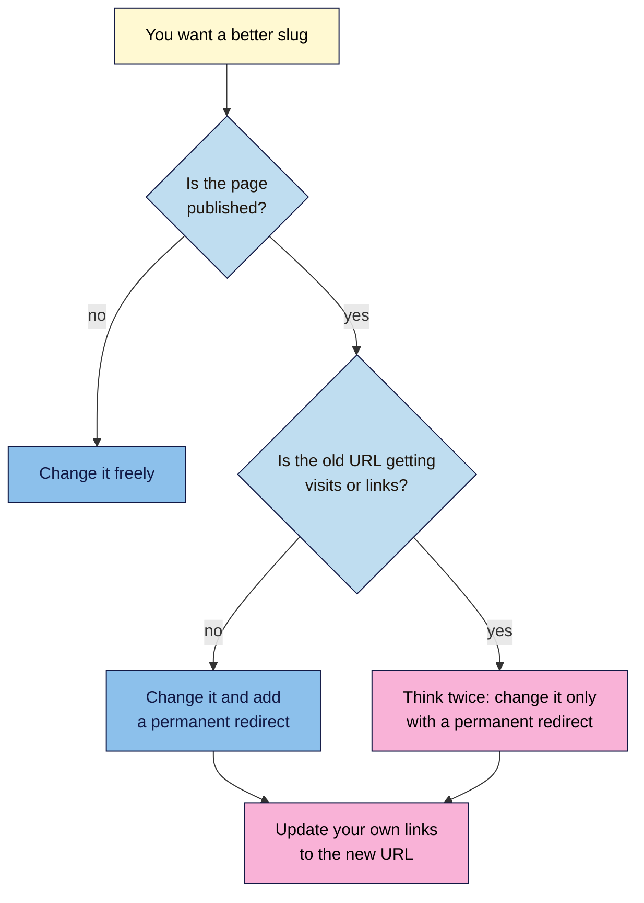

# M04.L02 — Headings, URL Slugs and the Opening Paragraph
> After this lesson you can make a page's main heading, outline, address and first paragraph all tell the same story as its title, and change a page's address without losing visitors.

**Time:** ~15 min reading + ~30 min hands-on + ~10 min exercise · **Level:** L1 Foundation (beginner) · **Prereqs:** M04.L01, M02.L04 · **Remediate to:** M02.L04
**Verified against:** Google Search Central "SEO Starter Guide", "URL structure best practices for Google Search" (updated 2026-10-21), "Creating helpful, reliable, people-first content" (updated 2026-10-05), "Influencing your title links", "Designing a URL structure for ecommerce sites" and "Redirects and Google Search"; Google SEO office hours (July 2024); MDN "`<h1>`–`<h6>`: the HTML section heading elements"; WordPress 7.1 source code (old-slug redirects), all on 2026-11-09. Blogger and WordPress screens weren't tested live, so labels may differ slightly on yours.

> ⚠️ **Freshness flag:** Google's URL structure page was revised on 21 October 2026, and its helpful-content page on 5 October 2026. Recheck both if you read older guides that quote them.

## Learning objectives
1. **Match** a page's H1 and outline to its title and its one intent. *(O1)*
2. **Create** short, readable, hyphenated slugs, and explain why changing a live URL needs a redirect. *(O2)*
3. **Write** an opening paragraph that answers the searcher's question first. *(O3)*

## Why it matters
Amara is reviewing a client's recipe post. The title says "Jollof Rice: An Easy 45-Minute Recipe", but the page opens with three paragraphs about the writer's holiday in Accra. The main heading reads "Memories of West Africa", and the address is `/2023/06/post-1187`. A searcher who clicked for a recipe has to scroll a long way to find out whether this is it, and many leave first.

Nothing on the page is wrong by the HTML rules. But the title, heading, address and opening each say something different. In this lesson you'll line them up, so a visitor knows within seconds that they've found the right page.

## Core concept
**Plain version:** the title is the promise in the results. The **H1** repeats that promise on the page. The **headings** below it show the route, the **slug** names the page in its address, and the **opening paragraph** delivers the first part of the answer. All five should agree.

**Analogy:** think of a recipe card. The name at the top matches what you looked up, the section names (ingredients, method, tips) tell you where things are, and the first line tells you how long it takes and how many it serves. You know at a glance whether it's what you need.

**Precise definitions:**
- **H1:** the page's main heading, in `<h1>`. You met headings in Lesson 2.4.
- **Heading outline:** the page's headings read in order. It should work as a table of contents.
- **Slug:** the readable last part of a URL, such as `cold-brew-guide` in `nilacoffee.example/cold-brew-guide/`.
- **URL parameter:** text after a `?` in a URL, such as `?p=123` or `?sort=price`. Each `key=value` pair changes or tracks something.
- **Answer-first opening:** a first paragraph that answers the main question straight away, then adds detail *(observed practice, often called the inverted pyramid)*.
- **Permanent redirect (301):** an instruction that sends visitors and search engines from an old URL to a new one. Module 6 covers redirects in depth.

### What Google says
| Claim | Verdict | What the source says |
|---|---|---|
| Your H1 helps Google choose the title link | **Documented** | Google suggests "putting the title text in the first visible `<h1>` element on the page" so the main title is clear |
| Headings in the wrong order hurt rankings | **False, for Google** | "from Google Search perspective, it doesn't matter if you're using them out of order" |
| Heading order still matters | **Documented, for people** | "Having your headings in semantic order is fantastic for screen readers". MDN: "A page should generally have a single `<h1>`" |
| SEO tools flag "multiple H1s", so Google must care | **Google public comment** | Gary Illyes (2024): "just because a non-Google tool tells you something is good or bad, that doesn't make it relevant for Google" |
| Use readable words in URLs | **Documented** | "When possible, use readable words rather than long ID numbers in your URLs." |
| Separate words with hyphens | **Documented** | "we recommend using hyphens (-) instead of underscores (_) to separate words in your URLs" |
| Use lowercase URLs | **Convention** | Google says URLs are case sensitive and to "convert all text to the same case". Lowercase is the usual choice *(observed practice)* |
| Keywords in the URL boost rankings | **Mostly false** | Keywords in the URL path "alone have hardly any effect beyond appearing in breadcrumbs". For shops, "The words in URLs may help Google better understand the page." |
| Put the keyword in the first 100 words | **Not in Google's docs** | No Google page says this. Google asks: "Does the main heading or page title provide a descriptive, helpful summary of the content?" |

**What the course asks** (non-negotiable #3): one H1, and headings that go down one level at a time. It's for readers and screen readers, as you saw in Lesson 2.4, not a Google ranking rule.

### What good looks like
| Part | Nila's cold brew guide | Job |
|---|---|---|
| Title | Cold Brew at Home: A Simple 12-Hour Guide \| Nila Coffee | The promise in the results |
| H1 | Cold Brew at Home: A Simple 12-Hour Guide | The same promise on the page, without the brand |
| Slug | `/cold-brew-guide/` | Names the page in a few readable words |
| Opening | "You need coarse coffee, cold water, a jar and 12 hours in the fridge. Use one part coffee to eight parts water, then strain it." | Answers the question first |
| H2s | What you need · Step-by-step · How to serve it · How long it keeps | The route through the page, matching an informational intent |

The H1 doesn't have to match the title word for word. It should say the same thing, so nobody wonders whether they clicked the right result.

## How it works


**In words:** start from the title's promise. The H1 repeats it on the page, and the opening paragraph answers the main question straight away. The headings below then lay out the route, in the shape the intent needs: steps for a how-to, options for a comparison, details for a product. The slug names the same topic in a few readable, hyphenated words.

**Headings follow the intent** (Lesson 3.1):
- **Informational:** questions and steps, such as "How long does cold brew keep?"
- **Commercial:** options and criteria, such as "French press vs pour-over: which is easier?"
- **Transactional:** details people check before buying, such as "Roast and tasting notes", "Size and price", "Delivery".

### Slugs: good and bad
| Slug | Problem | Better |
|---|---|---|
| `/?p=123` | No words at all | `/cold-brew-guide/` |
| `/Cold_Brew_Guide/` | Capitals and underscores | `/cold-brew-guide/` |
| `/coldbrewguide/` | Words joined together | `/cold-brew-guide/` |
| `/the-ultimate-complete-guide-to-making-cold-brew-coffee-at-home-2024/` | Too long, with a year that will date it | `/cold-brew-guide/` |
| `/shop/beans?id=48213&ref=home` | An ID and a tracking parameter | `/shop/chikmagalur-medium-roast/` |

Keep slugs short, and leave out years on pages you'll keep updating *(observed practice)*. Use your audience's language: Google suggests "words in your audience's language in the URL (and, if applicable, transliterated words)".

### Changing a slug on a live page


**In words:** if the page isn't published yet, change the slug as often as you like. Once it's live, a new slug means a new URL, and anyone following the old one, including Google, finds an error unless you add a permanent redirect. If the old URL already gets visits or links, think twice before changing it, and only do it with a redirect. Either way, update your own links to point at the new URL.

> **Under the hood: what your platform does for you.** WordPress adds a 301 redirect automatically when you change the slug of a **published post**, but not a **page**. Its code skips "hierarchical" types, and pages are one. Blogger and many builders don't redirect blog posts for you either, so you add one yourself: Blogger has **Custom redirects** in **Settings** (Lesson 2.2). Google says to use permanent redirects "when you're sure that the redirect won't be reverted".

## Hands-on walkthrough
You'll check whether one page's title, H1, outline, slug and opening agree, then plan fixes. Use one of the three pages you worked on in Lesson 4.1.

**Before you start: which steps apply to you?**
- **Path A (your own site):** do every part. Change slugs only on unpublished pages for now. Module 6 covers redirects for live pages.
- **Path B (Blogger practice site):** do every part. A practice blog with little traffic is a safe place to try a slug change and a redirect in Part C.
- **Path C (client site):** do every part, but change nothing. Give the client your table.

**Part A — Read the top of the page (8 min)**
1. Add a tab called **Page outline** to your "SEO 101 project" sheet, with these columns: **URL**, **Title**, **H1**, **Same promise?**, **Opening (first two sentences)**, **Answers first?**, **Slug now**, **Slug planned**, **Notes**.
2. Open the page and copy its title from your **Titles** tab. Copy the H1 and the first two sentences of the main text.
3. Mark **Same promise?** as Yes if a visitor reading only the H1 would know they'd found what the title promised. Mark **Answers first?** as Yes if the opening answers the main question, not just introduces it.
   **Expected:** many blog posts open with background or a story, and many product pages open with brand text instead of the product's key details.

**Part B — Check the outline (7 min)**
1. Open the **Console** in DevTools (**Ctrl+Shift+J**; Mac: **Cmd+Option+J**) and run the line from Lesson 2.4:
   ```js
   document.querySelectorAll('h1,h2,h3,h4,h5,h6').forEach(h => console.log(h.tagName, h.textContent.trim()))
   ```
2. Paste the headings into **Notes**, and read them alone, as a table of contents. Ask:
   - Is there one H1, and does it match the title's promise?
   - Do the H2s follow the intent? For a how-to, do they read like steps or questions?
   - Would a visitor know where to jump to for the answer they want?
   **Expected:** one H1 at the top. Extra H1s often come from the theme, such as the site name in the header. They don't harm rankings, but they make the outline harder to read, so note them.
   > 🖼️ **Image prompt:** Chrome DevTools Console (1280×600) listing a page's headings as H1, H2 and H3 lines for a cold brew guide, with one extra H1 for the site name at the top. Highlight the extra H1 line with a 3px #F9B2D7 outline; blur any personal details.
   > **Alt text:** DevTools Console listing a page's headings, with an extra H1 from the site header highlighted.

**Part C — Plan the slug (8 min)**
1. Copy the current slug into **Slug now**. Check it against the slug table: words, hyphens, same case, short, no ID or tracking parameter, no year.
2. Write a better one in **Slug planned**, or "Keep" if it's fine.
3. **On paths A and C, don't change a live slug yet.** On path B, try it on a practice post:
   - **Blogger:** in the post editor's settings, choose a custom permalink, then update the post. Then add a redirect from the old URL to the new one under **Custom redirects** in **Settings**, choosing the permanent option if it's offered.
   - **WordPress:** edit the post's URL in the post settings. Published posts get a redirect automatically, and pages don't.
4. Visit the old URL in a private window.
   **Expected:** you land on the new URL. If you see "Not found", the redirect is missing.

**Part D — Rewrite the opening (7 min)**
1. Write a new opening of two to four sentences. It should answer the main question first, with the key facts: amounts, times, prices, or who it's for.
2. Then add one sentence that tells readers what the rest of the page covers.
3. Read your title, H1 and new opening one after another. Do they tell the same story?
   **Expected:** someone could stop after the opening and still have the main answer. Google "primarily uses the content on the page" for snippets (Lesson 4.1), so a clear opening often makes a good snippet too.

**Expected output:** a **Page outline** tab for at least one page, with a verdict on its H1 and opening, a reviewed outline, a planned slug, and a rewritten opening. Path B also has one tested slug change with a working redirect.

## When to use / when not to
**Rewrite the H1 and opening** whenever they don't match the title, or the answer is buried. It's low-risk and you can do it any time.

**Fix headings** when the outline doesn't read like a table of contents, or skips levels. It's mostly for readers, so do it when you're editing the page anyway.

**Change a slug** before publishing, or on a live page only if the slug is really unclear, and always with a redirect. Don't change slugs just to add a keyword: Google says it has "hardly any effect".

**The trade-off:** a clean URL is nicer for people and easier to share, but a changed URL risks broken links. On a live page that's working, a merely imperfect slug is usually best left alone.

## Use AI for this
**Example prompt:**
> "Here are a page's title, H1, headings and first three paragraphs: [paste]. The main search it answers is 'cold brew ratio', which is informational. (1) Does the H1 make the same promise as the title? (2) Do the headings follow the intent? Suggest a better outline if not. (3) Rewrite the opening in 2–4 sentences so it answers the question first. Use only facts from what I pasted."

**What AI does well here:** spotting a buried answer, suggesting clearer headings, and tightening a rambling opening.
**Where it gets it wrong:** it may invent facts for the opening, such as a ratio or brewing time, add keywords to every heading, or claim that keywords in the first 100 words are a ranking rule.
**How to check:** compare every fact in the new opening with your own notes or the page, and read the outline aloud.

## Common mistakes
- **An H1 that doesn't match the title,** such as a clever headline or a story title on a how-to page.
- **Burying the answer** under an introduction.
- **Headings chosen for size,** not structure (Lesson 2.4).
- **Changing a live slug without a redirect.**
- **Years in the slugs of pages you'll update,** such as `/best-coffee-2024/`.
- **Stuffing the keyword into every heading.** Write headings for readers.
- **Treating "multiple H1" warnings in tools as a ranking emergency.** Fix them for readers, when you can.

## Troubleshooting
| Symptom | Likely cause | Fix |
|---|---|---|
| The Console shows two H1s | The theme puts the site name or logo in an H1 | Note it. Change it in the theme if you can (Module 5), or leave it |
| The old URL shows "Not found" after a slug change | No redirect | Add a permanent redirect from the old URL to the new one |
| WordPress didn't redirect a changed slug | It's a page, or the post wasn't published when you changed it | Add a redirect yourself (WordPress 101 Module 5 covers a redirect plugin) |
| The slug has strange `%` codes | Non-Latin characters are encoded in the address bar | That's normal. Google shows the same examples encoded and unencoded |
| Your theme shows the title as the H1 automatically | Many themes do | That's fine: check the H1 text in the Console output |

## Exercise
**Task:** complete your **Page outline** tab (Parts A–D). Then review this draft Nila Coffee product page. All details are illustrative. List what's wrong, and write a fix for each.

```text
Title:    Chikmagalur Medium Roast, 250 g Whole Beans | Nila Coffee
URL:      nilacoffee.example/shop/Product_48213?ref=homepage
H1:       Welcome to Nila Coffee
H1:       Chikmagalur Medium Roast
Opening:  "At Nila, we believe coffee is more than a drink. It's a ritual,
           a moment, a journey from bean to cup..."
H4:       Price
H2:       Tasting notes
H2:       Chikmagalur medium roast coffee beans best medium roast coffee
```

**Expected outcome:** a complete **Page outline** tab, and these fixes:
- **URL:** capitals, an underscore, an ID and a tracking parameter. Use `/shop/chikmagalur-medium-roast/`, with a redirect if the old URL is already live.
- **Two H1s:** "Welcome to Nila Coffee" isn't the page's topic. Keep the product name as the only H1.
- **Opening:** it doesn't say what the product is. Start with roast, origin, tasting notes, size and price.
- **Skipped level:** "Price" is an H4 under the H1. Make it an H2, and put it near the top, because buyers check it.
- **Stuffed heading:** the last H2 is a keyword list. Replace it with something useful, such as "How to brew it".

**Stretch goal:** find a page on your site whose slug contains a year or an ID. Write down whether you'd change it now, later with a redirect, or leave it, and why.

## Key takeaways
- The title, H1, opening and slug should all make the same promise.
- Headings show the route, in the shape the intent needs. Order matters for readers, not for Google's rankings.
- Slugs: a few readable, hyphenated words in one case, with no IDs, tracking parameters or years.
- Changing a live URL needs a permanent redirect. WordPress only adds one for published posts.
- Answer the main question in the opening. There's no Google rule about the first 100 words.

## Teach it back
Explain to a friend in 3 sentences why a page's title, main heading and first paragraph should agree, and what can go wrong if you change a page's address.

## Glossary terms added
- Answer-first opening — added to `seo-101/glossary.md`
- URL parameter — added to `seo-101/glossary.md`
- Permanent redirect (301) — added to `seo-101/glossary.md`
- *Already in the glossary:* H1 (under Heading), Heading outline, Slug, Redirect

## Further reading
*All checked 2026-11-09.*
- Google Search Central — SEO Starter Guide: https://developers.google.com/search/docs/fundamentals/seo-starter-guide
- Google Search Central — URL structure best practices for Google Search: https://developers.google.com/search/docs/crawling-indexing/url-structure
- Google Search Central — Designing a URL structure for ecommerce sites: https://developers.google.com/search/docs/specialty/ecommerce/designing-a-url-structure-for-ecommerce-sites
- Google Search Central — Redirects and Google Search: https://developers.google.com/search/docs/crawling-indexing/301-redirects
- Google Search Central — Creating helpful, reliable, people-first content: https://developers.google.com/search/docs/fundamentals/creating-helpful-content
- Google Search Central — Influencing your title links: https://developers.google.com/search/docs/appearance/title-link
- Google SEO office hours, July 2024 (heading order): https://developers.google.com/search/help/office-hours/2024/july
- MDN — `<h1>`–`<h6>`: the HTML section heading elements: https://developer.mozilla.org/en-US/docs/Web/HTML/Reference/Elements/Heading_Elements
- WordPress 101, Module 5 — permalinks, slugs and redirects: `wordpress-101/lessons/m05-l02-seo-plugin-setup.md`

> ⚠️ **May change:** Google's URL structure page (revised October 2026); how WordPress and Blogger handle changed slugs; Blogger's setting names.

## Refresher card
*Used by remediation when a learner fails a quiz twice on a later lesson that points back here.*
**Line up the top of the page:** title (promise in results) → **H1** (same promise on the page) → **opening** (answer first) → **H2s** (the route, shaped by intent). Heading order matters for readers and screen readers. Google says it "doesn't matter" for Search. **Slug:** a few readable words, hyphens not underscores, one case (usually lowercase), no IDs, tracking parameters or years. Keywords in the URL have "hardly any effect" on ranking. **Changing a live slug** creates a new URL, so add a permanent redirect and update your links. WordPress redirects changed **post** slugs automatically, not **pages**. No Google rule says "keyword in the first 100 words".
