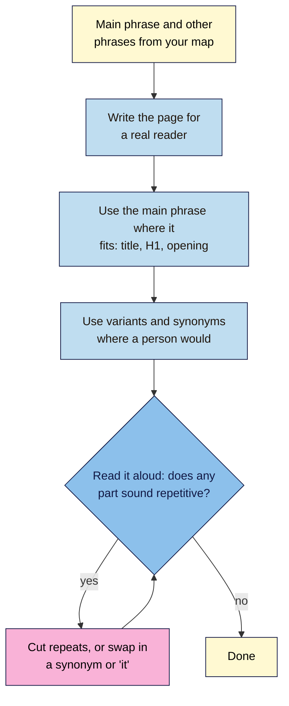
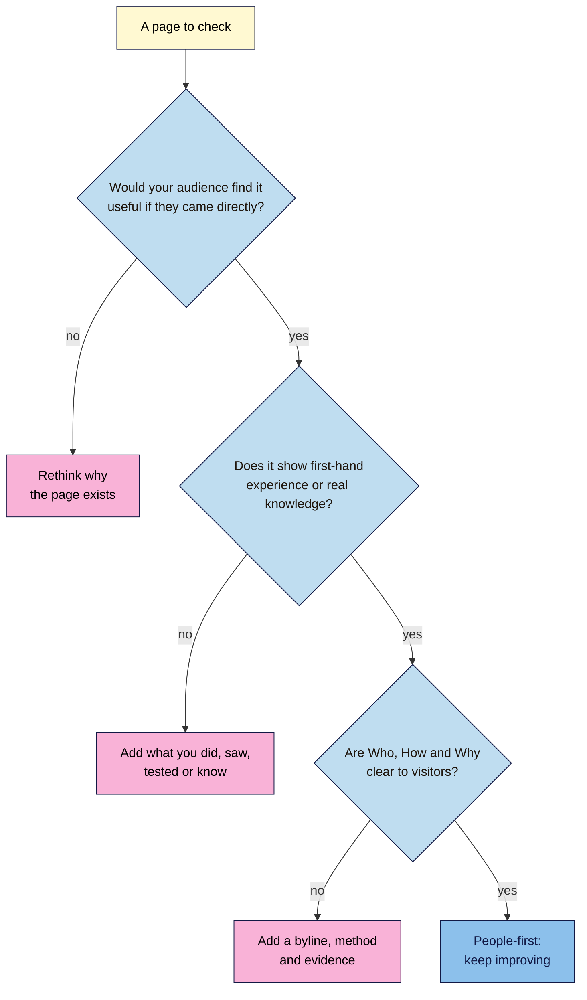

# M04.L03 — Writing for People: Natural Keywords, Synonyms and E-E-A-T Basics
> After this lesson you can use the words your audience searches for without stuffing them in, judge a page the way Google asks you to, and show readers who wrote it, how and why.

**Time:** ~16 min reading + ~35 min hands-on + ~10 min exercise · **Level:** L1 Foundation (beginner) · **Prereqs:** M04.L02, M03.L01 · **Remediate to:** M03.L01
**Verified against:** Google Search Central "Spam policies for Google web search" (updated 2026-08-28), "SEO Starter Guide" and "Creating helpful, reliable, people-first content" (updated 2026-10-05); Search Central blog "E-A-T gets an extra E for Experience" (15 Dec 2022), all on 2026-11-09. Search Console screens weren't tested live, so labels may differ slightly on yours.

> ⚠️ **Freshness flag:** Google's helpful-content page gained a "Main content" section and a warning about fake author profiles in October 2026. Guides written before then won't mention either. Module 14 covers E-E-A-T, quality raters and AI content in depth.

## Learning objectives
1. **Use** a topic's main phrase, variants and synonyms naturally, and recognise keyword stuffing as Google's spam policy describes it. *(O1)*
2. **Assess** a page with Google's people-first self-assessment questions and "Who, How, Why". *(O2)*
3. **Explain** what E-E-A-T is and isn't (not a single ranking factor), with the full picture left to Module 14. *(O3)*

## Why it matters
A freelancer wrote Nila Coffee a cold brew guide. It mentions "cold brew" 41 times in 600 words, and every heading starts with "Best Cold Brew". It has no byline, no photos of Nila's own brewing, and a ratio copied from another site. It reads like it was written for a machine, because it was.

Kavya and Amara will meet the same choice. Write for the reader, using the words they use, or write for a search engine that the freelancer imagines counts keywords. Google says plainly which one it's trying to reward.

## Core concept
**Plain version:** use the words your audience searches for, in the places they'd naturally go, and then stop. Vary them the way a person would. Then make the page genuinely useful, and make it obvious who wrote it, how they know, and why the page exists.

**Analogy:** think of a good shop assistant. They use the words you use ("a jar for cold brew"), mention the proper name once ("a cold brew maker"), and then talk about what you need. One who repeats "cold brew maker" in every sentence sounds like a sales script, and you'd stop trusting them.

**Precise definitions:**
- **Keyword variant:** a different form of the same phrase, such as "cold brew ratio" and "cold brew coffee ratio".
- **Synonym:** a different word for the same thing, such as "cold brew" and "cold-steeped coffee". Beginners and experts often use different ones.
- **Keyword stuffing:** in Google's words, "filling a web page with keywords or numbers in an attempt to manipulate rankings in Google Search results". It's a spam policy violation.
- **People-first content:** content made to help people, not mainly to attract search visits.
- **E-E-A-T:** experience, expertise, authoritativeness and trustworthiness, from Lesson 1.7. Google says "trust is most important".
- **Byline:** the line that names a page's author, often linking to more about them.

### What Google says
| Claim | Verdict | What the source says |
|---|---|---|
| Repeating your keyword helps you rank | **False** | "Excessively repeating the same words over and over (even in variations) is tiring for users, and keyword stuffing is against Google's spam policies." |
| Aim for a keyword density of 1–2% | **Myth** | No Google page mentions keyword density or a percentage |
| Varying your words can help | **Documented** | "If you are varying the words (writing naturally to not be repetitive), you have more chances to show up in Search simply because you are using more keywords." |
| You must use every variation of a phrase | **False** | "don't worry if you don't anticipate every variation", because "Google's language matching systems are sophisticated" |
| Longer pages rank better | **False** | "there's no magical word count target, minimum or maximum, though you probably want to have at least one word" |
| E-E-A-T is a ranking factor | **No, as a single factor** | "Thinking E-E-A-T is a ranking factor: No, it's not." But "using a mix of factors that can identify content with good E-E-A-T is useful" |
| Quality raters decide your ranking | **False** | "Search raters have no control over how pages rank." |
| Made-up author profiles are fine | **False** | "Fabricating creator profiles (such as by using AI-generated headshots, made-up names, or false credentials …) is a form of deception." |

Google's own example of stuffing is worth reading once: "Unlimited app store credit. There are so many sites that claim to offer app store credit for $0 but they're all fake and always mess up with users looking for unlimited app store credits…" You can hear the problem.

### Finding the words your audience uses
Google's Starter Guide gives the clearest example: "some users might search for "charcuterie", while others might search for "cheese board"". Nila's version:

| Expert word | Everyday words people also search |
|---|---|
| Cold brew | cold coffee, iced coffee concentrate, cold-steeped coffee |
| Pour-over | drip coffee, V60, filter coffee |
| Single-origin | coffee from one estate, one-farm coffee |
| Grind size | how fine to grind coffee |

Your **Keyword map**'s **Other phrases** column (Lesson 3.5) already holds many of these. Search Console's queries for a page show more, in the words real visitors used.

## How it works

**In words:** start with the main phrase and other phrases from your keyword map. Write the page for a real reader first. Use the main phrase where it fits naturally, usually in the title, the H1 and the opening, as in Lessons 4.1 and 4.2. Use variants and synonyms where a person would. Then read it aloud. If any part sounds repetitive, cut the repeats or swap in a synonym or a pronoun, and read it again.

**Before and after** (Nila Coffee, illustrative):
> ❌ "Our cold brew guide is the best cold brew guide for cold brew lovers. To make cold brew at home, you need cold brew coffee and a cold brew maker. Cold brew is easy!"
>
> ✅ "Cold brew is coffee steeped in cold water for 12 hours or more. It tastes smoother and less bitter than iced coffee made with hot water. You don't need special kit: a large jar and a sieve will do."

The second version uses "cold brew" twice, adds a synonym ("iced coffee") and is far more useful.

### Is the page people-first?

**In words:** first ask whether your audience would find the page useful if they came straight to your site, not from a search. If not, rethink why it exists. Then check that it shows first-hand experience or real knowledge, such as something you did, tested or saw. If not, add it. Then check that visitors can see who wrote it, how it was made and why. If all three are clear, the page is on the right track, and you keep improving it.

### Who, How and Why
Google suggests judging content by "Who, How, and Why":

| Question | What Google asks | Nila's cold brew guide |
|---|---|---|
| **Who** made it? | "Is it self-evident to your visitors who authored your content?" "Do pages carry a byline, where one might be expected?" | A byline for Nila's head roaster, linking to a short About page |
| **How** was it made? | Show how you tested or created it, "accompanied by evidence of the work involved, such as photographs" | Photos of Nila's own jars and the 12-hour steep, and the ratios they tried |
| **Why** does it exist? | ""Why" is perhaps the most important question to answer about your content." It should be "primarily to help people" | To help customers brew the beans they bought |

> **Under the hood: E-E-A-T isn't a score.** No tool can read your E-E-A-T, and Google says it isn't "a specific ranking factor". Instead, Google's systems use "a mix of factors" that tend to line up with content people can trust. That's why the advice is about real things (a real author, real experience, sources, accuracy) rather than tricks. The extra "E" for **Experience** was added on 15 December 2022. Google gives even more weight to these qualities on "Your Money or Your Life" (YMYL) topics, such as health and money.

## Hands-on walkthrough
You'll rewrite a stuffed paragraph, collect the real words people use for one of your topics, and check one of your pages against Google's questions.

**Before you start: which steps apply to you?**
- **Path A (your own site):** do every part, on one page from your three Lesson 4.1 pages.
- **Path B (Blogger practice site):** do every part. If Search Console shows no queries yet, use your **Keyword map** and the autocomplete phrases from Lesson 3.2 in Part B.
- **Path C (client site):** do every part. Use only Search Console data the client has shared with you.

**Part A — Rewrite a stuffed paragraph (7 min)**
1. Copy this paragraph into a new tab called **People-first check**:
   > "Looking for the best French press coffee? Our French press coffee guide shows you how to make French press coffee with the best French press coffee beans. French press coffee lovers love our French press coffee tips for perfect French press coffee."
2. Count how many times "French press coffee" appears.
3. Rewrite it in two or three sentences that a reader would find useful. Use "French press" once or twice, and add one real fact, such as a ratio or a brewing time.
   **Expected:** the original uses the phrase seven times and says nothing useful. Your version should read like advice from a person, with at least one fact.

**Part B — Collect the words people really use (8 min)**
1. In Search Console, open **Performance > Search results**. Click **+ Add filter > Page**, and enter the URL of your chosen page.
2. Open the **Queries** tab, and copy the top 15 queries into your sheet.
   > 🖼️ **Image prompt:** Search Console Performance report (1280×800) filtered to one page, with the Queries tab open listing about ten varied searches for a cold brew guide. Highlight the queries table with a 3px #F9B2D7 outline; blur any personal details.
   > **Alt text:** Search Console showing the searches that led to one page, with the query list highlighted.
3. Group them: the main phrase, close variants, synonyms or everyday words, and questions.
   **Expected:** you'll find words you never used, such as "cold coffee" for a cold brew page, or a question your page doesn't answer.
4. For each synonym or question, write **Already on page**, **Add naturally** or **Different topic** (it belongs to another page in your map).

**Part C — Check the page against Google's questions (12 min)**
1. Read the page as a visitor would. Then answer each question with **Yes**, **Partly** or **No**, and a one-line reason:
   1. "Does the content provide original information, reporting, research, or analysis?"
   2. "Does your content clearly demonstrate first-hand expertise and a depth of knowledge"?
   3. "Is this the sort of page you'd want to bookmark, share with a friend, or recommend?"
   4. "Does the content have any easily-verified factual errors?" (Here you want No.)
   5. "Is the content produced well, or does it appear sloppy or hastily produced?"
   6. "After reading your content, will someone leave feeling they've learned enough about a topic to help achieve their goal?"
   7. "Are you mainly summarizing what others have to say without adding much value?" (Here you want No.)
   8. "Are you writing to a particular word count because you've heard or read that Google has a preferred word count?" (Here you want No. Google adds: "No, we don't.")
2. Google suggests going further: "consider having others you trust but who are unaffiliated with your site provide an honest assessment." Ask one person outside the business to answer questions 3 and 6.
   **Expected:** most pages score **Partly** on original information and first-hand experience. That's where the biggest improvements usually are.

**Part D — Who, How and Why (8 min)**
1. Fill in three rows, **Who**, **How** and **Why**, for the page: what's there now, and what you'd add.
   - **Who:** is there a byline? Does it lead to more about the author?
   - **How:** are there your own photos, steps you tested, or sources for facts?
   - **Why:** would this page exist if search engines didn't?
2. Write the three changes that would most improve the page, in order. Don't publish them yet: you'll apply them in the Module 4 capstone.
   **Expected:** for most small sites, the top changes are a real byline, one piece of first-hand evidence (a photo, a test, a customer question), and cutting text that only repeats keywords.

**Expected output:** a **People-first check** tab with a rewritten paragraph, a grouped list of real queries with decisions, eight questions answered for one page, a Who/How/Why table, and three ranked improvements.

## When to use / when not to
**Use this check** on any page before you publish it, and on your most important existing pages once a year.

**Add a synonym** when real searchers use it and it reads naturally. **Don't** force in every variation: Google matches meaning, not just exact words.

**Add a byline** wherever a reader would expect one: guides, reviews, advice. A product page or a contact page doesn't need one.

**The trade-off:** proving experience takes effort, such as your own photos and tests. That effort is what makes a page worth more than the others in the results, and it's hard for competitors to copy.

## Use AI for this
**Example prompt:**
> "Here's a paragraph from my coffee guide: [paste]. The main phrase is 'cold brew ratio', and real searchers also use these words: [paste from Part B]. Rewrite it so it reads naturally for a beginner, uses the main phrase no more than once, and uses one or two of the other words only where they fit. Keep every fact exactly as I wrote it, and don't add new ones."

**What AI does well here:** spotting repetition, suggesting everyday synonyms, and smoothing awkward sentences.
**Where it gets it wrong:** it adds facts and "experience" you don't have, writes generic filler, and may claim there's an ideal keyword density. It can't add first-hand evidence, because it hasn't brewed your coffee.
**How to check:** compare every fact with your notes, and make sure every claim of experience is true. Google's guidance asks: "Does the content have any easily-verified factual errors?"

## Common mistakes
- **Counting keywords** or aiming for a density. Google doesn't use one.
- **One sentence per keyword variant,** making the page read like a list.
- **Writing to a word count.** "No, we don't" have a preferred one, says Google.
- **Claiming experience you don't have,** or using a made-up author.
- **Copying or lightly rewriting another site.** Google asks for "substantial additional value and originality".
- **Treating E-E-A-T as a checklist of badges.** It describes real qualities, not tags you add.
- **Stuffing keywords into alt text, headings or link text.** The same spam policy applies everywhere on the page.

## Troubleshooting
| Symptom | Likely cause | Fix |
|---|---|---|
| The page reads awkwardly after adding keywords | Phrases forced in where a person wouldn't use them | Remove them. Use a pronoun, or say it another way |
| Search Console shows no queries for the page | The page is new or rarely shown, or its queries are anonymized | Use your keyword map and autocomplete, and check again in a month |
| A query belongs to a different intent | Google sometimes shows your page for nearby searches | Note it in your map, and leave it to the right page |
| You can't think of first-hand evidence | The topic is outside what you or the business has done | Add what you can show, cite good sources, or choose a topic you know |
| An SEO tool gives the page a low "content score" | The tool measures keyword use against competitors | Treat it as a hint. Google's questions matter more |

## Exercise
**Task:** complete your **People-first check** tab (Parts A–D). Then say whether each situation is people-first or a warning sign, and why. All details are illustrative.
1. Nila's guide to Chikmagalur beans includes photos of a visit to the estate and notes from the farmer.
2. A writer pads a 600-word brew guide to 2,000 words because "Google likes long content".
3. Every Nila blog post is signed "Coffee Expert Priya", but there's no Priya, and the photo is AI-generated.
4. Kavya's yoga page uses "yoga for beginners", "beginner yoga" and "yoga for complete beginners" once each, where each fits naturally.
5. A post summarises five other sites' French press guides, with nothing new added.
6. Tomás's product page for a drill lists "drill Lisbon, drill Porto, drill Braga, drill Faro, drill Coimbra" at the bottom.

**Expected outcome:** a complete tab, and these answers:
- **1** People-first: first-hand experience and original information.
- **2** Warning sign: writing to a word count. Google has no preferred one.
- **3** Warning sign: a fabricated author is "a form of deception".
- **4** People-first: natural variants, used where they fit.
- **5** Warning sign: "mainly summarizing what others have to say without adding much value".
- **6** Warning sign: keyword stuffing. Google's examples include "Blocks of text that list cities and regions that a web page is trying to rank for".

**Stretch goal:** add one piece of first-hand evidence to your chosen page, such as your own photo or a short note on something you tested, and record it in your sheet.

## Key takeaways
- Use the main phrase where it fits, then vary your words as a person would. There's no keyword density to hit.
- Real searchers' words, from your map and Search Console, show you which synonyms to use.
- Keyword stuffing, including lists of places, breaks Google's spam policies.
- Check pages with Google's own questions, and with Who, How and Why. "Why" matters most.
- E-E-A-T isn't a single ranking factor. Real authors, real experience and accuracy are what it describes.

## Teach it back
Explain to a friend in 3 sentences why repeating a keyword doesn't help, and what makes a page "people-first".

## Glossary terms added
- Keyword variant — added to `seo-101/glossary.md`
- People-first content — added to `seo-101/glossary.md`
- Byline — added to `seo-101/glossary.md`
- *Already in the glossary:* E-E-A-T, Keyword stuffing, YMYL

## Further reading
*All checked 2026-11-09.*
- Google Search Central — Spam policies (keyword stuffing): https://developers.google.com/search/docs/essentials/spam-policies
- Google Search Central — SEO Starter Guide: https://developers.google.com/search/docs/fundamentals/seo-starter-guide
- Google Search Central — Creating helpful, reliable, people-first content: https://developers.google.com/search/docs/fundamentals/creating-helpful-content
- Search Central blog — E-A-T gets an extra E for Experience (15 Dec 2022): https://developers.google.com/search/blog/2022/12/google-raters-guidelines-e-e-a-t

> ⚠️ **May change:** Google's helpful-content questions (revised October 2026) and spam policies (revised August 2026). Module 14 covers quality raters, E-E-A-T and AI content in more depth.

## Refresher card
*Used by remediation when a learner fails a quiz twice on a later lesson that points back here.*
**Write for people:** use the main phrase where it fits (title, H1, opening), then vary your words with real searchers' **variants** and **synonyms** from your map and Search Console. Google: varying words gives "more chances to show up". **Keyword stuffing** ("filling a web page with keywords or numbers in an attempt to manipulate rankings", including lists of cities) breaks the spam policies. No keyword density, no "magical word count". **Check a page** with Google's questions (original? first-hand? bookmark-worthy? accurate?) and **Who, How, Why**: a real byline, evidence of how it was made, and a purpose "primarily to help people". **E-E-A-T** isn't "a specific ranking factor", and "trust is most important". Fake author profiles are "a form of deception".
