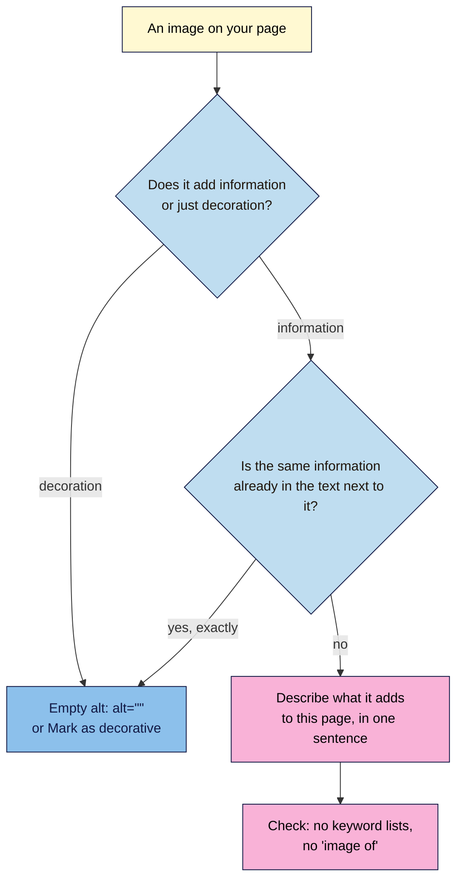
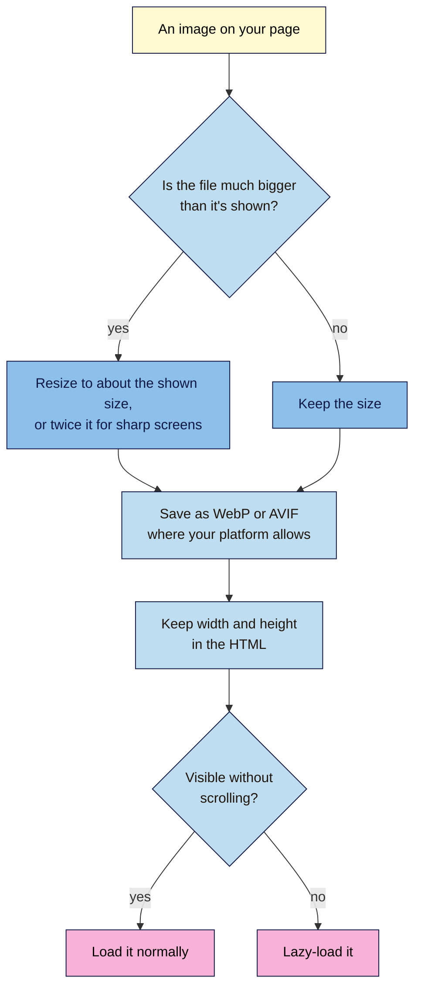

# M04.L04 — Image SEO: File Names, Alt Text, Size and Format
> After this lesson you can describe each image so people and search engines understand it, find the images that slow your pages down, and choose a lighter format and loading approach.

**Time:** ~15 min reading + ~35 min hands-on + ~10 min exercise · **Level:** L1 Foundation (beginner) · **Prereqs:** M02.L05, M04.L03 · **Remediate to:** M02.L05
**Verified against:** Google Search Central "Google image SEO best practices" (updated 2026-03-02), "Fix lazy-loaded content" and "Image sitemaps"; web.dev "Image performance" (updated 2023-11-01); WordPress.org "Image block"; Make WordPress Core "Client-side media processing in WordPress 7.1" (22 Jul 2026); Blogger Help "Help people find your blog on search engines", all on 2026-11-09. DevTools panels and the Blogger image editor weren't tested live, so labels may differ slightly on yours.

> ⚠️ **Freshness flag:** Google's image guide moved its lazy-loading advice to a separate page in 2026. web.dev's format advice dates from 2023, so check current browser support for AVIF before relying on it. WordPress 7.1 now resizes images in the browser, fully in Chrome and Edge only, so two people uploading the same photo may get different files.

## Learning objectives
1. **Name** image files and write alt text that describes each image in its context. *(O1)*
2. **Check** an image's real size and format against its displayed size, using the browser's DevTools. *(O2)*
3. **Choose** a suitable format and loading approach (WebP or AVIF, `width` and `height`, lazy loading below the fold only). *(O3)*

## Why it matters
Tomás photographs every product on his phone and uploads the photos straight to his shop. Each one is called something like `IMG_4482.jpg`, is about 4,000 pixels wide and weighs 5 MB, and shows at 400 pixels wide on the page. His category page has 30 of them. On a mobile connection, customers wait for 150 MB of photos to see a list of hammers, and most leave before it loads.

Images can help people find you through Google Images, and they help visitors decide. Google notes that "images are often the largest contributor to overall page size, which can make pages slow and expensive to load". A few minutes per image fixes both problems.

## Core concept
**Plain version:** an image needs four things. A **file name** that says what it is, **alt text** that says what it adds to the page, a **size** close to how big it's shown, and a **format** that keeps the file light. Put it near the text it belongs to, and let the browser delay images further down the page.

**Analogy:** think of a photo in a printed catalogue. It's labelled, it sits next to the product description, and it's printed at the size it's shown. Nobody prints a poster and then folds it into a stamp-sized box.

**Precise definitions:**
- **Alt text:** the `alt` attribute on ``, a text replacement for the image. Google calls it "the most important attribute" for image metadata. You met it in Lesson 2.5.
- **Decorative image:** an image that adds no information, such as a divider line. It gets `alt=""`, so screen readers skip it.
- **Intrinsic size:** the image file's real width and height in pixels.
- **Rendered size:** how big the image is shown on the page.
- **WebP and AVIF:** newer image formats that usually make smaller files than JPEG or PNG for the same quality.
- **Lazy loading:** delaying an image's download until it's near the visible part of the page, with `loading="lazy"`.
- **Above the fold:** the part of the page visible without scrolling.

### What Google says
| Claim | Verdict | What the source says |
|---|---|---|
| Alt text is the key image detail for Google | **Documented** | "The most important attribute when it comes to providing more metadata for an image is the alt text" |
| Google reads only the alt text | **False** | "Google uses alt text along with computer vision algorithms and the contents of the page to understand the subject matter of the image." |
| Stuffing keywords into alt text helps | **False** | It "results in a negative user experience and may cause your site to be seen as spam" |
| Where you put the image matters | **Documented** | "make sure images are placed near relevant text and on pages that are relevant to the image subject matter" |
| File names matter a lot | **Only lightly** | "the filename can give Google very light clues about the subject matter of the image" |
| Google supports WebP and AVIF | **Documented** | Google supports "BMP, GIF, JPEG, PNG, WebP, SVG, and AVIF" in `` |
| Lazy-load every image | **False** | "Don't add lazy-loading to content that is likely to be immediately visible when a user opens a page." |
| Google scrolls to load lazy images | **False** | "Google Search does not interact with your page." Lazy images must load when they're "visible in the viewport" |
| You need an image sitemap | **Usually not** | It helps with images "we might not have otherwise discovered". Most images in normal `` elements are found anyway |

### The alt text ladder
Google's own example uses a puppy. Nila's version:

| Level | Alt text | Why |
|---|---|---|
| Bad: missing | `` | Nothing for screen readers or Google |
| Bad: stuffed | `alt="coffee beans best coffee beans buy coffee beans india cheap coffee"` | A keyword list, which Google treats as spam |
| Better | `alt="coffee beans"` | True, but it could be any coffee |
| Best | `alt="250 g bag of Nila Chikmagalur medium roast whole beans"` | Says exactly what this image adds to this page |

Write what the image adds **in this context**. The same photo of a jar might be "Cold brew steeping in a glass jar" on a guide, and "Nila 1-litre cold brew jar with filter" on its product page.

Blogger's help suggests using the alt box for "a long description". Keep it useful rather than long: one clear sentence is usually enough.

## How it works

**In words:** for each image, ask whether it adds information or is only decoration. Decoration gets an empty `alt`, or the **Mark as decorative** option in WordPress's Image block. If the image repeats text right next to it exactly, it can be treated the same way. Otherwise, describe in one sentence what the image adds to this page. Then check there's no keyword list and no "image of" at the start: screen readers already say it's an image.

### Make images lighter

**In words:** compare the image file's real size with how big it's shown. If it's much bigger, resize it to about the shown size, or up to twice that for sharp phone and laptop screens. Save it as WebP or AVIF if your platform allows. Keep `width` and `height` in the HTML, so the page doesn't jump as it loads (Lesson 2.5). Finally, load images normally if they're visible without scrolling, and lazy-load the ones further down.

**How big is too big?** web.dev's example: an image shown at 500 × 500 pixels "would be optimally sized at 500 pixels by 500 pixels", and a 1,000-pixel image is "twice as large as needed", except on screens with twice the pixel density, where 1,000 pixels is right. Beyond that, people can't see the difference. A rule of thumb: no more than twice the shown width *(course rule of thumb)*.

> **Under the hood: what your platform already does.** WordPress makes several smaller copies of each upload and lists them in a `srcset`, so browsers pick a suitable size (WordPress 101 Module 3). Images bigger than 2,560 pixels are scaled down automatically. WordPress also leaves its first few content images out of lazy loading (WordPress 101 Module 7). In WordPress 7.1, resizing and compression happen in your browser: "The feature is enabled by default in supporting browsers", and the full version is "Chromium-only", meaning Chrome and Edge. Blogger hosts and resizes images for you too. So on most platforms, your job is mainly the file you upload, the alt text and where you put it.

## Hands-on walkthrough
You'll check three images on one page: their names and alt text, their real and shown sizes, and their format and loading.

**Before you start: which steps apply to you?**
- **Path A (your own site):** do every part, and fix the alt text in Part D.
- **Path B (Blogger practice site):** do every part. Use a post with at least three images, and add some if it doesn't have them.
- **Path C (client site):** do Parts A–C. Give the client your table in Part D, and change nothing yourself.

**Part A — Record the images (8 min)**
1. Pick a page with at least three images, ideally one of your three pages from Lesson 4.1. Add a tab called **Image check**, with these columns: **Image**, **File name**, **Alt now**, **Decorative?**, **Alt planned**, **Near relevant text?**, **Shown size**, **Real size**, **Format**, **File size**, **Above the fold?**, **Lazy?**.
2. Right-click the first image and choose **Inspect**. In the **Elements** panel, copy the `src` file name and the `alt` text, if there is one.
   **Expected:** file names like `IMG_4482.jpg` or `image1.png`, and missing or vague alt text, are common.

**Part B — Compare real and shown sizes (10 min)**
1. In the **Elements** panel, hover over the `src` address. Chrome shows a small preview with the **rendered size** (how big it's shown) and the **intrinsic size** (the file's real size). Copy both.
   > 🖼️ **Image prompt:** Chrome DevTools Elements panel (1280×700) with the mouse over an image's src address, showing a tooltip with rendered size 400 × 300 and intrinsic size 4000 × 3000. Highlight the tooltip with a 3px #F9B2D7 outline; blur any personal details.
   > **Alt text:** DevTools showing an image's rendered and intrinsic sizes in a tooltip, highlighted.
2. Open the **Network** panel, click **Img**, and reload the page. Find the image, and copy its **Size** and its **Type** (format).
3. Note whether the image is visible without scrolling, and whether its `` has `loading="lazy"`.
   **Expected:** on many small sites, at least one image is three or more times wider than it's shown, and weighs over 500 KB. That's your biggest quick win.

**Part C — Plan the fixes (10 min)**
1. For each image, decide whether it's decorative. For the rest, write a **best**-level alt text from the ladder.
2. Check **Near relevant text?**: is the image next to the words it illustrates?
3. If the real size is more than twice the shown size, plan a resized file. If it's a JPEG or PNG photo, plan a WebP version if your platform accepts it.
4. Check loading: images above the fold shouldn't be lazy. Images further down can be.
   **Expected:** a short list of changes, such as "Alt: write best version (3 images). Resize hero from 4,000 to 1,600 px wide, save as WebP. Remove lazy loading from the hero."

**Part D — Fix the alt text (7 min)**
1. Update the alt text on your platform:
   - **WordPress:** select the image, and in the block settings, edit **Alternative text**, or choose **Mark as decorative** if it adds nothing. WordPress's docs note that the block's alt text "only applies to the image on that specific page or post", while the Media Library sets the default for new uses.
   - **Blogger:** click the image in the post editor, choose **Edit**, and fill in the **alt** box.
2. Check the live page with **Inspect**: each image's `alt` should show your new text.
   **Expected:** every informative image has a one-sentence alt, and decorative images have `alt=""`. Resizing and converting files is covered step by step in WordPress 101 Module 3. Save it for the Module 4 capstone if you don't do it now.

**Expected output:** an **Image check** tab for three images, with planned alt text, size and format notes, and loading checks, plus updated alt text on paths A and B.

## When to use / when not to
**Write alt text** for every image that adds information: product photos, steps in a guide, charts. Use empty alt for decoration.

**Resize and convert** images that are much bigger than they're shown, starting with the largest file on your most important pages.

**Lazy-load** images below the fold. Leave the first images people see to load normally.

**Add an image sitemap** only if your images can't be found in normal `` elements, for example if they're loaded in unusual ways. Most small sites don't need one.

**The trade-off:** smaller files load faster but can look blurry if you shrink them too far. Check the result on a sharp phone screen before you replace the original.

## Use AI for this
**Example prompt:**
> "Here are three product photos from my coffee shop, with the text next to each: [describe or paste]. Write alt text of one sentence for each, saying what the image adds to the page. Don't start with 'image of', don't list keywords, and don't describe anything you can't see."

**What AI does well here:** first drafts of alt text for many images, especially if it can see the image.
**Where it gets it wrong:** it describes what it guesses rather than what matters on the page, misses product details (size, roast, model number), and sometimes stuffs in keywords if asked to "optimise".
**How to check:** read each alt text next to its image and page. Would a screen reader user get what a sighted visitor gets?

## Common mistakes
- **Camera file names** like `IMG_4482.jpg`. Rename before uploading.
- **Missing alt text** on product photos.
- **Keyword lists in alt text.**
- **"Image of" or "photo of"** at the start of the alt. Screen readers already announce an image.
- **Uploading huge photos** straight from a phone.
- **Lazy-loading the first image** on the page.
- **Removing `width` and `height`**, which makes the page jump as images load.
- **Text inside images** with no text version on the page. Google and screen readers can't rely on it.

## Troubleshooting
| Symptom | Likely cause | Fix |
|---|---|---|
| DevTools shows no intrinsic size | The image is a CSS background, not an `` | Use an `` for meaningful images. "Google doesn't index CSS images" |
| The alt text you changed isn't on the page | Your edit was in the Media Library, which only sets the default for new uses | Edit the alt in the image block on that page |
| The resized image looks blurry | It's smaller than the shown size, or compressed too much | Use about twice the shown width, with lighter compression |
| WebP or AVIF upload fails | Your host or platform doesn't support the format | Check your platform's media settings, or use WebP, which is more widely supported |
| The top image appears late | It's lazy-loaded | Remove `loading="lazy"` from images visible without scrolling |
| Network panel shows no images | The **Img** filter is on, but the page wasn't reloaded | Reload the page with DevTools open |

## Exercise
**Task:** complete your **Image check** tab (Parts A–D). Then fix these images from Nila Coffee's draft cold brew guide. All details are illustrative. Say what's wrong with each, and give a fix.
1. The top photo: `IMG_0093.JPG`, 4,032 × 3,024 pixels, 4.8 MB, shown at 800 × 600, `loading="lazy"`, `alt="cold brew"`.
2. A divider line between sections: `alt="cold brew coffee divider best cold brew"`.
3. A step photo of coffee being strained: `alt="image of coffee"`.
4. A photo of a jar halfway down the page, in the "What you need" section, with `width` and `height` removed "to keep the code clean".
5. A table of ratios saved as a picture, with no text version on the page.

**Expected outcome:** a complete tab, and these fixes:
- **1** Rename to something like `cold-brew-jar-fridge.jpg`, resize to about 1,600 × 1,200, save as WebP, remove `loading="lazy"` (it's the first image people see), and describe it: "A jar of cold brew steeping in the fridge".
- **2** Decorative: use `alt=""`, or **Mark as decorative**.
- **3** Drop "image of", and say what it shows: "Straining cold brew through a paper filter into a jug".
- **4** Put `width` and `height` back, so the page doesn't jump. It can be lazy-loaded, since it's further down.
- **5** Use a real HTML table (Lesson 2.7). Neither Google nor screen readers can rely on text inside a picture.

**Stretch goal:** find the single heaviest image on your site's home page, and write down its file size before and after you resize it.

## Key takeaways
- Alt text is the most important image detail: one sentence on what the image adds to this page, or empty for decoration.
- Google also reads the page around the image, so put images next to the text they belong to.
- File names give only "very light clues", but descriptive names cost nothing.
- Resize images to no more than about twice their shown width, and use WebP or AVIF where you can.
- Lazy-load images below the fold only. Keep `width` and `height`.

## Teach it back
Explain to a friend in 3 sentences what makes good alt text, and why a 5 MB photo shown at 400 pixels wide is a problem.

## Glossary terms added
- Intrinsic size — added to `seo-101/glossary.md`
- Rendered size — added to `seo-101/glossary.md`
- Above the fold — added to `seo-101/glossary.md`
- WebP and AVIF — added to `seo-101/glossary.md`
- *Already in the glossary:* Alt text, Decorative image, Lazy loading

## Further reading
*All checked 2026-11-09.*
- Google Search Central — Google image SEO best practices: https://developers.google.com/search/docs/appearance/google-images
- Google Search Central — Fix lazy-loaded content: https://developers.google.com/search/docs/crawling-indexing/javascript/lazy-loading
- Google Search Central — Image sitemaps: https://developers.google.com/search/docs/crawling-indexing/sitemaps/image-sitemaps
- web.dev — Image performance (updated 2023): https://web.dev/learn/performance/image-performance
- WordPress.org — Image block: https://wordpress.org/documentation/article/image-block/
- Make WordPress Core — Client-side media processing in WordPress 7.1 (22 Jul 2026): https://make.wordpress.org/core/2026/07/22/client-side-media-processing-in-wordpress-7-1/
- Blogger Help — Help people find your blog on search engines: https://support.google.com/blogger/answer/41373
- WordPress 101, Module 3 — media sizes, compressing and converting images, accessible media: `wordpress-101/lessons/m03-l01-media-library-image-sizes.md`, `m03-l02-compress-convert-images.md`, `m03-l03-accessible-media.md`

> ⚠️ **May change:** browser support for AVIF; WordPress's in-browser image processing (new in 7.1); DevTools panel names. Core Web Vitals and image speed are covered in depth in Module 12.

## Refresher card
*Used by remediation when a learner fails a quiz twice on a later lesson that points back here.*
**Alt text** is "the most important attribute" for image metadata: one sentence on what the image adds **to this page**, no keyword lists, no "image of". Decorative images get `alt=""` (WordPress: **Mark as decorative**). Google also uses "computer vision" and the page around the image, so place it "near relevant text". **File names** give "very light clues": `cold-brew-jar.jpg`, not `IMG_0093.JPG`. **Size:** check rendered vs intrinsic size in DevTools; keep files no more than about twice the shown width. **Format:** WebP or AVIF where supported. Keep `width` and `height`. **Lazy-load** only images below the fold: "Don't add lazy-loading to content that is likely to be immediately visible".
