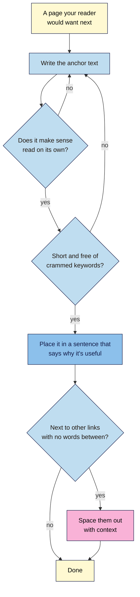
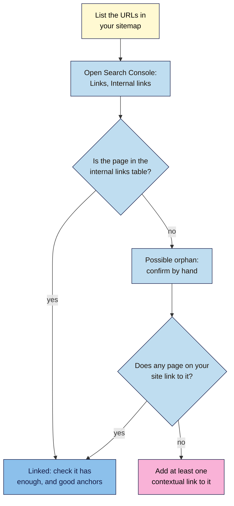

# M04.L05 — Internal Links and Anchor Text
> After this lesson you can write links whose words say exactly where they go, find pages on your site that nothing links to, and plan links that guide readers from one useful page to the next.

**Time:** ~15 min reading + ~35 min hands-on + ~10 min exercise · **Level:** L1 Foundation (beginner) · **Prereqs:** M02.L05, M03.L05 · **Remediate to:** M02.L05
**Verified against:** Google Search Central "Link best practices for Google" (updated 2025-12-10), "Help Google understand your ecommerce site structure" and "SEO Starter Guide"; Search Console Help "Links report"; Google SEO office hours (July 2024), all on 2026-11-09. Search Console screens weren't tested live, so labels may differ slightly on yours.

> ⚠️ **Freshness flag:** "orphan page" is an SEO-tool term. Google's documentation doesn't use it, and it says nothing about links in the body counting more than links in menus or footers. Treat any claim like that as unproven.

## Learning objectives
1. **Write** anchor text that describes its target, avoiding generic, overlong and chained links. *(O1)*
2. **Find** pages with no internal links pointing to them, by comparing your sitemap with the links on your site. *(O2)*
3. **Plan** internal links between related keyword-map topics, such as from guides to products. *(O3)*

## Why it matters
Nila's most popular post is the cold brew guide. It explains which beans to use, and then says "Buy them here", linking to the shop's home page. The cold brew concentrate, Nila's best seller in summer, isn't linked from any guide at all. Visitors who'd happily buy it never find it, and Google has to guess how important it is.

Internal links are the roads between your pages. Google says it "uses links as a signal when determining the relevancy of pages and to find new pages to crawl". Your readers use them to find the next thing they need. A few well-placed links cost nothing and help both.

## Core concept
**Plain version:** link from a page to another page on your site wherever a reader would want to go next. Make the linked words say what's at the other end. Make sure every page you care about has at least one link pointing to it.

**Analogy:** think of signs in a shopping centre. A good sign says "Coffee shop, first floor", not "Click here". A shop that no sign points to gets few visitors, however good it is.

**Precise definitions:**
- **Internal link:** a link from one page on your site to another (Lesson 2.5).
- **Anchor text:** "the visible text of a link", which "tells people and Google something about the page you're linking to".
- **Contextual link:** a link inside the main text, with words around it that explain why it's there.
- **Orphan page:** a page with no internal links pointing to it. It's an SEO-tool term, not Google's. Google's version is the rule: "Every page you care about should have a link from at least one other page on your site."
- **Chained links:** several links placed side by side with no words between them.

### What Google says
| Claim | Verdict | What the source says |
|---|---|---|
| Good anchor text describes the target | **Documented** | "Good anchor text is descriptive, reasonably concise, and relevant to the page that it's on and to the page it links to." |
| "Click here" and "Read more" are fine | **False** | Google lists "Click here", "Read more", "website" and "article" as "Bad (too generic)" |
| Pack keywords into anchor text | **False** | "resist the urge to cram every keyword that's related to the page that you're linking to" |
| The words around a link matter | **Documented** | "the words before and after links matter, so pay attention to the sentence as a whole" |
| Links side by side are fine | **Not recommended** | "Don't chain up links next to each other; it's harder for your readers to distinguish between links" |
| Every important page needs an internal link | **Documented** | "Every page you care about should have a link from at least one other page on your site." |
| More internal links make a page look more important | **Documented** | "the more links a page has to it within a site, the higher the relative importance of the page to other pages on your site" |
| There's an ideal number of links per page | **False** | "There's no magical ideal number of links a given page should contain. However, if you think it's too much, then it probably is." |
| Your URL folders show Google your site structure | **False** | "Google generally doesn't look at the structure of URLs to work out the structure of a site." It looks at the links |
| Links in the main text count more than menu links | **Not in Google's docs** | Google doesn't say. It only asks you to "link to those pages in context" |

### Good and bad anchor text
| Kind | Example | Better |
|---|---|---|
| Too generic | "To buy the beans, **click here**." | "Buy our **Chikmagalur medium roast** for this recipe." |
| Too long | "Read **our complete and detailed guide to everything you need to know about making cold brew coffee at home in summer**." | "Read **our cold brew guide**." |
| Stuffed | "**Best cold brew coffee beans buy cold brew beans India**" | "**Beans for cold brew**" |
| Chained | "See: **French press**, **pour-over**, **cold brew**, **AeroPress**." | "If you like a full body, try the **French press method**. For something lighter, **pour-over** is quicker." |

Google's own test: "Try reading only the anchor text (out of context) and check if it's specific enough to make sense by itself."

## How it works

**In words:** start from a page your reader would want next. Write anchor text, and read it on its own: if it doesn't say where it goes, rewrite it. Keep it short, without crammed keywords. Put it in a sentence that says why the page is useful. If it ends up next to other links with no words between, space them out with context.

### Plan links from your keyword map
Your **Keyword map** (Lesson 3.5) shows which topics belong together. Use it to plan links that follow the reader's journey *(observed practice)*:
- **Guide → product:** the cold brew guide links to the beans and the jar it uses. Google's shop guide suggests linking to a best seller "from the home page or in other content, such as blog posts".
- **Product → guide:** the jar's product page links to "How to make cold brew".
- **Related guides:** the French press ratio guide links to the grind size guide.
- **Category → product:** every product has a link from its category page (Lesson 4.6).
- **Two pages that share a search but not an intent** (Lesson 3.5): link them, so each sends readers to the right one.

### Find pages nothing links to

**In words:** list every URL in your sitemap. Then open the internal links table in Search Console's **Links** report. If a page appears there, it's linked, so check it has enough links and good anchor text. If it's missing, it may have no internal links, but the report is only a sample, so confirm by hand. If no page on your site links to it, add at least one contextual link.

> **Under the hood: why the Links report isn't the whole story.** Search Console says the report "isn't a comprehensive list of every link on your site. It shows a sample of internal and external links". Tables stop at 1,000 rows, and pages are grouped by their canonical URL. So a page missing from the report might still have links. That's why you confirm by hand before adding links. A crawler such as Screaming Frog (Module 6) can check every link, up to 500 pages free.

## Hands-on walkthrough
You'll find pages with no internal links, fix five weak anchors, and plan new links between your keyword-map topics.

**Before you start: which steps apply to you?**
- **Path A (your own site):** do every part, and add the links in Part D.
- **Path B (Blogger practice site):** do every part. A new blog may have no Links data yet, so in Part B check each post by hand. Add the links in Part D.
- **Path C (client site):** do Parts A–C. Give the client your plan in Part D, and change nothing yourself.

**Part A — List your pages (7 min)**
1. Open your sitemap in a browser:
   - **WordPress:** `yourdomain.com/wp-sitemap.xml`, or your SEO plugin's sitemap, often `/sitemap_index.xml`.
   - **Blogger:** `yourblog.blogspot.com/sitemap.xml`.
2. Open each child sitemap (for posts, pages, products), and copy the URLs into a new tab called **Internal links**, with these columns: **URL**, **In Links report?**, **Linked from**, **Links in**, **Orphan?**, **Planned links from**, **Anchor text**.
   **Expected:** a list of every page your site tells search engines about. Category and tag pages may appear too. Keep the ones in your keyword map.

**Part B — Check which pages are linked (10 min)**
1. In Search Console, open **Links**. Under **Internal links**, open **Top linked pages** and choose **More** to see the full table.
   > 🖼️ **Image prompt:** Search Console Links report (1280×800) with the Internal links section expanded, showing a table of a coffee site's pages and how many internal links each has. Highlight the internal links table with a 3px #F9B2D7 outline; blur any personal details.
   > **Alt text:** Search Console's Links report with the table of internally linked pages highlighted.
2. For each URL in your sheet, mark **In Links report?** and copy the number of links.
3. For any page missing from the report, or with only one link, click it in the report (if it's there) to see which pages link to it. If it's missing, confirm by hand: open your home page, menu and two related posts, view their source, and use **Ctrl+F** to search for the page's slug.
4. Mark **Orphan?** Yes for pages that nothing links to.
   **Expected:** the home page, contact page and top categories have the most links. Older posts, products added outside a category, and landing pages from old campaigns are the usual orphans.

**Part C — Fix weak anchors (8 min)**
1. Open one of your three pages from Lesson 4.1, and list every link in its main text with its anchor text.
2. Read each anchor text on its own, as Google suggests. Mark any that are generic, overlong, stuffed or chained.
3. Rewrite five of them, using the table above as a guide.
   **Expected:** "Read more", "here", "this post" and bare URLs are the most common. Each rewrite should name what's at the other end in a few words.

**Part D — Plan and add links (10 min)**
1. For each orphan, and each important page with only one link, write in **Planned links from** two pages that could link to it in context. Use your **Keyword map** to find related topics.
2. Add at least one **guide → product** and one **product → guide** link, if your site has both.
3. Write each link's anchor text, and the sentence it goes in.
4. On paths A and B, add the links. Then open each linking page and click the new link.
   **Expected:** each new link works, makes sense on its own, and sits in a sentence that explains it.

**Expected output:** an **Internal links** tab listing your sitemap's pages, with link counts, confirmed orphans and a plan of at least two links for each, plus five rewritten anchors. On paths A and B, the planned links are added.

## When to use / when not to
**Add internal links** when you publish a page (link to it from at least one related page) and when you update an old page (link to newer pages).

**Link generously but naturally,** where a reader would want to go next. Don't add a link just to reach a number.

**Don't link every mention** of a topic. Once per page, where it helps most, is usually enough *(observed practice)*.

**The trade-off:** links in menus and footers reach every page but carry no context. Links in the main text carry context but take effort. Use both: menus for the main sections, and contextual links for related topics.

## Use AI for this
**Example prompt:**
> "Here's a list of my site's pages, each with its topic and intent from my keyword map: [paste]. For the page '[page]', suggest three other pages it should link to, and for each, a short anchor text and a sentence to place it in. Don't suggest pages that aren't on the list, and don't put more than one keyword in an anchor."

**What AI does well here:** spotting related topics in a long list, and suggesting natural anchor text.
**Where it gets it wrong:** it invents pages or URLs, suggests links between unrelated topics, and writes keyword-stuffed anchors if you mention SEO.
**How to check:** confirm every URL exists in your sitemap, and read every anchor on its own.

## Common mistakes
- **"Click here", "Read more" or "here" as anchor text.**
- **Linking to the home page** when a specific page would help more.
- **Publishing a page and never linking to it.**
- **Several links in a row** with no words between them.
- **The same keyword-heavy anchor** on every link to a page.
- **Links to pages that redirect or are gone.** Update them to the final URL (Module 6).
- **Relying on the menu alone** for important pages deep in the site.

## Troubleshooting
| Symptom | Likely cause | Fix |
|---|---|---|
| The Links report is empty | New property, or very little data yet | Check pages by hand, and look again in a few weeks |
| A page you know is linked is missing from the report | The report is a sample, and groups pages by canonical URL | Confirm by hand, as in Part B |
| Every page shows hundreds of internal links | Menu, sidebar and footer links are counted on every page | Normal. Look at which pages have the fewest links |
| A new link goes to a "Not found" page | A typo, or the page moved | Copy the URL from the live page's address bar |
| You can't find where to add a link on a product page | The theme's product layout has no space for text | Add the link in the product description, or link from the guide instead |

## Exercise
**Task:** complete your **Internal links** tab (Parts A–D). Then fix these links from Nila Coffee's draft guides. All details are illustrative. Say what's wrong with each, and write a better version.
1. "For the beans we used, **click here**."
2. "Also see: **French press**, **pour-over**, **AeroPress**, **moka pot**."
3. "Try our **best cold brew coffee beans buy cold brew beans online India**."
4. The "Cold Brew Concentrate" product page isn't linked from any page except the sitemap.
5. The cold brew guide links to "/shop" when it mentions the cold brew jar.
6. A sentence: "Read **this**."

**Expected outcome:** a complete tab, and these answers:
- **1** Too generic. Try "We used our **Chikmagalur medium roast**."
- **2** Chained. Give each a reason: "For a full body, try the **French press method**. For a quick cup, **pour-over** takes three minutes."
- **3** Stuffed. Try "Try our **beans for cold brew**."
- **4** An orphan page. Link to it from the cold brew guide and the cold brew category page.
- **5** Too general a target. Link to the jar's product page, with anchor text naming the jar.
- **6** Too generic. Name the page: "Read **our guide to grind size**."

**Stretch goal:** pick your most important page, count the internal links pointing to it in the Links report, and add two more from relevant pages.

## Key takeaways
- Anchor text should make sense on its own: descriptive, short, and without crammed keywords.
- Put links in sentences that explain them, and don't chain them together.
- Every page you care about needs at least one internal link. More links signal more importance.
- Find unlinked pages by comparing your sitemap with Search Console's internal links, then confirm by hand.
- Use your keyword map to link guides to products, and related topics to each other.

## Teach it back
Explain to a friend in 3 sentences why "click here" is a weak link, and how to find a page on your site that nothing links to.

## Glossary terms added
- Contextual link — added to `seo-101/glossary.md`
- Orphan page — added to `seo-101/glossary.md`
- Chained links — added to `seo-101/glossary.md`
- *Already in the glossary:* Anchor text, Internal and external links

## Further reading
*All checked 2026-11-09.*
- Google Search Central — Link best practices for Google: https://developers.google.com/search/docs/crawling-indexing/links-crawlable
- Google Search Central — Help Google understand your ecommerce site structure: https://developers.google.com/search/docs/specialty/ecommerce/help-google-understand-your-ecommerce-site-structure
- Google Search Central — SEO Starter Guide: https://developers.google.com/search/docs/fundamentals/seo-starter-guide
- Search Console Help — Links report: https://support.google.com/webmasters/answer/9049606
- Google SEO office hours, July 2024 (discovering pages through links): https://developers.google.com/search/help/office-hours/2024/july

> ⚠️ **May change:** Search Console's Links report layout and limits. Module 6 adds full-site crawls, and Module 9 covers links from other sites.

## Refresher card
*Used by remediation when a learner fails a quiz twice on a later lesson that points back here.*
**Anchor text** = the visible words of a link. Good anchor text is "descriptive, reasonably concise, and relevant". Test it by reading it alone. Avoid "Bad (too generic)" ("click here", "read more"), overlong anchors, crammed keywords and **chained** links. "The words before and after links matter." **Every page you care about** needs "a link from at least one other page on your site", and more internal links signal more importance. Google reads links, not URL folders, for structure. **Orphan page** (tool term) = no internal links. **Find them:** sitemap URLs vs Search Console **Links > Internal links**, then confirm by hand, since the report is "a sample". **Plan links** from your keyword map: guides → products, products → guides, related guides.
