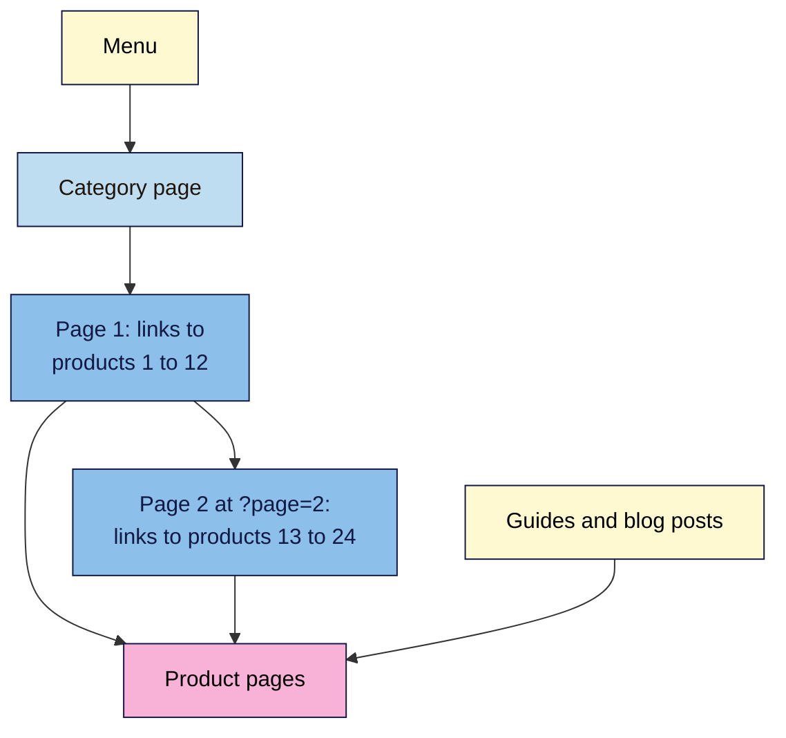
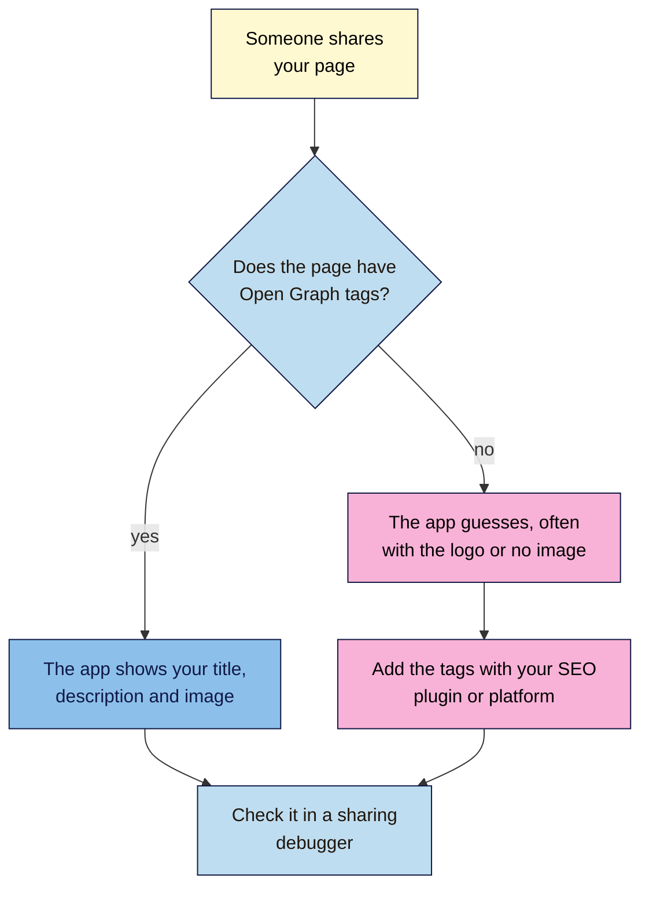

# M04.L06 — Shop Pages and Sharing: Product Pages, Category Pages and Open Graph
> After this lesson you can make sure every product can be found through your category pages, give each product page the details buyers need, and control how any page looks when it's shared.

**Time:** ~16 min reading + ~35 min hands-on + ~10 min exercise · **Level:** L1 Foundation (beginner) · **Prereqs:** M04.L01, M04.L05 · **Remediate to:** M04.L05
**Verified against:** Google Search Central "Best practices for ecommerce sites" (updated 2025-12-10) and its pages on site structure, URL structure, pagination and reviews, and "Product structured data"; The Open Graph protocol (ogp.me); Meta for Developers "A Guide to Sharing for Webmasters"; LinkedIn Help "Make your website shareable on LinkedIn"; the Open Graph tags on the official Blogger blog, all on 2026-11-09. Sharing Debugger and Post Inspector need a login and weren't tested live.

> ⚠️ **Freshness flag:** LinkedIn's image guidance was last updated about three years ago, and Meta moved its sharing docs to a new address in 2026. Share previews also depend on each app's own cache, so a fix can take a while to show.

## Learning objectives
1. **Structure** category and product pages so each product has a crawlable link, and paginated pages have real URLs. *(O1)*
2. **Improve** a product page's content with details people need to decide. *(O2)*
3. **Add** Open Graph tags and check how a page looks when shared. *(O3)*

## Why it matters
Nila's "Single-Origin Beans" page shows 12 coffees, then a **Load more** button that fetches the rest. Two of the best sellers only appear after the click. Google doesn't press buttons, so it may never find those products through the category page. Meanwhile, every product page opens with the same two lines about Nila's story, and buyers have to scroll to find the roast, size and price.

When Nila shares a new product on WhatsApp, the preview shows the logo, squashed, and the title "Shop". Almost nobody taps it.

None of this needs new content. It needs pages built so people and Google can find products and judge them quickly.

## Core concept
**Plain version:** a **category page** is a signpost to every product in it, so it needs a real link to each one. A **product page** is a shop assistant, so it needs the facts a buyer asks for. **Open Graph tags** are the label stuck on the parcel when someone shares your page: they choose the title, description and picture that apps show.

If your site isn't a shop, the same ideas apply. A blog category or a list of services is a category page, and a service page is a product page.

**Analogy:** in a real shop, every aisle sign leads to the shelves, and every product has a label with the price and size. If half the shelves are behind a locked door, customers and stock-checkers never see them.

**Precise definitions:**
- **Category page:** a page listing products (or posts) of one kind, such as "Single-Origin Beans".
- **Pagination:** splitting a long list across numbered pages, such as `?page=2`.
- **Product variant:** one version of a product, such as a 250 g or 1 kg bag.
- **Structured data:** code that labels facts on a page, such as price and availability, so search engines can read them reliably. Module 12 covers it.
- **Open Graph (OG) tags:** `<meta property="og:…">` tags in the `<head>` that tell social and messaging apps what to show when a page is shared.
- **Share preview:** the card an app shows for a shared link: an image, a title and often a description.

### What Google says
| Claim | Verdict | What the source says |
|---|---|---|
| Category pages should link to every product | **Documented** | "It's strongly recommended to link to all products that you wish indexed." |
| Google finds products through your search box | **False** | "Googlebot generally doesn't try to submit searches into a search box as part of crawling a site." |
| Google clicks "Load more" buttons | **False** | "Google's crawlers don't "click" buttons" |
| Paginated pages need their own URLs | **Documented** | "Give each page a unique URL. For example, include a ?page=n query parameter" |
| Paginated pages can share a title | **Documented** | Lesson 4.1: "You can use the same titles and descriptions for all pages in the sequence." |
| `rel="next"` and `rel="prev"` still help Google | **False** | "Google no longer uses these tags, although these links may still be used by other search engines." |
| `#` variants like `/shirt#black` are separate pages | **False** | "`/product/t-shirt#black` and `/product/t-shirt#white` are considered to be the same page by Google." |
| Empty categories should stay indexable | **Not recommended** | "If a category has no items, use a noindex robots meta tag" |
| Write more category text to rank | **Not in Google's docs** | Google has no guidance on category-page copy or its length |
| The best shop SEO is useful content | **Documented** | "The ultimate ecommerce SEO best practice is to create useful and interesting content that is valuable to users." |

### What a product page needs
Google's shop guidance doesn't give a list, but its review advice says what helps people decide: "Evaluate from a user's perspective", "Provide evidence such as visuals, audio, or other links of your own experience", and "Discuss the benefits and drawbacks". For a product page, that means *(observed practice)*:

| Buyers ask | Nila's Chikmagalur medium roast |
|---|---|
| What is it? | Medium roast, single estate, Chikmagalur, Karnataka |
| What's it like? | Notes of cocoa and jaggery, medium body, low acidity |
| Is it right for me? | Best for French press and pour-over. Not ideal for espresso |
| How much, and which size? | 250 g ₹480 · 1 kg ₹1,700, whole beans or ground |
| When will it arrive? | Roasted to order, ships in 2 days, free over ₹999 |
| Can I trust it? | Photos of the real bag and beans, the roast date, customer reviews |

Put these near the top. Brand story can go lower down.

## How it works


**In words:** the menu links to each category page. Each category page links to every product it holds, across real numbered pages such as `?page=2`, joined by ordinary `<a href>` links. Guides and blog posts link to products in context, as in Lesson 4.5. Google's version: "add links from menus to category pages, from category pages to sub-category pages, and finally from sub-category pages to all product pages."

**If your list uses "Load more" or infinite scroll,** check that your platform also creates numbered pages with real links, or that every product is in your sitemap. Google's advice: "If it's not possible to link to all pages, use a sitemap or a Google Merchant Center feed."

**Variants:** give each variant its own URL if it has its own page, using a path such as `/beans/chikmagalur/1kg` or a parameter such as `?size=1kg`. Not a `#`, because Google treats everything after `#` as the same page. Most shop platforms do this for you. Google notes, "If you're using an ecommerce platform, you can most likely skip this section". Canonical tags for variants come in Module 6.

### Open Graph: what to add


**In words:** when someone shares your page, the app looks for Open Graph tags. If they're there, it shows your chosen title, description and image. If not, it guesses, and Meta says its crawler then "uses internal heuristics to make a best guess". Add the tags through your SEO plugin or platform, and check the result in a sharing debugger.

The Open Graph protocol says "The four required properties for every page are" `og:title`, `og:type`, `og:image` and `og:url`. Add a description and image alt text too:

```html
<meta property="og:title" content="Chikmagalur Medium Roast, 250 g Whole Beans">
<meta property="og:type" content="product">
<meta property="og:url" content="https://nilacoffee.example/shop/chikmagalur-medium-roast/">
<meta property="og:image" content="https://nilacoffee.example/images/chikmagalur-medium-roast-bag.jpg">
<meta property="og:image:alt" content="250 g bag of Nila Chikmagalur medium roast whole beans">
<meta property="og:description" content="Cocoa and jaggery notes, roasted to order. Best for French press and pour-over.">
```

| Tag | Tip | Source |
|---|---|---|
| `og:title` | No need for the brand. Meta suggests "without any branding such as your site name" | Meta |
| `og:description` | "A one to two sentence description" | ogp.me |
| `og:image` | At least 1200 × 627 pixels, about 1.91:1, under 5 MB, for LinkedIn | LinkedIn Help |
| `og:image:alt` | "A description of what is in the image (not a caption)" | ogp.me |
| `og:url` | The page's main URL, without tracking codes | Meta, ogp.me |

Google also reads these tags. It lists `og:title` among the sources for title links (Lesson 4.1), and lets `og:image` suggest the preview image for a page, as long as it isn't "a generic image (for example, your site logo)".

> **Under the hood: who adds the tags.** WordPress core adds no Open Graph tags, so your SEO plugin does it, using your SEO title, description and featured image (WordPress 101 Module 3, Lesson 4). Blogger adds some by itself: the official Blogger blog's home page carries `og:title`, `og:url`, `og:description` and `og:site_name`, but no `og:image`. Shopify and Wix themes usually add them too. So you mostly check and adjust, not write them by hand.

## Hands-on walkthrough
You'll check one category page and one product page, then check and fix a page's share preview. If your site isn't a shop, use a blog category or services list as the category page, and a service page or post as the product page.

**Before you start: which steps apply to you?**
- **Path A (your own site):** do every part, and fix what you can in Part D.
- **Path B (Blogger practice site):** do every part, with a label page as the category page and a post as the product page. Blogger adds most OG tags itself.
- **Path C (client site):** do Parts A–C. In Part D, check the preview but change nothing.

**Part A — Check a category page (10 min)**
1. Add a tab called **Shop & share check**, with sections for **Category page**, **Product page** and **Share preview**.
2. Open a category page. Count the items shown, and check how more items appear: numbered pages, **Load more**, or infinite scroll.
3. If there are numbered pages, click page 2 and note its URL. It should have its own address, such as `?page=2` or `/page/2/`, not a `#`.
4. View the page source (**Ctrl+U**) and search (**Ctrl+F**) for the slug of a product on page 2. You're checking that it's linked with a real `<a href>`.
   **Expected:** most platforms create numbered pages with real links. If items only appear after a button click, with no page 2 URL, note it as a risk.
5. Note whether any category is empty.
   **Expected:** an empty category shows a page with no products. Note it for the fix list (`noindex` or removal, covered in Module 6).

**Part B — Check a product page (8 min)**
1. Open one product or service page. Without scrolling, list what you can see.
2. Compare it with the "What buyers ask" table: what is it, what's it like, who it's for, size and price, delivery, and evidence you can trust it.
3. Note anything missing or buried, and whether the photos are your own.
   **Expected:** price and the main details are often visible, but who it's for, real photos and delivery details are often missing or far down the page.
   > 🖼️ **Image prompt:** A product page for a bag of coffee beans (1280×800), showing the product name, roast and tasting notes, size options, price and a photo of the real bag above the fold. Highlight the key-details block with a 3px #F9B2D7 outline; blur any personal details.
   > **Alt text:** A product page with its name, tasting notes, size, price and photo, with the key details highlighted.

**Part C — Read the Open Graph tags (5 min)**
1. On the product page (or a post), view the source and search for `og:`.
2. Copy each tag's content into your sheet: `og:title`, `og:type`, `og:url`, `og:image`, `og:image:alt`, `og:description`.
   **Expected:** with an SEO plugin or a shop platform, most tags are there. `og:image:alt` is often missing, and the image may be the logo.

**Part D — Check and fix the share preview (12 min)**
1. Check the preview in a free debugger (each needs a free account):
   - **Facebook:** Sharing Debugger at `https://developers.facebook.com/tools/debug/`. Meta says it shows "which meta tags the crawler scrapes as well as any errors or warnings".
   - **LinkedIn:** Post Inspector at `https://www.linkedin.com/post-inspector/`.
   - **No account?** Send the link to yourself in WhatsApp or another messaging app, and look at the preview.
2. Note the image, title and description shown, and any warnings.
3. On path A or B, fix what's wrong:
   - **WordPress:** set a featured image, and check your SEO plugin's social settings for the post.
   - **Blogger:** add an image to the post, since Blogger uses the post's images for previews *(observed practice)*.
   - **Shop platforms:** check the product's social sharing or SEO settings.
4. Ask the debugger to fetch the page again, then recheck the preview.
   **Expected:** the preview shows the product photo, a clear title and a short description. Messaging apps may keep the old preview for a while.

**Expected output:** a **Shop & share check** tab with a category page verdict (real links, pagination, empty categories), a product page gap list, the page's Open Graph tags, and before and after notes on its share preview.

## When to use / when not to
**Check category pages** when you add a category, change your theme, or switch to "Load more" or infinite scroll.

**Improve product pages** for your best sellers and most-visited products first.

**Check share previews** before you share a page in a campaign, newsletter or group chat.

**Don't hand-code OG tags** if your plugin or platform adds them: two sets of tags confuse apps. Adjust the settings instead.

**The trade-off:** infinite scroll can feel smoother for shoppers, but it needs real numbered pages or a complete sitemap behind it, or some products may never be found.

## Use AI for this
**Example prompt:**
> "Here are the facts about a product: [paste origin, roast, notes, sizes, prices, delivery, brewing methods]. Write the top section of its product page: a one-line summary, five short bullet points answering what it is, what it tastes like, who it's for, sizes and prices, and delivery. Then write an og:title without the brand, and an og:description of one or two sentences. Use only the facts I gave you."

**What AI does well here:** turning a list of facts into clear, scannable product text, and short share descriptions.
**Where it gets it wrong:** it invents details (awards, origins, reviews, "best-selling"), writes generic hype, and may claim category pages need a set word count.
**How to check:** compare every claim with your product records. Never publish a review, rating or claim you can't prove.

## Common mistakes
- **"Load more" with no numbered pages or sitemap,** so some products can't be found.
- **Pagination with `#`** instead of real URLs.
- **Variants on `#` URLs,** which Google treats as one page.
- **Empty categories left live and indexable.**
- **Product pages that lead with brand story,** not product facts.
- **Stock or manufacturer photos only,** when your own would show the real thing.
- **The logo as `og:image`,** or no image at all.
- **Two sets of OG tags** from a theme and a plugin.

## Troubleshooting
| Symptom | Likely cause | Fix |
|---|---|---|
| Products after page 1 aren't in the source | They load with JavaScript after a click | Turn on numbered pagination, or make sure every product is in the sitemap |
| Page 2 has the same URL as page 1 | Pagination uses `#` or JavaScript only | Switch to `?page=2` or `/page/2/` in your theme or platform settings |
| The preview shows an old image | The app cached the old version | Ask the debugger to scrape again, and wait for messaging apps to refresh |
| The preview shows the logo | No `og:image`, or the logo is set as the default | Set a featured image or a social image for the page |
| Two `og:title` tags in the source | The theme and a plugin both add them | Turn off one of them |
| The debugger says the image is too small | It's under the app's minimum | Use an image at least 1200 × 627 pixels |

## Exercise
**Task:** complete your **Shop & share check** tab (Parts A–D). Then say what's wrong with each Nila Coffee setup, and how to fix it. All details are illustrative.
1. The "Brewing Gear" category shows 8 items and a **Load more** button. There's no page 2 URL, and the sitemap lists only the first 8 products.
2. The 250 g and 1 kg bags of one coffee are at `/shop/chikmagalur#250g` and `/shop/chikmagalur#1kg`, and Nila wants them indexed separately.
3. The "Decaf" category has had no products for six months, and it's still in the menu.
4. A product page starts with 300 words about Nila's founding story. The roast, size and price are at the bottom.
5. When the cold brew guide is shared, the preview shows the Nila logo and the title "Blog".
6. A writer says, "Category pages need at least 500 words of text to rank."

**Expected outcome:** a complete tab, and these answers:
- **1** Google doesn't click buttons. Add numbered pages with real links, or at least list every product in the sitemap.
- **2** Google treats `#` versions as one page. Use a path or parameter instead, such as `/shop/chikmagalur/1kg` or `?size=1kg`.
- **3** Remove it from the menu, and use `noindex` until it has products again (or remove it, with Module 6's guidance).
- **4** Move the key facts to the top: roast, notes, who it's for, sizes and prices, delivery. Keep the story lower down.
- **5** Set a real `og:image` (a photo from the guide), and an `og:title` naming the guide.
- **6** Not in Google's docs. Write what helps shoppers choose, at whatever length that takes.

**Stretch goal:** run your home page through a sharing debugger, and fix its preview image and description.

## Key takeaways
- Category pages must link to every product with real links. Google doesn't click buttons or search your site.
- Paginated pages need their own URLs, such as `?page=2`. They can share a title.
- Variants need real URLs, not `#`. Empty categories shouldn't be indexed.
- Product pages should lead with the facts buyers need, and real evidence such as your own photos.
- Open Graph tags control share previews. Set a real image, a clear title and a short description, then check them in a debugger.

## Teach it back
Explain to a friend in 3 sentences why a "Load more" button can hide products from Google, and what Open Graph tags do.

## Glossary terms added
- Category page — added to `seo-101/glossary.md`
- Pagination — added to `seo-101/glossary.md`
- Product variant — added to `seo-101/glossary.md`
- Share preview — added to `seo-101/glossary.md`
- Open Graph (OG) tags — added to `seo-101/glossary.md`
- *Already in the glossary:* Structured data

## Further reading
*All checked 2026-11-09.*
- Google Search Central — Best practices for ecommerce sites: https://developers.google.com/search/docs/specialty/ecommerce
- Google Search Central — Help Google understand your ecommerce site structure: https://developers.google.com/search/docs/specialty/ecommerce/help-google-understand-your-ecommerce-site-structure
- Google Search Central — Designing a URL structure for ecommerce sites: https://developers.google.com/search/docs/specialty/ecommerce/designing-a-url-structure-for-ecommerce-sites
- Google Search Central — Pagination, incremental page loading, and their impact on Google Search: https://developers.google.com/search/docs/specialty/ecommerce/pagination-and-incremental-page-loading
- Google Search Central — Write high quality reviews: https://developers.google.com/search/docs/specialty/ecommerce/write-high-quality-reviews
- Google Search Central — Product structured data (Module 12 preview): https://developers.google.com/search/docs/appearance/structured-data/product
- The Open Graph protocol: https://ogp.me/
- Meta for Developers — A Guide to Sharing for Webmasters: https://developers.facebook.com/docs/sharing/webmasters/
- LinkedIn Help — Make your website shareable on LinkedIn: https://www.linkedin.com/help/linkedin/answer/a521928
- WordPress 101, Module 3, Lesson 4 — featured images and social share images: `wordpress-101/lessons/m03-l04-featured-social-images.md`

> ⚠️ **May change:** each app's preview sizes and caching; LinkedIn's image guidance (last updated about three years ago); debugger tool names and addresses.

## Refresher card
*Used by remediation when a learner fails a quiz twice on a later lesson that points back here.*
**Category pages** must link to every product with real `<a href>` links: "It's strongly recommended to link to all products that you wish indexed." Google doesn't click buttons or use your search box. **Pagination:** each page gets a unique URL (`?page=2`), and pages can share titles; Google no longer uses `rel="next"`/`"prev"`. **Variants:** real URLs, not `#`. **Empty categories:** `noindex`. **Product pages:** lead with what buyers ask (what, like, for whom, size and price, delivery, proof), with your own photos. **Open Graph:** `og:title`, `og:type`, `og:image`, `og:url`, plus `og:description` and `og:image:alt`. Usually added by your plugin or platform. Check previews in Sharing Debugger or Post Inspector.
