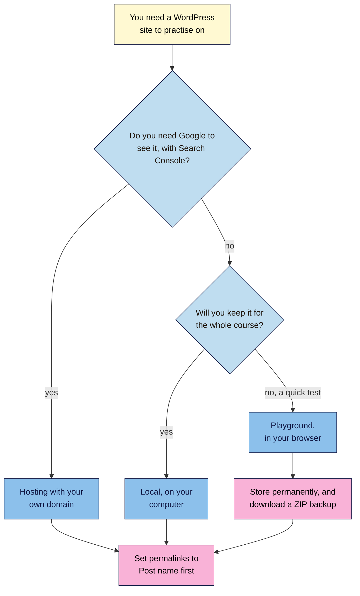

# M05.L01 — Your WordPress Practice Site: Set-up, Permalinks and Moving from Blogger
> After this lesson you have a WordPress site to practise on, with clean, readable web addresses set before your first post, a couple of real posts in it, and a backup you can restore.

**Time:** ~14 min reading + ~35 min hands-on + ~10 min exercise · **Level:** L1 Foundation (beginner) · **Prereqs:** M01.L08, M02.L02 · **Remediate to:** M02.L02
**Verified against:** WordPress Playground Handbook ("Use the Playground web instance", "Quick start guide", "Limitations", last updated 2026-11-04); localwp.com; WordPress 7.1 source (`wp-admin/options-permalink.php`); WordPress.org "Customize permalinks"; Google Search Central "SEO Starter Guide" (updated 2025-12-10) and "URL structure best practices" (updated 2026-10-21); Blogger Help "Back up or import your blog"; WordPress.org "Blogger Importer" plugin page and the Advanced Administration Handbook "Importing content", all on 2026-11-09. Playground, Local and WordPress screens weren't tested live, so labels may differ slightly on yours.

> ⚠️ **Freshness flag:** Playground changed how it saves sites in 2026. There's now a **Dock** with a save status, and WordPress 101's older "Save" step no longer matches. WordPress 7.2 is due on 8 December 2026, so some screens may change soon after.

> **Already did WordPress 101?** You have a Local practice site with **Post name** permalinks. Skim this lesson, do Part D (backup) and the exercise, and move on.

## Learning objectives
1. **Choose** a practice site (Local, Playground or hosting), and explain why a Playground site can't be indexed by Google. *(O1)*
2. **Set** Post name permalinks before the first post, giving readability, not rankings, as the reason. *(O2)*
3. **Recreate** one to three posts from Blogger or your project site, and save a portable backup. *(O3)*

## Why it matters
Amara set up WordPress for a client, wrote twelve posts, and then noticed every address looked like `/2026/11/09/cold-brew-guide/`. She switched the setting to a shorter style. Overnight, every link she'd shared in newsletters and social posts pointed to the old addresses. Some still worked because WordPress guessed, and others showed "Page not found".

Two settings decide a lot before you write a word: where your practice site lives, and what its web addresses look like. Choosing them first takes ten minutes. Changing them later can take days of redirects.

From this module on, you'll practise WordPress itself. Everything you learned in Module 4 now gets a home where you can see and fix it.

## Core concept
**Plain version:** a **practice site** is a WordPress site where you can try things without risk. You can run it on your own computer (Local), in your browser (Playground) or on cheap hosting. A **permalink** is a page's permanent web address. Set its pattern to **Post name** before you publish anything, so addresses are short and readable, like `/cold-brew-guide/`.

**Analogy:** a practice site is a rehearsal room. Nobody outside can hear you, so you can make mistakes. Permalinks are the house numbers on a street: pick a sensible system before people start sending post, because renumbering later confuses everyone.

**Precise definitions:**
- **Local:** a free desktop app that runs WordPress on your computer. Its site says "It's free and always will be."
- **WordPress Playground:** WordPress running inside your browser tab, with no server or account.
- **Permalink:** "the permanent URLs of your posts, pages, categories, and other archive pages". WordPress's docs add that they "should never be changed — hence the name permalink."
- **Slug:** the last part of a permalink, such as `cold-brew-guide` (Lesson 4.2).
- **WXR file:** WordPress's export file for content (posts, pages, comments). It "imports WordPress content into an existing site."
- **Backup:** a copy you can restore. For Playground, that's a ZIP of the whole site.

### What the sources say
| Claim | Verdict | What the source says |
|---|---|---|
| Google can index your Playground or Local site | **False** | Playground "runs locally in your browser. It does not upload your site unless you choose an action such as Export to GitHub." Local runs on your own computer. Neither has a public address *(course inference)* |
| Playground keeps your site safe for ever | **False** | "Autosaves are recovery points, not long-term backups." "Export a ZIP when you need a portable backup." |
| Playground keeps every autosave | **False** | "Playground keeps up to five recent autosaves." |
| Keywords in the URL boost rankings | **Hardly** | Google: keywords in the domain or URL path "alone have hardly any effect beyond appearing in breadcrumbs" |
| WordPress says Post name helps rankings | **WordPress says so; Google disagrees** | The Permalinks screen says Post name "can help your posts rank higher in search engines". Follow Google, and choose it for readability |
| Readable words beat ID numbers | **Documented** | "When possible, use readable words rather than long ID numbers in your URLs." |
| Use hyphens between words | **Documented** | "we recommend using hyphens (-) instead of underscores (_) to separate words in your URLs" |
| A plugin can move a Blogger blog for you | **Risky** | The Blogger Importer "hasn't been tested with the latest 3 major releases of WordPress", and "does not handle blogger pages" |

### Which practice site?
| Option | Cost | Public? | Lasts | Best for |
|---|---|---|---|---|
| **Local** (recommended) | Free | No, your computer only | Until you delete it | Your main practice site for this course, as in WordPress 101 |
| **Playground** | Free, no account | No, your browser only | Until browser storage is cleared, unless you export it | Quick experiments and break-it labs |
| **Hosting** with your own domain | About ₹150–₹500 / $3–$10 a month | Yes | As long as you pay | Learners who want Search Console data on WordPress (Path B with hosting, from Lesson 1.8) |

Local and Playground are private, so Search Console can't see them. That's fine for practising. For real Search Console data, use your project site (paths A and C) or a hosted practice site.

## How it works

**In words:** if you need Google to see your WordPress site, use hosting with your own domain. If not, and you'll keep the site for the whole course, use Local. For quick tests, use Playground, but store it permanently and download a ZIP backup. Whichever you choose, set permalinks to **Post name** before your first post.

### Why permalinks come first
WordPress offers **Plain** (`/?p=123`), **Day and name**, **Month and name**, **Numeric**, **Post name** and **Custom Structure**. A new install often starts with **Day and name** (WordPress 101 Module 1), which puts the date in every address.

| Pattern | Example | Problem |
|---|---|---|
| Plain | `/?p=123` | Says nothing about the page |
| Day and name | `/2026/11/09/cold-brew-guide/` | Long, and makes guides you keep updating look old |
| **Post name** | `/cold-brew-guide/` | None for most small sites. Two posts can't share a slug |

Google says "readable words" beat ID numbers, but URL keywords "alone have hardly any effect". So choose Post name because people can read, remember and share it, not to rank.

Change it **before the first post**. After that, every published address would change. WordPress tries to guess old addresses, but only when it can read a post name in them, so don't rely on it. Module 6 covers redirects if you ever have to.

> **Under the hood: what "private" really means.** Playground runs WordPress inside your browser using WebAssembly, so the first load can take "5-10 seconds" and downloads a lot of files. Its database lives in your browser's storage. "Temporary Playgrounds, including ?storage=temp, are lost when the tab is closed or refreshed." Even a saved Playground can vanish if you clear site data or use a private window. That's why Playground is for experiments and Local is for your course site.

## Hands-on walkthrough
You'll set up a practice site, fix its permalinks, add two real posts and make a backup.

**Before you start: which steps apply to you?**
- **Path A (your own site, on WordPress):** set up Local as a practice copy, so you can test changes before making them live. Don't change permalinks on your live site.
- **Path A or C on Shopify, Wix or another platform:** set up Local to learn WordPress. Lesson 5.5 has notes for your platform.
- **Path B (Blogger):** set up Local, and move two of your Blogger posts in Part C. Keep the Blogger blog: it's still your Search Console practice site.
- **Path B (WordPress on hosting):** use your hosted site. If it already has posts, check Part B carefully before changing anything.
- **Path C (client site):** set up Local, and never change the client's settings.

**Part A — Set up the site (10 min)**
1. Add a tab called **WordPress setup**, with these columns: **Step**, **Setting or label**, **What I chose**, **Why**, **Date**.
2. Set up your site:
   - **Local:** download it from localwp.com (Mac, Windows or Linux), create a site, and note its name and address. WordPress 101 Module 1, Lesson 3 has the full steps.
   - **Playground:** go to `https://playground.wordpress.net/`. Note the save status next to the address field in the **Dock**.
   - **Hosting:** use your host's one-click installer.
   **Expected:** a working WordPress site you can log in to. On Playground, the status shows **Unsaved** or **Autosaved**.

**Part B — Set permalinks (5 min)**
1. Go to **Settings → Permalinks**. Note which option is selected now.
2. If the site has **no published posts**, choose **Post name** and click **Save Changes**.
   > 🖼️ **Image prompt:** WordPress Settings → Permalinks screen (1280×800) with Post name selected under Common Settings, and the example address ending in /sample-post/. Highlight the Post name option with a 3px #F9B2D7 outline; blur any personal details.
   > **Alt text:** WordPress permalink settings with the Post name option selected and highlighted.
3. If it **already has published posts** (a hosted site, or your live site), stop. Write down the current pattern, and leave it until you've read Module 6 on redirects.
   **Expected:** "Permalink structure updated." on a new site, and a row in your tab saying what you chose and why ("readable, short, no dates").

**Part C — Add two real posts (12 min)**
1. Pick two pages from your **Keyword map** (Lesson 3.5).
2. Recreate them as posts:
   - **Path B (Blogger):** open each Blogger post, copy the text, and paste it into a new WordPress post. Re-add headings as Heading blocks and re-upload images, since pasted images may still load from Blogger. Set the slug to match your keyword map (Lesson 4.2).
   - **Everyone else:** write two short posts, or copy two from your project site.
3. Publish each post, and open it. Check the address is `/your-slug/`, with no date.
   **Expected:** two posts at short, readable addresses. Don't use the Blogger Importer plugin: it "hasn't been tested with the latest 3 major releases of WordPress", and it doesn't move pages. Moving two posts by hand is quicker and shows you how blocks work.

**Part D — Back it up (8 min)**
1. Back up your site:
   - **Playground:** click the save status (**Autosaved** or **Unsaved**), and choose **Store permanently**. Then open **Export** in the Dock and use **Download as .zip**, which "exports the current files, database, plugins, themes, uploads, and edits". To check it, restore it with **New → Import zip**.
   > 🖼️ **Image prompt:** The WordPress Playground Dock (1280×700) with the save status next to the address field opened, showing the Store permanently option. Highlight the save status with a 3px #F9B2D7 outline; blur any personal details.
   > **Alt text:** Playground's Dock with the save status open and the Store permanently option highlighted.
   - **Local or hosting:** go to **Tools → Export**, choose **All content**, and click **Download Export File**. This WXR file holds your content, but not your theme, plugins or settings.
   - **Blogger (keep a copy):** in Blogger, go to **Settings**, and under "Manage blog" click **Back up content**, then **Download**.
2. Note where you saved each file, and the date.
   **Expected:** a ZIP (Playground) or XML file (WordPress export) on your computer, and a Blogger backup if you're on path B.

**Expected output:** a **WordPress setup** tab recording your site choice, permalink setting, two posts and backup files, plus a practice site with two posts at Post name addresses.

## When to use / when not to
**Use Local** for the course practice site and for trying changes before you make them on a live site.

**Use Playground** for break-it labs and quick tests, such as trying a plugin. Download a ZIP if you want to keep it.

**Use hosting** if you want Search Console and analytics data from a WordPress site.

**Don't change permalinks on a live site** just to "improve SEO". The ranking gain is close to nothing, and broken links cost visitors. Module 6 shows how to do it safely if you must.

**The trade-off:** Local and Playground are free and safe but invisible to Google. Hosting shows real data but costs money and needs care, because mistakes are public.

## Use AI for this
**Example prompt:**
> "I'm setting up a WordPress practice site for an SEO course. My posts are: [list topics]. Suggest a short, readable slug for each, using hyphens and no dates. Then list three things I should check before changing the permalink setting on a site that already has published posts."

**What AI does well here:** suggesting clean slugs, and reminding you of risks before a change.
**Where it gets it wrong:** it often says URL keywords are a strong ranking factor, gives menu names from older WordPress versions, and may say Playground sites are saved for ever.
**How to check:** compare labels with your own screen, and ranking claims with Google's Starter Guide.

## Common mistakes
- **Writing posts before setting permalinks,** then changing them.
- **Changing permalinks on a live site** without redirects.
- **Treating Playground as permanent,** and losing work when browser data is cleared.
- **Expecting Search Console to see a Local or Playground site.**
- **Pasting Blogger posts** with images still loading from Blogger.
- **Using an unmaintained importer** on a new WordPress version.
- **Deleting the Blogger blog** before you've backed it up.

## Troubleshooting
| Symptom | Likely cause | Fix |
|---|---|---|
| Your Playground site disappeared | It was temporary, or browser storage was cleared | Restore from your ZIP with **New → Import zip**. Next time, use **Store permanently** and download a ZIP |
| Post addresses still show a date | Permalinks weren't saved, or the post was published before the change | Check **Settings → Permalinks**, then re-open the post |
| "Page not found" after changing permalinks | Your server's rewrite rules didn't update | Click **Save Changes** on the Permalinks screen again. On hosting, ask your host to check its settings |
| Search Console can't verify your site | It's on Local or Playground | Expected. Use your project site or hosting for Search Console |
| Images in a moved post are broken | They loaded from Blogger, or weren't uploaded | Download them, and upload them to the WordPress Media Library |
| Playground is slow to open | It downloads WordPress into your browser first | Wait. "5-10 seconds" is typical for a fresh site |

## Exercise
**Task:** complete your **WordPress setup** tab (Parts A–D). Then answer these setup questions. All details are illustrative.
1. Kavya wants to test a new theme without risking her live site, and she'll throw the test away afterwards. Which practice site?
2. Tomás wants to compare his WordPress practice site's search data in Search Console. Which practice site?
3. Amara's client site has 80 posts at `/2025/03/14/post-name/` addresses. The client asks her to "switch to Post name for SEO". What should she say?
4. A learner built their whole course site in Playground with **?storage=temp**. What happens when they refresh?
5. Rewrite these slugs: `/?p=482`, `/2026/11/09/how-to-make-cold-brew-coffee-at-home-easy/`, `/cold_brew_ratio/`.

**Expected outcome:** a complete tab, and these answers:
- **1** Playground: quick and disposable. Or Local if she wants to keep it.
- **2** Hosting with a domain. Search Console can't see Local or Playground.
- **3** The ranking gain is "hardly any", and changing 80 live addresses risks broken links. If the client still wants it, it needs a redirect for every post (Module 6). Otherwise, leave it.
- **4** The site is lost. Temporary Playgrounds "are lost when the tab is closed or refreshed".
- **5** For example, `/cold-brew-guide/` (or your keyword map's slug), `/cold-brew-at-home/` and `/cold-brew-ratio/`, with hyphens.

**Stretch goal:** on Local or Playground, publish a test post with **Day and name** permalinks, switch to **Post name**, and visit the old address. Note whether WordPress found the post, and how long the old address took to load.

## Key takeaways
- Use Local for your course site, Playground for quick tests, and hosting only if you need Google to see it.
- Local and Playground are private. Search Console can't inspect them.
- Set **Post name** permalinks before the first post, for readability, not rankings.
- Don't change permalinks on a live site without redirects.
- Playground autosaves are "recovery points, not long-term backups". Download a ZIP.

## Teach it back
Explain to a friend in 3 sentences why you set permalinks before writing your first post, and why Playground isn't a safe place to keep your only copy of a site.

## Glossary terms added
- Practice site — added to `seo-101/glossary.md`
- WordPress Playground — added to `seo-101/glossary.md`
- WXR file — added to `seo-101/glossary.md`
- Permalink — added to `seo-101/glossary.md`
- *Already in the glossary:* Slug

## Further reading
*All checked 2026-11-09.*
- WordPress Playground Handbook — Use the Playground web instance: https://developer.wordpress.org/playground/handbook/web-instance/
- WordPress Playground Handbook — Limitations: https://developer.wordpress.org/playground/developers/limitations/
- WordPress Playground Handbook — Quick start guide: https://developer.wordpress.org/playground/handbook/quick-start-guide/
- Local: https://localwp.com/
- WordPress.org — Customize permalinks: https://wordpress.org/documentation/article/customize-permalinks/
- Google Search Central — SEO Starter Guide (URLs and domain names): https://developers.google.com/search/docs/fundamentals/seo-starter-guide
- Google Search Central — URL structure best practices: https://developers.google.com/search/docs/crawling-indexing/url-structure
- Blogger Help — Back up or import your blog: https://support.google.com/blogger/answer/41387
- WordPress.org — Blogger Importer plugin: https://wordpress.org/plugins/blogger-importer/
- WordPress 101, Module 1, Lessons 1, 3 and 4 — choosing a platform, installing WordPress, first-day settings: `wordpress-101/lessons/m01-l01-choose-your-platform.md`, `m01-l03-install-https-dashboard.md`, `m01-l04-first-day-settings.md`

> ⚠️ **May change:** Playground's Dock and save options; Local's download list; WordPress 7.2 screens (due 8 December 2026); the Blogger Importer's status.

## Refresher card
*Used by remediation when a learner fails a quiz twice on a later lesson that points back here.*
**Practice site:** Local (free, on your computer, lasting) for the course; Playground (in your browser) for quick tests; hosting if Google must see it. Playground "runs locally in your browser" and Local is on your computer, so Search Console can't see either. **Playground saving:** "Autosaves are recovery points, not long-term backups"; use **Store permanently** and **Download as .zip**; `?storage=temp` sites "are lost when the tab is closed or refreshed". **Permalinks:** set **Settings → Permalinks → Post name** before the first post. Google: URL keywords "have hardly any effect", so the reason is readability. Never change permalinks on a live site without redirects (Module 6). **Moving from Blogger:** recreate posts by hand; keep a Blogger backup (**Back up content**).
