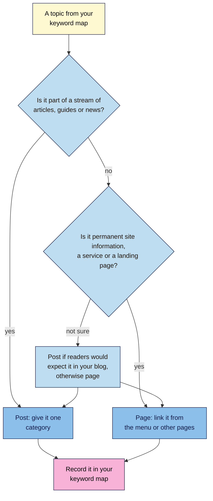
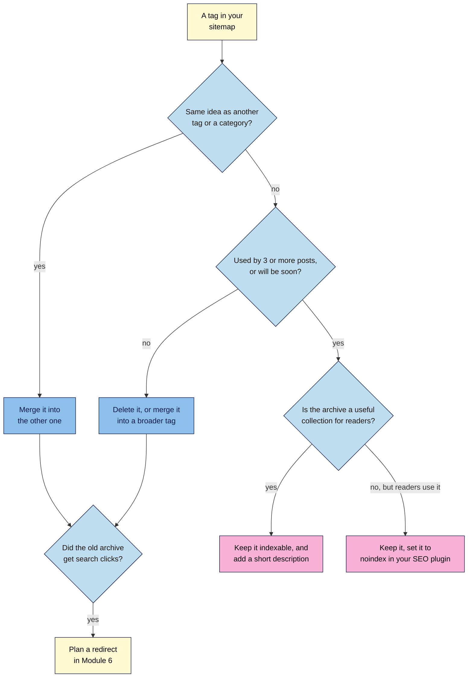

# M05.L02 — Posts, Pages, Categories and Tags Without Thin Archives
> After this lesson you can decide whether each topic should be a post or a page, organise posts so each has a clear home, and keep your category and tag pages useful instead of thin.

**Time:** ~14 min reading + ~30 min hands-on + ~10 min exercise · **Level:** L1 Foundation (beginner) · **Prereqs:** M05.L01, M03.L05 · **Remediate to:** M03.L05
**Verified against:** WordPress 7.1 source (`default-filters.php`, `robots-template.php`, `sitemaps/providers/class-wp-sitemaps-taxonomies.php`); Google Search Central "What is URL canonicalization" (updated 2026-08-20) and "Sitemaps overview"; Search Engine Roundtable report of a Google Webmaster Hangout (27 Apr 2015); WordPress 101 Module 2, Lessons 1 and 3, all on 2026-11-09. WordPress screens weren't tested live, so labels may differ slightly on yours.

> ⚠️ **Freshness flag:** Google's only public comment on tag pages that we found is from 2015, reported secondhand. Treat it as a sensible principle, not current policy. SEO plugins change their archive settings often, so check yours.

## Learning objectives
1. **Decide** whether each keyword-map topic is a post or a page. *(O1)*
2. **Organise** posts with one category each and a small, reused set of tags. *(O2)*
3. **Audit** the archive pages in `wp-sitemap.xml`, and decide for each tag whether to keep it, merge it or `noindex` it. *(O3)*

## Why it matters
Kavya added a tag to every post for every idea in it: *breathing*, *breath*, *pranayama*, *calm*, *morning*, *beginners*, *beginner*. After a year she had 22 posts and 64 tags. Most tags were used once. Each one made its own page, listing a single post with a short excerpt. Her sitemap sent Google to 64 near-empty pages, and the useful ones were hard to find among them.

WordPress makes a page for every category and tag you use, and lists it in your sitemap automatically. That's helpful when those pages are good collections. It's clutter when they're not. A few decisions now keep your site tidy as it grows.

## Core concept
**Plain version:** **posts** are dated articles in a stream; **pages** are the permanent rooms of your site. Every post goes in **one category**, its main section. **Tags** are optional labels for topics that several posts share. WordPress turns every category and tag in use into an **archive page** that lists its posts. Keep archives that are useful collections, and clear away the rest.

**Analogy:** a bookshop. Pages are the fixed signs (Opening hours, Contact). Posts are the books. Categories are the sections (Cookery, Travel). Tags are the little "staff picks" or "gifts under ₹500" cards. A card with one book behind it isn't much of a display.

**Precise definitions:**
- **Post:** dated content, shown in your blog list, feed, and category and tag pages (WordPress 101 Module 2, Lesson 1).
- **Page:** permanent content with no date order, reached through menus and links.
- **Category:** a main section for posts. Every post has at least one. A new site starts with **Uncategorized**.
- **Tag:** an optional label shared across categories.
- **Archive page (taxonomy archive):** the page WordPress builds for a category or tag, such as `/category/brew-guides/` or `/tag/cold-brew/`, listing its posts.
- **Thin archive:** an archive with so few posts, or so little else, that it adds nothing beyond the posts themselves *(course term)*.

### What the sources say
| Claim | Verdict | What the source says |
|---|---|---|
| WordPress hides tag pages from Google by default | **False** | Core adds `noindex` only to search results and to a site set to discourage search engines. Archives get no `noindex` (7.1 source) |
| WordPress lists archives in its sitemap | **Documented** | The core sitemap "Returns all public, registered taxonomies", with `hide_empty` set to true, so every category and tag that has posts is listed |
| Tag pages cause a duplicate-content penalty | **Myth** | "Some duplicate content on a site is normal and it's not a violation of Google's spam policies." No penalty for tag pages was found in Google's docs |
| All tag pages should be `noindex` | **No default** | Mueller (2015): some tag pages are "essentially going to search results pages, which probably don't make sense to get indexed", while others are "almost like category pages" that you may want indexed. "There is a default answer that works well for everyone" — he said there isn't |
| More tags help SEO | **No source** | Nothing in Google's docs says so. Lots of one-post tags just create thin pages *(observed practice)* |
| Posts and pages rank differently | **Not in Google's docs** | Google sees both as web pages. The choice is about your site's structure and readers *(course inference)* |

## How it works

### Post or page?

**In words:** if a topic belongs in your stream of articles, guides or news, make it a post and give it one category. If it's permanent site information, a service or a landing page, make it a page and link to it from the menu or other pages. If you're not sure, ask whether readers would expect to find it in your blog. Record the choice in your keyword map.

For Nila Coffee:
| Topic | Type | Why |
|---|---|---|
| How to make cold brew | Post, in **Brew guides** | Part of the guides stream, and in the feed |
| French press ratio | Post, in **Brew guides** | Same |
| About Nila | Page | Permanent, no date |
| Wholesale for cafés | Page | A service, linked from the menu |
| Shipping and returns | Page | Permanent information |
| Products | Shop pages | Made by the shop plugin, not posts or pages (Lesson 4.6) |

One SEO detail matters here. WordPress redirects a changed **post** slug automatically, but not a **page** slug (Lesson 4.2). Choose page slugs with extra care.

### Categories and tags
WordPress 101 Module 2, Lesson 3 sets the rules this course uses:
- **Categories:** four to seven to start, one per post, and rename **Uncategorized** to something real.
- **Tags:** reuse a tag before you create one, create a new tag only if **at least three posts** will use it, and use no more than **three tags** per post.
- **Don't duplicate:** a tag shouldn't match a category name. If "Cold brew" is a category, don't also make it a tag.

### Keep, merge, delete or `noindex` a tag?

**In words:** for each tag, first ask whether it means the same as another tag or a category. If so, merge it. If not, check whether at least three posts use it, or soon will. If not, delete it or fold it into a broader tag. If it has enough posts and the archive is a useful collection, keep it indexable and give it a short description. If readers use it but the archive adds nothing for searchers, keep it and set it to `noindex` in your SEO plugin. Before deleting or merging, check whether the old archive got search clicks. If it did, plan a redirect in Module 6.

> **Under the hood: what WordPress does on its own.** In WordPress 7.1, core adds `noindex` in only two situations: when **Settings → Reading → Search engine visibility** is ticked, and on search-results pages (`/?s=…`). Category, tag, author and date archives get no `noindex` from core. Its sitemap at `/wp-sitemap.xml` lists every public taxonomy, skipping empty terms (`hide_empty`). So when you delete or merge a one-post tag, its archive disappears from the sitemap automatically. To `noindex` an archive you keep, you need an SEO plugin (WordPress 101 Module 5, Lesson 2).

## Hands-on walkthrough
You'll label your keyword map, check your archives, and decide what to do with each tag.

**Before you start: which steps apply to you?**
- **Path A (your own site, on WordPress):** do every part on your live site, but only plan deletions in Part D. Make them after the Module 5 capstone.
- **Path B (practice site):** do every part on your practice site. Add a few tags first if it has none, including one used only once.
- **Path C (client site):** do Parts A–C. Give the client your decisions in Part D, and change nothing yourself.
- **Shopify, Wix or Blogger:** do Part A. Blogger "labels" work like tags, and Shopify blogs have tags too. Check the same way, by visiting each label or tag page.

**Part A — Post or page? (7 min)**
1. Add a column **Post or page** to your **Keyword map** tab.
2. For each topic, choose **Post**, **Page** or **Shop page**, using the flowchart. For posts, add the category.
   **Expected:** guides and articles are posts, each with one category. About, services, contact and policy topics are pages.

**Part B — List your archives (8 min)**
1. Add a tab called **Archive check**, with these columns: **Archive URL**, **Type**, **Posts**, **Same as another tag or category?**, **Search clicks (3 months)**, **Decision**, **Why**.
2. Open `yourdomain.com/wp-sitemap.xml`. Open the child sitemaps for categories and tags, such as `wp-sitemap-taxonomies-category-1.xml` and `wp-sitemap-taxonomies-post_tag-1.xml`. If your SEO plugin replaces the core sitemap, open its sitemap instead, often `/sitemap_index.xml`.
   > 🖼️ **Image prompt:** A browser showing a WordPress sitemap index at /wp-sitemap.xml (1280×700), listing child sitemaps for posts, pages, categories and tags. Highlight the category and tag sitemap rows with a 3px #F9B2D7 outline; blur any personal details.
   > **Alt text:** A WordPress sitemap index with the category and tag sitemaps highlighted.
3. Copy every category and tag archive URL into your tab.
4. In WordPress, go to **Posts → Tags** and **Posts → Categories**. Copy the post count for each.
   **Expected:** categories with several posts each, and on many sites, tags used by only one or two posts.

**Part C — Check what Google sees (7 min)**
1. Open one tag archive, view the source (**Ctrl+U**), and search for `robots`.
   **Expected:** `max-image-preview:large`, and no `noindex`, unless your SEO plugin adds one. Core doesn't hide archives.
2. In Search Console, go to **Performance > Search results**, set the date range to 3 months, open **Pages**, and filter by **URL contains** `/tag/`. Note any tag archives with clicks. Repeat with `/category/`.
   **Expected:** most tag archives have no clicks. One or two may get a few, often from people searching a topic you've written about several times.

**Part D — Decide for each tag (8 min)**
1. Use the flowchart to choose **Keep**, **Keep + noindex**, **Merge into …** or **Delete** for each tag. Write the reason.
2. On path B, make the changes: in **Posts → Tags**, edit a tag to rename it, or delete it. To merge, add the kept tag to the posts first, then delete the old one.
3. Recheck your tag sitemap.
   **Expected:** fewer tags, each with three or more posts. Deleted one-post tags have gone from the sitemap. Any archive that had clicks is noted for a redirect in Module 6.

**Expected output:** a **Post or page** column in your keyword map, and an **Archive check** tab with every category and tag archive, its post count, clicks, decision and reason.

## When to use / when not to
**Use a post** for articles, guides and news that belong in your stream. **Use a page** for permanent information and services.

**Keep a tag** when it groups three or more posts into a collection someone would want to browse.

**Use `noindex`** for archives readers use but searchers don't need, such as a tag that only repeats a category. Don't `noindex` every archive by default: a good category page can be a strong landing page.

**Delete or merge** one-off tags and duplicate wordings.

**The trade-off:** more tags make posts easier to cross-link in theory, but each tag adds a page to look after. A few strong tags beat many weak ones.

## Use AI for this
**Example prompt:**
> "Here are my blog's tags with how many posts use each: [paste]. Group tags that mean the same thing, suggest which to merge into which, and flag tags with fewer than three posts. Don't invent new tags. Explain each suggestion in one line."

**What AI does well here:** spotting duplicate wordings (beach, beaches) and grouping similar tags.
**Where it gets it wrong:** it may say tag pages cause penalties, suggest `noindex` for every archive, or recommend adding more tags "for keywords".
**How to check:** compare every suggestion with your post counts and Search Console clicks before changing anything.

## Common mistakes
- **Leaving posts in "Uncategorized".**
- **Putting a post in several categories** "to be safe".
- **Creating a tag for every idea,** so most tags have one post.
- **Tags that repeat category names,** making two archives with the same posts.
- **Making services or About into posts,** so they slide down the blog and show an old date.
- **`noindex` on every archive** without checking which ones get clicks.
- **Deleting an archive that gets visits** without planning a redirect.

## Troubleshooting
| Symptom | Likely cause | Fix |
|---|---|---|
| No tag sitemap in `wp-sitemap.xml` | No tags are in use, or your SEO plugin replaced the core sitemap | Check **Posts → Tags**, or open your plugin's sitemap |
| A deleted tag still shows in your sitemap | Your SEO plugin caches its sitemap | Clear the plugin's cache, or wait for it to rebuild |
| A tag archive shows a "Not found" page | The tag was deleted, or has no posts | Expected after deleting. Plan a redirect if it had traffic |
| Search Console shows tag URLs you didn't know about | Old tags, or tags added by a former editor | Add them to your **Archive check** tab and decide |
| `noindex` doesn't appear after changing a plugin setting | Page caching | Clear your cache, then view the source again |

## Exercise
**Task:** complete Parts A–D. Then decide what to do with each of these Nila Coffee tags and topics. All details are illustrative.
1. Tags *cold brew* (6 posts) and *cold-brew coffee* (1 post).
2. Tag *iced* (1 post), with no plans for more.
3. Tag *brew guides* (9 posts), which is also a category with the same 9 posts.
4. Tag *single origin* (5 posts). Its archive got 14 clicks in 3 months.
5. A "Wholesale for cafés" offer, currently published as a post in 2024.
6. A writer says, "Let's set every tag and category to `noindex`, because archives are duplicate content and Google penalises that."

**Expected outcome:** a complete tab, and these answers:
- **1** Merge *cold-brew coffee* into *cold brew*.
- **2** Delete it, or merge it into a broader tag. The archive leaves the sitemap.
- **3** Delete the tag: it duplicates the category.
- **4** Keep it indexable, and add a short description. It's a real collection that searchers use.
- **5** Make it a page, and link it from the menu. A post slides down the blog and shows an old date. Moving it changes its address, so plan a redirect (Module 6).
- **6** No. Google says some duplication "is normal and it's not a violation of Google's spam policies". Decide for each archive. Good category pages can earn clicks.

**Stretch goal:** write a two-sentence description for your best category, and check whether your theme shows it at the top of the archive page.

## Key takeaways
- Posts are dated articles; pages are permanent information. Choose by your site's structure, not rankings.
- One category per post, a few reused tags, and no tags that repeat categories.
- WordPress doesn't `noindex` archives, and lists every category and tag in use in its sitemap.
- Tag pages don't cause a penalty. Thin ones are clutter: merge, delete or `noindex` them, tag by tag.
- Check Search Console clicks before deleting an archive.

## Teach it back
Explain to a friend in 3 sentences why 60 one-post tags are a problem, and how to decide which tags to keep.

## Glossary terms added
- Archive page — added to `seo-101/glossary.md`
- Category (WordPress) — added to `seo-101/glossary.md`
- Tag (WordPress) — added to `seo-101/glossary.md`
- *Already in the glossary:* Category page, Tag (HTML) (a different meaning)
- Thin archive — added to `seo-101/glossary.md`

## Further reading
*All checked 2026-11-09.*
- Google Search Central — What is URL canonicalization: https://developers.google.com/search/docs/crawling-indexing/canonicalization
- Google Search Central — Sitemaps overview: https://developers.google.com/search/docs/crawling-indexing/sitemaps/overview
- Search Engine Roundtable — Google: Not All Tag Pages Should Be Blocked From Google's Index (27 Apr 2015): https://www.seroundtable.com/google-tag-pages-index-20211.html
- WordPress core 7.1 source — robots functions: https://github.com/WordPress/wordpress-develop/blob/7.1/src/wp-includes/robots-template.php
- WordPress 101, Module 2, Lessons 1 and 3 — posts vs pages, categories and tags: `wordpress-101/lessons/m02-l01-posts-pages-blocks.md`, `wordpress-101/lessons/m02-l03-categories-tags.md`
- WordPress 101, Module 5, Lesson 2 — SEO plugin set-up and archive settings: `wordpress-101/lessons/m05-l02-seo-plugin-setup.md`

> ⚠️ **May change:** SEO plugin archive settings; WordPress's core sitemap. Canonicals and duplicate content are covered in depth in Module 6.

## Refresher card
*Used by remediation when a learner fails a quiz twice on a later lesson that points back here.*
**Post** = dated, in the blog stream, with one category. **Page** = permanent information, linked from menus. Page slugs don't get automatic redirects. **Categories:** 4–7, one per post, rename **Uncategorized**. **Tags:** reuse first, 3+ posts, max 3 per post, never a copy of a category. **WordPress core** adds `noindex` only to search results and non-public sites, and its sitemap lists every category and tag in use (`hide_empty`). **No penalty:** "Some duplicate content on a site is normal". **Per tag:** merge duplicates, delete one-offs, keep useful collections (with a description), `noindex` only the ones kept for readers. Check clicks before deleting.
