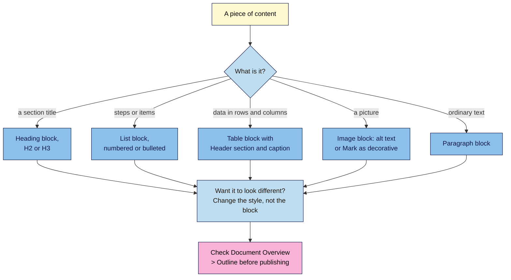

# M05.L03 — Clean Structure in the Block Editor
> After this lesson you can build a page in WordPress whose headings, lists, tables, images and links are real structure, not just formatting, and check it in the editor's own outline before you publish.

**Time:** ~15 min reading + ~35 min hands-on + ~10 min exercise · **Level:** L1 Foundation (beginner) · **Prereqs:** M02.L04, M04.L02 · **Remediate to:** M02.L04
**Verified against:** WordPress.org "Heading block" (updated 4 June 2026), "List block", "Table block", "Image block" and "Patterns (synced)"; the WordPress 7.1 editor scripts (`editor.js`, `block-library.js`, `patterns.js`); Google Search Central "SEO Starter Guide" (updated 2025-12-10), all on 2026-11-09. Editor screens weren't tested live, so labels may differ slightly on yours.

> ⚠️ **Freshness flag:** WordPress 7.0 added a new Heading block with H1–H6 variations, and 7.1 added **Mark as decorative** to the Image block. WordPress 7.2 is due on 8 December 2026, so check labels if you're reading this later.

## Learning objectives
1. **Build** a heading outline with the Heading block, and check it in **Document Overview > Outline** until no heading shows as incorrect. *(O1)*
2. **Use** lists, tables (with a header section and caption) and patterns for the jobs they're made for. *(O2)*
3. **Apply** Module 4 inside blocks: alt text or **Mark as decorative**, image resolution, and internal links with descriptive anchors. *(O3)*

## Why it matters
Amara pasted a client's draft from a word processor into WordPress. It looked fine. But the "headings" were bold paragraphs, the steps were lines starting with a dash, and a price comparison was lined up with spaces. When she checked the page source, there wasn't one `<h2>`, `<ul>` or `<table>` in it. To a screen reader, and to Google, it was one long wall of text with some bold words.

In Module 2 you wrote this structure by hand in HTML. In Module 4 you learned what each part does for search. The block editor writes the HTML for you, but only if you use the right block. This lesson is about choosing it.

## Core concept
**Plain version:** every block becomes an HTML element. A **Heading** block becomes `<h2>`, a **List** block becomes `<ul>` or `<ol>`, a **Table** block becomes `<table>`. Bold text in a Paragraph block is still just a paragraph. Use the block that matches what the content *is*, then style it if you want it to look different.

**Analogy:** blocks are labelled storage boxes. You can paint a box any colour you like, but if you put the cutlery in the box labelled "Books", nobody will find it.

**Precise definitions:**
- **Heading block:** creates a heading from H1 to H6. "In most cases, the page title is used as the `<h1>` tag, with subsequent Heading blocks added as H2, H3, and so on."
- **Document Overview > Outline:** the editor's panel that lists your page's headings in order and flags problems.
- **List block:** a bulleted ("Unordered list") or numbered ("Ordered list") list.
- **Table block:** a data table. Its **Header section** setting adds a row of column headings.
- **Pattern:** a saved group of blocks you can reuse. A **synced** pattern stays the same everywhere: "Editing the synced pattern will update it anywhere it is used."
- **Fake heading:** a bold or large paragraph made to look like a heading *(course term)*.

### What the sources say
| Claim | Verdict | What the source says |
|---|---|---|
| Headings help readers and search engines | **Documented** | Headings "make your website more readable by humans and search engines" (WordPress) |
| Use headings in order | **Documented, for accessibility** | "Use headings in order to make your page accessible." (WordPress) |
| Heading order affects Google rankings | **False** | "from Google Search perspective, it doesn't matter if you're using them out of order", though semantic order "is fantastic for screen readers" |
| A page needs a set number of headings | **False** | "There's also no magical, ideal amount of headings a given page should have." |
| Headings help people navigate | **Documented** | "provide headings to help users navigate your pages" (Google) |
| The title is usually the H1 | **Documented, theme-dependent** | It "may vary depending on the theme or page template you're using" |
| Tables can lay out a page | **Not recommended** | "tables are best used for tabulated data rather than page design. For example, if you want columns, you can use the Columns block." |

The course keeps one H1 and headings in order (non-negotiable #3) for readers and screen readers, not because Google ranks it.

### What the Outline warns about
The 7.1 editor shows these messages in **Document Overview > Outline**:

| Message | When it appears | Fix |
|---|---|---|
| **(Incorrect heading level)** | A heading jumps more than one level deeper than the one before it, such as H2 straight to H4 | Change it to the next level down (H3) |
| **(Multiple H1 headings are not recommended)** | More than one H1 in the content | Change the extras to H2 |
| **(Your theme may already use a H1 for the post title)** | An H1 inside the content, when the title is already the H1 | Change it to H2 |
| **(Empty heading)** | A Heading block with no text | Delete it, or add text |

Going back up is fine: an H3 followed by an H2 isn't flagged.

## How it works


**In words:** for each piece of content, ask what it is. A section title is a Heading block, steps or items are a List block, data is a Table block with a header section and caption, a picture is an Image block with alt text, and ordinary text is a Paragraph block. If you want it to look different, change its style, such as the font size, rather than switching to another block or heading level. Before publishing, check the Outline.

### Quick ways in
| You type at the start of an empty block | You get |
|---|---|
| `## ` (two hashes and a space) | An H2 Heading block. "Type ## followed by a space to add an H2 heading." |
| `### ` | An H3 Heading block |
| `- ` | A bulleted List block |
| `1. ` | A numbered List block |
| `/table` | The Table block |

To change a heading's level, select it and use the H1–H6 buttons in its toolbar.

### Images and links inside blocks
- **Alt text:** in the Image block settings, fill in **Alternative text**, or switch on **Mark as decorative** for images that add nothing (Lesson 4.4). Text typed here applies only to this page; the Media Library sets the default for new uses.
- **Resolution:** the Image block's **Resolution** setting chooses which size WordPress shows, such as Large or Full Size. Pick the smallest one that looks sharp in its space.
- **Links:** select the words, click **Link** in the toolbar, and search for the page. Link descriptive words, not "click here" (Lesson 4.5).

### Patterns: reuse with care
A synced pattern, such as a "Shop the beans in this guide" box at the end of every brew guide, saves time and keeps wording consistent. Two things to watch *(observed practice)*:
- Every link inside it appears on every page that uses it. Make sure it's a link you want everywhere.
- Don't put a heading in a pattern unless its level fits every page you'll use it on.

> **Under the hood: why bold isn't a heading.** A bold paragraph is `<p><strong>Ingredients</strong></p>`. A heading is `<h2>Ingredients</h2>`. Screen-reader users often jump from heading to heading to skim a page, and they can't jump to a bold paragraph. Google says it uses headings to understand sections, but that their order doesn't matter for ranking. So fake headings are mainly an accessibility and readability problem, and that's reason enough to fix them.

## Hands-on walkthrough
You'll paste a messy draft into WordPress, fix its structure until the Outline is clean, and record what you changed.

**Before you start: which steps apply to you?**
- **Path A or B (WordPress):** do every part on your practice site. On path A, don't publish the test post on your live site.
- **Path C (client site):** do every part on your own practice site, then check one of the client's pages in Part D without changing it.
- **Shopify, Wix or Blogger:** do Parts A–C on a WordPress practice site, then check one of your own pages in Part D with View Source.

**Part A — Paste the messy draft (5 min)**
1. Add a tab called **Outline check**, with these columns: **Item**, **Before (block or HTML)**, **After**, **Outline message**, **Fixed?**.
2. Create a new post called **Cold Brew at Home: A Simple 12-Hour Guide**. Paste this text into the first block:

   ```text
   **What you need**
   - a 1-litre jar
   - 100 g coarse ground coffee
   - 800 ml cold water
   **Steps**
   1) Stir the coffee into the water.
   2) Cover and leave in the fridge for 12 hours.
   3) Strain through a paper filter.
   **Ratios at a glance**
   Strength    Coffee    Water
   Strong      100 g     800 ml
   Lighter     75 g      800 ml
   **Serving ideas**
   ```

3. Add a Heading block, set it to **H4**, and type "Tips from our roasters" "because it's smaller".
   **Expected:** it looks roughly right, but the "headings" are bold text, the lists may be plain lines, and the ratio table is lined up with spaces.

**Part B — Check the Outline (5 min)**
1. Open **Document Overview** (the list icon in the top toolbar), and choose the **Outline** tab.
   > 🖼️ **Image prompt:** The WordPress block editor (1280×800) with Document Overview open on the Outline tab, listing the title and an H4 heading marked "(Incorrect heading level)". Highlight the warning with a 3px #F9B2D7 outline; blur any personal details.
   > **Alt text:** The editor's Outline tab showing a heading flagged as an incorrect heading level, highlighted.
2. Note what it lists and any messages.
   **Expected:** only the title and the H4, with **(Incorrect heading level)** next to the H4. The bold "headings" don't appear at all, because they aren't headings.

**Part C — Fix the structure (15 min)**
1. **Headings:** turn each bold line into a Heading block. Type `## ` at the start of a new block, or select the block and transform it to a Heading. Make "What you need", "Steps", "Ratios at a glance" and "Serving ideas" H2s. Change the H4 to an H2, or to an H3 if it belongs under "Serving ideas".
2. **Lists:** make the ingredients a bulleted List block and the steps a numbered List block, using `- ` and `1. `.
3. **Table:** insert a Table block with 3 columns and 3 rows. Turn on **Header section** and put Strength, Coffee and Water in it. Use **Add or remove caption** to add "Cold brew ratios for 800 ml of water". Delete the lines with spaces.
4. **Image:** add an Image block under "What you need", with a photo of a jar. Fill in **Alternative text** ("A 1-litre glass jar of coffee steeping in cold water"), and choose a **Resolution** that fits.
5. **Link:** in "Steps", link the words "paper filter" to a related page on your site, if you have one.
6. **Style:** if you want "Tips from our roasters" to look smaller, keep it as a heading and change its font size in the block's **Typography** settings.
   **Expected:** the Outline lists the title and five headings, with no messages.

**Part D — Check the HTML (10 min)**
1. Preview the post, view the source (**Ctrl+U**), and search for `<h2`, `<ul`, `<ol`, `<table`, `<th` and `alt=`.
2. Record the counts before and after in your tab.
   **Expected:** 5 `<h2>` (or 4 plus an `<h3>`), 1 `<ul>`, 1 `<ol>`, 1 `<table>` with `<th>` cells, and an `alt=` with your description. Before, most of these counts were zero.

**Expected output:** an **Outline check** tab with before and after for each item, and a practice post whose Outline shows no messages.

## When to use / when not to
**Use a Heading block** for every section title. Change its look with typography settings, never by picking a different level.

**Use a List block** for steps, ingredients and any set of items.

**Use a Table block** for data that has rows and columns. Use the **Columns** block for side-by-side layout.

**Use a synced pattern** for blocks repeated across many pages, such as a call to action. Keep links in it few and useful.

**The trade-off:** pasting from a word processor is fast but often brings fake structure. Writing directly in the editor, or pasting as plain text and adding blocks, takes a few minutes more and gets it right.

## Use AI for this
**Example prompt:**
> "Here's a draft blog post: [paste]. Rewrite it in Markdown with one H2 per section, H3s only under H2s, bulleted lists for items, numbered lists for steps, and a table for any data in rows and columns. Don't change the wording, and don't add new content."

**What AI does well here:** spotting where headings, lists and tables belong. If you paste Markdown into WordPress, the editor turns `##` lines and lists into blocks.
**Where it gets it wrong:** it may add headings that aren't in your draft, rewrite text, or invent table data.
**How to check:** compare the result with your original line by line, then check the Outline in WordPress.

## Common mistakes
- **Bold paragraphs as headings.**
- **Picking a heading level by its size,** such as an H4 "because it's smaller".
- **An H1 inside the content** when the title is already the H1.
- **Lines starting with dashes** instead of a List block.
- **Data lined up with spaces or tabs** instead of a table.
- **A table used for layout,** such as two columns of text.
- **Tables without a header section.**
- **Links in a synced pattern** that don't make sense on every page.

## Troubleshooting
| Symptom | Likely cause | Fix |
|---|---|---|
| The Outline shows only the title | No Heading blocks yet | Turn fake headings into Heading blocks |
| "(Your theme may already use a H1 for the post title)" | An H1 Heading block in the content | Change it to H2 |
| Pasted text arrives as one big block | It was pasted as plain text in one go | Split it with Enter, then use `## ` and `- ` shortcuts |
| The table is too wide on a phone | Too many columns | Cut columns, or turn the table into a list. Turn on **Fixed width table cells** if your theme needs it |
| Changing a synced pattern changed other pages | That's how synced patterns work | Detach it on the page that needs to differ |
| The alt text you typed isn't on the page | You edited it in the Media Library, not the block | Edit **Alternative text** in the Image block on that page |

## Exercise
**Task:** complete your **Outline check** tab (Parts A–D). Then say what's wrong with each of these, and the block-editor fix. All details are illustrative.
1. A guide's sections are bold paragraphs in a large font.
2. The Outline shows H2, H2, H4, H2.
3. A Heading block set to H1 in the content says "How to make cold brew", the same as the title.
4. A price list is lined up with spaces.
5. Kavya uses a Table block to put her photo next to her biography.
6. A synced "Book a class" pattern on every page links to a class that ended last month.

**Expected outcome:** a complete tab, and these fixes:
- **1** Fake headings. Turn each into a Heading block (H2), then set the font size in **Typography** if needed.
- **2** The H4 skips a level and shows **(Incorrect heading level)**. Make it H3, or H2 if it starts a new section.
- **3** A second H1 that repeats the title. Change it to H2 with its own section name, or delete it.
- **4** Use a Table block with a **Header section** and a caption.
- **5** Tables are for data. Use the **Columns** block for layout.
- **6** Edit the synced pattern once: the fix updates every page that uses it.

**Stretch goal:** open one of your published posts, check its Outline, and fix any message it shows.

## Key takeaways
- Each block becomes an HTML element. Choose the block for what the content is, then style it.
- Check **Document Overview > Outline** before publishing. Fix **(Incorrect heading level)** and extra H1s.
- Google says heading order doesn't affect rankings, but it matters for screen readers, so keep it (non-negotiable #3).
- Use lists for items and steps, and tables only for data, with a header section and caption.
- In image blocks, add alt text or mark the image as decorative, and pick a sensible resolution.

## Teach it back
Explain to a friend in 3 sentences why a bold paragraph isn't a heading, and how WordPress's Outline helps you catch it.

## Glossary terms added
- Document Outline — added to `seo-101/glossary.md`
- Fake heading — added to `seo-101/glossary.md`
- Synced pattern — added to `seo-101/glossary.md`

## Further reading
*All checked 2026-11-09.*
- WordPress.org — Heading block: https://wordpress.org/documentation/article/heading-block/
- WordPress.org — List block: https://wordpress.org/documentation/article/list-block/
- WordPress.org — Table block: https://wordpress.org/documentation/article/table-block/
- WordPress.org — Image block: https://wordpress.org/documentation/article/image-block/
- WordPress.org — Patterns (synced): https://wordpress.org/documentation/article/reusable-blocks/
- Google Search Central — SEO Starter Guide (headings): https://developers.google.com/search/docs/fundamentals/seo-starter-guide
- WordPress 101, Module 2, Lessons 1 and 2 — block editor basics, patterns and synced patterns: `wordpress-101/lessons/m02-l01-posts-pages-blocks.md`, `wordpress-101/lessons/m02-l02-patterns-synced-patterns.md`
- WordPress 101, Module 5, Lesson 3 — writing for search intent, with the Outline check: `wordpress-101/lessons/m05-l03-write-for-search-intent.md`

> ⚠️ **May change:** editor labels and Outline messages in WordPress 7.2 (due 8 December 2026); the Image block's settings.

## Refresher card
*Used by remediation when a learner fails a quiz twice on a later lesson that points back here.*
**Block = HTML element.** Heading → `<h2>`, List → `<ul>`/`<ol>`, Table → `<table>`. Bold text is still a paragraph. The title is usually the H1, so use H2 and H3 in the content. Shortcuts: `## `, `### `, `- `, `1. `. **Document Overview > Outline** flags **(Incorrect heading level)** (a jump of more than one level, such as H2 to H4), **(Multiple H1 headings are not recommended)**, **(Your theme may already use a H1 for the post title)** and **(Empty heading)**. Google: order "doesn't matter" for Search, but it "is fantastic for screen readers". **Tables** are for data, with **Header section** and a caption; use **Columns** for layout. **Images:** **Alternative text** or **Mark as decorative**, plus **Resolution**. **Synced patterns** update everywhere.
