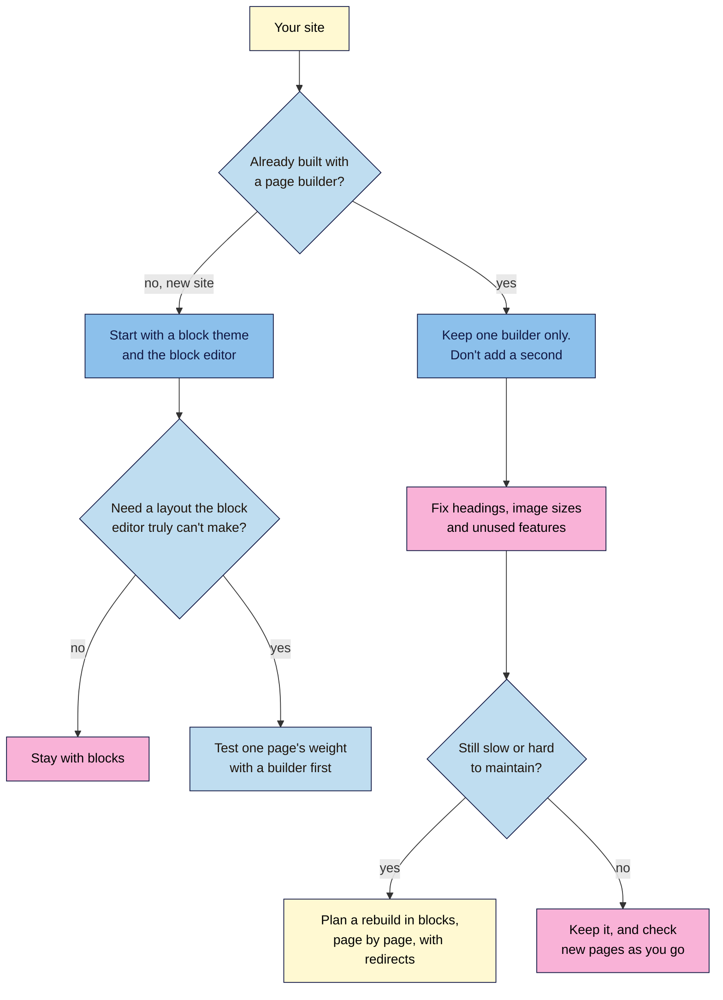

# M05.L04 — Page Builders vs the Block Editor: When Each Makes Sense
> After this lesson you can explain what a page builder costs a site, decide whether you need one, and fix a page where headings have been used for styling, using the page's own code to prove the difference.

**Time:** ~15 min reading + ~35 min hands-on + ~10 min exercise · **Level:** L1 Foundation (beginner) · **Prereqs:** M05.L03, M02.L09 · **Remediate to:** M05.L03
**Verified against:** HTTP Archive Web Almanac 2025 CMS chapter (published 2026-01-15) and 2024 CMS chapter; Google Search Central "Understanding page experience" (updated 2026-09-22) and "Understanding Core Web Vitals" (updated 2025-12-10); Search Engine Roundtable reports of Google comments (2 Apr 2018, 24 Feb 2021); WordPress 7.0 release post (20 May 2026), all on 2026-11-09. No page builder was installed or tested.

> ⚠️ **Freshness flag:** page-builder market shares change fast. Elementor's share of WordPress pages fell from about 56% to 43% in one year, according to the Almanac. Quote the year with any figure. Google has never named a page builder in its documentation.

## Learning objectives
1. **Explain** the speed and markup cost of page builders, using dated data and without claiming more than it shows. *(O1)*
2. **Decide** between the block editor and a builder with a decision guide. *(O2)*
3. **Replace** headings used for styling with typography settings or block CSS, and compare the outline and page weight in DevTools. *(O3)*

## Why it matters
Tomás's agency built his shop's home page with a page builder. It looks great. But when he views the source, the main heading is a styled `
`, the small print under each product is an `<h5>`, and the hero banner is a 5 MB photo. On his phone, the page takes ages to appear. The agency says "Google doesn't care about code". Tomás doesn't know whether to believe them.

They're half right. Google doesn't measure how much code a page has. But it does reward pages that load quickly and are easy to use, and it reads headings to understand sections. A page builder can make both harder. Knowing exactly where the cost lies lets you keep a builder's benefits without paying for its worst habits.

## Core concept
**Plain version:** a **page builder** is a plugin, such as Elementor, Divi or WPBakery, that lets you design pages by dragging boxes around. It's flexible, but it often adds extra code and files to every page. The **block editor** is built into WordPress and usually produces lighter pages. Neither is "bad for SEO" by itself. What matters is what the finished page looks like to a browser: its structure, its weight and how fast it appears.

**Analogy:** a page builder is like a furnished flat. You can move in quickly, and it looks good, but you pay for furniture you might not use, and moving out means leaving it all behind. The block editor is an empty flat with good basic furniture. It takes a bit more thought, but you only carry what you need.

**Precise definitions:**
- **Page builder:** a plugin that replaces or extends the WordPress editor with its own drag-and-drop design tools.
- **Block theme:** a theme designed for the block editor, where headers, footers and templates are made from blocks too (WordPress 101 Module 4, Lesson 1).
- **Markup:** the HTML a page is made of. **Heavy markup** means many nested elements, often `
`s, around little content.
- **Page weight:** the total size of everything a page downloads, shown in DevTools' **Network** panel.
- **Core Web Vitals:** Google's measures of loading speed, responsiveness and visual stability, covered in Module 12.

### What the sources say
| Claim | Verdict | What the source says |
|---|---|---|
| Most WordPress sites use a page builder | **Estimate** | "Estimates suggest that around 60% of WordPress sites use a page builder" (Almanac 2025; the chapter gives no source for this figure) |
| Elementor is the most used builder | **Measured, 2025** | "Elementor is the clear market leader, with a substantial 43% adoption on mobile and 42% on desktop, more than doubling the share of the WordPress Block Editor at 18%." |
| Page builders add weight | **Documented, in general** | They "often generate more complex DOM structures and larger CSS and JavaScript bundles, raising performance risks at scale" |
| Page builders make pages X% slower | **Not measured** | The Almanac gives no per-builder speed comparison. Don't quote a percentage |
| Some builders cost less | **Documented, in general** | Builders that "reduce markup overhead, avoid global asset loading, and integrate deeply with the Block Editor tend to limit performance costs more effectively" |
| Google penalises page builders | **No source** | No Google document names Elementor, Divi or page builders |
| Google measures code-to-text ratio | **False** | Asked "Is there any term like text to code ratio in SEO?", John Mueller said "no" (2018, reported) |
| Bloated sites rank because of their extras | **False** | "there is no SEO reason for making such terrible & bloated sites. If anything, they rank despite doing these things, not because of them." (Mueller, 2021, reported) |
| Page experience is a ranking factor | **Documented, as a tie-breaker** | "Google Search always seeks to show the most relevant content, even if the page experience is sub-par." But "for many queries, there is lots of helpful content available", and then "a great page experience can contribute to success" |

So the honest summary is: **content and relevance come first; speed and structure help you win when others are just as good.** A builder doesn't stop a page ranking, but it can make it slower and harder to read, for people and for Google.

## How it works

**In words:** on a new site, start with a block theme and the block editor. Only consider a builder if you need a layout the editor truly can't make, and test one page's weight first. On a site already built with a builder, keep using one builder and never add a second. Fix the structure, image sizes and unused features. If the site is still slow or hard to maintain, plan a careful rebuild in blocks, page by page. Otherwise keep it, and check each new page as you go.

### Where the cost comes from
| Cost | What happens | How to see it |
|---|---|---|
| **Extra wrappers** | Each heading or button sits inside several `
`s | View Source: count `<div` before your first `<h1>` |
| **Global files** | The builder's CSS and JavaScript load on every page, even pages that don't use its features | DevTools **Network**: filter by **CSS** and **JS** |
| **Styling as structure** | Headings picked for their size, or styled boxes used as headings | **Document Overview > Outline**, or search the source for `<h1` to `<h6` |
| **Oversized media** | Background images and sliders at full camera size | DevTools: compare rendered and intrinsic size (Lesson 4.4) |
| **Lock-in** | Pages are saved in the builder's own format, so switching off the plugin can leave broken layouts or shortcodes *(observed practice)* | Preview a copy of a page with the builder deactivated, on a practice site only |

### Style without breaking structure
The heading level says where a section sits in the outline. Its size and colour are just styling. In the block editor:
- Keep the right level (H2 or H3), and change **Font size** in the block's **Typography** settings.
- WordPress 7.0 added more styling options: "Style every detail of content with custom CSS at the block level, right in your post or page."
- For text that should look big but isn't a section title, such as a slogan, use a Paragraph block with a large font size, not a heading.

> **Under the hood: why Google doesn't count your code, but still feels it.** Google doesn't score pages by how much HTML they contain: Mueller called that "a design thing, not a content thing". But a browser must download, read and lay out every element and file before the page appears. More `
`s, more CSS and more JavaScript mean more work, especially on cheap phones. That shows up in Core Web Vitals, which Google does use as part of page experience. So the cost isn't the code itself. It's the slower page the code produces.

## Hands-on walkthrough
You'll build two versions of the same page, one "builder-style" and one clean, and compare their structure and weight.

**Before you start: which steps apply to you?**
- **All paths:** build both pages in Playground or your Local practice site, so nothing public changes.
- **Path A or C with a page builder:** in Part D, also check one real page built with it, without editing it.
- **Optional extension:** if you want to see a real builder, install a free page builder plugin from the WordPress plugin directory in **Playground only**, and repeat Part A with it. It isn't needed for this lesson.

**Part A — Build the "builder-style" page (10 min)**
1. Add a tab called **Builder check**, with these columns: **Check**, **Heavy page**, **Clean page**, **Notes**.
2. Create a page called **Cold Brew Starter Kit (heavy)**. Add:
   - a Paragraph block with the text "Cold Brew Starter Kit" at the largest font size (a fake heading),
   - a Heading block set to **H1** with the text "Everything you need for summer" (a second H1),
   - an Image block with a full-size phone photo, about 4,000 pixels wide, with **Resolution** set to **Full Size**,
   - three paragraphs of product text, each followed by a Heading block set to **H5** with the text "Free delivery over ₹999" (headings used as small print),
   - two YouTube embeds.
3. Publish it.
   **Expected:** it looks like a busy landing page.

**Part B — Build the clean page (8 min)**
1. Duplicate the page, or create **Cold Brew Starter Kit (clean)** with the same content.
2. Fix it, using Lesson 5.3:
   - Delete the fake heading. The page title is the H1.
   - Change the second H1 to an **H2**.
   - Turn each "Free delivery over ₹999" H5 into a Paragraph block with a small font size, or keep it once at the end.
   - Set the image's **Resolution** to **Large**, and add **Alternative text**.
   - Keep one embed. Replace the other with a link to the video.
3. Publish it.
   **Expected:** it looks almost the same, but simpler.

**Part C — Compare them (12 min)**
1. For each page, check **Document Overview > Outline** in the editor, and note any messages.
2. Open each published page, view the source, and count `<h1`, `<h2`, `<h5` and `<div`. Use **Ctrl+F**; the browser shows the number of matches.
3. Open DevTools, choose **Network**, tick **Disable cache**, and reload. Note the total transferred at the bottom of the panel, and the size of the largest image.
   > 🖼️ **Image prompt:** Chrome DevTools Network panel (1280×700) after reloading a WordPress page, showing the list of requests and the summary bar with the total transferred size. Highlight the summary bar with a 3px #F9B2D7 outline; blur any personal details.
   > **Alt text:** DevTools Network panel with the total transferred size in the summary bar highlighted.
   **Expected:** the heavy page shows Outline messages, two `<h1>` tags and three `<h5>` tags, and transfers several times more data, mostly from the full-size image and the embeds. The clean page has one `<h1>`, no Outline messages and a much smaller total.

**Part D — Check a real page (5 min)**
1. If you use a page builder on a real site, open one of its pages and repeat step 2 and step 3 of Part C. Don't edit anything.
2. Note the number of CSS and JavaScript files (filter **Network** by **CSS**, then **JS**).
   **Expected:** builder pages often load several CSS and JavaScript files from the builder's plugin folder, even on simple pages. On a block theme page, the count is usually lower.

**Expected output:** a **Builder check** tab comparing the heavy and clean pages (Outline messages, heading counts, `
` count, total transferred, largest image), plus notes on one real page if you have one.

## When to use / when not to
**Use the block editor** for most posts and pages, especially on a new site.

**A page builder can make sense** when a site already depends on it, when a non-technical owner must edit complex layouts, or when you need a design the editor can't make. Test one page's weight before committing.

**Never run two builders** on one site, and switch off features you don't use, such as sliders and animations.

**Don't rebuild a working site in a hurry** just because it uses a builder. Fix headings and images first. Rebuild only if it's still slow or hard to maintain, and plan redirects for any URL that changes (Module 6).

**The trade-off:** a builder saves design time and gives owners freedom, at the cost of page weight and some lock-in. The block editor is lighter and future-proof, but some layouts take more effort.

## Use AI for this
**Example prompt:**
> "Here are the heading tags from my page's source, in order: [paste the list of h1–h6 and their text]. Which ones are used for styling rather than structure? Suggest the right level for each, and which should be paragraphs with a larger or smaller font size instead. Don't rewrite the text."

**What AI does well here:** spotting headings that are really slogans, prices or small print, and suggesting a clean outline.
**Where it gets it wrong:** it may claim page builders get a Google penalty, quote made-up speed percentages, or recommend switching builders as the fix.
**How to check:** check the outline in the editor, and measure page weight in DevTools yourself.

## Common mistakes
- **Choosing heading levels by size** in the builder's style menu.
- **Styled boxes as headings,** so the page has no real `<h1>` or `<h2>`.
- **Full-size background images** and sliders on every page.
- **Installing a second builder** to get one extra feature.
- **Believing "Google doesn't care about code"** and ignoring slow pages.
- **Believing "builders get penalised"** and rebuilding a working site in a panic.
- **Deactivating a builder on a live site** to "test", and breaking every page built with it.

## Troubleshooting
| Symptom | Likely cause | Fix |
|---|---|---|
| The Outline shows no headings on a builder page | The builder's layout isn't made of blocks, so the editor can't read it | Check the headings in View Source instead |
| A builder's heading widget won't let you change the level | The level setting is in the widget's options, not its style | Look for an "HTML tag" or similar option in the widget settings |
| Network shows many CSS and JS files from the builder | The builder loads its files on every page | Check the builder's own performance settings for loading files only where they're used |
| The page jumps as it loads | Images or embeds without set sizes | Keep `width` and `height` on images (Lesson 4.4), and give embeds a fixed shape |
| Shortcodes like `[et_pb_section]` appear on the page | The builder was deactivated | Reactivate it at once. Never deactivate a builder on a live site without a migration plan |

## Exercise
**Task:** complete your **Builder check** tab (Parts A–D). Then answer these. All details are illustrative.
1. Kavya is starting a new site for her yoga classes. A friend says she needs Elementor "for SEO". What do you advise?
2. Tomás's agency site uses one builder. Its home page has three H1s, all slogans. What should he ask the agency to change?
3. An SEO blog says "page builders make pages 70% slower". Can you use this figure?
4. Amara's client wants to add a second builder for one animated banner. What do you say?
5. A product page loads the builder's slider files, but has no slider. What should the owner check?
6. Someone says, "Google measures your code-to-text ratio, so builders are penalised." Is that true?

**Expected outcome:** a complete tab, and these answers:
- **1** Start with a block theme and the block editor. No Google document says a builder helps SEO.
- **2** Keep one H1 that names the page, and turn the slogans into styled paragraphs or H2s where they start real sections.
- **3** No. The Almanac gives no per-builder speed comparison. Measure your own pages instead.
- **4** Don't. Two builders mean more files on every page, and more to maintain. Use the existing builder, or a simple image.
- **5** The builder's settings for loading its files only on pages that use them.
- **6** No. Mueller said there's no "text to code ratio" in Google's systems. The real risk is slower pages and messy structure.

**Stretch goal:** if you have a builder page, use the builder's own heading settings to fix one heading level, then check it in View Source.

## Key takeaways
- A page builder isn't an SEO penalty. Google has never named one, and it doesn't measure code-to-text ratio.
- Builders often add wrappers and site-wide files, which can slow pages down. Google rewards good page experience when content is equally relevant.
- Start new sites with a block theme. Keep one builder at most on existing sites.
- Choose heading levels for structure and change their look with typography settings, never the other way round.
- Prove the difference with the Outline, View Source and DevTools, not with someone else's percentage.

## Teach it back
Explain to a friend in 3 sentences whether page builders are "bad for SEO", and what you would check on a page built with one.

## Glossary terms added
- Page builder — added to `seo-101/glossary.md`
- Block theme — added to `seo-101/glossary.md`
- Page weight — added to `seo-101/glossary.md`
- *Already in the glossary:* Core Web Vitals

## Further reading
*All checked 2026-11-09.*
- HTTP Archive — Web Almanac 2025, CMS chapter: https://almanac.httparchive.org/en/2025/cms
- HTTP Archive — Web Almanac 2024, CMS chapter: https://almanac.httparchive.org/en/2024/cms
- Google Search Central — Understanding page experience in Google Search results: https://developers.google.com/search/docs/appearance/page-experience
- Google Search Central — Understanding Core Web Vitals and Google search results: https://developers.google.com/search/docs/appearance/core-web-vitals
- Search Engine Roundtable — Google Has No Code To Text Ratio Ranking Algorithm (2 Apr 2018): https://www.seroundtable.com/google-code-to-text-ratio-algorithm-25503.html
- Search Engine Roundtable — Google on bloated sites (24 Feb 2021): https://www.seroundtable.com/google-seo-bloated-sites-30980.html
- WordPress.org News — WordPress 7.0 "Armstrong" (20 May 2026): https://wordpress.org/news/2026/05/armstrong/
- WordPress 101, Module 4, Lesson 1 and Module 7, Lesson 4 — choosing a theme, performance and Core Web Vitals: `wordpress-101/lessons/m04-l01-choose-a-theme.md`, `wordpress-101/lessons/m07-l04-performance-core-web-vitals.md`

> ⚠️ **May change:** builder market shares (re-check each year's Almanac); page builders' own performance settings; WordPress's block styling options in 7.2.

## Refresher card
*Used by remediation when a learner fails a quiz twice on a later lesson that points back here.*
**Page builder** = a drag-and-drop design plugin (Elementor led with 43% on mobile in the 2025 Almanac). Builders "often generate more complex DOM structures and larger CSS and JavaScript bundles", but no per-builder speed figure exists. **Google** names no builder, has no "text to code ratio" (Mueller, 2018), and "always seeks to show the most relevant content, even if the page experience is sub-par"; good page experience helps when content is equally good. **Decide:** new site → block theme; existing builder → one builder only, fix headings and images, rebuild only with a plan. **Headings:** level for structure, **Typography** for size. **Measure:** Outline, View Source heading and `
` counts, DevTools **Network** total.
