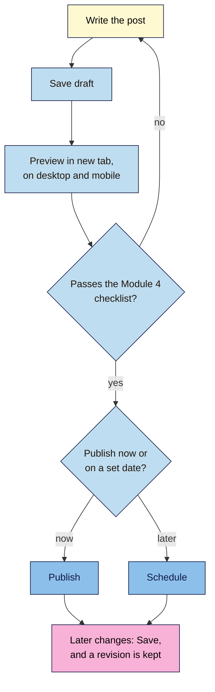
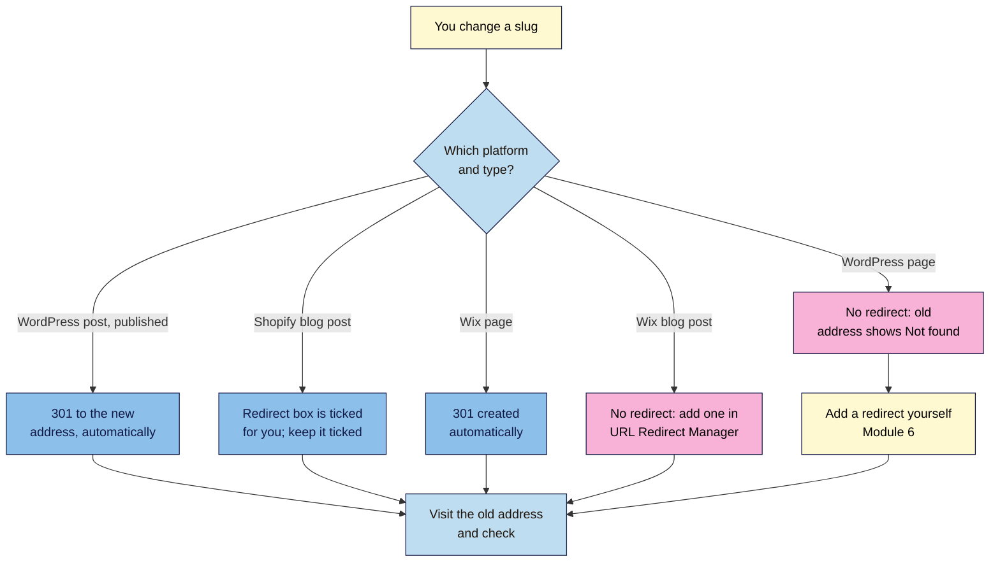

# M05.L05 — Publish, Update and Change URLs Safely (with Shopify and Wix Notes)
> After this lesson you can publish and schedule posts with a check before each one goes live, update old content honestly, and predict what happens to an old web address when you change it, on WordPress, Shopify and Wix.

**Time:** ~15 min reading + ~35 min hands-on + ~10 min exercise · **Level:** L1 Foundation (beginner) · **Prereqs:** M05.L04, M04.L02 · **Remediate to:** M04.L02
**Verified against:** WordPress 7.1 source (`editor.js`, `wp-includes/post.php`, `wp-includes/query.php`, the core posts sitemap); WordPress 7.0 release post; Google Search Central "Influence your byline dates", "Creating helpful content" (updated 2026-10-05), "Build and submit a sitemap" and "Redirects and Google Search"; Shopify Help Center "Working with blog posts" and "URL redirects" (read through a fetch tool, no date shown); Wix Help Center "Wix Blog: SEO for blog posts" and "Setting up 301 redirects", all on 2026-11-09. Editor, Shopify and Wix screens weren't tested live, so labels may differ slightly on yours.

> ⚠️ **Freshness flag:** in WordPress 7.1, the main button on a published post says **Save**. Older versions and many tutorials say "Update". Wix now calls its SEO area **SEO & GEO**; older guides say "Marketing & SEO". WordPress 7.2 is due on 8 December 2026.

## Learning objectives
1. **Run** the publishing workflow (save draft, preview, publish or schedule, save), using revisions to undo mistakes. *(O1)*
2. **Show** honest published and updated dates, without changing dates to look fresh. *(O2)*
3. **Predict** and test what happens to an old URL after a slug change on WordPress (posts and pages), Shopify and Wix. *(O3)*

## Why it matters
Kavya renamed her "Classes" page to "Yoga Classes in Chennai" and changed its slug from `/classes/` to `/yoga-classes-chennai/`. It looked great. A week later, students said the link on her Instagram profile showed "Page not found". So did the link in her Google Business Profile, and the old page in Google's results. WordPress hadn't redirected it, because it was a page, not a post.

The same week, a friend told her to "refresh" all her old posts by changing their dates to today, so Google would think they were new. Google's own self-check asks whether you're doing exactly that.

Publishing isn't just pressing a button. It's checking the page before people see it, keeping your dates honest, and making sure no change to an address leaves visitors stranded.

## Core concept
**Plain version:** save a **draft**, **preview** it, then **publish** or **schedule** it. When you change a published post, press **Save**, and WordPress keeps a **revision** you can go back to. Only change a post's date if you've really updated it. And before you change any web address, know whether your platform will **redirect** the old one, then test it.

**Analogy:** publishing is like printing a menu. You check a proof first (preview), you print it on the day the dishes are ready (schedule), and you keep the old version in a drawer (revisions). If you move the restaurant, you leave a sign at the old door (redirect).

**Precise definitions:**
- **Draft:** a saved post that isn't public yet.
- **Preview:** a view of the post as visitors will see it, before or after publishing. In 7.1, **Preview in new tab** opens it fully.
- **Schedule:** set a future date and time, and WordPress publishes it then.
- **Revision:** a saved earlier version of a post. You can compare and restore it.
- **Published date and updated date:** when a page first went live, and when it was last significantly changed.
- **Redirect (301):** an instruction that sends visitors and search engines from an old address to a new one (Lesson 4.2). Module 6 covers redirects in depth.

### What the sources say
| Claim | Verdict | What the source says |
|---|---|---|
| Google works out when a page was updated | **Documented** | "our systems look at several factors to determine our best estimate of when a page was published or significantly updated" |
| Label your dates clearly | **Documented** | "Label your dates appropriately with text like "Publish" or "Last updated"." |
| Changing dates makes pages look fresh to Google | **Discouraged** | Google's self-check asks: "Are you changing the date of pages to make them seem fresh when the content has not substantially changed?" |
| Sitemap dates should mean real changes | **Documented** | `lastmod` "should reflect the date and time of the last significant update", and Google uses it only "if it's consistently and verifiably … accurate" |
| WordPress redirects every changed slug | **False** | Core only stores old slugs for "published, non-hierarchical objects", meaning posts, not pages (7.1 source) |
| Shopify redirects a changed blog handle | **Documented, by default** | "you have a pre-selected option to Create a URL redirect, and the old web address redirects to the new web address" |
| Wix redirects every changed slug | **False** | Wix redirects pages, but "For Wix Blog pages, 301 redirects will not automatically be created." |
| Use 301s for permanent moves | **Documented** | "Use permanent redirects when you're sure that the redirect won't be reverted." |

## How it works

**In words:** write the post and save a draft. Preview it in a new tab, on desktop and on a phone. Check it against the Module 4 checklist: title, description, H1, opening, headings, images and links. If it fails, fix it and preview again. Then publish now, or schedule it for a set date. After that, each time you change it, press **Save**, and WordPress keeps a revision.

### The labels in WordPress 7.1
| You want to | Button or label | Notes |
|---|---|---|
| Save without publishing | **Save draft** | Or **Save as pending** to send it for review |
| See it as visitors will | **Preview in new tab** | Also desktop, tablet and mobile previews |
| Publish now | **Publish**, then confirm "Are you ready to publish?" | |
| Publish later | Change **Publish:** from **Immediately** to a date, then **Schedule** | "Are you ready to schedule?" |
| Change a published post | **Save** | Many older guides say "Update" |
| Undo changes | **Revisions** | WordPress 7.0 lets you "Visually scrub through revision versions to see what changed at a glance" |
| Take it offline | **Switch to draft** | The address stops working while it's a draft |

### Honest dates
- **Update the content, then the date.** If you add a new section, fix outdated facts or rewrite steps, show "Last updated" with the new date.
- **Don't change the date for a typo.** That's not a significant update.
- **Never re-save old posts just to look fresh.** WordPress's core sitemap takes each post's `lastmod` from its last modified time, so every save moves it *(inference from 7.1 source, not tested)*. Google uses `lastmod` only if it's "consistently and verifiably" accurate, so faking it helps nothing.
- **Show the date clearly.** Whether your theme shows a "Last updated" line depends on its templates. Some SEO plugins also add the date to structured data (WordPress 101 Module 5, Lesson 4).

### What happens when you change an address

**In words:** each platform behaves differently. WordPress redirects a changed slug on a published post, but not on a page. Shopify ticks a "Create a URL redirect" box for you when you change a blog post's handle, so keep it ticked. Wix creates a redirect for a page, but not for a blog post: add that yourself in the **URL Redirect Manager**. Whatever the platform, visit the old address afterwards to check, and for a WordPress page, add a redirect yourself (Module 6).

| Platform | Where to change it | Old address afterwards |
|---|---|---|
| **WordPress post** | Post settings, the URL or slug field | Redirects (301), if the post was published before the change |
| **WordPress page** | Page settings, the URL or slug field | "Not found", unless you add a redirect |
| **Shopify blog post** | **Search engine listing preview** → pencil icon → **URL handle** | Redirects, if **Create a URL redirect** stays ticked |
| **Wix page** | The page's SEO settings | "Wix automatically creates a 301 redirect" |
| **Wix blog post** | Blog → **Edit** → **SEO** tab → **Basics** | No redirect: create one in **SEO & GEO** → **Tools and settings** → **URL Redirect Manager**. "301 redirects only work with custom domains." |
| **Blogger post** | Post settings, permalink (custom) | Check it yourself. Blogger has **Custom redirects** under **Settings** (Lesson 4.2) |

> **Under the hood: why posts and pages differ.** When you change the slug of a published post, WordPress stores the old one in a hidden field called `_wp_old_slug`. The code's own comment says "We're only concerned with published, non-hierarchical objects." Later, when someone visits the old address and would get "Not found", WordPress looks up that field and sends a 301. Pages are "hierarchical" (they can have parent pages), and the redirect code says "Do not attempt redirect for hierarchical post types." So a page's old slug is never stored. A slug changed while a post is still a draft isn't stored either, because nothing was public yet.

## Hands-on walkthrough
You'll publish and schedule posts, use a revision, and test what happens to old addresses.

**Before you start: which steps apply to you?**
- **Path A or B (WordPress):** do every part on your practice site. Never test slug changes on live pages.
- **Path C (client site):** do every part on your own practice site, and change nothing on the client's site.
- **Shopify or Wix:** do Parts A and B on a WordPress practice site, then do Part D as a desk exercise using the table above, and check your own platform's settings without changing anything.

**Part A — Draft, preview, publish, schedule (10 min)**
1. Add a tab called **URL change test**, with these columns: **Test**, **Type**, **Old address**, **New address**, **Predicted**, **Result**, **Date**.
2. Create a post, **French Press Ratio for One Mug**. Click **Save draft**, then **Preview in new tab**. Check it on the mobile preview too.
3. Run your Module 4 checklist (title, description, H1, opening, images, links). Then click **Publish**.
4. Create a second post, set **Publish:** to tomorrow at 9:00, and click **Schedule**.
   **Expected:** the first post is live. The second shows as scheduled in **Posts**, with the date.

**Part B — Use a revision (5 min)**
1. Open the published post, delete a paragraph, and click **Save**.
2. Open **Revisions** in the post settings, compare the two versions, and restore the earlier one.
   > 🖼️ **Image prompt:** The WordPress revisions screen (1280×800) comparing two versions of a post, with a deleted paragraph shown in red, and the restore button visible. Highlight the restore button with a 3px #F9B2D7 outline; blur any personal details.
   > **Alt text:** WordPress revisions comparing two versions of a post, with the restore button highlighted.
   **Expected:** the paragraph is back, and a new revision records the restore.

**Part C — Test slug changes in WordPress (15 min)**
For each test, write your prediction first, then try it, and record the result.
1. **Published post:** change the published post's slug from `/french-press-ratio-for-one-mug/` to `/french-press-ratio/`, and click **Save**. Visit the old address.
2. **Page:** create and publish a page, `/classes/`. Change its slug to `/yoga-classes/`, and save. Visit the old address.
3. **Draft:** create a draft post with the slug `/draft-test/`, change it to `/draft-test-2/`, then publish. Visit `/draft-test/`.
4. For each test, open DevTools, choose **Network**, reload the old address, and click the first request. Note its **Status**.
   **Expected:** test 1 redirects to the new address with status **301**. Test 2 shows "Not found" (**404**). Test 3 shows **404**, because the old slug was never public.

**Part D — Predict for other platforms (5 min)**
1. Using the table above, predict what happens if Nila changes the address of a Shopify blog post, a Wix page and a Wix blog post. Add the predictions to your tab.
2. If you use Shopify, Wix or Blogger, find where your platform shows its redirect settings. Note the name of the screen, without changing anything.
   **Expected:** Shopify redirects if the box stays ticked, a Wix page redirects automatically, and a Wix blog post needs a manual redirect.

**Expected output:** a **URL change test** tab with predictions and results for three WordPress tests and three other-platform predictions, plus a published post, a scheduled post and a restored revision on your practice site.

## When to use / when not to
**Schedule** posts when you want them live at a set time, such as before a campaign or a seasonal search peak.

**Update dates** only when you've changed the content substantially, and say "Last updated".

**Change a slug** only before publishing, or when the old one is truly wrong or misleading. Then check the redirect, and update your internal links (Lesson 4.5).

**Don't change dates, slugs or permalinks** just to "refresh" SEO. They don't help, and they risk broken links.

**The trade-off:** a better slug can be clearer for readers, but every change risks broken links from other sites and social posts. On a published page, a good-enough slug is usually better than a perfect new one.

## Use AI for this
**Example prompt:**
> "Here's a blog post I published in 2024, and notes on what's changed since: [paste]. List what needs updating, rate each change as small (typo, wording) or significant (new facts, new steps, new section), and draft a one-line 'Last updated' note describing the significant changes. Don't change any facts I haven't given you."

**What AI does well here:** spotting outdated sections, and separating cosmetic edits from real updates.
**Where it gets it wrong:** it often suggests changing the date anyway "for freshness", invents new facts, or says platforms always redirect changed URLs.
**How to check:** compare every suggested fact with your sources, and test any changed URL yourself.

## Common mistakes
- **Publishing without previewing** on a phone.
- **Changing a page's slug** and assuming WordPress redirects it.
- **Changing a Wix blog post's slug** without adding a redirect.
- **Unticking Shopify's redirect box** by accident.
- **Re-saving old posts or changing their dates** to look fresh.
- **Using "Switch to draft"** to fix a typo, which makes the address stop working.
- **Forgetting internal links** after a slug change, so your own site sends visitors through a redirect.

## Troubleshooting
| Symptom | Likely cause | Fix |
|---|---|---|
| A scheduled post shows "Missed schedule" | WordPress's scheduler didn't run, often on low-traffic sites | Publish it by hand, and see WordPress 101 Module 2, Lesson 4 |
| The old post address shows "Not found" | The slug was changed while the post was a draft, or it's a page | Add a redirect (Module 6) |
| The old address redirects to the wrong post | WordPress guessed a similar slug | Add a redirect to the right address (Module 6) |
| You can't find **Revisions** | The post has only one saved version, or revisions are turned off | Save once more, then look again in the post settings |
| A Wix redirect doesn't work | The site has no custom domain | "301 redirects only work with custom domains." |
| A Shopify redirect doesn't work | The old address still loads a page | Shopify can redirect only from addresses that no longer load anything |

## Exercise
**Task:** complete your **URL change test** tab (Parts A–D). Then answer these. All details are illustrative.
1. Kavya changed her published "Classes" **page** slug. What happens to the old address, and what should she do?
2. Tomás changed a Shopify blog post's handle and left every box as it was. What happens?
3. Amara changed a Wix blog post's slug on a client's site. What should she check?
4. A friend tells Kavya to change all her posts' dates to today "for freshness". What do you say?
5. Nila fixes a typo in a 2025 guide. Should the "Last updated" date change?
6. A post with a typo in its slug is still a draft. Can Nila fix the slug safely?

**Expected outcome:** a complete tab, and these answers:
- **1** Pages don't get an automatic redirect, so the old address shows "Not found". She should add a 301 from `/classes/` to the new address (Module 6), update her internal links, and check her Instagram and Business Profile links.
- **2** The old address redirects, because **Create a URL redirect** is pre-selected.
- **3** Wix doesn't redirect blog posts automatically. She should add a 301 in the **URL Redirect Manager**, on a custom domain, then test the old address.
- **4** Don't. Google's self-check asks whether you're "changing the date of pages to make them seem fresh when the content has not substantially changed".
- **5** No. A typo isn't a significant update.
- **6** Yes. Nothing was public, so there's no old address to redirect.

**Stretch goal:** in your practice site, change a published post's slug twice, then visit the first address. Note whether it still redirects.

## Key takeaways
- Save draft → preview (on mobile too) → publish or schedule → **Save** for changes. Revisions let you undo.
- Show "Last updated" only after a significant change. Never change dates to look fresh.
- WordPress redirects changed slugs on published posts, but not pages.
- Shopify redirects a changed blog handle if the box stays ticked. Wix redirects pages, but not blog posts.
- After any address change, visit the old address and check the status in DevTools.

## Teach it back
Explain to a friend in 3 sentences why changing a page's slug in WordPress can break links, and why changing a post's date doesn't make it fresh for Google.

## Glossary terms added
- Revision — added to `seo-101/glossary.md`
- Scheduled post — added to `seo-101/glossary.md`
- Last updated date — added to `seo-101/glossary.md`
- *Already in the glossary:* Permanent redirect (301), Redirect, Slug

## Further reading
*All checked 2026-11-09.*
- Google Search Central — Influence your byline dates in Google Search: https://developers.google.com/search/docs/appearance/publication-dates
- Google Search Central — Creating helpful, reliable, people-first content: https://developers.google.com/search/docs/fundamentals/creating-helpful-content
- Google Search Central — Build and submit a sitemap (`lastmod`): https://developers.google.com/search/docs/crawling-indexing/sitemaps/build-sitemap
- Google Search Central — Redirects and Google Search: https://developers.google.com/search/docs/crawling-indexing/301-redirects
- Shopify Help Center — Working with blog posts: https://help.shopify.com/en/manual/online-store/blogs/writing-blogs/working-with-blog-posts
- Shopify Help Center — URL redirects: https://help.shopify.com/en/manual/online-store/menus-and-links/url-redirect
- Wix Help Center — Wix Blog: SEO for blog posts: https://support.wix.com/en/article/wix-blog-seo-for-blog-posts
- Wix Help Center — Setting up 301 redirects: https://support.wix.com/en/article/setting-up-301-redirects
- WordPress 101, Module 2, Lesson 4 and Module 5, Lesson 2 — editorial workflow, redirects and the SEO plugin: `wordpress-101/lessons/m02-l04-editorial-workflow.md`, `wordpress-101/lessons/m05-l02-seo-plugin-setup.md`

> ⚠️ **May change:** WordPress 7.2 editor labels (due 8 December 2026); Shopify and Wix menu names. Module 6 covers redirects, redirect chains and site moves in depth.

## Refresher card
*Used by remediation when a learner fails a quiz twice on a later lesson that points back here.*
**Workflow (7.1):** **Save draft** → **Preview in new tab** (check mobile) → Module 4 checklist → **Publish** or **Schedule** → later changes with **Save** (not "Update") → **Revisions** to undo. **Dates:** "Last updated" only after a significant change; Google asks if you're "changing the date of pages to make them seem fresh". **Slug changes:** WordPress redirects published **posts** (301) but not **pages** or slugs changed as drafts. Shopify: **Create a URL redirect** is pre-selected. Wix: pages redirect automatically; "For Wix Blog pages, 301 redirects will not automatically be created", so use the **URL Redirect Manager** (custom domains only). Always test the old address, and update internal links.
