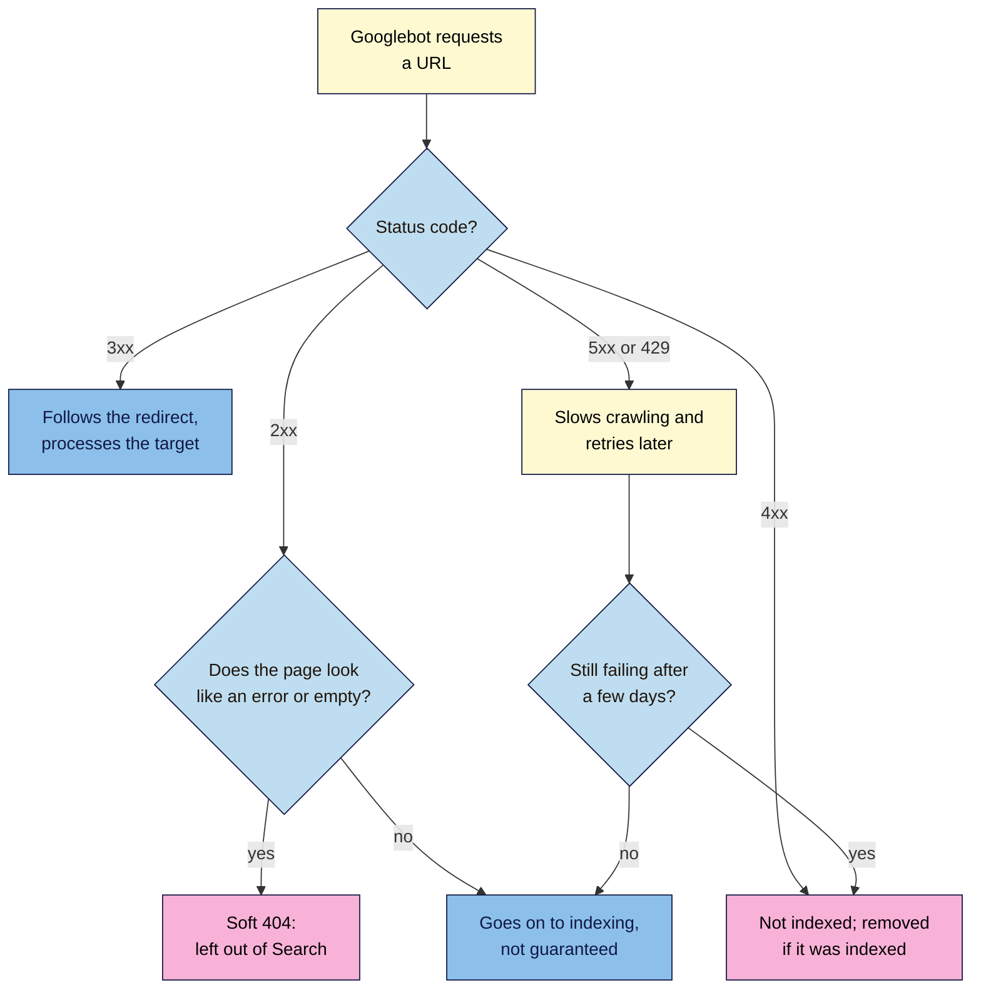
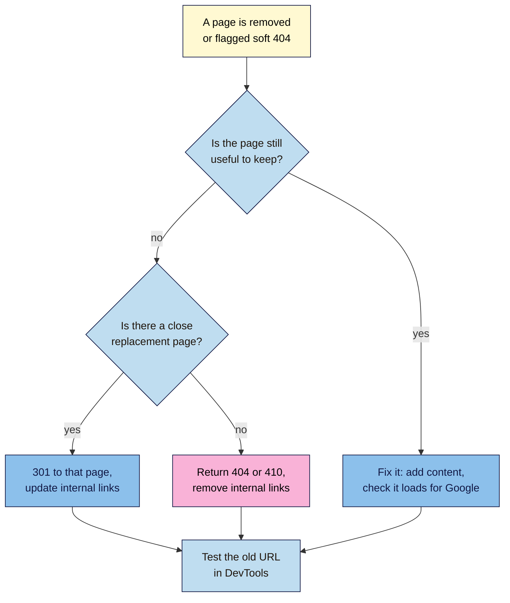

# M06.L01 — Status Codes, Soft 404s and the "Can It Be Indexed?" Check
> After this lesson you can read the status code of any page, explain what Google does with it, spot a soft 404, and run a six-point check that tells you whether a page can be indexed at all.

**Time:** ~15 min reading + ~30 min hands-on + ~10 min exercise · **Level:** L2 Practitioner · **Prereqs:** M01.L04, M05.L05 · **Remediate to:** M01.L04
**Verified against:** Google Crawling Infrastructure "How HTTP status codes affect Google's crawlers" (updated 2026-02-04) and "Crawl budget management" (updated 2026-07-22); Google Search Central "Troubleshoot Google Search crawling errors" (updated 2025-12-18); Search Console Help "Page indexing report" and "URL Inspection tool" (no date shown), all on 2026-11-09. Search Console screens weren't tested live, so labels may differ slightly on yours.

> ⚠️ **Freshness flag:** in 2026 Google moved its crawling documentation, including the status-codes page, from Search Central to a new "Crawling infrastructure" site at `developers.google.com/crawling/`. Old links redirect, but older guides may cite the old addresses. Some Search Console help pages still mention the robots.txt Tester and Lighthouse; the Tester was retired in late 2023.

## Learning objectives
1. **Explain** what 2xx, 3xx, 4xx and 5xx codes mean to Google, including 404 vs 410 and short vs long server errors. *(O1)*
2. **Identify** soft 404s, and choose a fix (a real 404 or 410, a relevant redirect, or real content). *(O2)*
3. **Apply** the "can it be indexed?" checklist (non-negotiable #7) to a page. *(O3)*

## Why it matters
Amara's client sells handmade bags. Last month they deleted 40 sold-out products, and their web designer redirected every old address to the home page "so nobody sees an error". The Page indexing report now lists those addresses under **Soft 404**. Meanwhile, the shop's "Sorry, nothing here yet" category page shows up in Google with the snippet "Sorry, nothing here yet".

Both problems come from the same thing: the server's answer said one thing, and the page said another. Before you polish titles or write new posts, you need to know what your server tells Google about every page. That's the status code. In Module 1 you learned to read it. Now you'll learn what Google does with each one, and what to do when it's wrong.

## Core concept
**Plain version:** every time a browser or Googlebot asks for a page, the server answers with a three-digit **status code** before it sends anything else. **200** means "here it is". **301** means "it moved, go here". **404** means "there's nothing here". **500** means "I'm broken right now". Google trusts that code first. If the code says 200 but the page says "not found", Google calls it a **soft 404** and leaves it out of Search.

**Analogy:** a status code is the label on a parcel. "Delivered", "Moved to a new address", "No such person here", "Depot closed today". The post office acts on the label, not on what's written inside the box. A box marked "Delivered" with a note inside saying "nobody lives here" just confuses everyone.

**Precise definitions:**
- **Status code:** the number in the first line of a server's response (Lesson 1.4).
- **2xx (success):** the server sent the page. **200 OK** is the normal one.
- **3xx (redirect):** the page is somewhere else. **301** and **308** are permanent, **302** and **307** are temporary.
- **4xx (client error):** the page doesn't exist, or you aren't allowed to see it. **404 Not Found**, **410 Gone**, **401** and **403** (access refused), and **429** (too many requests).
- **5xx (server error):** the server failed. **500**, **502**, **503**.
- **Soft 404:** a page that says "not found" (or is nearly empty) but returns **200** (Lesson 1.4).
- **Indexable page:** a page Google is *able* to index: it returns 200, isn't blocked, and doesn't tell Google to stay away. Being indexable doesn't guarantee being indexed.

### What Google says
| Claim | Verdict | What Google says |
|---|---|---|
| A 200 means the page will be indexed | **False** | "For Google Search, an HTTP 2xx (success) status code doesn't guarantee indexing." |
| A 200 page that looks like an error is a soft 404 | **Documented** | "If the content suggests an error for Google Search, an empty page or an error message, Search Console will show a soft 404 error." |
| 301 and 302 are the same to Google | **Partly true** | Google follows both, but a 301 is "a strong signal" and a 302 "a weak signal" that "the redirect target should be processed". Lesson 6.5 covers redirects in depth |
| 404 pages are removed from Google | **Documented** | "Google doesn't index URLs that return a 4xx status code, and URLs that are already indexed and return a 4xx status code are removed from the index." |
| A 410 removes a page faster than a 404 | **Not in Google's docs** | "All 4xx errors, except 429, are treated the same". Use 410 if you like, for accuracy |
| Lots of 404s hurt your rankings | **Myth** | "404 responses are not necessarily a problem, if the page has been removed without any replacement." Google recommends "fixing only 404 errors that you link to yourself or list in a sitemap" |
| A short outage drops your pages | **False** | For 5xx errors, "already indexed URLs are preserved in the index, but eventually dropped". Googlebot retries 503 and 429 "for about 2 days" |
| A long outage is safe | **False** | "returning "no availability" codes for more than a few days will cause Google to permanently slow or stop crawling URLs on your site" |
| You can use 403 to slow Googlebot down | **False** | "Don't use 401 and 403 status codes for limiting the crawl rate." |

**Course rule of thumb:** for server errors, hours are fine and days are risky.

## How it works

**In words:** Googlebot asks for a URL and reads the status code first. With a 2xx, it looks at the page: if it looks like an error or is empty, it's a soft 404 and stays out of Search; otherwise it goes on to indexing, which isn't guaranteed. With a 3xx, it follows the redirect and processes the target instead. With a 4xx, the page isn't indexed, and is removed if it was. With a 5xx or 429, Google slows down and tries again later. If the errors last more than a few days, the pages drop out.

### Soft 404s: causes and fixes
| What you see | Likely cause | Fix |
|---|---|---|
| A "Sorry, not found" page that returns 200 | The site's error page is set up wrongly | Make it return **404**. Google says custom 404 pages "are created solely for users", so the server must still send a 404 |
| Deleted products all redirect to the home page | Mass redirects "so nobody sees an error" | Redirect each one to a close replacement if there is one. If not, let it return **404** or **410** (non-negotiable #8) |
| An empty category, tag or search results page | No content yet | Add content, link it only when it has some, or remove it. Google lists "An empty internal search result page" as a cause |
| A real, good page flagged as soft 404 | It didn't load properly for Googlebot | Check it in URL Inspection's live test. Google says it's likely "it didn't load properly for Googlebot, it was missing critical resources, or it displayed a prominent error message during rendering" |
| A thin page with a few words and a big "Out of stock" | The page looks empty to Google | Add useful content (details, alternatives, a restock date), or remove it with a 404 or a redirect |

Choosing between the fixes follows Google's own rule: "If your page has moved or has a clear replacement on your site, return a 301 (permanent redirect)". If there's no replacement, "return a 404 (not found) or 410 (gone)".

**In words:** if the page is still worth keeping, fix it: add content and check it loads for Google. If not, look for a close replacement. If there is one, add a 301 to it and update your internal links. If there isn't, let the page return 404 or 410 and remove the links to it. Whatever you choose, test the old URL in DevTools afterwards. Never send everything to the home page.

### The "can it be indexed?" checklist (non-negotiable #7)
Before you spend time improving a page, check that Google *can* index it. You'll learn each check in depth over this module; for now, learn the list and where to look.

| # | Check | Pass looks like | Where to check | In depth |
|---|---|---|---|---|
| 1 | **Status** | 200, in one request (no redirect) | DevTools **Network**: the first row | This lesson |
| 2 | **Crawl allowed** | Not blocked by `robots.txt` | `yourdomain/robots.txt`; URL Inspection **Crawl allowed?** | Lesson 6.2 |
| 3 | **No stray `noindex`** | No `noindex` in the page's `<head>` or in an `X-Robots-Tag` header | View Source (search `noindex`); DevTools **Headers**; URL Inspection **Indexing allowed?** | Lesson 6.2 |
| 4 | **Correct canonical** | `rel="canonical"` points to the page itself, or to the version you want | View Source (search `canonical`); URL Inspection **User-declared canonical** | Lesson 6.3 |
| 5 | **In the sitemap** | The exact URL appears once | Your sitemap (`/wp-sitemap.xml` on WordPress) | Lesson 6.4 |
| 6 | **Linked internally** | At least one normal link from another page | Your **Internal links** tab (Lesson 4.5) | Lesson 6.5 |

> **Under the hood: why Google can't see your error message.** Google's systems act on the status code before they look at the page. A 404 page that says "Oops!" is fine, because the code already said "not found". A page that says "Oops!" with a **200** forces Google to guess, from the words and how empty the page is, that it's really an error. Guessing is slower and less reliable, and Google keeps re-crawling the address: "soft 404 pages will continue to be crawled, and waste your budget." A real 404, by contrast, "is a strong signal not to crawl that URL again". There's one more catch: if a page is blocked by `robots.txt`, URL Inspection's **Indexing allowed?** "will always be "Yes"", because Google can't read the page to see any `noindex` on it. That's why the checklist checks crawling before `noindex`.

## Hands-on walkthrough
You'll collect the status codes of six kinds of address on your site, then run the six-point check on one important page.

**Before you start: which steps apply to you?**
- **Path A (your own site):** do Parts A–C on your live site. Part B creates nothing public if you use a draft post. Do Part D in Search Console.
- **Path B:** do Parts A–C on your Blogger site *and* your WordPress practice site (Local or Playground can't be seen by Google, but DevTools still works). Do Part D on Blogger, or on hosting.
- **Path C (client site):** do Parts A and C on the client's site, read-only. Do Part B on your own practice site. Do Part D only if you have Search Console access.

**Part A — Status code safari (10 min)**
1. Add a tab called **Status check**, with these columns: **Address**, **Type**, **Expected**, **Actual status**, **Redirects to**, **OK?**, **Date**.
2. Open DevTools (**F12**), choose **Network**, and tick **Preserve log** and **Disable cache**.
3. Visit each address below, and record the **Status** of the first row (the document):
   - your home page,
   - an important page or post,
   - a made-up address, such as `/this-page-does-not-exist-123/`,
   - `/robots.txt`,
   - your old slug from Lesson 5.5's **URL change test** (practice site),
   - the `http://` (not `https://`) version of your home page.
   > 🖼️ **Image prompt:** Chrome DevTools Network panel (1280×720) after visiting a made-up address, with Preserve log ticked and the first document row showing status 404. Highlight the Status column with a 3px #F9B2D7 outline; blur any personal details.
   > **Alt text:** DevTools Network panel showing a 404 status for a made-up address, with the Status column highlighted.

   **Expected:** 200 for the home page, the important page and `/robots.txt`. **404** for the made-up address. One **301** (or 308) for the old slug and for `http://`, each followed by a 200 row. If the made-up address shows **200** or redirects to your home page, you've found a soft 404 problem.

**Part B — Make a removed page (8 min)**
On your WordPress practice site:
1. Publish a test post, **Status Code Test**. Copy its address, and check it returns **200**.
2. Move it to the **Trash**. Visit the address again, logged out (use a private window).
   **Expected:** **404**, with your theme's "not found" page. The page says "not found" *and* the code agrees, which is exactly right.
3. Search your site for a word that isn't on it, such as `/?s=zzzzqq`. Note the status, then view the source and search for `noindex`.
   **Expected:** **200**, and a `robots` meta tag containing `noindex`. WordPress adds `noindex` to search results, so Google is told not to index them (Lesson 5.2).

**Part C — Run the six-point check on one page (8 min)**
Choose your most important page (from your **Keyword map**). Add a second section to the tab, with one row per check from the table above, and record what you find:
1. **Status:** from Part A.
2. **Crawl allowed:** open `/robots.txt`. Note any `Disallow:` lines. (You'll learn to read them in Lesson 6.2. For now, note whether one starts with the start of your page's path.)
3. **No stray `noindex`:** View Source, search for `noindex`. Then in DevTools, click the first row, open **Headers**, and look for `x-robots-tag` in the **Response Headers**.
4. **Canonical:** View Source, search for `canonical`, and copy the `href`.
5. **In the sitemap:** open your sitemap, and search for the page's address.
6. **Linked internally:** check your **Internal links** tab.
   **Expected:** status 200, no matching `Disallow`, no `noindex`, a canonical that matches the address exactly (same `https`, `www` and trailing slash), listed in the sitemap, and at least one internal link.

**Part D — Confirm in Search Console (4 min, public sites only)**
1. In Search Console, paste the page's address into the search bar at the top to open **URL Inspection**.
2. Note **Crawl allowed?**, **Page fetch**, **Indexing allowed?**, **User-declared canonical** and **Google-selected canonical**.
3. Click **Test live URL** to check the current version.
   **Expected:** the answers match your own checks. Note that "URL is on Google" doesn't guarantee that the page "is appearing in Search results".
4. Open **Indexing → Pages**, and note whether **Soft 404** or **Not found (404)** appears under **Why pages aren't indexed**. If **Not found (404)** lists pages you no longer link to, that's fine.

**Expected output:** a **Status check** tab with six addresses and their status codes, a six-point check for one key page, and (on public sites) a note of what URL Inspection says.

## When to use / when not to
**Return 200** only for real pages with real content.

**Return 404 or 410** for pages that are gone with no replacement. Use 410 if your platform makes it easy and you're sure the page won't come back. Google treats both the same.

**Use a 301** only when there's a close replacement (Lesson 6.5).

**Return 503** for planned maintenance of a few hours, not 404 or 200. Never leave a site on 503 for days.

**Don't "fix" every 404** in the Page indexing report. Fix the ones you link to or list in your sitemap.

**The trade-off:** redirecting everything feels safer, because visitors never see an error. But sending people to an unrelated page is worse for them than an honest "not found" with links to your best pages, and Google treats it as a soft 404 anyway.

## Use AI for this
**Example prompt:**
> "Here is a list of 20 URLs from my site that now return 404, with their old page titles, and a list of my current pages: [paste both]. For each old URL, suggest the closest current page if one is a genuine replacement, or say 'no replacement: leave as 404'. Don't suggest the home page as a replacement."

**What AI does well here:** matching old titles to likely replacements quickly.
**Where it gets it wrong:** it tends to force a match for every URL, suggests the home page or a broad category, and may claim that 404s harm rankings.
**How to check:** open each suggested pair and ask, "would a visitor looking for the old page be happy here?" If not, leave it as a 404.

## Common mistakes
- **Redirecting all removed pages to the home page,** which creates soft 404s.
- **A custom "not found" page that returns 200.**
- **Leaving empty category, tag or search pages** linked from the menu.
- **Using 403 or 404 to slow Googlebot down,** or leaving a site on 503 for days.
- **Panicking about 404s** for pages that were removed on purpose.
- **Testing while logged in,** so drafts and private pages look like 200s.
- **Treating "indexable" as "indexed".** A page that passes all six checks still isn't guaranteed a place in the index.

## Troubleshooting
| Symptom | Likely cause | Fix |
|---|---|---|
| A made-up address returns 200 | The theme or a plugin shows a "not found" page with a 200 | Check the platform's 404 settings, or ask the host or developer to return a real 404 |
| A made-up address redirects to the home page | A "redirect all 404s" plugin or rule | Turn that option off, and redirect only addresses with a close replacement |
| DevTools shows several redirects before the 200 | A redirect chain, such as `http` → `https` → `www` | Note it for Lesson 6.5, where you'll make it one hop |
| Status shows **(failed)** or nothing | An ad blocker, extension or offline mode | Try a private window with extensions off |
| **Server error (5xx)** in the Page indexing report | The server failed when Google visited | Check the host's status and error logs. If it's fixed, use URL Inspection's live test, then **Validate fix** |
| A good page is flagged **Soft 404** | It didn't load properly for Googlebot | Use **Test live URL**, and check the screenshot shows the real content |

## Exercise
**Task:** complete your **Status check** tab (Parts A–D). Then answer these. All details are illustrative.
1. Nila deletes a discontinued filter-paper product. A very similar paper is still sold. What should the old address return?
2. Tomás removes a page about a one-off 2024 event. There's no replacement. What should it return?
3. Amara's client redirects 40 sold-out bags to the home page. What does Google likely do, and what should they do instead?
4. Kavya's "not found" page says "Oops! Page not found" and returns 200. Is that a problem?
5. A site is down for 3 hours for an upgrade. Which status code should it return, and will the pages drop out?
6. A page returns 200, isn't blocked and has no `noindex`, but its canonical points to another page. Which checklist item fails?

**Expected outcome:** a complete tab, and these answers:
- **1** A 301 to the similar paper's page, then update internal links.
- **2** A 404 (or 410). It's gone with no replacement, and that's fine.
- **3** Google likely treats them as soft 404s. Redirect each bag to a close replacement if one exists; otherwise let it return 404 or 410.
- **4** Yes. It's a soft 404. The page should return a 404 status.
- **5** 503. A few hours is fine: Googlebot retries for about 2 days, and indexed pages are kept for a while. Days of 503 would be risky.
- **6** Check 4, the canonical (Lesson 6.3).

**Stretch goal:** check the status of five old addresses from your site's past, such as old posts you deleted or renamed. Record whether each one is a real 404, a single 301 to a good replacement, or a soft 404.

## Key takeaways
- The status code comes first: Google acts on it before it reads the page.
- 200 doesn't guarantee indexing. A 200 page that looks like an error is a soft 404 and stays out of Search.
- 404 and 410 are treated the same. 404s for pages you removed on purpose are normal.
- Redirect only to a close replacement. Never send removed pages to the home page.
- Before optimising a page, check it's indexable: 200, crawl allowed, no stray `noindex`, correct canonical, in the sitemap, linked internally.

## Teach it back
Explain to a friend in 3 sentences what a soft 404 is, why redirecting deleted pages to the home page causes them, and what to do instead.

## Glossary terms added
- 410 (Gone) — added to `seo-101/glossary.md`
- Server error (5xx) — added to `seo-101/glossary.md`
- Indexable page — added to `seo-101/glossary.md`
- URL Inspection — added to `seo-101/glossary.md`
- *Already in the glossary:* Soft 404, Status code, Redirect

## Further reading
*All checked 2026-11-09.*
- Google Crawling Infrastructure — How HTTP status codes affect Google's crawlers (updated 2026-02-04): https://developers.google.com/crawling/docs/troubleshooting/http-status-codes
- Google Search Central — Troubleshoot Google Search crawling errors (soft 404s; updated 2025-12-18): https://developers.google.com/search/docs/crawling-indexing/troubleshoot-crawling-errors
- Google Crawling Infrastructure — Crawl budget management (updated 2026-07-22): https://developers.google.com/crawling/docs/crawl-budget
- Search Console Help — Page indexing report: https://support.google.com/webmasters/answer/7440203
- Search Console Help — URL Inspection tool: https://support.google.com/webmasters/answer/9012289
- SEO 101, Lesson 1.4 — How search engines work (status codes, first look): `seo-101/lessons/m01-l04-how-search-engines-work.md`

> ⚠️ **May change:** Search Console report names and URL Inspection labels; Google's documentation addresses (moved in 2026). Check the reason names in your own property.

## Refresher card
*Used by remediation when a learner fails a quiz twice on a later lesson that points back here.*
**Status codes:** 200 = sent (but "doesn't guarantee indexing"); 301/308 = moved for good ("strong signal"); 302/307 = moved for now ("weak signal"); 404/410 = gone, treated the same, removed from the index; 429/5xx = slow down and retry ("about 2 days" for 503/429; days of errors drop pages). **Soft 404** = a "not found" or empty page that returns 200, often caused by redirecting removed pages to the home page; fix with a real 404/410, a 301 to a close replacement, or real content. Fix only 404s you link to or list in a sitemap. **Indexable check (#7):** 200 in one hop · crawl allowed · no stray `noindex` (head or header) · correct canonical · in the sitemap · linked internally. Check in DevTools **Network**, View Source and URL Inspection.
