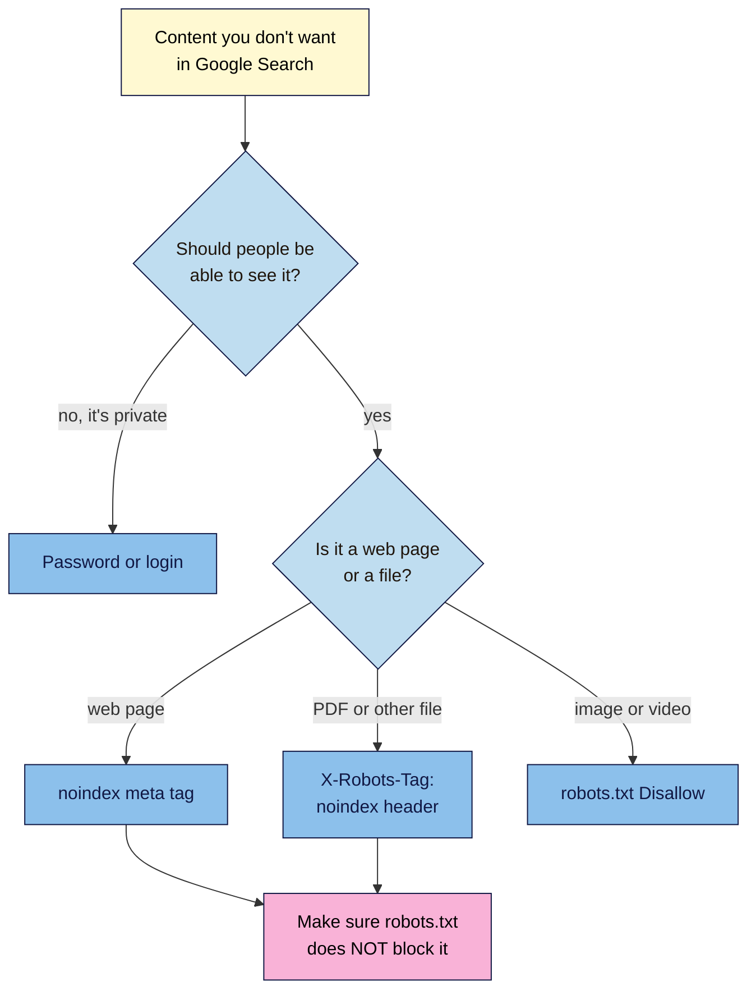

# M06.L02 — Controlling Crawling and Indexing: robots.txt vs `noindex` vs Passwords
> After this lesson you can read a robots.txt file the way Google does, choose the right tool to keep a page out of search, and spot the two classic mistakes: a page blocked *and* noindexed, and a live site left blocked after a redesign.

**Time:** ~15 min reading + ~35 min hands-on + ~10 min exercise · **Level:** L2 Practitioner · **Prereqs:** M06.L01, M02.L02 · **Remediate to:** M02.L02
**Verified against:** Google Search Central "Introduction to robots.txt" (updated 2025-12-10), "Block Search indexing with noindex" (2025-12-10), "Robots meta tag, data-nosnippet, and X-Robots-Tag specifications" (2026-03-24) and "Control what you share with Google" (2026-10-21); Google Crawling Infrastructure "How Google interprets the robots.txt specification" (2026-10-23); Search Console Help "robots.txt report" and "Page indexing report"; Bing Webmaster Blog (June 2025); WordPress 7.1 source (`do_robots()`, `robots-template.php`, the sitemaps class, the Reading settings screen), all on 2026-11-09. Search Console and Bing screens weren't tested live.

> ⚠️ **Freshness flag:** Google retired its robots.txt Tester in late 2023 (announced November 2023). Use the **robots.txt report** and URL Inspection instead, or Bing's robots.txt Tester. Google's robots.txt spec moved to `developers.google.com/crawling/` and was updated on 2026-10-23. Google's "Control what you share" page now also lists a **Search generative AI control** for AI Overviews and AI Mode; that's covered in Module 14.

## Learning objectives
1. **Read** a robots.txt file using Google's rules (most specific rule wins, least restrictive on ties, wildcards, the 500 KiB limit). *(O1)*
2. **Choose** between robots.txt, `noindex` (meta or `X-Robots-Tag`) and password protection for a given page, using Google's table. *(O2)*
3. **Diagnose** the "blocked and noindexed" trap and an accidentally blocked live site. *(O3)*

## Why it matters
Tomás wanted his shop's "thank you for your order" page out of Google, so his developer added it to robots.txt *and* put a `noindex` on it, "to be extra safe". Months later, the page still shows up for his shop's name, with no description, just "No information is available for this page." The double protection is the reason: robots.txt stopped Google from ever reading the `noindex`.

Kavya had the opposite problem. Her designer rebuilt her site on a staging copy with "Discourage search engines" ticked, then copied it live. Two weeks later, her indexed pages started to fall, and there was no error anywhere.

There are three different tools here, and they do three different jobs. **robots.txt** controls *crawling*. **`noindex`** controls *indexing*. A **password** controls *access*. Mixing them up is one of the most common ways sites hide good pages and leak private ones.

## Core concept
**Plain version:** robots.txt is a sign at your gate that says which paths crawlers may *visit*. It doesn't stop a page appearing in Google: if other sites link to it, Google can list the address without visiting. `noindex` is a note *on the page* that says "don't show this in search", and Google can only read it if it's allowed to visit. A password stops everyone, people and crawlers, from seeing the page at all.

**Analogy:** robots.txt is a "Staff only" sign on a door: polite visitors don't go in, but they can still tell others the room exists. `noindex` is a note inside the room saying "please don't mention this room in the guidebook": it only works if the guidebook writer is allowed in to read it. A password is a locked door.

**Precise definitions:**
- **robots.txt:** a plain-text file at the root of a host (`https://example.com/robots.txt`) with `user-agent`, `allow`, `disallow` and `sitemap` lines.
- **`noindex`:** a rule that tells search engines not to show a page in results. It goes in a **robots meta tag** in the page's `<head>`, or in an **`X-Robots-Tag`** HTTP header.
- **Robots meta tag:** `<meta name="robots" content="noindex">`.
- **`X-Robots-Tag`:** the same rules sent as an HTTP response header, which also works for PDFs, images and videos.
- **Password protection:** a login (or HTTP authentication) in front of the content.

### What Google says
| Claim | Verdict | What Google says |
|---|---|---|
| robots.txt keeps a page out of Google | **False** | It's "not a mechanism for keeping a web page out of Google. To keep a web page out of Google, block indexing with noindex or password-protect the page." |
| A blocked page can still appear | **Documented** | "its URL can still appear in search results, but the search result won't have a description." |
| Block it in robots.txt *and* noindex it, to be safe | **False** | "For the noindex rule to be effective, the page or resource must not be blocked by a robots.txt file". "Using a robots.txt rule is not recommended for blocking a page, and will actually prevent noindex from being seen by Google." |
| You can put `noindex` in robots.txt | **False** | "Specifying the noindex rule in the robots.txt file is not supported by Google." |
| `noindex` works for PDFs | **Documented** | With `X-Robots-Tag`: "A response header can be used for non-HTML resources, such as PDFs, video files, and image files." |
| A `noindex` page drops out at once | **False** | Google must crawl it again first: "it may take months for Googlebot to revisit a page." |
| robots.txt is right for images and video | **Documented** | Google lists robots.txt as the method for "images and video" |
| Private content needs a password | **Documented** | "you need to password protect it to ensure only authorized users can access it." |
| Google obeys `crawl-delay` | **False** | "other fields such as crawl-delay aren't supported" |
| No robots.txt is a problem | **False** | "Not having a robots.txt file is fine, and means that Google can crawl all URLs on your site" |

### Which tool when
| You want to… | Use | Why |
|---|---|---|
| Keep private content private (client area, invoices, staging site) | **Password** (login or HTTP authentication) | The only option that stops people as well as crawlers |
| Keep a page out of search, but let people visit it (thank-you page, thin tag page) | **`noindex`** meta tag | Google must be able to crawl it to see the rule |
| Keep a PDF or image file out of search | **`X-Robots-Tag: noindex`** header | Files have no `<head>` for a meta tag |
| Keep images or videos out of Google Images | **robots.txt** `Disallow` | Google's documented method for media |
| Stop crawlers wasting time on endless URLs (sort and filter parameters, cart) | **robots.txt** `Disallow` | Saves crawling; it doesn't remove pages already indexed |
| Remove a page completely | **Delete it** (404 or 410), or 301 to a replacement | Lesson 6.1 |
| Point duplicates to one version | **Canonical** | Lesson 6.3 |

## How it works


**In words:** if nobody but you should see the content, use a password. If people may see it but it shouldn't be in Google, use a `noindex` meta tag for a web page, or an `X-Robots-Tag: noindex` header for a PDF or other file. Use robots.txt for images and videos you want out of Google Images. Whenever you use `noindex`, make sure robots.txt does *not* block the same address, or Google will never see the rule.

### Reading robots.txt the way Google does
```text
User-agent: *
Disallow: /cart/
Allow: /cart/help
Disallow: /*?sort=
Disallow: /drafts

Sitemap: https://nilacoffee.example/wp-sitemap.xml
```
- **Groups:** Google uses the group with "the most specific user agent" that matches it. "Only one group is valid for a particular crawler." Here there's only `*` (everyone).
- **Prefixes:** a rule matches any path that *starts with* it. `Disallow: /drafts` also blocks `/drafts-of-brew-guide/`.
- **Most specific wins:** when an `allow` and a `disallow` both match, Google uses "the most specific rule based on the length of the rule path". `/cart/help` (10 characters) beats `/cart/` (6), so `/cart/help` is allowed.
- **Ties:** "In case of conflicting rules, including those with wildcards, Google uses the least restrictive rule." So `Allow: /page` and `Disallow: /page` means allowed.
- **Wildcards:** `*` means "0 or more instances of any valid character" and `$` means "the end of the URL". `/*?sort=` blocks any address containing `?sort=`. `/*.pdf$` blocks addresses ending in `.pdf`.
- **Case matters:** the path "value is case-sensitive". `Disallow: /cart/` doesn't block `/Cart/`.
- **Limits:** Google reads only the first 500 KiB: "Google enforces a robots.txt file size limit of 500 kibibytes (KiB)."
- **One file per host:** `shop.example.com` needs its own file.
- **Errors:** if robots.txt returns a 404, Google assumes there are no restrictions. If it returns a **5xx**, "For the first 12 hours, Google stops crawling the site". A broken robots.txt can stop crawling of your whole site.
- **Caching:** Google "generally caches the contents of robots.txt file for up to 24 hours", so changes aren't instant.

### What WordPress does for you
- If you have no robots.txt file, WordPress serves a virtual one: `User-agent: *`, `Disallow: /wp-admin/`, `Allow: /wp-admin/admin-ajax.php`, plus a `Sitemap:` line pointing to `wp-sitemap.xml` when the site is public (7.1 source).
- **Settings → Reading → Search engine visibility** has the box **Discourage search engines from indexing this site**. Since WordPress 5.3, ticking it adds a `noindex, nofollow` robots meta tag to every page rather than a `Disallow: /`. WordPress also warns: "It is up to search engines to honor this request."
- WordPress adds `noindex` to internal search results (Lesson 6.1). SEO plugins add more options, such as a per-post `noindex` switch (WordPress 101 Module 5, Lesson 2).
- On **Blogger** and **Wix**, you "might not need to (or be able to) edit your robots.txt file directly". Use the platform's SEO settings instead.

> **Under the hood: the "blocked and noindexed" trap.** robots meta tags and `X-Robots-Tag` headers are only discovered when Google crawls the page. If robots.txt blocks the page, Google never fetches it, so it never sees the `noindex`. If other sites link to the page, Google can still list its address, with no description. In the Page indexing report, this often shows up as **Indexed, though blocked by robots.txt**, and Google's own fix is: "To avoid being indexed, remove the robots.txt block and use 'noindex'." URL Inspection has a matching clue: when **Crawl allowed?** says **No**, **Indexing allowed?** will "always be "Yes"", because Google can't see the rule. So the fix is to *remove* the block, not add more of them.

### The accidentally blocked live site
A designer builds a new site on a staging copy and blocks search engines there: a `Disallow: /` in robots.txt, a site-wide `noindex`, or WordPress's **Discourage search engines** box. Then the copy goes live with the block still on.

Nothing breaks for visitors, so nobody notices. In Search Console, Google describes the symptom: a "Drop in total indexed pages without corresponding errors", where "you might be blocking access to your existing pages via robots.txt, 'noindex' or a required login."

**Prevention:** protect staging sites with a password instead (Google: password protection is how to keep content private), and add "check robots.txt and Reading settings" to every launch checklist.

## Hands-on walkthrough
You'll read a robots.txt like Google, choose the right tool for eight cases, and check your own site's controls.

**Before you start: which steps apply to you?**
- **All paths:** do Parts A and B (no site needed).
- **Path A or C:** do Part C on the live site (read-only on path C). Do Part D if you have a Search Console Domain property or Bing Webmaster Tools.
- **Path B:** do Part C on Blogger and on your WordPress practice site. Part D needs a public site (Blogger or hosting).

**Part A — Read robots.txt like Google (10 min)**
1. Add a tab called **Crawl control**, with these columns: **URL**, **Matching rules**, **Winning rule**, **Allowed?**, **Checked with**.
2. Using Nila's robots.txt above, decide for each address whether Googlebot may crawl it:
   1. `/cart/`
   2. `/cart/help`
   3. `/shop/cold-brew-kit?sort=price`
   4. `/drafts-of-brew-guide/`
   5. `/Cart/`
   6. `/blog/drafts/`
   **Expected:** 1 blocked (`/cart/`). 2 allowed (`/cart/help` is longer, so it wins). 3 blocked (`/*?sort=`). 4 **blocked**: `/drafts` matches any path starting with it, which is probably not what Nila meant (`/drafts/` would be safer). 5 allowed (case-sensitive). 6 allowed (the path starts with `/blog/`).
3. **Optional, if you've verified a site in Bing Webmaster Tools (Lesson 1.8):** paste Nila's file into Bing's **robots.txt Tester** and test two of the addresses. Bing says the tester lets you "Validate your robots.txt file and confirm that Bingbot can access key content." Bing's matching may differ slightly from Google's, so note any differences.

**Part B — Choose the tool (10 min)**
In the same tab, add a second table: **Case**, **Tool**, **Why**. Choose a tool for each:
1. Kavya's members-only video lessons.
2. Nila's "Thanks for your order" page.
3. A PDF price list for cafés that Nila emails to wholesale buyers.
4. Amara's client's staging site, `staging.example.com`.
5. A folder of product photos Tomás doesn't want in Google Images.
6. Thousands of `?sort=` and `?colour=` versions of Tomás's category pages.
7. A discontinued product with no replacement.
8. A thin tag page with one post, kept for readers.
   **Expected:** 1 password · 2 `noindex` · 3 `X-Robots-Tag: noindex` (or a password, if it's confidential) · 4 password (HTTP authentication) · 5 robots.txt `Disallow` · 6 robots.txt `Disallow` for the parameters (plus canonicals, Lesson 6.3) · 7 404 or 410 (Lesson 6.1) · 8 `noindex`, and make sure robots.txt doesn't block it.

**Part C — Check your own site (10 min)**
1. Open `https://yourdomain/robots.txt`. Copy it into the tab. Note any `Disallow` lines, and whether there's a `Sitemap:` line.
   **Expected:** on WordPress, the virtual file above, or your SEO plugin's version. **Red flag:** `Disallow: /` under `User-agent: *` on a live site.
2. **WordPress:** open **Settings → Reading**, and check that **Discourage search engines from indexing this site** is *not* ticked.
3. View the source of your home page and your most important page. Search for `robots`.
   **Expected:** either no robots meta tag, or one *without* `noindex`. WordPress usually adds `max-image-preview:large`, which is fine.
4. In DevTools **Network**, click the first row, open **Headers**, and look for `x-robots-tag` under **Response Headers**.
   **Expected:** none on normal pages.
5. Check one page you *do* want hidden (a thank-you page, or your search results page from Lesson 6.1): it should have `noindex`, and robots.txt should *not* block it.
   > 🖼️ **Image prompt:** View Source of a WordPress search results page (1280×600) with the search box showing "robots" and the robots meta tag line found, with `noindex, follow` in its content. Highlight that line with a 3px #F9B2D7 outline; blur any personal details.
   > **Alt text:** Page source of a WordPress search page with the noindex robots meta tag highlighted.

**Part D — Confirm in the tools (5 min, public sites)**
1. In Search Console, open **URL Inspection** for your thank-you or search page. Check **Crawl allowed?** and **Indexing allowed?**.
   **Expected:** **Crawl allowed?** Yes; **Indexing allowed?** No, because of the `noindex`.
2. **Domain properties only:** open **Settings**, then the **robots.txt report**, which "shows which robots.txt files Google found for the top 20 hosts on your site". Check the status is **Fetched**. ("This report is available only for properties at the domain level.")
3. **URL-prefix properties (including Blogger):** use URL Inspection's **Crawl allowed?** instead.

**Expected output:** a **Crawl control** tab with six robots.txt decisions, eight tool choices, your own robots.txt, Reading setting and robots meta checks, and (on public sites) what URL Inspection says.

## When to use / when not to
**Use a password** for anything private, including staging sites.

**Use `noindex`** for pages people may visit but searchers don't need, such as thank-you pages, internal search results and thin archives you keep for readers.

**Use robots.txt** to save crawling on endless or useless URLs, and for media files. Never use it to hide a page.

**Don't list secret folders in robots.txt.** The file is public, so it tells everyone where they are.

**Don't block CSS or JavaScript** that the page needs to display properly. Google says "don't block them" if their absence makes the page "harder for Google's crawler to understand".

**The trade-off:** robots.txt saves crawling but can leave bare addresses in search. `noindex` removes pages cleanly but costs a crawl each time Google checks. A password is the safest, but nobody without it can see the page.

## Use AI for this
**Example prompt:**
> "Here is my robots.txt: [paste]. For each of these URLs, tell me which rules match, which one wins under Google's rules (longest matching path wins; on a tie, the least restrictive), and whether Googlebot may crawl it: [list]. Point out any rule that blocks more than it probably should."

**What AI does well here:** applying the matching rules to many URLs, and spotting over-broad prefixes like `/drafts`.
**Where it gets it wrong:** it may say robots.txt removes pages from Google, suggest `noindex` inside robots.txt, recommend `crawl-delay` for Google, or apply Bing's rules as if they were Google's.
**How to check:** confirm important URLs with URL Inspection's **Crawl allowed?**, and recheck the rules in Google's robots.txt spec.

## Common mistakes
- **Blocking a page in robots.txt to hide it,** so it shows up with no description.
- **Blocking and noindexing the same page.**
- **Going live with a staging block:** `Disallow: /`, a site-wide `noindex`, or WordPress's **Discourage search engines** box.
- **Putting `noindex` in robots.txt.** Google doesn't support it.
- **Over-broad prefixes,** like `Disallow: /p`, which blocks `/products/` and `/pricing/`.
- **Listing private folders in robots.txt,** which publishes their addresses.
- **Blocking CSS and JavaScript files** the page needs.
- **Expecting instant removal** after adding `noindex`.

## Troubleshooting
| Symptom | Likely cause | Fix |
|---|---|---|
| A page appears in Google with no description | It's blocked by robots.txt but linked from elsewhere | Remove the block, and add `noindex` if you want it gone |
| **Indexed, though blocked by robots.txt** | Same as above | Same fix: unblock, then `noindex` |
| Indexed pages fall with no errors | A staging block went live | Check robots.txt, the Reading setting and the page source for `noindex` |
| A `noindex` page still shows weeks later | Google hasn't recrawled it yet | Check it isn't blocked, then wait or use URL Inspection's **Request Indexing** |
| robots.txt changes don't take effect | Google caches it for up to 24 hours | Wait a day. In an emergency, use **Request a recrawl** in the robots.txt report |
| The whole site stopped being crawled | robots.txt returns a 5xx error | Fix the server error for `/robots.txt` first (Lesson 6.1) |
| You can't edit robots.txt | Blogger, Wix or a hosted platform | Use the platform's SEO settings, or `noindex` options |

## Exercise
**Task:** complete your **Crawl control** tab (Parts A–D). Then answer these. All details are illustrative.
1. Tomás's thank-you page is in robots.txt and has a `noindex`. It still appears in Google, with no description. What should he change?
2. Under `User-agent: *`, a file has `Allow: /blog` and `Disallow: /blog`. Can Googlebot crawl `/blog/post-1/`?
3. Kavya's indexed pages dropped by half after a redesign, with no new errors. What three things should she check first?
4. Nila wants a PDF price list out of Google but still linkable from emails. What should she use?
5. Amara's client asks to put `Disallow: /secret-pricing/` in robots.txt to hide it. What's the risk?
6. A staging site needs to stay out of Google. Which method do you recommend, and why?

**Expected outcome:** a complete tab, and these answers:
- **1** Remove the robots.txt block and keep the `noindex`, so Google can crawl the page and see it.
- **2** Yes. Both rules match with the same length, so Google uses the least restrictive: allow.
- **3** robots.txt for `Disallow: /`, **Settings → Reading → Discourage search engines**, and the page source and headers for `noindex`.
- **4** An `X-Robots-Tag: noindex` header on the PDF, and no robots.txt block.
- **5** robots.txt is public, so it advertises the folder, and the page can still be listed if linked. Use a password.
- **6** A password (HTTP authentication): it stops people and crawlers, and there's no blocking rule to forget when the site goes live.

**Stretch goal:** write a robots.txt for Tomás's shop that blocks `/cart/`, `/checkout/` and any `?sort=` or `?colour=` URL, allows `/cart/help`, and lists the sitemap. Check it against the rules in this lesson.

## Key takeaways
- robots.txt controls crawling, `noindex` controls indexing, and a password controls access.
- robots.txt can't keep a page out of Google. Use `noindex` or a password.
- Never block a page you've `noindex`ed: Google must crawl it to see the rule.
- Google uses the longest matching rule, and the least restrictive on a tie. Paths are prefixes and case-sensitive.
- After every launch or redesign, check robots.txt, the WordPress Reading setting and the page source for stray blocks.

## Teach it back
Explain to a friend in 3 sentences why blocking a page in robots.txt *and* adding `noindex` can keep it in Google, and what to do instead.

## Glossary terms added
- `noindex` — added to `seo-101/glossary.md`
- Robots meta tag — added to `seo-101/glossary.md`
- `X-Robots-Tag` — added to `seo-101/glossary.md`
- Staging site — added to `seo-101/glossary.md`
- *Already in the glossary:* `robots.txt`, User agent, Crawling, Indexing

## Further reading
*All checked 2026-11-09.*
- Google Search Central — Introduction to robots.txt (updated 2025-12-10): https://developers.google.com/search/docs/crawling-indexing/robots/intro
- Google Crawling Infrastructure — How Google interprets the robots.txt specification (updated 2026-10-23): https://developers.google.com/crawling/docs/robots-txt/robots-txt-spec
- Google Search Central — Block Search indexing with noindex (updated 2025-12-10): https://developers.google.com/search/docs/crawling-indexing/block-indexing
- Google Search Central — Robots meta tag, data-nosnippet, and X-Robots-Tag specifications (updated 2026-03-24): https://developers.google.com/search/docs/crawling-indexing/robots-meta-tag
- Google Search Central — Control what you share with Google (updated 2026-10-21): https://developers.google.com/search/docs/crawling-indexing/control-what-you-share
- Search Console Help — robots.txt report: https://support.google.com/webmasters/answer/6062598
- Search Console Help — Page indexing report: https://support.google.com/webmasters/answer/7440203
- Bing Webmaster Blog — Start using Bing Webmaster Tools (June 2025): https://blogs.bing.com/webmaster/2025/6/Start-Using-Bing-Webmaster-Tools-to-Improve-Your-Site-Visibility/
- RFC 9309 — Robots Exclusion Protocol (September 2022): https://www.rfc-editor.org/rfc/rfc9309
- SEO 101, Lesson 2.2 — first look at robots.txt and sitemaps: `seo-101/lessons/m02-l02-cms-vs-custom-coded.md`

> ⚠️ **May change:** Google's robots.txt spec (updated often); Search Console report locations; Google's new AI controls (Module 14).

## Refresher card
*Used by remediation when a learner fails a quiz twice on a later lesson that points back here.*
**Three tools:** robots.txt = crawling ("not a mechanism for keeping a web page out of Google"); `noindex` (meta tag or `X-Robots-Tag` header) = indexing, only seen if the page is crawlable; password = access, for anything private, including staging. **Never** block and `noindex` the same page: remove the block. **Reading robots.txt:** one group per crawler; rules are case-sensitive prefixes; longest matching path wins; least restrictive on a tie; `*` and `$` wildcards; first 500 KiB only; cached up to 24 hours; a 5xx robots.txt stops crawling. **WordPress:** virtual robots.txt with a `Sitemap:` line; **Discourage search engines** adds `noindex, nofollow`. **Staging leak symptom:** indexed pages fall "without corresponding errors".
