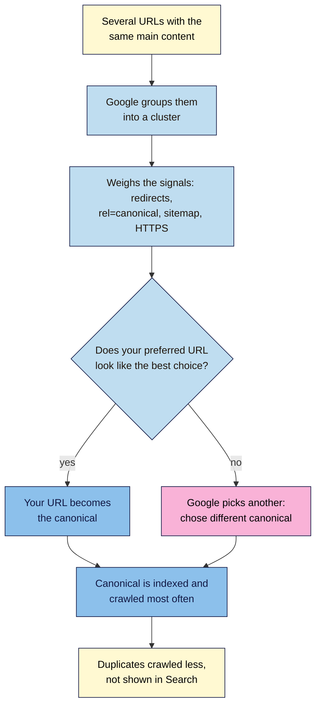

# M06.L03 — Canonicals and Duplicate Content
> After this lesson you can explain how Google picks one URL from a group of duplicates, choose the right way to tell it which one you prefer, and work out why Google sometimes picks a different one.

**Time:** ~15 min reading + ~30 min hands-on + ~10 min exercise · **Level:** L2 Practitioner · **Prereqs:** M06.L02, M03.L05 · **Remediate to:** M03.L05
**Verified against:** Google Search Central "What is canonicalization" (updated 2026-08-20), "How to specify a canonical URL" (2026-07-10) and "Fix canonicalization issues" (2026-08-21); Search Console Help "Page indexing report" and "URL Inspection tool"; WordPress 7.1 source (`rel_canonical()`, `wp_get_canonical_url()`, `canonical.php`), all on 2026-11-09. Search Console screens weren't tested live.

> ⚠️ **Freshness flag:** all three of Google's canonical pages were updated in July and August 2026. Many SEO tools still describe a canonical as an instruction that pages "are being instructed to not index". Google calls it "a hint, not a rule". Use Google's wording.

## Learning objectives
1. **Explain** how Google groups duplicate URLs and chooses a canonical, and why a canonical tag is "a hint, not a rule". *(O1)*
2. **Rank** canonical signals (redirects, `rel="canonical"`, sitemaps), and pick the right one for a case. *(O2)*
3. **Diagnose** "Google chose different canonical than user", and canonicals that point to redirected or `noindex` pages. *(O3)*

## Why it matters
Nila's cold brew guide can be reached at five addresses: `http://` and `https://`, with and without `www`, and with `?utm_source=instagram` from her Instagram bio. To a person, it's one page. To a search engine, it's five URLs with the same content. Google has to pick one to show. If it picks the Instagram version, that's the address people copy and share, and the one her reports show.

A **canonical** is how you tell Google which one you prefer. Most sites don't need to do much, because good platforms handle the common cases. But when they get it wrong (a plugin pointing every page's canonical to the home page, or a canonical pointing to an old address), the "right" page can quietly vanish from Search.

## Core concept
**Plain version:** when several URLs show the same or very similar content, Google groups them and picks one, the **canonical**, to index and show. The others are **duplicates**. You can suggest which one it should pick, mainly with redirects and a `rel="canonical"` tag. Google usually agrees, but it treats your choice as a strong hint, not an order.

**Analogy:** a canonical is like the "official" photo in a passport application. You might have five similar photos, and you send the one you prefer. The office usually accepts it, but if it's blurry or doesn't look like you, it picks a better one from your file.

**Precise definitions:**
- **Duplicate content:** the same or very similar main content at more than one URL.
- **Canonical URL:** the URL Google picks to represent a group of duplicates.
- **`rel="canonical"`:** a `<link rel="canonical" href="…">` element in the page's `<head>` saying which URL you prefer. A **self-referencing canonical** points to the page itself.
- **User-declared canonical** and **Google-selected canonical:** your choice and Google's, both shown in URL Inspection.

### What Google says
| Claim | Verdict | What Google says |
|---|---|---|
| Duplicate content gets a penalty | **Myth** | "Some duplicate content on a site is normal and it's not a violation of Google's spam policies." |
| Google picks the canonical | **Documented** | Google "clusters them together" and chooses the page that "is objectively the most complete and useful for search users" |
| A canonical tag is an instruction | **False** | "indicating a canonical preference is a hint, not a rule." |
| Every site needs to set canonicals | **False** | "none of them are required; your site will likely do just fine without specifying a canonical preference." |
| Redirects are the strongest signal | **Documented** | Redirect: "A strong signal". `rel="canonical"`: "A strong signal". Sitemap: "A weak signal". Listed "in order of how strongly they can influence canonicalization" |
| Signals add up | **Documented** | "these methods can stack and thus become more effective when combined." |
| Use robots.txt or `noindex` to stop duplicates | **False** | "Don't use the robots.txt file for canonicalization purposes." `noindex` "will completely block the page from Search. rel="canonical" link annotations are the preferred solution." |
| A canonical can point anywhere | **False** | "If the user-declared canonical is not similar to the current page, then Google won't ever choose that URL as canonical." |
| A canonical in the page body works | **False** | It's "only accepted if it appears in the <head> section of the HTML" |
| Fixes show up at once | **False** | "Google might hold pages in a duplicate cluster for up to two weeks." |

### Where duplicates come from
Google lists the usual causes, including:
- **Protocol and host variants:** "the HTTP and HTTPS versions of a site", and `www` vs non-`www`.
- **Site functions:** "the results of sorting and filtering functions of a category page", such as `?sort=price`.
- **Tracking parameters:** `?utm_source=…` added to links in emails and social posts *(course example)*.
- **Accidental variants:** "the demo version of the site is accidentally left accessible to crawlers" (Lesson 6.2's staging leak).
- **Device and region variants:** separate mobile pages, or one page for several countries (hreflang, Module 12).
- **Copies on other sites:** syndicated articles, or a copycat site.

## How it works

**In words:** Google finds several URLs with the same main content and groups them. It weighs the signals you've given (redirects, `rel="canonical"` tags, sitemap entries, HTTPS) and its own judgement. If your preferred URL looks like the best choice, it becomes the canonical. If not, Google picks another one. Either way, the canonical is indexed and crawled most often, and the duplicates are crawled less and not shown in Search.

### Choose the right signal
| Situation | Best signal | Why |
|---|---|---|
| `http`/`https`, `www`/non-`www`, trailing slash | **301 redirect** to one version | Visitors land on the right address too. Most hosts and WordPress do this already |
| A page you're retiring in favour of another | **301 redirect** (Lesson 6.5) | The old page shouldn't exist any more |
| Tracking (`?utm_…`), sort and filter parameters | **`rel="canonical"`** to the clean URL | Both versions must keep working for visitors |
| An article republished on another site | Ask them for a **`rel="canonical"`** to your original | You can't redirect someone else's page |
| A PDF that duplicates a web page | **`Link: <…>; rel="canonical"`** HTTP header | Files have no `<head>`. Google supports it "for web search results only" |
| Every page | A **self-referencing canonical**, and the canonical URL in your sitemap and internal links | Stack the signals so they agree |

### Common canonical mistakes
- **Mixed signals:** "don't specify one URL in a sitemap, but a different URL for that same page using rel="canonical"".
- **Linking to duplicates:** "When linking within your site, link to the canonical URL rather than a duplicate URL."
- **Relative paths:** Google says "Use absolute paths" (`https://nilacoffee.example/cold-brew/`, not `/cold-brew/`), because relative ones break if a staging copy is crawled.
- **Canonical to a non-indexable page:** pointing to a URL that redirects, returns 404, or has `noindex`. Google's docs don't name this one directly, but crawlers such as Screaming Frog flag it, and it sends mixed signals *(observed practice)*.
- **Canonical to an unrelated page:** such as every post pointing to the home page. "A duplicate page must be similar to the canonical", so Google ignores it, and you've told it nothing useful.
- **`noindex` plus a canonical** on the same page: one says "this is a copy of that", the other says "drop this". Pick one *(course rule of thumb)*.
- **Faulty plugins:** Google notes some CMS plugins "can make incorrect use of canonicalization techniques to point to undesired URLs. Check your HTML with your browser's developer tools".

### What WordPress does
- **Canonical tags:** WordPress core adds a self-referencing `<link rel="canonical">` to **single posts and pages** only, and only once they're published. Home, category and tag pages get none from core; SEO plugins usually add them (7.1 source).
- **Redirects:** WordPress redirects common variants, such as `www` vs non-`www` and a missing trailing slash, to the address set in **Settings → General**, with a 301. A comment in WordPress's code says this "prevents penalty for duplicate content". There's no such penalty, but the redirect is still useful.
- **`http` to `https`:** usually handled by your host or HTTPS settings (WordPress 101 Module 1, Lesson 3).

> **Under the hood: why Google can overrule you.** Google treats your canonical as one signal among several. If your `rel="canonical"` says page A, but your sitemap lists page B, your internal links point to B, and B is the HTTPS version, the signals disagree, and Google may well pick B. Content matters too: Google picks the page that's "objectively the most complete and useful". So when Google "chose different canonical than user", first check whether your signals agree, then whether the pages really are duplicates. If they aren't similar, Google "won't ever choose that URL as canonical". After a fix, allow time: Google "might hold pages in a duplicate cluster for up to two weeks."

## Hands-on walkthrough
You'll test the common variants of one important URL, check canonical tags on different page types, and compare your choice with Google's.

**Before you start: which steps apply to you?**
- **Path A or C:** do every part on the live site (read-only on path C). Part C needs Search Console.
- **Path B:** do Parts A and B on your Blogger site and your WordPress practice site. Do Part C on Blogger.

**Part A — Test the variants (10 min)**
1. Add a tab called **Canonical check**, with these columns: **URL tested**, **Status**, **Lands on**, **Canonical in source**, **OK?**.
2. Choose your most important page, and write down its exact address, such as `https://www.nilacoffee.example/cold-brew-guide/`.
3. In DevTools **Network** (with **Preserve log**), visit each variant, and record the status of the first row and where you end up:
   - `http://` instead of `https://`
   - with `www.` added or removed
   - without the trailing slash (or with it, if your address has none)
   - with `?utm_source=test` added on the end
   **Expected:** the first three each return a single **301** to your exact address, then **200**. The `?utm_source=test` version returns **200** without a redirect, and its source shows a canonical pointing to the clean address. If any variant returns **200** with no canonical, or takes two or more redirects, note it (Lesson 6.5 fixes chains).
   > 🖼️ **Image prompt:** Chrome DevTools Network panel (1280×600) with Preserve log ticked, showing a request to the http:// version of a page with status 301, followed by the https:// version with status 200. Highlight the 301 row with a 3px #F9B2D7 outline; blur any personal details.
   > **Alt text:** DevTools Network panel showing a 301 redirect from the http version of a page to the https version.

**Part B — Check canonical tags on four page types (8 min)**
View the source of each page below, search for `canonical`, and copy the `href`:
1. a blog post,
2. a page,
3. your home page,
4. a category page.
   **Expected:** on WordPress without an SEO plugin, the post and the page have a self-referencing canonical; the home and category pages have none. With an SEO plugin, all four usually have one. Each `href` should be absolute, use `https`, and match the address exactly. **Red flags:** every page pointing to the home page, a canonical pointing to an `http://` or old address, or two canonical tags on one page.

**Part C — Compare with Google (10 min, public sites)**
1. In URL Inspection, check your important page and two others. Record **User-declared canonical** and **Google-selected canonical**.
   **Expected:** they match. If not, check whether your signals agree (canonical tag, sitemap, internal links, redirects) and whether the pages are really duplicates.
2. Open **Indexing → Pages**, and look under **Why pages aren't indexed** for:
   - **Alternate page with proper canonical tag:** fine. Google says "there is nothing you need to do."
   - **Duplicate without user-selected canonical:** usually fine, if Google's choice is the one you'd pick.
   - **Duplicate, Google chose different canonical than user:** look into it.
   Record the counts and one example of each in the tab.

**Expected output:** a **Canonical check** tab with four variant tests, canonical tags for four page types, and (on public sites) your choice vs Google's for three pages, plus the duplicate reasons from Page indexing.

## When to use / when not to
**Use a 301** when only one version should exist.

**Use `rel="canonical"`** when visitors still need several versions, such as tracking links, sorted lists or printer-friendly pages.

**Use a self-referencing canonical** on every indexable page, and keep your sitemap and internal links pointing to the same URL.

**Don't use** robots.txt, `noindex` or the URL removal tool to deal with duplicates.

**Don't panic** about **Duplicate without user-selected canonical** if Google's choice is sensible.

**The trade-off:** canonicals let you keep useful variants for visitors, but Google may overrule them. Redirects are firmer, but they remove the variant for everyone.

## Use AI for this
**Example prompt:**
> "Here are the canonical tags I found on 10 pages of my site, with each page's own URL: [paste pairs]. For each pair, tell me whether the canonical is self-referencing, points to a similar duplicate, or looks wrong (relative, http, a different page, the home page). Don't guess about pages I haven't listed."

**What AI does well here:** spotting mismatches in long lists, such as `http` vs `https` or missing trailing slashes.
**Where it gets it wrong:** it often calls canonicals "directives", claims a "duplicate content penalty", or suggests `noindex` for duplicates.
**How to check:** open the flagged pages in View Source, and confirm with URL Inspection.

## Common mistakes
- **Believing in a duplicate content penalty,** and deleting or blocking useful pages.
- **Canonicals that disagree with the sitemap or internal links.**
- **Relative or `http://` canonicals.**
- **Every page's canonical pointing to the home page,** often from a misconfigured plugin or theme.
- **Canonicals pointing to redirected, 404 or `noindex` pages.**
- **Using robots.txt or `noindex` for duplicates.**
- **Two canonical tags on one page,** from a theme and a plugin both adding one.

## Troubleshooting
| Symptom | Likely cause | Fix |
|---|---|---|
| **Duplicate, Google chose different canonical than user** | Your signals disagree, or the pages aren't really duplicates | Make the canonical tag, sitemap, internal links and redirects agree; make sure the pages are similar |
| Two canonical tags in the source | The theme and an SEO plugin both add one | Turn one off, usually in the theme |
| All pages' canonicals point to the home page | A plugin or theme setting | Fix the setting, then check several pages |
| The `?utm_` version appears in Search | No canonical on the page, or internal links use the tracking URL | Add a self-referencing canonical; never use tracking links internally |
| Both `www` and non-`www` load with 200 | No host redirect | Set the redirect at your host, or in **Settings → General** on WordPress |
| Changes don't show in URL Inspection | Google hasn't recrawled yet | Use **Test live URL** to check the live page; allow up to two weeks |

## Exercise
**Task:** complete your **Canonical check** tab (Parts A–C). Then answer these. All details are illustrative.
1. Nila's cold brew guide loads at both `http://` and `https://` with a 200. What should she do?
2. Tomás's category page has `?sort=price` and `?sort=newest` versions. Should he redirect them, `noindex` them, or use a canonical?
3. Amara finds that every page on a client's site has `<link rel="canonical" href="https://client.example/">`. What will Google do, and what should she fix?
4. Kavya's guest article was republished on a yoga magazine's site. How can she help Google show her version?
5. URL Inspection shows **User-declared canonical** `https://nilacoffee.example/brew/`, but **Google-selected canonical** `https://nilacoffee.example/brew-guide/`. List two things Nila should check.
6. Someone says, "We'll get a duplicate content penalty for our printer-friendly pages." Is that right?

**Expected outcome:** a complete tab, and these answers:
- **1** Redirect `http://` to `https://` with a 301, and keep a self-referencing `https` canonical.
- **2** A canonical to the clean category URL. Visitors still need the sort options. (Lesson 6.2: robots.txt can also save crawling on huge numbers of parameters.)
- **3** Google will likely ignore them, because the pages aren't duplicates of the home page. Fix the plugin or theme setting so each page points to itself.
- **4** Ask the magazine to add a `rel="canonical"` pointing to her original article.
- **5** Whether her sitemap and internal links point to `/brew/` too, and whether the two pages are really the same, or whether `/brew-guide/` is the more complete one.
- **6** No. "Some duplicate content on a site is normal". Add a canonical to the main version.

**Stretch goal:** run Part A on a competitor's site, or a large shop's. Note which variants redirect, and which rely on canonicals.

## Key takeaways
- Duplicate content is normal, not a penalty. Google groups duplicates and picks one canonical.
- Your canonical is "a hint, not a rule". Google weighs it with redirects, sitemaps, links and content.
- Redirects and `rel="canonical"` are strong signals; sitemaps are weak. Make them all agree.
- Use absolute, `https`, self-referencing canonicals, and link internally to the canonical URL.
- Never use robots.txt or `noindex` to handle duplicates, and never point canonicals at redirected, 404 or `noindex` pages.

## Teach it back
Explain to a friend in 3 sentences why Google might ignore a canonical tag, and what to check when it does.

## Glossary terms added
- Duplicate content — added to `seo-101/glossary.md`
- Self-referencing canonical — added to `seo-101/glossary.md`
- Google-selected canonical — added to `seo-101/glossary.md`
- *Already in the glossary:* Canonical URL, Redirect, Sitemap

## Further reading
*All checked 2026-11-09.*
- Google Search Central — What is canonicalization (updated 2026-08-20): https://developers.google.com/search/docs/crawling-indexing/canonicalization
- Google Search Central — How to specify a canonical URL (updated 2026-07-10): https://developers.google.com/search/docs/crawling-indexing/consolidate-duplicate-urls
- Google Search Central — Fix canonicalization issues (updated 2026-08-21): https://developers.google.com/search/docs/crawling-indexing/canonicalization-troubleshooting
- Search Console Help — Page indexing report: https://support.google.com/webmasters/answer/7440203
- Search Console Help — URL Inspection tool: https://support.google.com/webmasters/answer/9012289
- SEO 101, Lesson 3.5 — one page per topic (cannibalisation): `seo-101/lessons/m03-l05-keyword-maps-cannibalisation.md`

> ⚠️ **May change:** Google's canonical documentation (updated three times in 2026); Search Console reason names; SEO plugins' canonical settings.

## Refresher card
*Used by remediation when a learner fails a quiz twice on a later lesson that points back here.*
**Canonical** = the URL Google picks from a cluster of duplicates. Duplicate content is "not a violation of Google's spam policies". Your preference is "a hint, not a rule". **Signals, strongest first:** redirect (strong), `rel="canonical"` (strong), sitemap (weak); they "stack", so make them agree. **Rules:** absolute `https` URLs; self-referencing canonical on every indexable page; only in `<head>`; link internally to the canonical; never robots.txt or `noindex` for duplicates; never point to redirected, 404, `noindex` or unrelated pages. **WordPress:** core canonical on published single posts and pages only; 301s for `www` and trailing-slash variants. **Diagnose** "Google chose different canonical than user": signals disagree, or pages aren't similar; allow up to two weeks.
