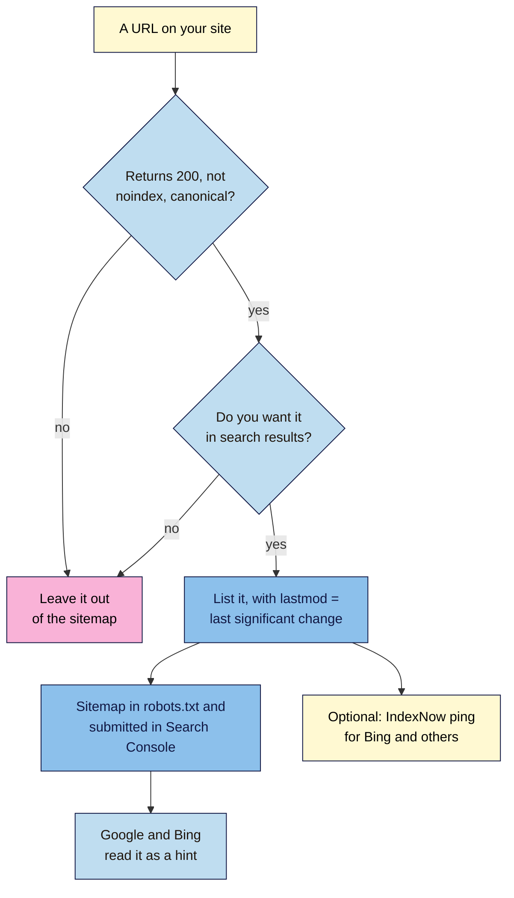

# M06.L04 — XML Sitemaps and IndexNow
> After this lesson you can check that your sitemap lists only the pages you want in search, with honest dates, read the Sitemaps report, and decide whether IndexNow is worth setting up for Bing and others.

**Time:** ~15 min reading + ~30 min hands-on + ~10 min exercise · **Level:** L2 Practitioner · **Prereqs:** M06.L03, M01.L08 · **Remediate to:** M01.L08
**Verified against:** Google Search Central "Build and submit a sitemap" (updated 2026-07-08), "Learn about sitemaps" (2025-12-10) and the sitemaps ping blog post (2023-06-26); Search Console Help "Sitemaps report"; Bing Webmaster Blog "Keeping Content Discoverable with Sitemaps in AI Powered Search" (2025-07-31); indexnow.org home, FAQ, documentation and `searchengines.json`; WordPress 7.1 source (core sitemaps), all on 2026-11-09. Search Console and Bing screens weren't tested live.

> ⚠️ **Freshness flag:** Google's sitemap "ping" endpoint stopped working after a six-month notice from June 2023; old plugins may still "ping" for nothing. Google doesn't list IndexNow support (checked 2026-11-09). IndexNow's own pages don't fully agree on which engines take part, so date any list you quote.

## Learning objectives
1. **Build** a clean sitemap that lists only indexable, canonical, 200-status URLs within Google's limits. *(O1)*
2. **Check** `lastmod` accuracy and the Sitemaps report status, knowing which tags Google ignores and that sitemap "ping" is gone. *(O2)*
3. **Set up** IndexNow for Bing and other participating engines, knowing Google doesn't support it. *(O3)*

## Why it matters
Amara opens a client's sitemap and finds 1,400 URLs on a site with 90 real pages. There are tag pages with one post, attachment pages for every image, three redirected old addresses, a "thank you" page with `noindex`, and every `lastmod` set to this morning. The sitemap is meant to be a list of "pages we want in Google". This one says "here's everything, and it all changed today".

Google treats a sitemap as a hint. A clean one helps it find and refresh your important pages. A messy one wastes its time and teaches it to ignore your dates. And for Bing, a newer tool called **IndexNow** can announce changes the moment you make them.

## Core concept
**Plain version:** an **XML sitemap** is a file that lists the pages you want search engines to find, with an optional date for when each one last really changed. It doesn't force anything to be indexed, but it helps discovery, especially for new or poorly linked pages. **IndexNow** is a "ping" that tells Bing and some other engines "this URL just changed". Google doesn't use it.

**Analogy:** a sitemap is the contents page of a book you send to a library. It helps the librarian find every chapter, but it doesn't make them shelve the book. If your contents page lists chapters that don't exist, or says every chapter was rewritten yesterday, the librarian stops trusting it. IndexNow is a quick text to the library saying "chapter 4 just changed", but only some libraries read those texts.

**Precise definitions:**
- **XML sitemap:** a file of `<url>` entries, each with a `<loc>` (the address) and optionally a `<lastmod>` (last significant change).
- **Sitemap index:** a file that lists other sitemap files. WordPress's `/wp-sitemap.xml` is one.
- **`lastmod`:** the date and time of the last significant update to the page.
- **IndexNow:** an open protocol for telling participating search engines that URLs were added, updated or deleted.

### What the sources say
| Claim | Verdict | What the source says |
|---|---|---|
| A sitemap gets pages indexed | **False** | Submitting one "is merely a hint: it doesn't guarantee that Google will download the sitemap or use the sitemap for crawling" |
| Small sites don't need one | **Partly true** | You might not need one if your site is "about 500 pages or fewer" and well linked, but "in most cases, your site will benefit from having a sitemap" |
| List every URL on the site | **False** | "Include the URLs in your sitemap that you want to see in Google's search results." |
| `priority` and `changefreq` matter | **False** | "Google ignores <priority> and <changefreq> values." Bing ignores them too |
| `lastmod` matters | **Documented, if honest** | Google uses it "if it's consistently and verifiably … accurate". Otherwise "eventually we're not going to believe you anymore" |
| A copyright-year change is an update | **False** | Main content, structured data or links count; "an update to the copyright date is not" |
| You can ping Google about a new sitemap | **False, since 2023** | Pings to the old endpoint "will result in a 404 error". Use Search Console or robots.txt |
| Size limits | **Documented** | "50MB (uncompressed) or 50,000 URLs" per sitemap file |
| Google supports IndexNow | **Not listed** | indexnow.org lists Microsoft Bing, Naver, Seznam.cz, Yandex and Yep, and its engine file adds the Internet Archive and Amazonbot. Google isn't on either list |
| IndexNow replaces sitemaps | **False** | IndexNow's FAQ says to use "both IndexNow and sitemaps" |

## How it works

**In words:** for each URL, check that it returns 200, has no `noindex` and is its own canonical (Lessons 6.1–6.3), and that you actually want it in search results. If not, leave it out. If so, list it with a `lastmod` that reflects its last significant change. Point to the sitemap in robots.txt and submit it in Search Console (and Bing Webmaster Tools). Google and Bing read it as a hint. Optionally, also send IndexNow pings so Bing and other participating engines hear about changes straight away.

### What belongs in a sitemap
| Include | Leave out |
|---|---|
| Pages that return **200** | Redirected URLs (3xx) and removed pages (4xx) |
| The **canonical** version (`https`, the right host, the right trailing slash) | Duplicates, `?utm_` and `?sort=` versions |
| Pages you want in search | `noindex` pages: thank-you pages, internal search, thin tag pages |
| Absolute URLs: "Use fully-qualified, absolute URLs" | Pages blocked by robots.txt |
| An honest `lastmod` | `lastmod` set to the time the file was generated |

**Mixed signals again:** a URL in the sitemap tells Google "this is canonical" (a weak signal). If the page's `rel="canonical"` points elsewhere, or it's `noindex`, your signals disagree (Lesson 6.3).

### `lastmod`, honestly
- **Significant:** a change to "the main content, the structured data, or links on the page".
- **Not significant:** a typo, a new copyright year, a sidebar widget.
- **Format:** Google accepts the sitemaps.org date formats. Bing asks for "standard ISO 8601 date formatting for lastmod values, including both the date and time", such as `2026-11-09T10:30:00+05:30`. Using the full date-time works for both *(course rule of thumb)*.
- **If you can't be accurate,** leave `lastmod` out. Google said in 2023: "In these cases it's fine to leave out lastmod for those pages."
- **WordPress:** the core sitemap takes each post's `lastmod` from its last-modified time (7.1 source), so *any* save moves it (Lesson 5.5). Don't re-save old posts to "refresh" them.

### WordPress and other platforms
- **WordPress core** creates `/wp-sitemap.xml`, a sitemap index listing separate sitemaps for posts, pages, categories, tags and authors, with up to 2,000 URLs per file (7.1 source). It's linked from the virtual robots.txt (Lesson 6.2).
- **SEO plugins** usually replace it with their own sitemap (often `/sitemap_index.xml`) and leave out `noindex` content. Use only one sitemap system, and submit the one that's in use.
- **Blogger, Shopify and Wix** create sitemaps automatically. Find the address in the platform's help or in robots.txt.

### IndexNow in brief
- You create a **key** (8–128 hexadecimal characters), and host it in a text file named `{your-key}.txt` at the root of your site, to prove the site is yours.
- When a URL changes, you (or a plugin, or your platform) send it to an IndexNow endpoint, such as `https://<searchengine>/indexnow?url=url-changed&key=your-key`. Bulk submissions take "up to 10,000 URLs per POST request".
- Participating engines share submissions: "your submission will be shared across all IndexNow-enabled search engines".
- Responses: **200** means "the search engine has received your URL", and **202** means "URL received. IndexNow key validation pending." **403** means the key isn't valid. Neither 200 nor 202 means "indexed": "Submitting a URL does not guarantee immediate indexing."
- **Google:** not on IndexNow's lists. For Google, keep using a sitemap and Search Console.

> **Under the hood: why your dates matter more than your sitemap.** Google reads a sitemap to decide *what* to crawl and *when*. `lastmod` is the part that changes its schedule: an accurate one says "this page changed, come back". Google checks it against the page ("verifiably … accurate"). If every URL claims to have changed today, and the pages haven't, Google learns that your dates are meaningless and stops using them, for every page. That's worse than leaving `lastmod` out. Bing works the same way: it uses `lastmod` to "prioritize URLs for recrawling" or "skip them entirely if the content hasn't changed". And the Sitemaps report only shows sitemaps you submitted there: "It does not show any sitemaps discovered through a robots.txt reference".

## Hands-on walkthrough
You'll audit your sitemap, check five URLs and three dates, and confirm both search engines can read it. Setting up IndexNow is optional.

**Before you start: which steps apply to you?**
- **Path A or C:** do Parts A–C on the live site (read-only on path C). Part D is optional on path A only.
- **Path B:** do Parts A and B on your WordPress practice site *and* Blogger. Do Part C on Blogger. Skip Part D (Local and Playground can't receive IndexNow requests).

**Part A — Find and count (8 min)**
1. Add a tab called **Sitemap audit**, with these columns: **URL**, **In sitemap?**, **Status**, **`noindex`?**, **Canonical = URL?**, **`lastmod`**, **Real last change**, **OK?**.
2. Open `https://yourdomain/robots.txt` and find the `Sitemap:` line. Open that address.
   **Expected:** a sitemap or a sitemap index. On WordPress without a plugin, `/wp-sitemap.xml`, listing sub-sitemaps such as `wp-sitemap-posts-post-1.xml`.
3. Open each sub-sitemap and count the URLs (**Ctrl+F**, search `<loc>` or `https://`). Write the totals by type.
   **Expected:** roughly the number of posts and pages you've published. **Red flags:** far more URLs than real pages, sitemaps for things you don't want in search (such as a single-post tag), or two sitemap systems running at once.

**Part B — Check five URLs and three dates (12 min)**
1. Pick five URLs from the sitemap: two posts, one page, one category or tag, and one that looks odd.
2. For each, record the status (DevTools **Network**), whether it has `noindex` (View Source), and whether its canonical matches the URL exactly (Lesson 6.3).
   **Expected:** all **200**, no `noindex`, canonical = URL. Any failure means the URL shouldn't be in the sitemap, or the page needs fixing.
3. For three posts, compare the sitemap `lastmod` with the date you last really changed the post (from the post's **Revisions**, Lesson 5.5).
   **Expected:** they match the last save. If you've re-saved posts without real changes, the dates will look newer than the content. Note it, and don't do it again.
   > 🖼️ **Image prompt:** A WordPress core posts sitemap (1280×700) opened in the browser, showing a table of post URLs with their last modified dates. Highlight one URL and its lastmod value with a 3px #F9B2D7 outline; blur any personal details.
   > **Alt text:** A WordPress posts sitemap in the browser with one URL and its last modified date highlighted.

**Part C — Check the reports (5 min, public sites)**
1. In Search Console, open **Indexing → Sitemaps**. Check your sitemap's **Status** (**Success**, **Has errors** or **Couldn't fetch**) and the number of discovered pages.
   **Expected:** **Success**, and a page count close to Part A's total. If you use an SEO plugin, the submitted address should be the plugin's sitemap.
2. Open **Indexing → Pages**, change the filter at the top from **All known pages** to **All submitted pages**, and note how many submitted pages are indexed and not indexed.
3. In Bing Webmaster Tools, open **Sitemaps** and check the same sitemap is listed.

**Part D — Optional: IndexNow by hand (5 min, path A only)**
1. Make a key of 8–128 hexadecimal characters (the digits 0–9 and letters a–f), such as 32 random ones from a password generator. Save it as `{your-key}.txt` containing only the key, and upload it to your site's root. Check that `https://yourdomain/{your-key}.txt` opens.
2. In your browser, visit `https://api.indexnow.org/indexnow?url=<your page URL>&key=<your key>`.
   **Expected:** a blank page; DevTools **Network** shows **202** the first time (key check pending) or **200**. A **403** means the key file couldn't be found or doesn't match.
3. **WordPress alternative:** many SEO plugins and some hosts offer an IndexNow setting. Use one method only.

**Expected output:** a **Sitemap audit** tab with URL counts by type, five checked URLs, three date checks, the Search Console and Bing status, and (optionally) an IndexNow response code.

## When to use / when not to
**Always have a sitemap** on a site with more than a handful of pages, and submit it in Search Console and Bing Webmaster Tools.

**Keep it to indexable, canonical, 200 URLs** you want in search.

**Use `lastmod`** only if it's accurate. Otherwise leave it out.

**Use IndexNow** if Bing traffic matters to you and your platform makes it easy. It's not needed for Google.

**Don't** set `priority` or `changefreq` and expect anything; don't ping Google; don't run two sitemap systems.

**The trade-off:** a complete sitemap helps discovery, but a padded one wastes crawling and weakens your signals. Fewer, better URLs beat more.

## Use AI for this
**Example prompt:**
> "Here is my sitemap's list of URLs with their lastmod dates: [paste]. Group them by type (posts, pages, tags, categories, other), point out any that look like duplicates, parameters, attachments or thin archives, and flag any dates that look generated rather than real (for example, all the same). Don't guess status codes; I'll check those myself."

**What AI does well here:** spotting patterns in long lists, such as one-post tags, `?` parameters, or identical dates.
**Where it gets it wrong:** it may claim `priority` affects ranking, say Google supports IndexNow, or invent status codes it can't see.
**How to check:** test the flagged URLs in DevTools and View Source, and check the reports yourself.

## Common mistakes
- **Listing redirected, 404, `noindex` or duplicate URLs.**
- **Every `lastmod` set to today,** or re-saving posts to "refresh" them.
- **Two sitemap systems** (core plus a plugin) both submitted.
- **Relying on `priority` and `changefreq`.**
- **Pinging Google** with an old plugin or script.
- **Expecting a sitemap to force indexing.**
- **Expecting IndexNow to affect Google.**
- **Submitting the sitemap of a staging site.**

## Troubleshooting
| Symptom | Likely cause | Fix |
|---|---|---|
| **Couldn't fetch** | Wrong address, the sitemap is blocked, or it returns an error | Open the address in a private window; check robots.txt and the status code |
| **Has errors** | Bad XML or invalid URLs | Open the report's details; check for relative URLs or the wrong host |
| Far more URLs than real pages | Attachments, tags, parameters or a second sitemap system | Turn off unwanted sitemap types in your SEO plugin; use one system |
| Many submitted pages **not indexed** | They're `noindex`, duplicates or thin | Remove them from the sitemap or improve them (Lessons 6.1–6.3) |
| The sitemap isn't in the Sitemaps report | It was only found through robots.txt | Submit it in the report too |
| IndexNow returns **403** | The key file is missing or doesn't match | Check `https://yourdomain/{your-key}.txt` opens and contains only the key |

## Exercise
**Task:** complete your **Sitemap audit** tab (Parts A–C, D optional). Then answer these. All details are illustrative.
1. Amara's client's sitemap lists 1,400 URLs for 90 real pages. Name three kinds of URL she should look for and remove.
2. Nila's sitemap shows every `lastmod` as today's date. What's the risk, and what should she do?
3. Tomás's sitemap includes a page with `noindex`. What's wrong?
4. Kavya's site has 40 well-linked pages. Does she need a sitemap?
5. A plugin says it "pings Google" after every new post. Does that help?
6. Is IndexNow worth setting up for a site that gets nearly all its search traffic from Google?

**Expected outcome:** a complete tab, and these answers:
- **1** Any three of: redirected or removed URLs, `noindex` pages, duplicates and parameter URLs, thin tag pages, attachment pages.
- **2** Google may stop trusting her dates ("eventually we're not going to believe you anymore"). Fix the generator so `lastmod` shows real changes, or leave it out.
- **3** Mixed signals: the sitemap says "index this", the page says "don't". Remove it from the sitemap, or remove the `noindex`.
- **4** Google says she "might not" need one, but most sites benefit. It's free, and helps monitoring in Search Console, so submit one.
- **5** No. Google's ping endpoint stopped working after 2023. Submit the sitemap once in Search Console and list it in robots.txt.
- **6** Not for Google, which isn't listed. It can still help with Bing and other engines, so set it up if it's easy.

**Stretch goal:** compare the number of URLs in your sitemap with the number of **All submitted pages** that are indexed. For each group of not-indexed pages, decide whether to improve them or remove them from the sitemap.

## Key takeaways
- A sitemap is a hint that helps discovery. It doesn't guarantee indexing.
- List only 200, indexable, canonical URLs you want in search, as absolute URLs.
- Google ignores `priority` and `changefreq`. `lastmod` counts only if it's honest.
- Submit the sitemap in Search Console and Bing, and list it in robots.txt. Google's ping is gone.
- IndexNow tells Bing and some other engines about changes fast. Google doesn't list support.

## Teach it back
Explain to a friend in 3 sentences what should and shouldn't go in a sitemap, and why fake `lastmod` dates backfire.

## Glossary terms added
- Sitemap index — added to `seo-101/glossary.md`
- lastmod — added to `seo-101/glossary.md`
- IndexNow — added to `seo-101/glossary.md`
- *Already in the glossary:* Sitemap, Canonical URL

## Further reading
*All checked 2026-11-09.*
- Google Search Central — Build and submit a sitemap (updated 2026-07-08): https://developers.google.com/search/docs/crawling-indexing/sitemaps/build-sitemap
- Google Search Central — Learn about sitemaps (updated 2025-12-10): https://developers.google.com/search/docs/crawling-indexing/sitemaps/overview
- Google Search Central Blog — Sitemaps ping endpoint is going away (2023-06-26): https://developers.google.com/search/blog/2023/06/sitemaps-lastmod-ping
- Search Console Help — Sitemaps report: https://support.google.com/webmasters/answer/7451001
- Bing Webmaster Blog — Keeping Content Discoverable with Sitemaps in AI Powered Search (2025-07-31): https://blogs.bing.com/webmaster/2025/7/Keeping-Content-Discoverable-with-Sitemaps-in-AI-Powered-Search/
- IndexNow — home, FAQ and documentation: https://www.indexnow.org/ · https://www.indexnow.org/faq · https://www.indexnow.org/documentation
- sitemaps.org — Sitemaps XML format: https://www.sitemaps.org/protocol.html
- SEO 101, Lesson 1.8 — submitting your first sitemap: `seo-101/lessons/m01-l08-practice-gsc-ga4-setup.md`

> ⚠️ **May change:** IndexNow's list of participating engines; whether Google adopts IndexNow; SEO plugins' sitemap settings.

## Refresher card
*Used by remediation when a learner fails a quiz twice on a later lesson that points back here.*
**Sitemap** = a hint ("merely a hint"), not a guarantee. **Include** only 200, indexable, canonical, absolute URLs "that you want to see in Google's search results". **Limits:** 50,000 URLs or 50MB per file; WordPress core uses 2,000 per file under `/wp-sitemap.xml`. **Ignored:** `priority`, `changefreq`. **`lastmod`:** last *significant* change (content, structured data, links; not the copyright year); fake dates get ignored; leave it out if unsure; full ISO 8601 date-time suits Google and Bing. **Submit** in Search Console and Bing, and list in robots.txt; Google's ping is gone. **IndexNow:** key file at the root, ping changed URLs, 200/202 = received (not indexed); Bing, Naver, Seznam.cz, Yandex, Yep and others; Google not listed.
