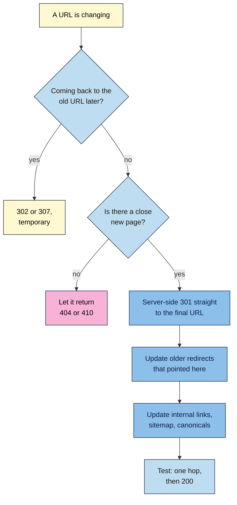

# M06.L05 — Redirects, Site Structure and Crawl Depth
> After this lesson you can choose the right redirect, build and test a redirect map so every changed URL reaches its new home in one hop, and plan a site where important pages are a few clicks from the home page.

**Time:** ~15 min reading + ~35 min hands-on + ~10 min exercise · **Level:** L2 Practitioner · **Prereqs:** M06.L04, M04.L05, M05.L05 · **Remediate to:** M05.L05
**Verified against:** Google Search Central "Redirects and Google Search" (updated 2026-04-14), "Site moves with URL changes" (2026-08-20), "URL structure best practices" (2026-10-21), "SEO Starter Guide", "Link best practices" and "Help Google understand your ecommerce site structure"; WordPress.org Redirection plugin page, all on 2026-11-09. No redirects were tested on a live site.

> ⚠️ **Freshness flag:** Google's URL structure page was updated on 2026-10-21. **Course standard:** non-negotiable #8 asks for **single-hop** 301s. Google is less strict: it advises "redirecting to the final destination directly", and if not, "ideally no more than 3 and fewer than 5" hops. We aim for one, on purpose.

## Learning objectives
1. **Choose** the right redirect (301/308 vs 302/307, server-side vs meta refresh or JavaScript), and avoid chains, loops and mass redirects to the home page. *(O1)*
2. **Build** a redirect map for changed URLs, and test that each old URL reaches its new one in a single hop (non-negotiable #8). *(O2)*
3. **Plan** a site structure where important pages are a few clicks from the home page, with no orphans. *(O3)*

## Why it matters
Nila's site has moved twice: from `http://` to `https://`, and from `/2024/05/cold-brew/` to `/cold-brew/`. Each move added redirects on top of the old ones. A link from a food blog in 2023 now goes `http://…/2024/05/cold-brew` → `https://…/2024/05/cold-brew` → `https://…/2024/05/cold-brew/` → `https://…/cold-brew/`. That's three hops. It still works, but it's slower for visitors, and every link from another site has to pass through the whole chain.

Meanwhile, her best-selling Chikmagalur roast is four clicks deep: **Home → Shop → Coffee → Medium roasts → Chikmagalur**. Google uses "the number of links it needs to follow to reach a page" as a clue to how important it is.

Redirects decide whether old links still count. Structure decides which pages Google, and visitors, find first.

## Core concept
**Plain version:** a **redirect** sends anyone who asks for an old URL to a new one. A **301** says "moved for good", and Google shows the new URL. A **302** says "moved for now", and Google keeps showing the old one. Point each old URL straight at its final new home, in one step, and keep the redirect for at least a year. Then make sure every important page is linked, and close to the home page.

**Analogy:** a redirect is a forwarding address at the post office. One forwarding note is fine. A note that forwards to another note that forwards to a third is slow, and some letters get lost. And a shop where the best product is in the back room, behind three doors, sells less than one that puts it by the entrance.

**Precise definitions:**
- **Permanent redirect:** 301 or 308. Google treats the target as the canonical.
- **Temporary redirect:** 302, 303 or 307. Google keeps the old URL in results.
- **Server-side redirect:** sent by the server as a status code, before any page loads. The most reliable kind.
- **Meta refresh** and **JavaScript redirects:** done by the page in the browser. Less reliable.
- **Redirect chain:** a redirect that leads to another redirect. **Redirect loop:** a chain that comes back to where it started, so the page never loads.
- **Redirect map:** a list of every old URL and the new URL it should go to.
- **Crawl depth (click depth):** how many clicks a page is from the home page.
- **Orphan page:** a page with no internal links to it (Lesson 4.5).

### What Google says
| Claim | Verdict | What Google says |
|---|---|---|
| Use 301s for permanent changes | **Documented** | "Use permanent redirects when you're sure that the redirect won't be reverted." |
| Server-side redirects are best | **Documented** | "we recommend that you use a permanent server-side redirect whenever possible." |
| A meta refresh can work | **Documented** | "instant meta refresh redirects" count as permanent; delayed ones count as temporary |
| JavaScript redirects are fine | **Last resort** | "Only use JavaScript redirects if you can't do server-side or meta refresh redirects." Google "might never see it if rendering of the content failed." |
| Chains are fine | **Avoid** | "Avoid chaining redirects." Googlebot can follow up to 10 hops, but "we advise redirecting to the final destination directly" |
| Redirect everything to the home page | **False** | "Don't redirect many old URLs to one irrelevant single URL destination, such as the home page … might be treated as a soft 404 error." |
| Merge pages into one | **Documented** | If you "consolidated content previously hosted on multiple pages", redirect them to "that new, consolidated page" |
| Redirects can be removed after a month | **False** | "Keep the redirects for as long as possible, generally at least 1 year." For users, "consider keeping redirects indefinitely." |
| URL folders define your structure | **False** | "Google generally doesn't look at the structure of URLs to work out the structure of a site. Instead, it analyzes the linkages between pages" |
| Click depth matters | **Documented** | Google uses "the number of links it needs to follow to reach a page and the number of links to a page to infer the relative importance of a page" |
| Pages must be linked | **Documented** | "Every page you care about should have a link from at least one other page on your site." |
| Important pages within 3 clicks | **Observed practice** | No Google document gives a number |

## How it works

**In words:** if the old URL will come back, use a temporary 302 or 307. If it won't, and there's a close new page, use a server-side 301 straight to the final URL. If there's no close page, let it return 404 or 410 (Lesson 6.1). After adding a 301, update any older redirects that pointed to the old URL, so they go straight to the new one. Then update your internal links, sitemap and canonicals, and test that the old URL takes one hop and then returns 200.

### Which redirect, and how
| Type | Code | Google treats it as | Use for |
|---|---|---|---|
| **Permanent, server-side** | 301, 308 | Permanent: the target becomes canonical | Changed slugs, merged pages, `http` to `https`, domain moves |
| **Temporary, server-side** | 302, 307 | Temporary: the old URL stays in results | A sale page, a service that's down for a while |
| **Instant meta refresh** | (in HTML) | Permanent | Only when you can't set server redirects |
| **Delayed meta refresh** | (in HTML) | Temporary | Avoid |
| **JavaScript** | (in script) | May be missed | Last resort |

**Where to add them:**
- **WordPress:** the Redirection plugin (**Tools → Redirection**, then **Add New**, with **Source URL** and **Target URL**; WordPress 101 Module 5, Lesson 2), or your SEO plugin's redirect tool. Use one tool only.
- **Blogger:** **Settings → Custom redirects** (Lesson 4.2).
- **Shopify:** **Content → Menus → View URL Redirects → Create URL redirect**. Shopify can "redirect only from broken URLs" (Lesson 5.5).
- **Wix:** **SEO & GEO → Tools and settings → URL Redirect Manager**, custom domains only (Lesson 5.5).
- **Your own server:** a hosting panel's redirect tool, or rules in `.htaccess` (Apache) or the server config (NGINX). Google's examples: `Redirect permanent "/old" "https://example.com/new"` and `return 301 $scheme://example.com/about/service`.

### Chains, loops and the single-hop rule
- **A chain:** `/a` → `/b` → `/c`. Fix it by pointing `/a` straight to `/c`, and keeping `/b` → `/c`.
- **A loop:** `/a` → `/b` → `/a`. The browser shows a "too many redirects" error, and Search Console shows **Redirect error**. Fix it by deciding which page is final.
- **Host chains:** `http://` → `https://` → `www` → trailing slash. Ask your host to combine them into one hop, or accept two and say so in your notes (Lesson 6.3).
- **The single-hop test:** in DevTools **Network** with **Preserve log**, the old URL should show **one** 301 row, then a **200** row.

### Site structure and crawl depth
- **Links, not folders.** Google "analyzes the linkages between pages". A short URL doesn't make a page important; links do.
- **Menus → categories → items.** Google suggests links "from menus to category pages, from category pages to sub-category pages, and finally from sub-category pages to all product pages".
- **Promote your best pages.** "if you have a best selling product, consider linking to it from the home page".
- **No search-only pages.** "Googlebot generally doesn't try to submit searches into a search box", so a page you can only reach by searching is effectively hidden.
- **No orphans.** "Every page you care about should have a link from at least one other page on your site."
- **About 3 clicks** for important pages is a common target *(observed practice)*. Google gives no number.
- **Don't reorganise just for SEO.** Google says search engines "will likely understand your pages as they are right now, regardless of how your site is organized." Structure matters more on sites with "more than a few thousand URLs".

> **Under the hood: what happens to old links.** When you redirect a URL, Google "keeps track of both the redirect source (the old URL) and the redirect target (the new URL)". With a permanent redirect, the target becomes the canonical, and over time, links from other sites to the old URL count towards the new one. That's why the redirect must stay in place: Google suggests "at least 1 year", so it can recrawl and reassign "links on other sites that point to your old URLs". Remove the redirect too early, and those links point at a 404. And every hop in a chain adds a round trip: chains add "latency for users, and not all user agents and browsers support long redirect chains."

## Hands-on walkthrough
You'll build a redirect map for a pretend slug change, test it for single hops, find and fix a chain, and sketch your site's click depth.

**Before you start: which steps apply to you?**
- **Path A or B (WordPress):** do Parts A–C on your **practice site**, with the Redirection plugin. Never test redirects on live pages you care about.
- **Path B (Blogger):** do Part A, then test one redirect with **Custom redirects** on Blogger.
- **Path C (client site):** do Parts A and D as a plan, and test redirects only on your own practice site.
- **Shopify or Wix:** plan in Part A, and test one redirect on your platform if you can do it on a test page.

**Part A — Build a redirect map (10 min)**
1. Add a tab called **Redirect map**, with these columns: **Old URL**, **New URL**, **Type**, **Reason**, **Tested status**, **Hops**, **Date**.
2. Imagine Nila is tidying ten old URLs. Map each one, choosing 301, 404/410 or "keep":

   | Old URL | Situation |
   |---|---|
   | `/2024/05/cold-brew/` | Now `/cold-brew/` |
   | `/cold-brew-recipe/` | A shorter, older duplicate of `/cold-brew/` |
   | `/iced-coffee-tips/` | Merged into `/cold-brew/` |
   | `/shop/filter-paper-v1/` | Replaced by `/shop/filter-paper/` |
   | `/events/2024-tasting/` | A one-off event, gone |
   | `/classes/` | A page renamed `/brewing-classes/` (Lesson 5.5) |
   | `/blog/?p=123` | An old WordPress short link for `/cold-brew/` |
   | `/summer-sale/` | Returns next summer |
   | `/about-us/` | Renamed `/about/` |
   | `/old-menu.pdf` | No longer offered, no replacement |

   **Expected:** 301 to the new URL for the first four, `/classes/`, `/about-us/`, and `/blog/?p=123` (WordPress already redirects this kind of short link, so test before adding a rule). 404 or 410 for the 2024 event and the old menu. For `/summer-sale/`, keep the page (or use a 302 to an "on its way" page) so the URL keeps its place. No row goes to the home page.

**Part B — Add and test (12 min)**
1. On your practice site, create pages or posts at three of the "new" URLs: `/cold-brew/`, `/brewing-classes/` and `/about/`.
2. Add 301s for `/cold-brew-recipe/`, `/classes/` and `/about-us/` (**Tools → Redirection → Add New**).
3. In DevTools **Network**, with **Preserve log** ticked, visit each old URL. Record the **Hops** and the final status.
   **Expected:** each shows one **301** row, then one **200** row.
   > 🖼️ **Image prompt:** Chrome DevTools Network panel (1280×600) with Preserve log ticked, showing a single 301 row for /about-us/ followed by a 200 row for /about/. Highlight both rows with a 3px #F9B2D7 outline; blur any personal details.
   > **Alt text:** DevTools Network panel showing one 301 redirect followed by a 200, which passes the single-hop test.

**Part C — Make and fix a chain (8 min)**
1. Change the slug of `/about/` to `/about-nila/`. If it's a page, WordPress won't redirect it (Lesson 5.5), so add a 301 from `/about/` to `/about-nila/`.
2. Visit `/about-us/` again.
   **Expected:** two hops: `/about-us/` → `/about/` → `/about-nila/`. That's a chain.
3. Edit the first redirect so `/about-us/` goes straight to `/about-nila/`. Test again.
   **Expected:** one hop. Record both tests in the tab. This is the habit: **every time you redirect a URL, check for older redirects pointing to it.**
4. **Optional:** add `/loop-a/` → `/loop-b/` and `/loop-b/` → `/loop-a/`, visit `/loop-a/`, note the browser's error, then delete both.

**Part D — Sketch your click depth (5 min)**
1. Starting from your home page, write down how many clicks it takes to reach your five most important pages (from your **Keyword map**), using only links and menus, not search.
2. Mark any page that takes more than three clicks, or that you can't reach at all.
   **Expected:** each important page is within about three clicks. For any deeper one, add a link from the home page, a category page or a related post (Lesson 4.5). For any unreachable one, you've found an orphan.

**Expected output:** a **Redirect map** tab with ten mapped URLs, three tested single-hop 301s, a chain found and fixed, and a click-depth list for five key pages.

## When to use / when not to
**Use a 301** every time a URL with value changes, or pages are merged (non-negotiable #8).

**Use a 302** only when the original URL will come back.

**Use 404 or 410** when content is gone with no close replacement.

**Don't redirect to the home page** unless the old page really was about the whole business.

**Don't remove redirects** for at least a year; ideally keep them for good.

**Don't redesign your structure** just for SEO on a small site. Add links to important pages instead.

**The trade-off:** every redirect you add keeps old links working, but it's one more rule to maintain. A redirect map makes the whole set easy to check after each change.

## Use AI for this
**Example prompt:**
> "Here is my list of old URLs and the titles of the pages they used to be, plus my current pages and their titles: [paste]. Make a redirect map: for each old URL, give the best matching current URL and 301 if it's a genuine match, or '404/410' if there isn't one. Then check the map for chains (an old URL whose target is itself an old URL) and rewrite those to point to the final URL."

**What AI does well here:** matching titles, and spotting chains inside a long map.
**Where it gets it wrong:** it often forces a match for everything, falls back on the home page, mixes up 301 and 302, or invents URLs that don't exist on your site.
**How to check:** test every row in DevTools for one hop and a 200, and open the target to confirm it's a real match.

## Common mistakes
- **Using a 302 for a permanent change.**
- **Redirect chains** built up over several site changes.
- **Redirect loops** from two rules pointing at each other.
- **Mass redirects to the home page** when pages are removed.
- **Removing redirects after a few weeks.**
- **Forgetting internal links,** so your own menus still go through redirects.
- **JavaScript redirects** when a server-side one is possible.
- **Important pages four or more clicks deep,** or reachable only through search.

## Troubleshooting
| Symptom | Likely cause | Fix |
|---|---|---|
| Two or more 301 rows before the 200 | A redirect chain | Point the first URL straight at the final one |
| "Too many redirects" error | A redirect loop | Delete one of the two rules, and decide which URL is final |
| **Redirect error** in Page indexing | A chain, a loop or a bad target | Test the URL in DevTools; fix it, then **Validate fix** |
| Old URL shows **Page with redirect** | Normal: redirected URLs aren't indexed | Nothing to do, if the target is indexed |
| A redirect doesn't work on Shopify | The old URL still loads a page | Shopify can redirect "only from broken URLs": hide or remove the old item first |
| The old URL still ranks months later | It's a 302, or the redirect is new | Use a 301, and allow time |
| A key page gets little traffic | It's deep or poorly linked | Link to it from the home page or a category page |

## Exercise
**Task:** complete your **Redirect map** tab (Parts A–D). Then answer these. All details are illustrative.
1. Tomás moves `/products/hammer-claw/` to `/tools/claw-hammer/` for good. Which redirect?
2. Kavya's site redirects `/class-schedule/` → `/schedule/` → `/timetable/`. What should she change?
3. Amara's client deletes 60 blog posts with no replacements, and wants them all redirected to the home page. What do you advise?
4. Nila runs a Diwali sale page every year at `/diwali-sale/`. For the rest of the year, what should the URL do?
5. Tomás asks if he can delete his old redirects after a month, "because Google has seen them". What do you say?
6. Kavya's teacher-training page is five clicks from her home page. What's a quick fix?

**Expected outcome:** a complete tab, and these answers:
- **1** A server-side 301, then update internal links, the sitemap and the canonical.
- **2** Point `/class-schedule/` straight at `/timetable/` (and keep `/schedule/` → `/timetable/`), then update internal links.
- **3** Don't. Google says that "might be treated as a soft 404". Let them return 404 or 410, except for any with a close replacement, which get a 301 to it.
- **4** Keep it live with useful content ("back for Diwali, sign up for updates"), or use a temporary 302 to a holding page, so the URL keeps its history.
- **5** No. Keep them "at least 1 year", and ideally for good, so links from other sites still work.
- **6** Link to it from the home page or main menu, and from her most related posts.

**Stretch goal:** run DevTools on five old URLs from your own site's history (old slugs, `http://` versions, old domains) and list any that take more than one hop. Fix the ones you can.

## Key takeaways
- 301 for permanent changes, 302 for temporary ones, server-side whenever possible.
- Point every old URL straight at its final new URL: one hop, then 200 (non-negotiable #8).
- Never mass-redirect removed pages to the home page; use 404 or 410 when there's no close match.
- Keep redirects for at least a year, update internal links, and keep a redirect map.
- Links, not folders, shape your structure: keep important pages within a few clicks, and leave no orphans.

## Teach it back
Explain to a friend in 3 sentences what a redirect chain is, why it builds up over time, and how to fix it.

## Glossary terms added
- Temporary redirect (302) — added to `seo-101/glossary.md`
- Redirect chain — added to `seo-101/glossary.md`
- Redirect loop — added to `seo-101/glossary.md`
- Redirect map — added to `seo-101/glossary.md`
- Crawl depth — added to `seo-101/glossary.md`
- *Already in the glossary:* Permanent redirect (301), Redirect, Orphan page

## Further reading
*All checked 2026-11-09.*
- Google Search Central — Redirects and Google Search (updated 2026-04-14): https://developers.google.com/search/docs/crawling-indexing/301-redirects
- Google Search Central — Site moves with URL changes (updated 2026-08-20): https://developers.google.com/search/docs/crawling-indexing/site-move-with-url-changes
- Google Search Central — URL structure best practices (updated 2026-10-21): https://developers.google.com/search/docs/crawling-indexing/url-structure
- Google Search Central — Help Google understand your ecommerce site structure: https://developers.google.com/search/docs/specialty/ecommerce/help-google-understand-your-ecommerce-site-structure
- Google Search Central — Link best practices: https://developers.google.com/search/docs/crawling-indexing/links-crawlable
- WordPress.org — Redirection plugin: https://wordpress.org/plugins/redirection/
- WordPress 101, Module 5, Lesson 2 — setting up the SEO plugin and Redirection: `wordpress-101/lessons/m05-l02-seo-plugin-setup.md`

> ⚠️ **May change:** Google's site-move and URL structure pages (updated in 2026); redirect tools' menus on each platform.

## Refresher card
*Used by remediation when a learner fails a quiz twice on a later lesson that points back here.*
**Redirects:** 301/308 = permanent (target becomes canonical); 302/307 = temporary (old URL stays in results); server-side is best; instant meta refresh = permanent; JavaScript = last resort. **Rules (#8):** one hop straight to the final URL (Google: "ideally no more than 3"; the course says one); no loops; no mass redirects to the home page ("might be treated as a soft 404"); 404/410 when there's no close match; keep redirects "at least 1 year"; update internal links, sitemap and canonicals; keep a redirect map and re-check it after every change. **Test:** DevTools **Network** + **Preserve log** → one 301, then 200. **Structure:** links, not folders; menus → categories → items; best pages linked from the home page; about 3 clicks (observed practice); no orphans.
