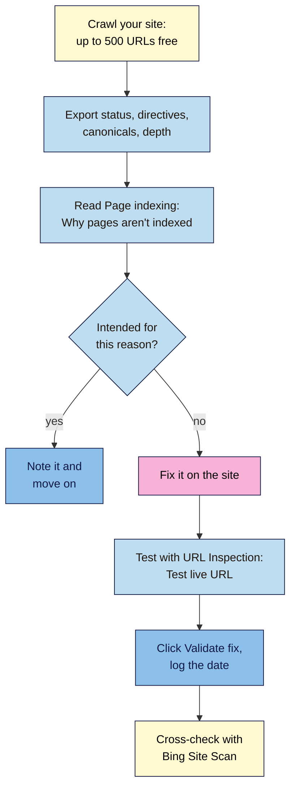

# M06.L06 — Crawl Your Site: Screaming Frog, Page Indexing and URL Inspection
> After this lesson you can crawl your site like a search engine, read Google's Page indexing report without panicking, sort every "not indexed" reason into "intended" or "fix", and check your fixes with URL Inspection, Validate fix and Bing's Site Scan.

**Time:** ~15 min reading + ~45 min hands-on + ~10 min exercise · **Level:** L2 Practitioner · **Prereqs:** M06.L05 · **Remediate to:** M06.L01
**Verified against:** Screaming Frog SEO Spider product, pricing, release history, FAQ and user guide pages (v25.1, 4 November 2026); Search Console Help "Page indexing report" and "URL Inspection tool"; Bing Webmaster Blog (July 2020 and June 2025), all on 2026-11-09. No crawl was run for this lesson, and Search Console, Bing and Screaming Frog screens weren't tested live, so labels may differ slightly on yours.

> ⚠️ **Freshness flag:** Screaming Frog released versions 25.0 and 25.1 on 3 and 4 November 2026, so menus and filter names may shift. Its price (£199 a year for a licence) can change. Some Search Console help pages still suggest the retired robots.txt Tester and Lighthouse; use URL Inspection and DevTools instead.

## Learning objectives
1. **Run** a free crawl (up to 500 URLs) and export the response codes, directives, canonicals and crawl depth. *(O1)*
2. **Read** the Page indexing report: sort each "not indexed" reason into intended or to fix, and use URL Inspection and **Validate fix**. *(O2)*
3. **Cross-check** the crawl with Bing Webmaster Tools Site Scan. *(O3)*

## Why it matters
Kavya opens her Page indexing report for the first time: 31 pages indexed, 74 **not indexed**. It looks like a disaster. Then she reads the reasons. 40 are **Alternate page with proper canonical tag** (her `?utm_` links), 18 are **Page with redirect** (old slugs she redirected in Lesson 6.5), 9 are **URL marked 'noindex'** (her search and thank-you pages), and 7 are **Not found (404)** (posts she deleted on purpose). Every one of them is intended.

Google itself says, "Remember that Not indexed is not necessarily bad." The skill is telling the 3 real problems from the 70 that are fine. A crawler finds problems from your side (what your links lead to). Search Console shows Google's side (what it actually did). You need both.

## Core concept
**Plain version:** a **crawler** like Screaming Frog visits your site the way Googlebot does: it starts at the home page, follows every link, and records each URL's status code, `noindex`, canonical and click depth. The **Page indexing report** in Search Console shows which of your URLs Google has indexed, and why the others aren't. **URL Inspection** zooms in on one URL. **Validate fix** asks Google to recheck an issue after you've fixed it.

**Analogy:** the crawler is you walking through your own shop with a checklist. Search Console is the inspector's report after their visit. Walk the shop first, fix what you find, then read the report and ask the inspector to come back for anything you've fixed.

**Precise definitions:**
- **Crawler (SEO spider):** software that follows links on your site and records what it finds.
- **Indexability:** whether a URL can be indexed (Lesson 6.1's checklist). Screaming Frog shows an **Indexability Status** column: "The reason why a URL is Non-Indexable."
- **Page indexing report:** Search Console's **Indexing → Pages**, split into indexed and not indexed, with a reason for each group.
- **Validate fix:** a button on an issue that asks Google to recheck its examples.
- **Site Scan:** Bing Webmaster Tools' "on-demand site audit tool which crawls your site and checks for common technical SEO issues".

### What the sources say
| Claim | Verdict | What the source says |
|---|---|---|
| Not indexed means something is wrong | **False** | "Remember that Not indexed is not necessarily bad." |
| Every URL should be indexed | **False** | "You should not expect all URLs on your site to be indexed, only the canonical pages" |
| The goal | **Documented** | "Your goal is to get the canonical version of every important page indexed." |
| Small sites need this report | **Not really** | "If your site has fewer than 500 pages, you probably don't need to use this report." It's still useful for spotting a sudden drop |
| You can fix every issue | **False** | "In general, you can fix only issues where the source is listed as "Website"." |
| **Crawled - currently not indexed** is an error | **Not necessarily** | "this is a common message for many sites and doesn't necessarily indicate an issue that needs attention." |
| Validation is quick | **False** | "Validation typically takes up to about two weeks, but in some cases can take much longer" |
| Screaming Frog is free | **Partly** | "The free version is restricted to crawling up to 500 URLs in a single crawl." Saving crawls is a paid feature |
| Screaming Frog sees what Google indexes | **False** | A crawler sees your site's signals; only Search Console shows Google's decisions *(course inference)* |

### Page indexing reasons: intended or fix?
| Reason (as named in Google's help) | Usually | What to check |
|---|---|---|
| **Alternate page with proper canonical tag** | Intended | Nothing: "there is nothing you need to do" |
| **Page with redirect** | Intended | The target is indexed |
| **URL marked 'noindex'** | Check | Intended for thank-you, search and thin pages; a problem on key pages (Lesson 6.2) |
| **Not found (404)** | Usually intended | Fix only "404 errors that you link to yourself or list in a sitemap" |
| **URL blocked by robots.txt** | Check | Fine for carts and parameters; a problem on key pages. Google: these "are probably intentionally blocked" |
| **Duplicate without user-selected canonical** | Usually intended | Google's choice is sensible (Lesson 6.3) |
| **Duplicate, Google chose different canonical than user** | Fix | Signals disagree, or the pages aren't duplicates (Lesson 6.3) |
| **Soft 404** | Fix | Lesson 6.1 |
| **Server error (5xx)** | Fix | Lesson 6.1 |
| **Redirect error** | Fix | A chain, loop or bad target (Lesson 6.5) |
| **Crawled - currently not indexed** | Look at quality | Often thin or similar pages; improve, merge or accept (Modules 7 and 14) |
| **Discovered - currently not indexed** | Wait, then check | Google hasn't crawled it yet; check internal links and the sitemap |
| **Indexed, though blocked by robots.txt** | Fix | Unblock and use `noindex` (Lesson 6.2) |

Labels in your property may differ slightly from the help page, and Google renames reasons from time to time.

## How it works

**In words:** crawl your site, and export the status codes, directives, canonicals and click depth. Then read the Page indexing report's **Why pages aren't indexed** table. For each reason, decide whether it's intended. If it is, note it and move on. If not, fix it on the site, test the fix with URL Inspection's live test, then click **Validate fix** and log the date. Finally, run Bing's Site Scan to see what a second crawler finds.

### Screaming Frog: what to look at
| Tab | Filter or column | What it tells you | Lesson |
|---|---|---|---|
| **Response Codes** | **Client Error (4xx)**, **Server Error (5xx)**, **Redirection (3XX)** | Broken links and redirects you link to. Screaming Frog: "Ideally all internal links would be to canonical resolving URLs, and avoid linking to URLs that redirect." | 6.1, 6.5 |
| **Response Codes** | **Blocked by Robots.txt** | "All URLs blocked by the site's robots.txt" | 6.2 |
| **Response Codes** | **Redirect Chain** | "Internal URLs that redirect to another URL, which also then redirects" | 6.5 |
| **Directives** | **Noindex** | Pages with `noindex` | 6.2 |
| **Canonicals** | **Non-Indexable Canonical** | "The canonical URL is a non-indexable page" (redirected, 404 or `noindex`) | 6.3 |
| **Internal** | **Indexability Status** column | "The reason why a URL is Non-Indexable" | 6.1 |
| **Site Structure** | **Crawl Depth** | Clicks from the start page; "redirects are counted as a level" | 6.5 |

**Free version limits:** 500 URLs per crawl, and you can't save crawls ("previously saved crawls cannot be opened" without a licence), so export what you need before closing. Screaming Frog calls a canonical an instruction; Google calls it "a hint, not a rule" (Lesson 6.3).

> **Under the hood: two views of the same site.** A crawler starts from one URL and follows links, so it only finds pages your links lead to. That's why it's good at broken links, chains and depth, and blind to orphans unless you give it your sitemap. Google finds URLs from links, sitemaps and other sites, and keeps old URLs it has seen before. That's why the Page indexing report lists 404s for pages you deleted years ago, and why it shows only "URLs that have shown 404 errors in the past month" in that group. Neither view is complete alone. And because the example lists are "limited to 1,000 rows", the report shows examples, not every URL. Filter it by your sitemap (**All submitted pages**, Lesson 6.4) to focus on pages you care about.

## Hands-on walkthrough
You'll crawl your site, triage the Page indexing report, fix and validate one issue, and compare with Bing.

**Before you start: which steps apply to you?**
- **Path A:** do every part on your live site.
- **Path B:** do Part A on your Blogger site (or your WordPress practice site's local address, which may work since Screaming Frog runs on the same computer; this wasn't tested). Do Parts B–D on Blogger.
- **Path C:** do Part A on the client's site only if you have permission to crawl it (a 500-URL crawl is light, but ask). Do Parts B–D if you have access.

**Part A — Your first crawl (15 min)**
1. Download the free **Screaming Frog SEO Spider** from screamingfrog.co.uk (Windows, macOS or Linux). The free version needs no sign-up.
2. Type your home page address into **Enter URL to spider** at the top, and click **Start**. Wait for the progress bar to reach 100%.
   **Expected:** a list of URLs in the **Internal** tab. If it stops at 500, that's the free limit.
3. Add a tab called **Crawl findings**, with these columns: **Source**, **Issue**, **URLs affected**, **Example URL**, **Intended?**, **Fix**, **Date fixed**, **Validated?**.
4. Check each row of the "what to look at" table above, and record the counts. Export any filter with results to a spreadsheet (use the export option above the table; the label may vary by version).
   **Expected:** a few 3xx (old links to redirected URLs), maybe a few 4xx, and `noindex` only on pages you meant. **Red flags:** 4xx or 5xx on pages in your menu, **Redirect Chain** results, `noindex` on key pages, **Non-Indexable Canonical** results.
5. Open **Site Structure** and note how many URLs are at each depth.
   **Expected:** most important pages at depth 1–3.
   > 🖼️ **Image prompt:** Screaming Frog SEO Spider (1280×800) after a small crawl, with the Response Codes tab open and the Redirection (3XX) filter selected, showing a few URLs with status 301. Highlight the filter dropdown with a 3px #F9B2D7 outline; blur any personal details.
   > **Alt text:** Screaming Frog showing the Response Codes tab filtered to redirects, with the filter menu highlighted.

**Part B — Triage the Page indexing report (12 min, public sites)**
1. In Search Console, open **Indexing → Pages**. Note the indexed and not-indexed totals.
2. Scroll to **Why pages aren't indexed**. For each reason, add a row to your tab with the count, one example URL (click the reason), and **Intended?** yes or no, using the table above.
3. Look at the **Source** column. Fix only reasons where it says **Website**.
4. At the top, switch from **All known pages** to **All submitted pages**, and see which reasons remain for pages in your sitemap.
   **Expected:** most reasons are intended. The few "no" rows are your fix list.

**Part C — Fix one issue and validate (10 min, public sites)**
1. Choose one "no" row. Fix the cause on your site, using the lesson it points to.
2. Open one example in **URL Inspection**, click **Test live URL**, and check the problem is gone (for example, **Indexing allowed?** is now **Yes**, or the page now returns 200).
3. Back in the report, open the reason and click **Validate fix**. Write the date in the tab. Google says: "Do not click Validate fix again until validation has succeeded or failed."
   **Expected:** the status shows **Started**. Check back in about two weeks; it may show **Passed** or **Failed**.
4. For one important new or updated page, you can also click **Request Indexing** in URL Inspection. It's limited by a quota, so save it for key pages.

**Part D — Cross-check with Bing (8 min, public sites)**
1. In Bing Webmaster Tools, open **Site Scan**, start a new scan of your site, and wait for it to finish.
2. Compare its errors with your Screaming Frog crawl. Bing describes Site Scan as a way to "detect broken links, duplicate tags, and missing metadata".
   **Expected:** mostly the same broken links and redirects. Note anything new (often missing descriptions or duplicate titles, Module 4).

**Expected output:** a **Crawl findings** tab with the crawl's counts per check, the depth spread, every Page indexing reason marked intended or not, one fix tested and sent for validation (with the date), and Bing's extra findings.

## When to use / when not to
**Crawl** after any redesign, migration or big batch of changes, and every few months anyway.

**Read Page indexing** monthly, and whenever traffic drops. Look for sudden changes, not the total.

**Use URL Inspection** for single pages: new pages, fixed pages, and pages that should rank but don't.

**Click Validate fix** once per fixed issue. Don't use it for intended reasons.

**Don't chase 100% indexed.** Aim for every important canonical page indexed.

**Don't crawl sites you don't have permission to crawl**, and keep crawls small on shared hosting.

**The trade-off:** crawlers give instant, complete answers about your links, but don't know Google's decisions. Search Console knows Google's decisions, but is slow and shows examples, not everything.

## Use AI for this
**Example prompt:**
> "Here is the 'Why pages aren't indexed' table from my Search Console, with each reason, its count and one example URL: [paste]. My site is [type of site]. For each reason, say whether it's usually intended or needs fixing, using Google's Page indexing help as the source, and what I should check first. Don't assume every not-indexed page is a problem."

**What AI does well here:** sorting many reasons quickly, and explaining each one in plain words.
**Where it gets it wrong:** it often treats every not-indexed URL as an error, promises that **Request Indexing** will make pages rank, or invents reason names.
**How to check:** compare each answer with Google's help page, and inspect one example URL per reason yourself.

## Common mistakes
- **Panicking at the not-indexed total** instead of reading the reasons.
- **Fixing 404s** for pages you deleted on purpose.
- **Clicking Validate fix repeatedly,** or before fixing anything.
- **Requesting indexing for dozens of pages** instead of fixing the cause.
- **Trusting the crawler as Google's view,** or the report as complete.
- **Not exporting** before closing the free crawler.
- **Crawling too fast** on a small shared host.

## Troubleshooting
| Symptom | Likely cause | Fix |
|---|---|---|
| The crawl stops after one URL | robots.txt blocks everything, or the home page redirects off-site | Check `/robots.txt` and the start URL's redirect (Lessons 6.2, 6.5) |
| The crawl finds far fewer pages than you have | Pages aren't linked, or links use JavaScript | Check menus and internal links (Lessons 4.5, 6.5) |
| The crawl hits 500 and stops | The free limit | Crawl one section at a time, or start from a category page |
| Indexed pages drop with no new errors | A stray block or `noindex` (Lesson 6.2) | Check robots.txt, the Reading setting and the page source |
| Validation **Failed** | At least one example still has the issue | Fix the rest, then start validation again |
| Many **Crawled - currently not indexed** | Thin or very similar pages | Improve, merge or remove them (Modules 7 and 14) |
| Site Scan can't reach the site | A firewall or bot-protection setting | Check your host's settings for blocked crawlers |

## Exercise
**Task:** complete your **Crawl findings** tab (Parts A–D). Then answer these. All details are illustrative.
1. Kavya's report shows 74 not-indexed pages. 40 are **Alternate page with proper canonical tag**. What should she do about those?
2. Tomás's crawl shows 25 internal links to URLs that return 301. What should he change?
3. Nila's report lists 12 **Not found (404)** pages for products she removed last year. Fix or leave?
4. Amara's client has 30 pages under **Crawled - currently not indexed**. What should she look at first?
5. After fixing a soft 404, when should Nila click **Validate fix**, and how long might it take?
6. Screaming Frog found no problems, but Search Console shows **Duplicate, Google chose different canonical than user**. How can both be true?

**Expected outcome:** a complete tab, and these answers:
- **1** Nothing: "there is nothing you need to do." They're intended.
- **2** Update those internal links to point straight at the final URLs.
- **3** Leave them, unless she still links to them or lists them in the sitemap.
- **4** Whether the pages are thin, very similar or low value; improve, merge or accept them.
- **5** After fixing it and checking with **Test live URL**. Once only. It typically takes up to about two weeks.
- **6** The crawler sees only her own signals, which may look fine. Google weighs other signals, such as links from other sites, content similarity and the sitemap, and made a different choice (Lesson 6.3).

**Stretch goal:** crawl your site again after your fixes, and compare the counts with your first crawl.

## Key takeaways
- A crawler shows what your links lead to. Search Console shows what Google did. Use both.
- "Not indexed is not necessarily bad." Sort each reason into intended or fix.
- Fix only issues with **Website** as the source, and only 404s you link to or list in a sitemap.
- Test fixes with **Test live URL**, then click **Validate fix** once, and allow about two weeks.
- Screaming Frog's free version crawls 500 URLs and can't save crawls, so export before closing.

## Teach it back
Explain to a friend in 3 sentences why a page indexing report with lots of "not indexed" pages can still be perfectly healthy, and how you'd find the ones that matter.

## Glossary terms added
- Page indexing report — added to `seo-101/glossary.md`
- Validate fix — added to `seo-101/glossary.md`
- SEO crawler — added to `seo-101/glossary.md`
- *Already in the glossary:* URL Inspection, Crawling, Indexing, Crawl depth

## Further reading
*All checked 2026-11-09.*
- Search Console Help — Page indexing report: https://support.google.com/webmasters/answer/7440203
- Search Console Help — URL Inspection tool: https://support.google.com/webmasters/answer/9012289
- Screaming Frog — SEO Spider (free version limits): https://www.screamingfrog.co.uk/seo-spider/
- Screaming Frog — Pricing (free vs licence features): https://www.screamingfrog.co.uk/seo-spider/pricing/
- Screaming Frog — User guide: tabs and filters: https://www.screamingfrog.co.uk/seo-spider/user-guide/tabs/
- Bing Webmaster Blog — Announcing the new Bing Webmaster Tools (July 2020, Site Scan): https://blogs.bing.com/webmaster/july-2020/Announcing-the-new-Bing-Webmaster-Tools-(migration-complete)
- Bing Webmaster Blog — Start using Bing Webmaster Tools (June 2025): https://blogs.bing.com/webmaster/2025/6/Start-Using-Bing-Webmaster-Tools-to-Improve-Your-Site-Visibility/

> ⚠️ **May change:** Screaming Frog's menus and price (updated often); Page indexing reason names; Bing Webmaster Tools menus.

## Refresher card
*Used by remediation when a learner fails a quiz twice on a later lesson that points back here.*
**Crawler** (Screaming Frog free: 500 URLs, no saved crawls, so export): Response Codes (4xx, 5xx, 3xx, Blocked by Robots.txt, Redirect Chain), Directives (Noindex), Canonicals (Non-Indexable Canonical), Internal (Indexability Status), Site Structure (Crawl Depth). **Page indexing:** "Not indexed is not necessarily bad"; goal = every important canonical page indexed; fix only **Website**-source issues and 404s you link to; intended = alternate with canonical, page with redirect, deliberate `noindex`/robots/404; fix = soft 404, 5xx, redirect error, Google chose different canonical, indexed though blocked. **Fix loop:** fix → **Test live URL** → **Validate fix** once (about two weeks) → log it. **Bing Site Scan** for a second opinion.
