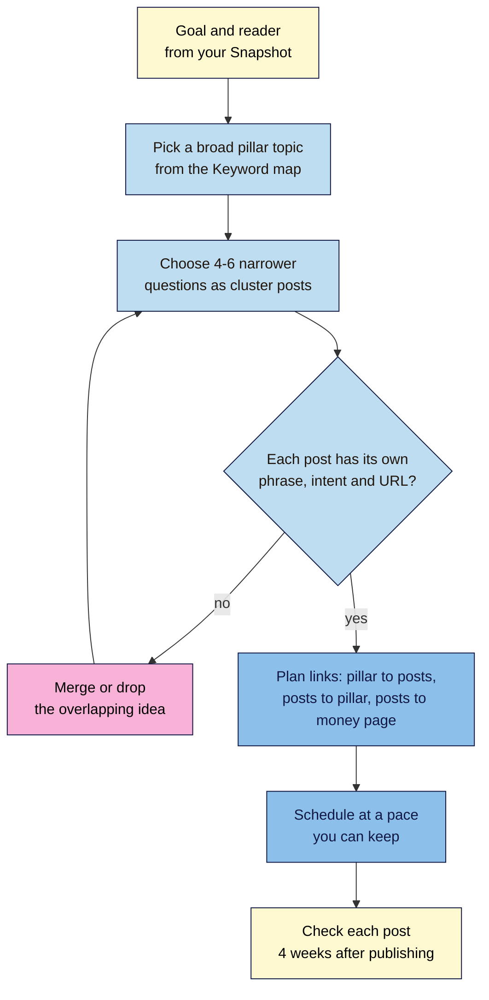
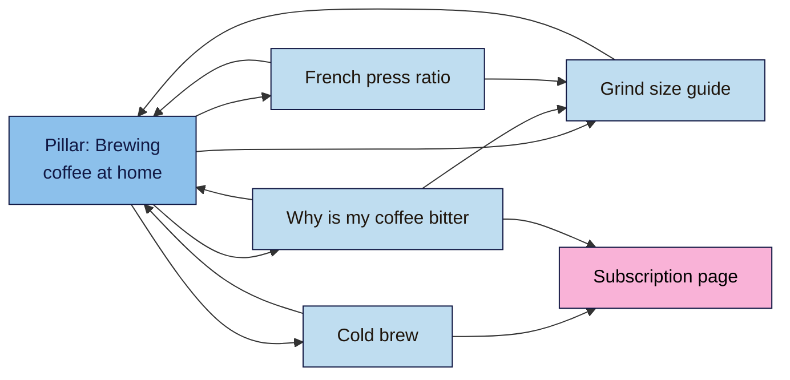

# M07.L01 — Content Strategy: Goals, Audience and Topic Clusters
> After this lesson you can decide what to publish and why: tie every planned post to a goal and a reader, group posts into one small topic cluster around a pillar page, and plan a 3-month calendar you can actually keep.

**Time:** ~15 min reading + ~40 min hands-on + ~10 min exercise · **Level:** L2 Practitioner · **Prereqs:** M01.L01, M03.L05, M04.L05 · **Remediate to:** M03.L05
**Verified against:** Google Search Central "Help Google understand your ecommerce site structure", SEO Starter Guide and "Make links crawlable" (all last updated 2025-12-10), "Optimizing your website for generative AI features" (2026-07-10), "Creating helpful, reliable, people-first content" (2026-10-05) and the spam policies; GOV.UK "Write content to meet user needs"; HubSpot's 2017 topic-cluster post (Wayback capture of 12 December 2019), all on 2026-11-09.

> ⚠️ **Freshness flag:** Google's helpful-content page changed on 2026-10-05 and its AI optimisation guide is new (May 2026). Both may change again. The words "pillar page", "topic cluster" and "topical authority" come from the content-marketing industry, not from Google's docs.

## Learning objectives
1. **Link** each planned post to a business goal and a reader from your M01 snapshot. *(O1)*
2. **Design** a small topic cluster (1 pillar + 4–6 posts) from your keyword map, with one keyword and intent per URL and planned internal links. *(O2)*
3. **Build** a realistic 3-month content calendar that one person can keep up with. *(O3)*

## Why it matters
Nila Coffee's blog has nine posts. Three are about Kochi cafés, two are news about a new roast, one is a French press guide, and three were written because "everyone writes about latte art". None link to each other, and none link to the subscription page. Search Console shows a trickle of visits to the French press guide and almost nothing else.

The problem isn't the writing. It's that nobody decided **what the blog is for**. Nila's snapshot (Lesson 1.1) says the missing stage is awareness: "no pages answer beginner questions like 'why is my coffee bitter?'". Her keyword map (Lesson 3.5) already lists those questions. A content strategy connects the two: a short list of posts that answer real beginner questions, link to each other, and lead to the subscription. Written at a pace Nila can keep, alongside roasting coffee.

## Core concept
**Plain version:** a **content strategy** answers four questions before you write anything: *why* (which business goal), *for whom* (which reader), *what* (which topics from your keyword map) and *when* (a calendar you can keep). A **topic cluster** is one way to organise the *what*: a broad **pillar page** that covers a subject, plus a few **cluster posts** that each answer one narrower question in depth. The pillar links to every cluster post, and each post links back to the pillar and to its neighbours.

**Analogy:** a pillar page is the "Brewing" aisle sign in a shop. Each cluster post is a shelf in that aisle: French press, pour-over, cold brew. The sign tells shoppers what's in the aisle; the shelves hold the detail; and the signs on each shelf point to the next one.

**Precise definitions:**
- **Content strategy:** a written plan of what you'll publish, for whom, why, and when, and how you'll know it worked.
- **Pillar page:** a broad page on one subject that summarises it and links to the detailed posts. It targets a broad phrase, not a long-tail one.
- **Cluster post:** a post that answers one narrower question in depth, with its own keyword and intent from the keyword map, linked to and from the pillar.
- **Topic cluster:** the pillar plus its cluster posts and the links between them. (Also called "hub and spoke".)
- **Content calendar:** a schedule of what gets drafted, checked and published when.

> **Don't mix up the two kinds of cluster.** In Lesson 3.5, a **topic (keyword cluster)** was a group of *phrases* that one *page* can answer. A **topic cluster** here is a group of *pages* on one subject. Each page in a topic cluster still has its own keyword-cluster row in your keyword map.

### What the sources say
| Claim | Verdict | What the source says |
|---|---|---|
| Start from what your readers need | **Documented** | GOV.UK: "Before you start writing, identify a user need." Google asks: "Do you have an existing or intended audience for your business or site that would find the content useful if they came directly to you?" |
| Google rewards "pillar pages" or "topical authority" | **Not documented** | Google's docs don't use these terms. The model comes from HubSpot (2017), whose own experiments started it *(observed practice)* |
| Google works out site structure from your links | **Documented** | "Google generally doesn't look at the structure of URLs to work out the structure of a site." And: "the more links a page has to it within a site, the higher the relative importance of the page" |
| Every page needs an internal link | **Documented** | "Every page you care about should have a link from at least one other page on your site." |
| Putting a cluster in one folder (`/brewing/…`) helps it rank | **Not for small sites** | Folders "can help Google learn how often the URLs in individual directories change", and Google raises this for sites with "more than a few thousand URLs". It's about crawling, not ranking |
| More posts = more traffic | **False** | "a high quantity of pages doesn't make a website higher quality or more relevant to users" |
| Write a page for every way people phrase a question | **Risky** | Doing so "primarily to manipulate rankings or generative AI responses in Google Search violates Google's scaled content abuse spam policy" |
| Write about whatever is trending | **Warning sign** | Google asks: "Are you writing about things simply because they seem trending and not because you'd write about them otherwise for your existing audience?" |

So: **use clusters because they make planning and internal linking easy, not because Google has a "cluster" signal.** Google's documented signals here are links and helpful content, and a cluster gives you both.

### How big should a cluster be?
HubSpot's original test for a pillar: "Would this page answer every question the reader who searched X keyword had, AND is it broad enough to be an umbrella for 20-30 posts?" That's a test of *breadth*, not a target. A small business writing a few posts a month can't fill 20–30 well, and Google's warnings about volume (above) point the same way. **For this course: 1 pillar + 4–6 cluster posts** *(course rule of thumb)*. Add more only when each new post answers a real, different question from your keyword map.

HubSpot's other test is useful too: "if you're trying to get the page you're working on to rank for a long-tail keyword, it's not a pillar page."

### Nila Coffee's first cluster
| Role | Page | Main phrase (from keyword map) | Intent | Status | Goal it serves |
|---|---|---|---|---|---|
| **Pillar** | /brewing-coffee-at-home | how to brew coffee at home | Informational | New | Awareness → email list |
| Cluster | /french-press-ratio | french press ratio | Informational | Existing (refresh, Lesson 7.6) | Awareness |
| Cluster | /cold-brew | how to make cold brew at home | Informational | New | Awareness → subscription |
| Cluster | /why-is-my-coffee-bitter | why is my coffee bitter | Informational | New | Awareness (the snapshot's gap) |
| Cluster | /grind-size-guide | coffee grind size chart | Informational | New | Consideration |
| Cluster | /pour-over-guide | how to make pour over coffee | Informational | New | Awareness |
| Money page | /subscription | coffee subscription india | Transactional | Existing | Main conversion |

The latte-art and café posts stay, but they're not in this cluster. The roast news posts become candidates for a merge or refresh in Lesson 7.6.

## How it works

**In words:** start with one goal and one reader from your snapshot. Pick a broad topic from your keyword map as the pillar, then choose four to six narrower questions as cluster posts. Check that each one has its own phrase, intent and URL; if two overlap, merge or drop one. Plan the links between the pillar, the posts and your money page. Schedule the work at a pace you can keep, and check each post four weeks after it goes live.

### The link pattern

**In words:** the pillar links down to every cluster post, and every post links back up to the pillar. Posts link sideways where one helps the reader of another, such as "bitter coffee" to "grind size". Posts where readers are close to buying link to the subscription page. Only add a link where it helps the reader of that paragraph (Lesson 4.5).

> **Under the hood: why the pattern works without a "cluster signal".** Google says it analyses "the linkages between pages to gain insights about the relative importance of different pages on a site". A pillar that every cluster post links to collects many internal links, so it looks important. Each cluster post gets at least two links (from the pillar and a neighbour), so none is an orphan. The anchor text of each link (Lesson 4.5) tells Google and readers what the target is about. Google's link advice reads almost like a cluster recipe: "Think about what other resources on your site could help your readers understand a given page on your site, and link to those pages in context." None of this needs folders, special markup or a plugin.

### A calendar you can keep
A calendar fails when it's planned for the time you wish you had. Plan it from the time you actually have *(observed practice)*:
1. **Time one post** from brief to publish, including the fact-check and publish checklist (Lessons 7.2–7.5). Many first posts take a full working day; yours may differ.
2. **Take your weekly hours** (Kavya has 4, Tomás 3, Amara 5) and reserve some for checking, refreshing and other SEO work.
3. **Pick a pace** you could keep for three months even in a busy week. For most people with a few hours a week, that's one post every one or two weeks *(course rule of thumb)*.
4. **Put the pillar first or last, not in the middle.** Publish it first if you already have some cluster posts to link to; publish it last if most posts are new, so it launches with real links.

Nila's 3-month plan: the pillar in week 1 (with links to the existing French press guide and two "coming soon" sections that don't link yet), then one new cluster post every two weeks, a refresh of the French press guide in week 8, and a 4-week check for each post.

## Hands-on walkthrough
You'll write down your content goals, map one topic cluster, and schedule three months of work. Nila Coffee's values are illustrative.

**Before you start: which steps apply to you?**
- **Path A (your own site):** do every part for your site.
- **Path B (practice site):** do every part for the site you described in your Snapshot. Your posts will go on the WordPress practice site (Lesson 5.1) or Blogger.
- **Path C (client site):** do every part, then share the plan with the client before anyone writes. They may know about launches, seasons or topics to avoid.

**Part A — Goals and readers (10 min)**
1. Open your **SEO 101 project** sheet and re-read your **Snapshot** tab: audience, main conversion, second conversion and the missing journey stage.
2. Add a tab called **Content plan**. At the top, write three lines:
   - **Goal:** what the content should do for the business, such as "bring beginner home brewers to the site and into the email list".
   - **Reader:** one sentence from your Snapshot, such as "home coffee drinkers without barista equipment".
   - **How we'll know (after 3 months):** one measurable sign, such as "the cluster posts get impressions in Search Console for their main phrases, and 20 email sign-ups come from blog pages". Module 8 shows how to measure it.
   **Expected:** three short, specific lines. "More traffic" alone isn't a goal; it doesn't say who or why.

**Part B — Map one cluster (15 min)**
1. Open your **Keyword map** (Lesson 3.5). Find a broad topic that several of your informational rows sit under. That's your pillar topic.
2. Run HubSpot's test on it: would a page on this topic answer most of a beginner's first questions, and could several of your keyword-map rows sit under it? If it's one narrow question, pick something broader.
3. Choose 4–6 rows from the keyword map that sit under the pillar. Prefer rows marked **Quick win** (Lesson 3.4) and rows that fill your Snapshot's missing stage.
4. Below the three lines in **Content plan**, add a table with these columns: **Role** (Pillar, Cluster, Money page), **URL**, **Main phrase**, **Intent**, **Existing or new**, **Goal it serves**, **Links to**, **Links from**.
5. Check for overlap: each row must have a different main phrase and URL, and no row may share a URL with another keyword-map row. If **Used twice?** in your keyword map shows TRUE for any of them, fix that first (Lesson 3.5).
6. Fill **Links to** and **Links from** using the link pattern above: pillar ↔ every post, at least one sideways link per post, and posts close to buying → your money page.
   **Expected:** 5–7 rows, each with a different phrase and URL, and every post with at least two planned links in.
   > 🖼️ **Image prompt:** Google Sheets tab called Content plan (1280×700) with three short lines at the top (Goal, Reader, How we'll know) and a table below listing one Pillar row, five Cluster rows and one Money page row with URL, main phrase, intent and planned links. Highlight the Pillar row with a 3px #F9B2D7 outline; blur any personal details.
   > **Alt text:** A content plan sheet with goals at the top and a pillar, five cluster posts and a money page listed with their planned links.

**Part C — Schedule three months (15 min)**
1. Write down your honest weekly hours for SEO, and your best guess at the time one post takes (if you've never timed one, write "8 hours" and correct it after Lesson 7.5).
2. Below the cluster table, add a calendar with these columns: **Week**, **URL**, **Task** (Brief, Draft, Fact-check, Publish, Refresh, 4-week check), **Status**, **Done on**.
3. Spread your cluster over 12 weeks at your chosen pace. Add a **4-week check** row four weeks after each publish date, and one **Refresh** row for an existing post.
4. Look at the busiest week. If it needs more hours than you have, move something later.
   **Expected:** a 12-week calendar with the pillar, 4–6 posts (or fewer if your hours are tight), one refresh and the 4-week checks, and no week over your hours.

**Expected output:** a **Content plan** tab with your goal, reader and success measure, one topic cluster with planned links and no overlapping URLs, and a 12-week calendar sized to your real hours.

## When to use / when not to
**Use a topic cluster** when several keyword-map rows share a subject and the same reader, such as brew guides, yoga for beginners, or garden tool care.

**Use a single page instead** when one page can answer the whole subject. Splitting a small topic into many thin posts creates cannibalisation (Lesson 3.5) and the volume Google warns about.

**Don't build clusters for product pages.** Shops already have a structure for that: category pages linking to products (Lesson 4.6). Clusters are for informational content that leads *to* those pages.

**Don't plan more than one new cluster at a time** until the first is published and checked *(course rule of thumb)*.

**The trade-off:** a narrow plan (one cluster, slow pace) feels small but gets finished, linked and measured. A wide plan (many topics, fast pace) looks impressive but tends to leave half-written posts with no links, the pattern in Nila's old blog.

## Use AI for this
**Example prompt:**
> "Here are the rows of my keyword map, each with a main phrase, intent and URL: [paste]. My site is [type of site] and my reader is [one sentence]. Suggest one pillar topic and 4–6 cluster posts **using only rows from this list**. For each post, say which other posts it should link to and why a reader would want that link. Flag any two rows that look like the same question."

**What AI does well here:** spotting which rows belong together in a long list, and suggesting sensible sideways links.
**Where it gets it wrong:** it invents extra posts that aren't in your keyword map (often 20 or more), suggests phrasing variations as separate posts, and promises "topical authority" as if Google measured it.
**How to check:** every suggested post must match a keyword-map row with its own intent and URL. Cut anything else. Search any two posts it put together in a private window: if the results are mostly the same, they're one page (Lesson 3.5).

## Common mistakes
- **Starting from "what should we post this week?"** instead of a goal and a reader.
- **Planning 20–30 posts** for one pillar because a blog said so.
- **A "pillar" that targets a long-tail phrase,** so it competes with its own cluster posts.
- **Two cluster posts for the same question** in different words.
- **Clusters with no links,** or links only from the pillar down.
- **A calendar sized to wishful hours,** which slips by week three.
- **Folders, tags or plugins instead of links.** Putting posts in `/brewing/` or tagging them "brewing" doesn't connect them for readers; contextual links do.

## Troubleshooting
| Symptom | Likely cause | Fix |
|---|---|---|
| You can't find a pillar topic | Your keyword map is mostly transactional (a shop) or very short | Pick the informational questions buyers ask before buying, or add rows (Lesson 3.2) |
| Every cluster post seems to need the same content | The posts are one question in different words | Merge them into one post (Lesson 3.5) |
| The pillar would just repeat the cluster posts | The pillar is trying to answer everything in full | Keep each section of the pillar short, and link to the post for the detail |
| You're behind after three weeks | The pace is too fast for your hours | Halve the pace and move posts later; don't skip the fact-check |
| A cluster post isn't getting impressions after 4 weeks | Too early, or it isn't indexed or linked | Check it's indexed (Lesson 6.6) and has at least two internal links; give it more time |
| Two of your pages show for the same phrase | Overlap between a cluster post and an older post | Use the fix flowchart in Lesson 3.5; merges are in Lesson 7.6 |

## Exercise
**Task:** complete your **Content plan** tab (Parts A–C). Then answer these. All details are illustrative.
1. Kavya wants a pillar called "Yoga for back pain relief at home with a chair". Is it a good pillar? What would you suggest?
2. Tomás plans 25 posts around "garden tools" in three months, with 3 hours a week. What's the risk, and what would you change?
3. Amara's client wants two posts: "best time to drink green tea" and "when should you drink green tea". Should they be two cluster posts?
4. Nila moves all her brew guides into a `/brewing/` folder to "build topical authority". Will that help them rank?
5. Nila's cold brew post is published, but nothing links to it except the sitemap. Which links should she add first?
6. Kavya's goal line says "more traffic". Rewrite it.

**Expected outcome:** a complete tab, and these answers:
- **1** No. It's a long-tail phrase, so it's a cluster post. A better pillar is "yoga at home for beginners", with back pain, chair yoga and morning routines as cluster posts.
- **2** He'll fall behind and publish thin, unlinked posts; Google warns that "a high quantity of pages doesn't make a website higher quality". Plan one pillar and 4–6 posts at a pace he can keep.
- **3** Probably not. Search both: if the results are mostly the same, it's one question and one post (Lesson 3.5).
- **4** No. Google doesn't use URL structure to work out site structure, and folders matter for crawling on sites with thousands of URLs. Links between the posts would help more. A URL change also needs redirects (Lesson 6.5).
- **5** A link from the pillar, a link back to the pillar, and a sideways link from a related post, such as the grind size guide.
- **6** For example: "bring beginner yoga students in Chennai to the schedule page, measured by clicks from Google to the blog and schedule page after 3 months".

**Stretch goal:** sketch your link pattern on paper or in a free diagram tool, and check that every post has at least two arrows pointing into it.

## Key takeaways
- Decide *why*, *for whom*, *what* and *when* before you write.
- A topic cluster is a pillar plus a few narrower posts, linked both ways. It's a planning and linking method, not a Google signal.
- Keep it small: 1 pillar + 4–6 posts, each with its own phrase, intent and URL.
- Google works out structure and importance from links, not folders.
- Plan your calendar from the hours you really have, with a 4-week check for each post.

## Teach it back
Explain to a friend in 3 sentences what a pillar page and cluster posts are, why you'd link them both ways, and why a small cluster beats a big one for a one-person business.

## Glossary terms added
- Content strategy — added to `seo-101/glossary.md`
- Pillar page — added to `seo-101/glossary.md`
- Topic cluster (pillar and cluster posts) — added to `seo-101/glossary.md`
- Content calendar — added to `seo-101/glossary.md`
- *Already in the glossary:* Topic (keyword cluster), Keyword map, Internal and external links, Orphan page, Keyword cannibalisation

## Further reading
*All checked 2026-11-09.*
- Google Search Central — Help Google understand your ecommerce site structure: https://developers.google.com/search/docs/specialty/ecommerce/help-google-understand-your-ecommerce-site-structure
- Google Search Central — Make your links crawlable: https://developers.google.com/search/docs/crawling-indexing/links-crawlable
- Google Search Central — SEO Starter Guide (organising content in directories): https://developers.google.com/search/docs/fundamentals/seo-starter-guide
- Google Search Central — Creating helpful, reliable, people-first content: https://developers.google.com/search/docs/fundamentals/creating-helpful-content
- Google Search Central — Optimizing your website for generative AI features on Google Search: https://developers.google.com/search/docs/fundamentals/ai-optimization-guide
- Google Search Central — Spam policies (scaled content abuse): https://developers.google.com/search/docs/essentials/spam-policies
- GOV.UK — Write content to meet user needs: https://guidance.publishing.service.gov.uk/writing-to-gov-uk-standards/writing-guidelines/meet-user-needs/
- HubSpot — Topic Clusters: The Next Evolution of SEO (2017, industry source; 2019 capture): http://web.archive.org/web/20191212091256/https://blog.hubspot.com/marketing/topic-clusters-seo

> ⚠️ **May change:** Google's helpful-content page and AI optimisation guide (both revised in 2026); HubSpot's live topic-cluster page was rewritten in 2026, so quote the 2017 wording only from the archived copy.

## Refresher card
*Used by remediation when a learner fails a quiz twice on a later lesson that points back here.*
**Strategy = why (goal), for whom (reader from the Snapshot), what (keyword-map topics), when (a calendar you can keep).** **Topic cluster:** a broad **pillar** page + 4–6 narrower **cluster posts**, each with its own phrase, intent and URL; pillar ↔ every post, sideways links where they help, posts → money page. Not a Google signal: Google judges structure and importance from internal links ("the more links a page has to it within a site, the higher the relative importance"), not folders. "A high quantity of pages doesn't make a website higher quality." A pillar never targets a long-tail phrase. Calendar: time one post, plan from real hours, add a 4-week check per post.
