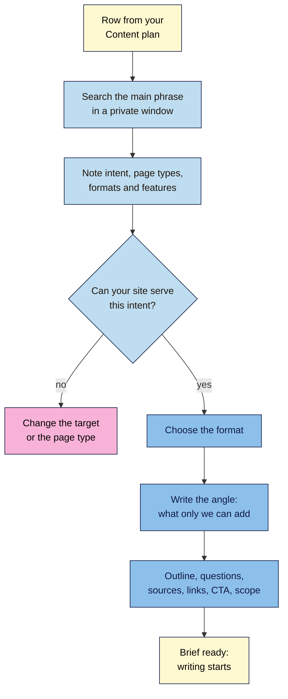

# M07.L02 — The Content Brief and Post Formats by Intent
> After this lesson you can turn a planned post into a one-page brief that a writer (you, a colleague or a freelancer) can follow, choose the post format the results page rewards, and name the one thing only your site can add.

**Time:** ~15 min reading + ~35 min hands-on + ~10 min exercise · **Level:** L2 Practitioner · **Prereqs:** M07.L01, M03.L01 · **Remediate to:** M03.L01
**Verified against:** Google Search Central SEO Starter Guide, "A guide to Google Search ranking systems" and "Write high quality reviews" (all last updated 2025-12-10), the Search Quality Rater Guidelines (11 September 2025), "Optimizing your website for generative AI features" (2026-07-10) and "Creating helpful, reliable, people-first content" (2026-10-05); GOV.UK "Write content to meet user needs", all on 2026-11-09.

> ⚠️ **Freshness flag:** Google has no official "content brief". The brief in this lesson is industry practice, with each field tied to a Google or GOV.UK line. Google's AI optimisation guide (source of the "commodity content" idea) is new and may change.

## Learning objectives
1. **Write** a content brief whose every field (keyword, intent, reader, angle, outline, questions, sources, links in and out, call to action, scope) traces to a reason. *(O1)*
2. **Choose** a post format (how-to, explainer, comparison, "best X", product-led) from the formats ranking for the keyword. *(O2)*
3. **Distinguish** commodity content from content with first-hand value, and set a word range as scope, not a target. *(O3)*

## Why it matters
Amara gets a message from a client: "Write 1,500 words on green tea benefits." She writes 1,500 words. The client says it's not what they wanted: they sell matcha, they wanted buyers, and the post doesn't mention their tea once. Two rewrites later, the post still ranks nowhere, because the results page for that phrase is full of health sites with doctors' reviews.

A brief would have caught all of it in ten minutes: which phrase, which intent, who it's for, what the results page shows, what the client can add that health sites can't, and where the post should send readers. Writing is the slow part. The brief makes sure you write the right thing.

## Core concept
**Plain version:** a **content brief** is a one-page plan for a single post. It fixes the decisions (what the post is for, who reads it, what format it takes, what it covers, what makes it different) before anyone writes a word. The **format** is the shape of the post: numbered steps, an explainer, a comparison, a list of picks. You choose it by looking at what already ranks, because the results page shows what searchers want (Lesson 3.1).

**Analogy:** a brief is a recipe card written *before* you cook. It lists the dish, who's eating, the ingredients you already have, and the one thing that will make yours better than the café's down the road. You can still improvise while cooking, but you won't end up making soup when they ordered cake.

**Precise definitions:**
- **Content brief:** a short document that sets a post's target phrase, intent, reader, angle, outline, sources, links and scope before writing starts.
- **Post format:** the structure that suits a search intent, such as steps for a how-to or a table for a comparison.
- **Angle (unique value):** what this post offers that others on the results page don't, usually first-hand experience, original tests or data, or local knowledge.
- **Commodity content:** Google's term for content "based on common knowledge, which could originate from anyone", that "typically adds little unique insight for readers".
- **Scope (word range):** a rough estimate of length from the outline, used for planning time, never as a target to fill.

### What the sources say
| Claim | Verdict | What the source says |
|---|---|---|
| Start from a need, not a word count | **Documented** | GOV.UK: "Before you start writing, identify a user need." "Publish only what's needed to meet that user need and nothing more." |
| Google has an ideal length | **False** | "there's no magical word count target, minimum or maximum, though you probably want to have at least one word." And: "(No, we don't.)" |
| Rewriting what ranks is enough | **False** | "create the content yourself based on what you know about the topic. Don't just rehash what others already published." |
| Common-knowledge posts struggle | **Documented** | "Commodity content … typically adds little unique insight for readers." Non-commodity content "provides unique expert or experienced takes that go beyond common knowledge and the ordinary." |
| Sources help readers trust you | **Documented** | "providing expert or experienced sources can help people understand your articles' expertise." Google also lists "clear sourcing" as a sign of trust |
| You must use every phrasing of a keyword | **False** | "don't worry if you don't anticipate every variation of how someone might seek your content. Google's language matching systems are sophisticated" |
| Some queries favour recent content | **Documented** | "We have various "query deserves freshness" systems designed to show fresher content for queries where it would be expected." |
| A content brief is a Google requirement | **No** | It's an industry habit *(observed practice)*. The fields below come from Google and GOV.UK guidance |

### The brief, field by field
| Field | What to write | Why (the source behind it) |
|---|---|---|
| **Working title and URL** | From the **Content plan** (Lesson 7.1) | One page per topic (Lesson 3.5) |
| **Main phrase and other phrases** | From the **Keyword map** | The post's target; extra phrases are hints, not a checklist |
| **Intent and format** | From your SERP check (Part A below) | Match what searchers want (Lesson 3.1) |
| **Reader and need** | One sentence: who, and what they want to get done | "identify a user need" (GOV.UK) |
| **Angle: what only we can add** | First-hand tests, photos, data, prices, local detail | "Don't just rehash what others already published" |
| **Outline** | H2s (and key H3s) in reading order, answer first | Lesson 4.2; Lesson 7.3 covers writing |
| **Questions to answer** | From People Also Ask and your own customers | "will someone leave feeling they've learned enough about a topic to help achieve their goal?" |
| **Sources to check** | Primary sources only (manufacturer, study, official page) and your own notes | "clear sourcing"; the fact-check pass is Lesson 7.4 |
| **Links in and out** | From the cluster table (Lesson 7.1) | "Every page you care about should have a link from at least one other page" (Lesson 4.5) |
| **Call to action** | The one next step for this reader | The goal in your Content plan |
| **Scope** | A rough word range from the outline | Planning only; there's "no magical word count target" |
| **AI use** | What, if anything, AI will help with | Lesson 7.4; needed for an honest "How" note |
| **Owner and dates** | Who writes, who checks, publish week | Your calendar |

### Formats by intent
| Intent (Lesson 3.1) | Common formats | What the reader wants first | Nila example |
|---|---|---|---|
| **Informational: how-to** | Numbered steps, a recipe card, a short video | The ratio, time or first step, then the method | "How to make cold brew at home" |
| **Informational: explainer or problem** | Causes and fixes, a short Q&A, a diagram | The answer in one or two sentences, then the reasons | "Why is my coffee bitter?" |
| **Commercial: "best X"** | A list of picks with the criteria, tests and who each suits | The short list, with who each one is for | "Best coffee grinder for French press" |
| **Commercial: "X vs Y"** | A comparison table, then a verdict by situation | The table and the verdict | "French press vs pour-over" |
| **Transactional** | A product or category page, not a blog post | Price, options, delivery, buy button (Lesson 4.6) | "Buy cold brew coffee beans" |
| **Navigational or local** | Contact, about, location pages | The address, hours or login | Module 11 |

Two extra rules for **"best X" and reviews**:
- **Freshness can matter.** For "best X" searches, people expect current products and prices, and Google says freshness systems apply "for queries where it would be expected". Put the "Last updated" date on the page (Lesson 7.5) and plan a yearly refresh (Lesson 7.6). For a timeless how-to like "French press ratio", freshness matters much less.
- **Show you tested it.** Google's review guidance asks you to "Provide evidence such as visuals, audio, or other links of your own experience with what you are reviewing" and to "Discuss the benefits and drawbacks of something, based on your own original research." If you haven't used the products, write a different post.

### Commodity or not?
Google's own example: "7 Tips for First-Time Homebuyers" is commodity content; "Why We Waived the Inspection & Saved Money: A Look Inside the Sewer Line" is not. The difference is first-hand experience that nobody else has.

| Commodity (anyone could write it) | Non-commodity (only Nila could write it) |
|---|---|
| "10 tips for better coffee at home" | "We brewed one bean five ways: here's which grind fixed the bitterness" |
| "What is cold brew?" | "Our cold brew recipe after 40 test batches, with the ratio we sell in the café" |
| "Best coffee grinders" (from other reviews) | "Three grinders we use in the tasting room, and the one we'd buy for home" |

You don't need a lab. A photo of your own setup, a number from your own test, a mistake you made, or what your customers ask most are all first-hand. Google's helpful-content page puts it as a question: "Does the content provide original information, reporting, research, or analysis?" Lesson 4.3 covers experience and trust in more depth.

## How it works

**In words:** take one row from your content plan and search its main phrase in a private window. Note the intent, the page types and formats in the top results, and any SERP features. If your site can't serve that intent (say, the results are all product pages and you're writing a blog post), change the target or the page type. Otherwise, choose the format, write down what only you can add, then fill in the outline, questions, sources, links, call to action and scope. Then writing can start.

> **Under the hood: why a word range isn't a target.** Many brief tools take the average length of the top results and suggest it as a target. That number describes pages, not what makes them rank. Google says the length "alone doesn't matter for ranking purposes", and the Search Quality Rater Guidelines (September 2025) say **filler** "can artificially inflate content, creating a page that appears rich but lacks content website visitors find valuable". So estimate scope from your outline instead: count the sections, guess each one's length, and add them up. If the post needs 600 words to do the job, 600 is right. If it needs 2,000, that's fine too.

## Hands-on walkthrough
You'll check the results page for three cluster phrases and write one full brief. Nila Coffee's values are illustrative. Results differ by country, device and day, so yours won't match these.

**Before you start: which steps apply to you?**
- **Path A (your own site):** do every part for posts in your **Content plan**.
- **Path B (practice site):** do every part for your practice site's plan.
- **Path C (client site):** do every part, then send the brief to the client for sign-off before writing. Ask them for the "only we can add" material: photos, numbers, customer questions.

**Part A — SERP format check (12 min)**
1. Pick three cluster posts from your **Content plan**.
2. For each main phrase, open a private window and search it. Look at the top ten organic results.
3. Add a tab called **Briefs**. At the top, make a small table: **Phrase**, **Date checked**, **Intent**, **Main page types**, **Main format**, **SERP features**, **Format we'll use**.
   | Phrase | Date checked | Intent | Main page types | Main format | SERP features | Format we'll use |
   |---|---|---|---|---|---|---|
   | how to make cold brew at home | 2026-11-09 | Informational | Recipe blogs, videos | Steps with a ratio | Videos, People Also Ask | Steps, ratio first |
   | why is my coffee bitter | 2026-11-09 | Informational | Guides, forums | Causes and fixes | People Also Ask | Causes and fixes |
   | best coffee grinder for french press | 2026-11-09 | Commercial | Review lists | Picks with tests | Shopping, videos | Picks we've used |
   **Expected:** one clear format per phrase. If the results mix formats, pick the one your site serves best (Lesson 3.1).

**Part B — Write one brief (18 min)**
1. Pick one of the three posts. Below the table, write a brief using every field in "The brief, field by field". Keep it to one page.
2. For **Angle**, write one sentence starting "Only we can…", such as "Only we can share the ratio we've tested in 40 batches and sell in the café."
3. For **Outline**, write the H2s in reading order. Put the answer (the ratio, the cause, the short list) in the first section.
4. For **Questions to answer**, copy 3–5 questions from People Also Ask or from what customers ask you.
5. For **Sources to check**, list only primary sources and your own notes. Leave a blank **Checked?** column for Lesson 7.4.
6. For **Scope**, give each H2 a rough length and add them up. Write it as a range, such as "900–1,200 words".
   **Expected:** a one-page brief where every field is filled, the angle names something only you have, and the scope comes from your outline.
   > 🖼️ **Image prompt:** Google Sheets tab called Briefs (1280×800) with a small SERP-check table at the top and below it a filled-in brief for "How to make cold brew at home", with rows for main phrase, intent, format, reader, angle starting "Only we can…", outline H2s, questions, sources, links, call to action and scope. Highlight the Angle row with a 3px #F9B2D7 outline; blur any personal details.
   > **Alt text:** A brief in a spreadsheet for a cold brew post, with the "Only we can" angle highlighted.

**Part C — Test the brief (5 min)**
1. Read the brief as if you were a freelancer who's never seen the site. Could you write the post without asking a question?
2. Check the angle against the top three results. If they already say the same thing, your angle isn't unique yet. Add a test, a photo or a number.
   **Expected:** you'd be happy to hand this brief to someone else.

**Expected output:** a **Briefs** tab with a dated SERP check for three phrases and one complete brief whose angle, format and scope are all justified.

## When to use / when not to
**Write a brief** for every new post and every major refresh, even if you're the only writer. Ten minutes of brief saves hours of rewriting.

**Keep it short** for small updates: a refresh that fixes a few facts needs only the phrase, what's changing and the sources.

**Don't write a blog post for a transactional phrase.** If the results are product pages, improve your product or category page instead (Lesson 4.6).

**Don't write a "best X" post without testing the products.** Choose a how-to or explainer you can write from experience.

**The trade-off:** a detailed brief makes writing faster and safer, especially with freelancers or AI help, but it can box in a writer who finds a better angle while drafting. Treat the brief as the plan, and update it if the angle improves.

## Use AI for this
**Example prompt:**
> "I'm writing a post for [reader] on '[main phrase]'. The top results are mostly [format you saw]. My first-hand material is: [your tests, photos, numbers]. Suggest an outline of H2s with the answer first, and list 5 questions a beginner would ask. **Don't add facts, statistics or sources**; I'll add those from my own notes."

**What AI does well here:** turning a messy list of ideas into a clear outline, and suggesting questions you've missed.
**Where it gets it wrong:** it describes a results page it hasn't seen, pads the outline with generic sections ("What is coffee?"), suggests word counts as targets, and invents statistics or sources to "support" the brief.
**How to check:** do the SERP check yourself; it's the one step AI can't do for you reliably. Cut any outline section a reader of this phrase wouldn't need. Every source in the brief must be one you've opened.

## Common mistakes
- **Briefing a word count, not a need** ("1,500 words on green tea").
- **Skipping the SERP check,** then writing a blog post for a phrase whose results are all product pages.
- **An angle any site could claim** ("high-quality, comprehensive guide").
- **A "best X" list of products you've never used.**
- **Copying competitors' outlines** heading by heading.
- **Sources you haven't opened,** or secondary blogs instead of the original.
- **No links in or out,** so the post becomes an orphan.

## Troubleshooting
| Symptom | Likely cause | Fix |
|---|---|---|
| The results are a mix of guides and shops | Mixed intent (Lesson 3.1) | Serve the intent your site does best, and link to the other page type |
| You can't think of an "only we can" angle | The topic is pure common knowledge for you | Add a small test, photo or customer question; or pick another cluster post |
| The outline repeats another post in the cluster | The two posts overlap | Move the shared part to one post and link to it (Lesson 7.1) |
| The writer ignored the brief | The brief was too long or vague | Keep it to one page, with the angle and the first section in plain words |
| The client wants a fixed word count | Belief that Google prefers length | Show Google's "(No, we don't.)" line and agree a range from the outline |

## Exercise
**Task:** complete your **Briefs** tab (Parts A–C). Then answer these. All details are illustrative.
1. Amara's brief from a client says only "1,500 words on green tea benefits". Name four fields she should ask them to fill in.
2. Tomás searches "best cordless drill" and sees review lists from big magazines. He has never tested drills but sells three models. What should he write?
3. Kavya searches "yoga for back pain" and sees guides from health sites with medical reviewers. What's her angle, and what should she be careful about?
4. Nila's brief tool suggests "2,350 words" for "French press ratio". Her outline needs about 700. What should she write in **Scope**?
5. Which of these is a commodity title, and how would you change it: "How to store coffee beans" or "How we store beans in our roastery (and the jar we tested for 3 months)"?
6. Nila's "best coffee grinder" post was written in 2024. What does the "query deserves freshness" idea suggest she should do?

**Expected outcome:** a complete tab, and these answers:
- **1** Any four of: the main phrase and intent, the reader and their need, the angle (what the client can add), the call to action, links to their products, and the sources.
- **2** Not a "best X" list. He can write a how-to or a buyer's guide from his own shop experience ("which drill for which job"), and link to his three product pages. Or improve those product pages.
- **3** Her angle is first-hand teaching experience: poses she uses with beginners, with photos. Back pain is a health topic, so she must avoid medical claims, suggest seeing a doctor, and cite reliable sources (Lesson 4.3 on YMYL).
- **4** A range from her outline, such as "600–800 words". The tool's number is an average of other pages, not a target.
- **5** "How to store coffee beans" is commodity. The second title shows first-hand testing. If she hasn't done the test, she should do it before using that title.
- **6** Check whether the results now favour recent posts, then update the picks and prices, and change the "Last updated" date only after a real update (Lessons 7.5 and 7.6).

**Stretch goal:** write a second brief for a different format (for example, an explainer or a comparison), and compare how the outlines differ.

## Key takeaways
- A brief fixes the phrase, intent, reader, angle, outline, sources, links and call to action before anyone writes.
- Choose the format from the results page, not from habit.
- Write down what only you can add; commodity content "adds little unique insight".
- Scope is a range from your outline, never a word count to fill.
- "Best X" posts need products you've actually used, and a yearly refresh.

## Teach it back
Explain to a friend in 3 sentences what a content brief is, why you check the results page before choosing a format, and why "1,500 words" is a bad brief.

## Glossary terms added
- Content brief — added to `seo-101/glossary.md`
- Post format — added to `seo-101/glossary.md`
- Commodity content — added to `seo-101/glossary.md`
- Query deserves freshness (QDF) — added to `seo-101/glossary.md`
- *Already in the glossary:* Search intent, Commercial intent, SERP feature, People also ask (related questions)

## Further reading
*All checked 2026-11-09.*
- GOV.UK — Write content to meet user needs: https://guidance.publishing.service.gov.uk/writing-to-gov-uk-standards/writing-guidelines/meet-user-needs/
- Google Search Central — SEO Starter Guide (create original content; content length): https://developers.google.com/search/docs/fundamentals/seo-starter-guide
- Google Search Central — Creating helpful, reliable, people-first content: https://developers.google.com/search/docs/fundamentals/creating-helpful-content
- Google Search Central — Optimizing your website for generative AI features (commodity content): https://developers.google.com/search/docs/fundamentals/ai-optimization-guide
- Google Search Central — Write high quality reviews: https://developers.google.com/search/docs/specialty/ecommerce/write-high-quality-reviews
- Google Search Central — A guide to Google Search ranking systems (freshness): https://developers.google.com/search/docs/appearance/ranking-systems-guide

> ⚠️ **May change:** Google's AI optimisation guide (new in 2026); the helpful-content page (revised October 2026).

## Refresher card
*Used by remediation when a learner fails a quiz twice on a later lesson that points back here.*
**Brief fields:** title + URL, main phrase, intent + format (from a dated SERP check), reader + need, **angle ("Only we can…")**, outline (answer first), questions, primary sources, links in/out, call to action, scope (range from the outline), AI use, owner + dates. **Formats:** how-to → steps, answer first; explainer → causes and fixes; "best X" → tested picks + "Last updated" (freshness matters); "X vs Y" → table + verdict; transactional → product/category page, not a post. **Commodity content** "typically adds little unique insight"; add first-hand tests, photos, numbers. No word-count target: "(No, we don't.)"
