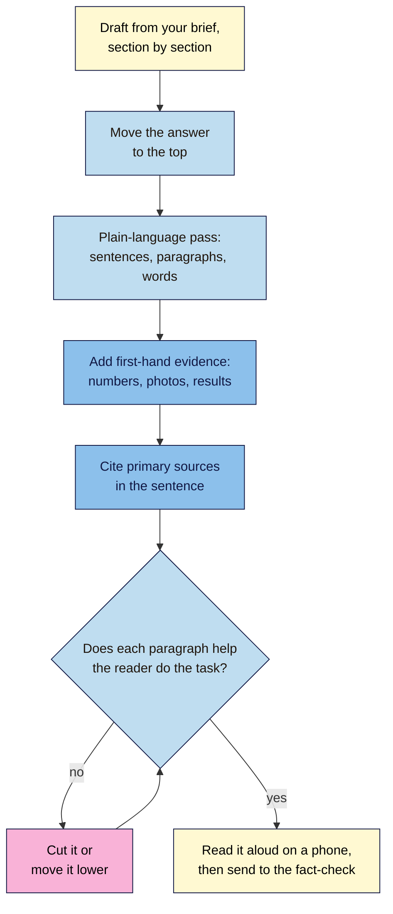

# M07.L03 — SEO Writing That Ranks and Reads Well
> After this lesson you can write a post that gives readers the answer first, reads easily on a phone, shows what you know first-hand, cites its sources properly, and has no filler, and you'll have the first draft of your own cluster post.

**Time:** ~15 min reading + ~40 min hands-on + ~10 min exercise · **Level:** L2 Practitioner · **Prereqs:** M07.L02, M04.L02, M04.L03 · **Remediate to:** M04.L03
**Verified against:** GOV.UK "Use clear language" and "Create a clear structure for your content"; digital.gov "Writing for understanding"; Google Search Central SEO Starter Guide and "A guide to Google Search ranking systems" (both last updated 2025-12-10), "Creating helpful, reliable, people-first content" (2026-10-05) and "Optimizing your website for generative AI features" (2026-07-10); Search Quality Rater Guidelines (11 September 2025), all on 2026-11-09.

> ⚠️ **Freshness flag:** plainlanguage.gov now redirects to digital.gov, and GOV.UK's writing guidance moved to guidance.publishing.service.gov.uk. Older links to either may break. Rater guideline section numbers change when Google publishes a new version.

## Learning objectives
1. **Apply** plain-language rules (answer first, descriptive headings, short sentences and paragraphs, everyday words) to a draft. *(O1)*
2. **Add** evidence of first-hand experience, and cite primary sources in the sentence. *(O2)*
3. **Cut** filler, and explain why word counts and readability scores aren't ranking factors. *(O3)*

## Why it matters
Here's the opening of Nila's old cold brew post:

> *In today's fast-paced world, coffee has become more than just a drink. It's a ritual, a passion and a way of life for millions of people around the globe. Over the centuries, coffee has evolved in countless fascinating ways, and one of the most exciting developments in recent years has been the rise of cold brew, which has taken the coffee world by storm and is now enjoyed by coffee lovers everywhere. But what exactly is cold brew, and how can you make it at home? In this comprehensive guide, we'll explore everything you need to know.*

Five sentences, 97 words, and no ratio, no steep time, no first step. Someone who searched "how to make cold brew at home" on a phone scrolls past it, or leaves. GOV.UK's research says people "only read 20 to 28% of text on a webpage". If the useful part is in paragraph five, most readers never see it.

The brief (Lesson 7.2) decided *what* to write. This lesson is about *how*: so the reader finds the answer fast, trusts it, and doesn't have to wade through filler to get there.

## Core concept
**Plain version:** write for a busy person on a phone. Put the answer first, then the detail. Use headings that say what's under them. Keep sentences short and words plain. Show what you know from doing it: your numbers, your photos, your mistakes. When you use someone else's fact, name them and link to the original. Cut anything that doesn't help the reader do what they came to do.

**Analogy:** think of a recipe card in a busy kitchen. The ingredients and quantities are at the top. The steps are numbered. Nobody writes "Cooking has been a part of human life for thousands of years" on a recipe card, because the cook's hands are full.

**Precise definitions:**
- **Plain language:** writing that the intended reader can understand the first time they read it. It isn't "dumbing down": GOV.UK notes that "the more educated the person and the more specialist their knowledge, the greater their preference for plain English".
- **Inverted pyramid (answer first):** the most important information first, then the detail, then the background.
- **Filler:** the rater guidelines' term for "low-effort content that adds little value and doesn't directly support the purpose of the page".
- **Primary source:** the original source of a fact: the study, the manufacturer's spec, the official page, or your own test. A blog that repeats it is a secondary source.
- **First-hand evidence:** something on the page that shows you did it, such as your own photo, measurement, result or mistake.

### What the sources say
| Claim | Verdict | What the source says |
|---|---|---|
| Write so people can read it easily | **Documented** | Google: "Write content naturally and make sure the content is well written, easy to follow, and free of spelling and grammatical mistakes. Break up long content into paragraphs and sections, and provide headings to help users navigate your pages." |
| Put the key content at the top | **Documented (raters)** | "Web site owners and content creators should place the most helpful and essential MC near the top of the page so that visitors can immediately access it." For recipes, "the recipe itself … should be prominently displayed near the top" |
| Readability scores are a ranking factor | **No evidence** | No Google doc mentions readability scores. Treat a plugin's score as a writing aid *(observed practice)* |
| Longer posts rank better | **False** | "There's no maximum or minimum overall page length" (GOV.UK); Google: "(No, we don't.)" prefer a word count (Lesson 4.3) |
| Filler makes a page look thorough | **It backfires** | Filler "can artificially inflate content, creating a page that appears rich but lacks content website visitors find valuable" |
| Spelling matters | **Documented** | Google asks: "Does the content have any spelling or stylistic issues?" |
| Citing a source is enough | **False** | "Attribution or giving credit to other sources doesn't replace the need for original effort." Google ranks "original reporting, ahead of those who merely cite it" |
| Links to good sources help readers | **Documented** | Links "can also add value by connecting users (and Google) to another resource that corroborates what you're writing about", but "make sure you trust the resource you're linking to" |

### The plain-language rules
| Rule | Source | Before → after |
|---|---|---|
| **Answer first** | GOV.UK: "Put the most important information first." | 97 words of history → "Use 1 part coarse coffee to 8 parts cold water, and steep for 12–18 hours in the fridge." *(Nila's tested recipe, illustrative)* |
| **Split sentences over 25 words** | GOV.UK: "Try to split up sentences that are over 25 words long." | One 46-word sentence → two of 20 |
| **No more than 5 sentences per paragraph** | GOV.UK: "Paragraphs should have no more than 5 sentences each." | A block of 9 sentences → two paragraphs and a list |
| **Everyday words** | GOV.UK: "Use 'buy' instead of 'purchase', 'help' instead of 'assist', and 'about' instead of 'approximately'" | "utilise a coarse grind" → "use a coarse grind" |
| **Active voice** | digital.gov: "Active voice makes it clear who should do what." | "The coffee should be filtered" → "Filter the coffee" |
| **Descriptive headings** | GOV.UK: headings should be "descriptive – avoid generic headings like 'Introduction'" and "removable – the content should still make sense with the headings removed" | "Introduction", "Step 2" → "What you need", "Steep for 12–18 hours" |
| **Lists and tables for steps and comparisons** | Google: "Break up long content into paragraphs and sections" | A paragraph of five steps → a numbered list |

**Question headings: a conflict to know about.** GOV.UK says headings should not "be questions – they're hard to frontload and users want answers, not questions". Many SEO guides use question headings because they match how people search. Both can work. If you use a question heading, such as "How long does cold brew last?", **answer it in the first sentence underneath** ("Up to two weeks in a sealed jar in the fridge" *(illustrative)*), so the reader still gets the answer first.

### Show what you know first-hand
Lesson 4.3 covered *why* experience matters ("Does your content clearly demonstrate first-hand expertise…?"). Here's *how* to show it in the text:

| Weak (anyone could write it) | Strong (shows you did it) |
|---|---|
| "Cold brew can taste bitter if steeped too long." | "Our 24-hour batch tasted woody and flat; 16 hours was the sweet spot for our medium roast." |
| "Use a good grinder." | "We grind on setting 26 of the café's burr grinder; a blade grinder gave us too much dust." *(add a photo)* |
| "Many people find it easy." | "Our tasting-room customers ask most about the ratio, so here it is first." |

Each strong line has a **number, a result, a photo, or a real observation**. One or two per section is enough. If you don't have any for a section, ask whether the section belongs in the post.

### Cite sources in the sentence
When a fact isn't from your own experience, name its source in the sentence and link to the original *(observed practice)*:
- **Weak:** "Studies show cold brew is less acidic [link to a coffee blog]."
- **Strong:** "In a [year] study in [journal name, linked to the study itself], [what it found, in plain words]." Or for a spec: "[Brand]'s manual lists [setting] as [grind size]." *(A pattern, not a real claim: fill it only with facts you've opened and checked, as Lesson 7.4 shows.)*

Link to the study, the manufacturer's page or the official guidance, not to a blog that summarises it. Use link text that names the source (Lesson 4.5). And remember the limit: a page that only repeats what its sources say still "doesn't replace the need for original effort".

## How it works

**In words:** write a first draft from your brief, one section at a time. Move the answer to the top. Then do a plain-language pass on sentences, paragraphs and words. Add your own numbers, photos and results, and cite primary sources by name. For each paragraph, ask whether it helps the reader do the task; if not, cut it or move it lower. Finally, read the post aloud on your phone, then send it to the fact-check pass in Lesson 7.4.

> **Under the hood: why readability tools don't rank you.** Readability plugins, like Yoast's, score text with formulas that count words per sentence, syllables per word, passive verbs and similar things. They're useful for spotting long sentences. But no Google doc mentions readability scores, and a formula can't tell whether a sentence is true, useful or first-hand. A post can score "green" and be pure filler; a technical guide can score "red" and be exactly what experts need. Use the score to find sentences to check, then trust your reader over the light. The same goes for keyword-density meters (Lesson 4.3).

## Hands-on walkthrough
You'll rewrite a padded intro, then draft your own cluster post from your brief and give it a plain-language pass. Nila Coffee's details are illustrative.

**Before you start: which steps apply to you?**
- **Path A (your own site):** draft the post from your brief in your editor (WordPress, Blogger or a document).
- **Path B (practice site):** draft in your WordPress practice site or a document. Don't publish yet (Lesson 7.5).
- **Path C (client site):** draft in a shared document and leave a comment wherever you need the client's first-hand material.

**Part A — Rewrite Nila's intro (10 min)**
1. Copy Nila's 97-word opening from "Why it matters" into a document.
2. Rewrite it in **three sentences or fewer**, with the ratio and steep time first. Use her tested recipe: 1 part coarse coffee to 8 parts cold water, 12–18 hours in the fridge, then strain *(illustrative)*.
3. Count the words in your version.
   **Expected:** something like: "Mix 1 part coarse coffee with 8 parts cold water, steep it in the fridge for 12–18 hours, then strain. That's the ratio we use in our café. Below: what you need, the steps, and how to fix bitter or weak cold brew." About 45 words, with the answer in the first sentence.

**Part B — Draft your post (20 min)**
1. Open your brief from the **Briefs** tab (Lesson 7.2). Write each H2 from the outline as a real heading.
2. Write the opening first: the answer to the main question in one or two sentences.
3. Fill each section. Where you have first-hand material (a number, a photo, a result), put it in. Where you use someone else's fact, write the source's name in the sentence and paste the link. Mark it **[check]** for Lesson 7.4.
4. Add one image of your own where it helps the reader most (Lesson 4.4 covers file names, alt text and size).
   **Expected:** a complete first draft that covers the outline, with the answer at the top and every borrowed fact marked **[check]**.

**Part C — Plain-language pass (10 min)**
1. Find every sentence over 25 words and split it. A free tool such as the Hemingway Editor, or your WordPress plugin's readability panel, can highlight long sentences; you can also just read each paragraph aloud.
2. Check each paragraph has 5 sentences or fewer.
3. Replace long words with everyday ones ("purchase" → "buy", "utilise" → "use").
4. Change passive instructions to active ("The water should be added" → "Add the water").
5. Read each heading alone. Does it say what's under it? Rename any "Introduction", "Overview" or "Conclusion".
6. For each paragraph, ask: does this help the reader do the task? Cut or shorten the ones that don't.
7. Add a row to your **Briefs** tab under this post's brief: **Draft link**, **Words before pass**, **Words after pass**, **Sentences split**, **Paragraphs cut**, **[check] items**.
   **Expected:** a draft that's usually shorter than before, with no sentence over 25 words unless it really needs to be, descriptive headings, and a count of facts to check.
   > 🖼️ **Image prompt:** A WordPress block editor screen (1280×800) showing the top of a cold brew post: an H1, a two-sentence answer-first opening with the ratio, a numbered list of steps, and the Yoast SEO readability panel open on the right with one long-sentence warning. Highlight the answer-first opening with a 3px #F9B2D7 outline; blur any personal details.
   > **Alt text:** A WordPress draft with a short answer-first opening highlighted, and a readability panel flagging one long sentence.

**Expected output:** a rewritten Nila intro, a first draft of your own cluster post with first-hand evidence and **[check]** marks on borrowed facts, and a writing-pass row in your **Briefs** tab.

## When to use / when not to
**Use the plain-language pass** on every post, product description and page before publishing. It takes ten minutes and makes everything easier to read.

**Keep technical terms when your readers use them.** A guide for baristas can say "extraction yield"; a guide for beginners should explain it first, or use "how much flavour comes out of the coffee". Use the words in your keyword map (Lesson 4.3).

**Don't strip out personality.** Plain language isn't flat language. "Our 24-hour batch tasted like a wet cardboard box" is plain, vivid and first-hand.

**Don't chase a readability score** by chopping every sentence into fragments. Some sentences need 30 words to be clear.

**The trade-off:** a very short, answer-first post serves the quick reader but can feel thin to someone who wants to understand *why*. Give both: the answer at the top, the reasons and detail below, under headings the quick reader can skip.

## Use AI for this
**Example prompt:**
> "Here's a section of my draft: [paste]. Rewrite it in plain English for [reader]: answer first, sentences under 25 words, active voice, everyday words. **Keep every number, name, quote and first-hand detail exactly as written**; don't add any new facts, examples or sources. List what you changed."

**What AI does well here:** splitting long sentences, swapping long words for short ones, and turning a paragraph of steps into a numbered list.
**Where it gets it wrong:** it adds new "facts" or statistics to sound authoritative, changes your numbers while rephrasing, slips in its own filler ("In today's fast-paced world…"), and smooths out the first-hand details that make your post worth reading.
**How to check:** compare every number, name and quote before and after. Search the draft for stock phrases ("delve", "in today's", "it's important to note", "comprehensive guide") and cut them. Any new fact the AI added goes on your **[check]** list for Lesson 7.4, or gets deleted.

## Common mistakes
- **A history lesson before the answer.**
- **Headings like "Introduction" and "Conclusion"** that say nothing about what's below them.
- **Padding to a word count** with restated points, generic tips or "In conclusion" summaries.
- **Linking to a blog** that repeats a study, instead of the study.
- **"Studies show…"** with no named source.
- **No first-hand detail:** a post anyone could have written.
- **Chasing a green readability light** at the expense of clarity.

## Troubleshooting
| Symptom | Likely cause | Fix |
|---|---|---|
| The draft is twice the scope in your brief | Filler, repetition, or two topics in one post | Cut paragraphs that don't help the task; move a second topic to its own brief |
| You can't find a first-hand detail for a section | The section is common knowledge | Shorten it to a line and link to a good source, or cut it |
| The opening still doesn't answer the question | The main question in the brief is vague | Rewrite the brief's "reader and need" line, then the opening |
| The readability plugin is red, but the post reads well | The formula counts syllables in technical words | Check sentence length by hand; ignore the light if readers understand it |
| A source link points to a blog | You found the fact second-hand | Follow the blog's link to the original, or mark it **[check]** for Lesson 7.4 |

## Exercise
**Task:** complete Parts A–C. Then answer these. All details are illustrative.
1. Kavya's post opens: "Yoga is an ancient practice that has been around for thousands of years and has many benefits for the mind and body." The post is "5 yoga poses for lower back stiffness". Rewrite the first sentence.
2. Tomás's heading is "Overview". The section explains which drill bit to use for tiles. Rename it.
3. Amara writes: "According to research, 80% of readers skim." There's no link. What are her two options?
4. Nila's readability plugin shows red because of "titratable acidity". The post is for coffee professionals. What should she do?
5. Which sentence shows first-hand experience? (a) "French press coffee can be gritty." (b) "Our first French press batch was gritty until we went from setting 15 to setting 24."
6. A client wants a 2,000-word post. Amara's draft does the job in 1,100 words. What should she tell them?

**Expected outcome:** these answers (wording will vary):
- **1** Something like: "These five poses ease lower back stiffness in about ten minutes; start with the cat-cow stretch." The answer and the first step come first.
- **2** "Which drill bit to use for tiles" or "Choose a tile drill bit".
- **3** Find the original source, check it says that, and cite it by name with a link; or cut the claim. "According to research" with no source can't stay.
- **4** Keep the term, because her readers use it. Check sentence length by hand and ignore the light.
- **5** (b): it has a number, a result and a change she made.
- **6** Google says there's no preferred word count, and padding adds filler that can make the page worse. Offer to add more first-hand detail if a section is thin, not more words.

**Stretch goal:** ask a friend who fits your reader persona to read your draft on their phone and tell you where they stopped reading. Fix that spot.

## Key takeaways
- Answer first. People "only read 20 to 28% of text on a webpage".
- Short sentences (split over 25 words), short paragraphs (5 sentences or fewer), everyday words, active voice, descriptive headings.
- Show you did it: numbers, photos, results and mistakes.
- Name and link the original source; citing alone "doesn't replace the need for original effort".
- Cut filler. Word counts and readability scores aren't ranking factors.

## Teach it back
Explain to a friend in 3 sentences why the best SEO writing puts the answer at the top, why short sentences help, and how to show a reader you've actually done what you're writing about.

## Glossary terms added
- Plain language — added to `seo-101/glossary.md`
- Filler — added to `seo-101/glossary.md`
- Primary source — added to `seo-101/glossary.md`
- First-hand evidence — added to `seo-101/glossary.md`
- *Already in the glossary:* Answer-first opening, People-first content, Keyword stuffing

## Further reading
*All checked 2026-11-09.*
- GOV.UK — Use clear language: https://guidance.publishing.service.gov.uk/writing-to-gov-uk-standards/writing-guidelines/clear-language/
- GOV.UK — Create a clear structure for your content: https://guidance.publishing.service.gov.uk/writing-to-gov-uk-standards/writing-guidelines/clear-structure/
- digital.gov — Writing for understanding (formerly plainlanguage.gov): https://digital.gov/guides/plain-language/writing
- Google Search Central — SEO Starter Guide (easy to read and well organised): https://developers.google.com/search/docs/fundamentals/seo-starter-guide
- Google Search Central — Creating helpful, reliable, people-first content: https://developers.google.com/search/docs/fundamentals/creating-helpful-content
- Google — Search Quality Rater Guidelines (September 2025; §5.2.2 on filler): https://static.googleusercontent.com/media/guidelines.raterhub.com/en//searchqualityevaluatorguidelines.pdf

> ⚠️ **May change:** the rater guidelines (revised about once a year); GOV.UK and digital.gov URLs (both moved recently).

## Refresher card
*Used by remediation when a learner fails a quiz twice on a later lesson that points back here.*
**Answer first** (inverted pyramid; raters: put "the most helpful and essential MC near the top"; recipes first on recipe pages). **Plain language:** split sentences over 25 words, ≤5 sentences per paragraph, everyday words ("buy" not "purchase"), active voice, **descriptive** headings (not "Introduction"); question headings are fine if answered in the first sentence. **First-hand evidence:** numbers, photos, results, mistakes. **Sources:** name the primary source in the sentence and link to it; citing "doesn't replace the need for original effort". **Cut filler** ("can artificially inflate content"). No word-count target; readability scores are a writing aid, not a ranking factor.
