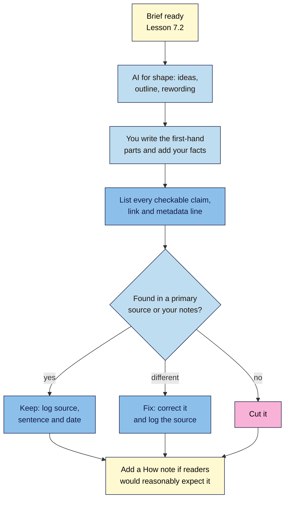

# M07.L04 — AI as a Helper: Where It Helps, Where It Fails, and the Fact-Check Pass
> After this lesson you can use an AI assistant for the jobs it's good at, catch the facts, quotes and links it makes up, keep a claim-by-claim fact-check log, and decide when to tell readers how AI was used.

**Time:** ~18 min reading + ~45 min hands-on + ~10 min exercise · **Level:** L2 Practitioner · **Prereqs:** M07.L03, M01.L06 · **Remediate to:** M01.L06
**Verified against:** Google Search Central blog "Google Search's guidance about AI-generated content" (8 February 2023) and "March 2024 core update and new spam policies" (5 March 2024); "Google Search's guidance on using generative AI content on your website" (last updated 2026-10-01); "Creating helpful, reliable, people-first content" (2026-10-05); "Spam policies for Google web search" (2026-08-28); Search Quality Rater Guidelines (11 September 2025); Claude Help Center (16 March 2026) and Gemini Apps Help, all on 2026-11-09.

> ⚠️ **Freshness flag:** Google added the "generative models don't retrieve facts … critical to manually factcheck" sentences to its AI content guidance on 2026-10-01, and the fake-author paragraph to its helpful-content page on 2026-10-05. Older articles won't mention either. AI tools change monthly; this lesson teaches checks that work with any of them, not one tool's buttons.

## Learning objectives
1. **Explain** Google's position on AI-generated content, and how scaled content abuse and fake authors break the spam policies. *(O1)*
2. **Run** a claim-by-claim fact-check (claim, source URL, supporting sentence, date checked, verdict) on an AI-assisted draft. *(O2)*
3. **Decide** when an AI disclosure is reasonably expected, and write one. *(O3)*

## Why it matters
Amara asks a free AI assistant to "write 300 words on why cold brew is better for your stomach, with a statistic and an expert quote". It returns a confident paragraph: "According to a 2021 study by the American Gastroenterology Institute, cold brew is 67% less acidic than hot coffee. As Dr. Lena Ortiz, a leading nutrition researcher, explains: 'Cold brew is the gentlest coffee you can drink.'" There's even a link.

Amara searches for the institute: nothing. She searches the quote in quotation marks: nothing. The link goes to a page that doesn't exist. None of it is real, and it would have gone out under her client's name.

Google's own guidance explains why: "generative models don't retrieve facts, but predict a likely sequence of words based on their training data." The AI wasn't lying; it was writing what a paragraph like that *usually* looks like. That's useful for structure and wording, and dangerous for facts. **Non-negotiable #10:** a human edits and fact-checks every AI-assisted page.

## Core concept
**Plain version:** an AI assistant is a fast, tireless helper with no memory of where its facts came from. It's good at shaping things you give it: ideas, outlines, rewording, questions you missed. It's bad at anything that must be true: numbers, quotes, names, dates, prices, links and your own experience. So you use it for shape, and you check every fact yourself against a real source before publishing.

**Analogy:** an AI assistant is like a very confident new intern who has read a lot but kept no notes. Great for a first draft of an outline. But if they say "a study found 67%", you ask "which study?", and if they can't show you, it doesn't go in.

**Precise definitions:**
- **Hallucination:** Google's word for AI output that's inaccurate but presented as fact: "generative AI outputs may contain inaccuracies (also known as hallucinations)".
- **Fact-check log:** a table listing every checkable claim in a draft, with its source, the exact supporting sentence, the date checked and a verdict.
- **Scaled content abuse:** "when many pages are generated for the primary purpose of manipulating search rankings and not helping users", "no matter how it's created".
- **AI disclosure:** a note telling readers how AI or automation was used to make the content.

### What the sources say
| Claim | Verdict | What the source says |
|---|---|---|
| Google bans or penalises AI content | **False** | "Appropriate use of AI or automation is not against our guidelines." Google's focus is "on the quality of content, rather than how content is produced" |
| AI content gets a ranking boost | **False** | "Using AI doesn't give content any special gains. It's just content." |
| Mass-producing AI pages is fine | **False** | Scaled content abuse examples include "Using generative AI tools or other similar tools to generate many pages without adding value for users" |
| Mass-producing pages *by hand* is fine | **False** | The policy applies "no matter whether content is produced through automation, human efforts, or some combination" |
| You must fact-check AI output | **Documented** | "It is critical to manually factcheck and review all AI-generated content for accuracy and trustworthiness before publishing." |
| Only the body text needs checking | **False** | The review "also applies to metadata like <title> elements, meta description elements, structured data, and alternate texts for images" |
| AI vendors say their tools are reliable | **False** | Anthropic: "Claude can display quotes that may look authoritative or sound convincing, but are not grounded in fact." Google: "Gemini can hallucinate and present inaccurate information as factual." |
| Raters can tell if AI was used, and that's what matters | **No** | "the use of Generative AI tools alone does not determine the level of effort or Page Quality rating. Generative AI tools may be used for high quality and low quality content creation." |
| You can make up an author to look expert | **False** | "Fabricating creator profiles (such as by using AI-generated headshots, made-up names, or false credentials …) is a form of deception." |
| AI disclosure is required in Search | **Recommended, not required** | Disclosures "are useful for content where someone might think "How was this created?"" "Consider adding these when it would be reasonably expected." |
| Health and money topics are judged more strictly | **Documented** | "On topics where information quality is critically important—like health, civic, or financial information—our systems place an even greater emphasis on signals of reliability." |

### Where AI helps, and where it fails
| Task | AI's role | Why |
|---|---|---|
| Brainstorming titles, angles and questions | ✅ Good helper | Ideas only; you choose. Google: AI "can be particularly useful when researching a topic, and to add structure to original content" |
| Outlining from your brief | ✅ Good helper | Structure, not facts (Lesson 7.2) |
| Rewording for plain language | ✅ Good helper, then check | It can change your numbers while rephrasing (Lesson 7.3) |
| Suggesting what a reader might ask | ✅ Good helper | Compare with People also ask and real customer questions |
| Summarising a source *you* give it | ⚠️ Check against the source | It can drop context or add things the source doesn't say |
| Statistics, dates, prices, specs | ❌ Don't trust | It predicts likely numbers; find the primary source |
| Quotes and who said them | ❌ Don't trust | Quotes "may look authoritative … but are not grounded in fact" |
| Links and source lists | ❌ Don't trust | Links are often invented or point somewhere else; open every one |
| Your first-hand experience | ❌ Can't do it | Only you tested the recipe, taught the class or fixed the tap |
| Health, money or safety advice | ❌ Expert check needed | Google puts "an even greater emphasis on signals of reliability" here |

### The fact-check pass, step by step
Go through the draft and list every **checkable claim**: a number, a date, a name, a quote, a product spec, a price, a "studies show", a link, and the title, meta description and alt text. Then check each one *(observed practice; the exact-phrase method is from the rater guidelines)*:

| Claim type | How to check it (free) | Keep it if… |
|---|---|---|
| **Statistic** | Find the original study or survey. Check the year, the sample, who ran it, and that the number means what the draft says | You've read the number in the primary source |
| **Quote** | Search the exact words in quotation marks. The rater guidelines say to "Copy a sentence or phrase in the text" and search it "surrounded by quotation marks to search for an exact match" | You found the original, said by that person |
| **Organisation or person** | Search the name; check their own website exists | They exist and the claim is on their own page |
| **Link** | Click it. Read the page | It loads and says what the sentence claims |
| **Product spec, price, ratio** | Your own notes, tests or the manufacturer's page | It matches your test or the official spec today |
| **Date or "latest"** | The official source; the Wayback Machine (web.archive.org) for when a page changed | You've confirmed it's still current |
| **Title, meta, alt text** | Read each against the page | Each is accurate and matches the content (Lessons 4.1, 4.4) |

**Verdicts:** **Keep** (confirmed), **Fix** (the real fact differs; write the correct version), or **Cut** (no source found). If you can't find a source in a few minutes, cut it. A post without a statistic is better than a post with an invented one.

### Disclosure: when and how
Google suggests thinking about **Who, How and Why** (Lesson 4.3). For AI, the "How" questions are:
- "Is the use of automation, including AI-generation, self-evident to visitors through disclosures or in other ways?"
- "Are you providing background about how automation or AI-generation was used to create content?"
- "Are you explaining why automation or AI was seen as useful to produce content?"

**Course rule of thumb:** add a short "How we made this" note when AI did more than brainstorm or tidy wording, or when readers would reasonably ask. For example:
> *How we made this: we used an AI assistant to suggest the outline and tidy the wording. The recipe, tasting notes and photos are from our own tests in the Kochi roastery, and every fact was checked by Nila on 9 November 2026.*

Three hard rules:
1. **The byline is a real person** who stands behind the page. Google: "Giving AI an author byline is probably not the best way" to be clear about AI use.
2. **No fake authors, photos or credentials.** Google calls fabricated creator profiles "a form of deception".
3. **Shops: Merchant Center is stricter than Search.** For product feeds, "AI-generated product data such as title and description attributes must be specified separately and labeled as AI-generated." Check Merchant Center's current policy before using AI product descriptions in a feed.

### Helper or abuse? The line
| Fine (AI helps a human make something useful) | Scaled content abuse (pages made to rank, not to help) |
|---|---|
| Nila uses AI for an outline, then writes from her own tests | 200 AI pages called "Coffee delivery in [city]" with the same text and the city swapped |
| Amara asks AI to simplify a section she wrote, then checks it | Rewriting competitors' posts with an AI "spinner" |
| Tomás asks AI to suggest questions buyers ask about drills | One AI post per keyword variation ("best drill", "top drill", "good drill") |

The difference isn't the tool. It's whether each page adds real value, and whether a human made sure it's true.

## How it works

**In words:** start from your brief. Use AI for shape only: ideas, an outline, rewording. Write the first-hand parts yourself and add your own facts. Then list every checkable claim, link and metadata line. Check each against a primary source or your own notes: keep it if it's confirmed, fix it if the real fact differs, and cut it if you can't find a source. Log the source, the supporting sentence and the date. Finally, add a "How we made this" note if readers would reasonably expect one.

> **Under the hood: why AI invents sources.** A language model writes one likely word after another, based on patterns in its training data. A sentence like "According to a 2021 study by the…" is usually followed by an official-sounding name and a number, so that's what it produces, whether or not such a study exists. Some tools now search the web and show sources, which helps, but Anthropic still advises: "When working with web search results, users should review Claude's cited sources", because the summary may miss "important context or details". Google says the same of Gemini: it "can hallucinate and present inaccurate information as factual". So a source list from an AI is a list of leads to open, not proof. The only proof is the original page, read by you.

## Hands-on walkthrough
You'll use a free AI assistant for an outline and a short section, fact-check it and your own draft, and write a disclosure line. Nila Coffee's details are illustrative.

**Before you start: which steps apply to you?**
- **All paths:** use any free AI assistant (ChatGPT, Gemini, Claude or Copilot). Don't paste private customer data, passwords or a client's confidential plans into it. **Path C:** check the client's rules on AI use before you start, and follow them.
- If you'd rather not use AI at all, skip Part A and run Parts B and C on your own draft from Lesson 7.3. The fact-check log is the skill that matters.

**Part A — Let AI help with shape (10 min)**
1. Open a free AI assistant. Paste your brief's main phrase, reader and angle (Lesson 7.2), and ask: "Suggest an outline of H2s, answer first, and 5 questions a beginner would ask."
2. Compare its outline with your own. Note one idea worth borrowing, and one section that's filler.
3. Now ask it to "write a 150-word section on [one H2], including one statistic and one expert quote". (You're doing this on purpose, to see what it invents.)
   **Expected:** a fluent section with a number and a quote, probably with a source name. Don't trust any of it yet.

**Part B — The fact-check log (25 min)**
1. Add a tab called **Fact-check log** with these columns: **#**, **Claim (exact words)**, **Type** (number, quote, name, date, spec, link, metadata), **Where it came from** (AI, me, a source), **Source URL**, **Supporting sentence (copied)**, **Checked on**, **Verdict** (Keep, Fix, Cut), **Fixed text**.
2. Enter every checkable claim from the AI's section in Part A.
3. Check each one using the table in "The fact-check pass". For quotes, search the exact words in quotation marks. For numbers, find the original study, not a blog that repeats it. Click every link.
   **Expected:** at least one claim you can't find a source for. That's normal; mark it **Cut**.
   > 🖼️ **Image prompt:** Google Sheets tab called Fact-check log (1280×700) with five rows: an AI statistic marked Cut (no source found), an AI quote marked Cut, a brew ratio marked Keep with "Nila's test notes" as the source, a link marked Fix with a corrected URL, and a meta description marked Keep. Highlight the Verdict column with a 3px #F9B2D7 outline; blur any personal details.
   > **Alt text:** A fact-check log with claims, sources and a highlighted Verdict column showing Keep, Fix and Cut.
4. Now do the same for every **[check]** item in your own draft from Lesson 7.3, plus its title, meta description and image alt text.
5. Apply the verdicts to your draft: correct the **Fix** items and delete the **Cut** items.
   **Expected:** every claim in your draft has a row with a source and a date, or has been removed.

**Part C — Disclosure and byline (10 min)**
1. Decide whether your post needs a "How we made this" note. Ask: did AI do more than brainstorm or tidy wording? Would a reader reasonably ask how this was made? Is it a health, money or safety topic?
2. If yes, write one or two sentences: what AI helped with, what's first-hand, and who checked it and when.
3. Check the byline: a real person, with a short bio that's true and links to an author or About page (Lesson 7.5 covers the page).
   **Expected:** a one-line decision (note or no note, and why), the note if needed, and a real byline.

**Expected output:** a **Fact-check log** tab covering the AI's test section and your own draft, with every claim kept, fixed or cut; a corrected draft; and a disclosure decision with a "How we made this" note where needed.

## When to use / when not to
**Use AI** for brainstorming, outlining, rewording and spotting missing questions, on any topic, as long as you check the result.

**Use the fact-check log** on every post, AI-assisted or not. Human writers misremember numbers too.

**Get an expert check** for health, money, legal or safety content, whatever tool you used. Kavya's back-pain post needs a qualified reviewer, or very careful limits ("see a doctor if…").

**Don't use AI** to write first-hand sections (tests, tastings, lessons taught, jobs done), to produce many similar pages, or to invent authors, reviews or testimonials.

**The trade-off:** AI saves time on structure and wording, but the fact-check takes time back. For a short, factual post, checking an AI draft can take longer than writing it yourself. Use AI where it saves more than it costs.

## Use AI for this
**Example prompt (for checking, not writing):**
> "Here's my draft: [paste]. List every checkable claim in it, one per line: every number, date, name, quote, product spec, price, link and 'studies show'. Don't judge whether they're true, and don't add anything; I'll check each one myself."

**What AI does well here:** spotting claims you'd skim past, quickly, in a long draft.
**Where it gets it wrong:** it may miss claims, merge two into one, or "helpfully" say a claim is true from memory. That's the very thing you can't trust.
**How to check:** read the draft yourself once more after the AI's list. The AI's list is a starting point for your log, never a verdict.

## Common mistakes
- **Publishing an AI draft with only a spell-check.**
- **Trusting a source list** from an AI without opening each link.
- **Keeping a statistic "because it sounds right"** when no primary source can be found.
- **Forgetting metadata:** an AI-written meta description or alt text that says something the page doesn't.
- **An AI byline, or a made-up expert** with a stock or AI headshot.
- **Fifty near-identical posts** for keyword variations or towns.
- **Pasting customer data** or a client's confidential plans into a free AI tool.

## Troubleshooting
| Symptom | Likely cause | Fix |
|---|---|---|
| The quote can't be found anywhere | It was invented | Cut it, or quote a real person you've asked |
| The study exists but says something else | The AI misremembered or mixed sources | Fix the sentence to match the study, with the exact supporting line in your log |
| The link goes to a 404 or an unrelated page | The AI made up the URL | Find the real page, or cut the claim |
| The number appears only on blogs that copy each other | No primary source behind it | Follow the trail; if it ends nowhere, cut it |
| The AI keeps adding facts when you ask it to reword | Your prompt didn't forbid it | Add "keep every number, name and quote exactly; add no new facts" |
| You're unsure whether to disclose | Mixed AI use | Ask "would a reader reasonably wonder how this was made?"; if yes, add a short note |

## Exercise
**Task:** complete Parts A–C. Then answer these. All details are illustrative.
1. An AI draft says "73% of coffee drinkers now prefer cold brew (National Coffee Institute, 2025)". Searching finds no such institute. What's the verdict?
2. Tomás's AI tool wrote product descriptions for his 300 products, and he wants to send them to Google Merchant Center. What must he check?
3. Kavya wants to list "Dr. Priya Rao, physiotherapist" as co-author of a post, using an AI-generated photo, "because it looks more trustworthy". What's wrong?
4. Nila's post was outlined by AI and written from her own tests. Does she need a disclosure?
5. Amara is asked to produce 80 AI pages, "Plumber in [suburb]", each with the same text. What's the risk?
6. The AI's meta description says the guide includes "a free printable chart". It doesn't. Does that matter?

**Expected outcome:** a complete **Fact-check log**, and these answers:
- **1** Cut. No primary source means it doesn't go in. If the point matters, find a real survey and cite it, or drop the number.
- **2** Merchant Center's policy: "AI-generated product data such as title and description attributes must be specified separately and labeled as AI-generated." Every description also needs a fact-check against the real product.
- **3** It's a fabricated creator profile, which Google calls "a form of deception". Use a real reviewer with real credentials, or none.
- **4** It's optional. AI only shaped the outline, so a note isn't strictly expected. A short "How we made this" line is still a nice touch, and honest.
- **5** Scaled content abuse: "many pages … generated for the primary purpose of manipulating search rankings and not helping users". Suggest one good service-area page and a few real local pages with distinct content (Module 11).
- **6** Yes. Google's review step "also applies to metadata like <title> elements, meta description elements, structured data, and alternate texts for images". Fix it, or make the chart.

**Stretch goal:** take one statistic you've seen repeated on several blogs in your niche and trace it to its original source. Note whether the original says what the blogs claim.

## Key takeaways
- Google judges quality, not the tool: "Appropriate use of AI or automation is not against our guidelines," and "Using AI doesn't give content any special gains."
- AI "doesn't retrieve facts": it predicts likely words. Use it for shape, never as a source.
- Fact-check every number, quote, name, link and metadata line, and log the source, sentence and date. No source means cut.
- Disclose how AI was used when readers would reasonably expect it. Real bylines only; no fake authors.
- Many pages made to rank, by AI or by hand, is scaled content abuse.

## Teach it back
Explain to a friend in 3 sentences why an AI assistant can write a convincing statistic that doesn't exist, what you'd do to check it, and when you'd tell readers that AI helped.

## Glossary terms added
- Hallucination (AI) — added to `seo-101/glossary.md`
- Fact-check log — added to `seo-101/glossary.md`
- AI disclosure — added to `seo-101/glossary.md`
- *Already in the glossary:* Scaled content abuse, Spam policies, E-E-A-T, Byline, YMYL (Your Money or Your Life)

## Further reading
*All checked 2026-11-09.*
- Google Search Central blog — Google Search's guidance about AI-generated content (8 February 2023): https://developers.google.com/search/blog/2023/02/google-search-and-ai-content
- Google Search Central — Google Search's guidance on using generative AI content on your website: https://developers.google.com/search/docs/fundamentals/using-gen-ai-content
- Google Search Central — Creating helpful, reliable, people-first content (Who, How and Why): https://developers.google.com/search/docs/fundamentals/creating-helpful-content
- Google Search Central — Spam policies (scaled content abuse): https://developers.google.com/search/docs/essentials/spam-policies
- Google Search Central blog — March 2024 core update and new spam policies: https://developers.google.com/search/blog/2024/03/core-update-spam-policies
- Google — Search Quality Rater Guidelines (September 2025; §4.5, §4.6.5–4.6.7): https://static.googleusercontent.com/media/guidelines.raterhub.com/en//searchqualityevaluatorguidelines.pdf
- Claude Help Center — Claude is providing incorrect or misleading responses: https://support.claude.com/en/articles/8525154-claude-is-providing-incorrect-or-misleading-responses-what-s-going-on
- Gemini Apps Help — Learn about responses from Gemini Apps: https://support.google.com/gemini/answer/16279220?hl=en
- Wayback Machine (check when a page said what): https://web.archive.org/

> ⚠️ **May change:** Google's AI content guidance and helpful-content page (both revised in October 2026); AI vendors' help pages; Merchant Center's AI-content policy. OpenAI's help pages couldn't be fetched for this lesson, so none are quoted.

## Refresher card
*Used by remediation when a learner fails a quiz twice on a later lesson that points back here.*
**Google on AI:** quality, not tool ("Appropriate use of AI or automation is not against our guidelines"; "Using AI doesn't give content any special gains"). **AI fails at facts:** "generative models don't retrieve facts"; "It is critical to manually factcheck and review all AI-generated content", **including titles, meta descriptions, structured data and alt text**. **Fact-check log:** claim · type · source URL · supporting sentence · date · verdict (Keep/Fix/Cut); quotes by exact-phrase search; open every link; no source = cut. **Disclosure** ("How we made this") when "reasonably expected"; real bylines, no AI authors, no fabricated profiles ("a form of deception"); Merchant Center AI product data "must be … labeled". **Scaled content abuse:** many pages to rank, "no matter how it's created".
