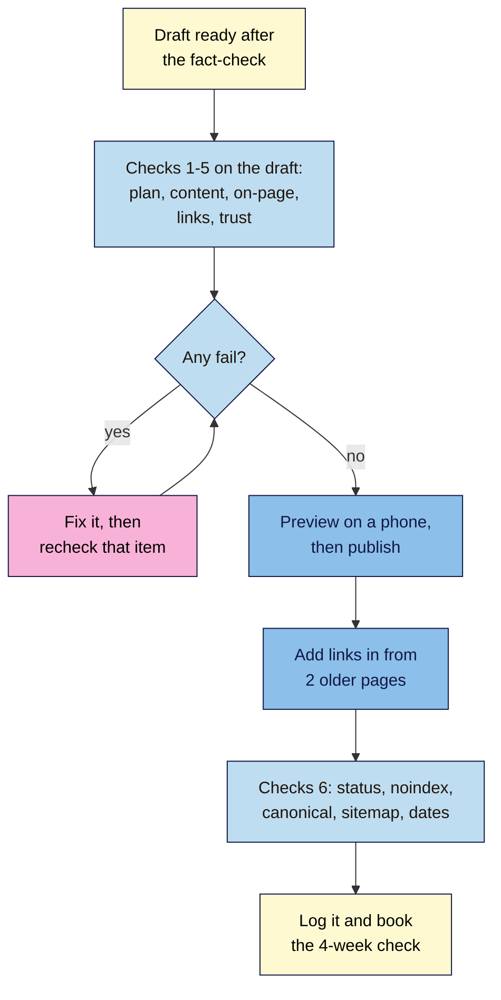

# M07.L05 — The Publish Checklist
> After this lesson you can run one checklist before every post goes live (plan, content, on-page, links, trust and indexing), fix what fails, publish with honest dates, and confirm the new page can actually be indexed.

**Time:** ~12 min reading + ~35 min hands-on + ~10 min exercise · **Level:** L2 Practitioner · **Prereqs:** M07.L04, M04.L01, M04.L04, M06.L01 · **Remediate to:** M04.L01
**Verified against:** Google Search Central "Influence your byline dates in Google Search" (last updated 2025-12-10), "Article (Article, NewsArticle, BlogPosting) structured data" (2026-09-08), "Make your links crawlable" and SEO Starter Guide (2025-12-10), "Creating helpful, reliable, people-first content" (2026-10-05) and "Google Search's guidance on using generative AI content on your website" (2026-10-01), all on 2026-11-09. WordPress screens weren't retested for this lesson; labels follow Module 5.

> ⚠️ **Freshness flag:** Google has no official "publish checklist". This one is the course's own, built from Google's documentation and the earlier modules; each item says where it comes from. Your theme and SEO plugin decide how dates and author details appear, so check yours.

## Learning objectives
1. **Run** the publish checklist (non-negotiable #9): one keyword and intent, facts checked, sources cited, internal links in and out, title, meta and alt reviewed, byline and author page, visible date. *(O1)*
2. **Set** honest "Published" and "Last updated" dates that match the structured data. *(O2)*
3. **Confirm** the new post passes the M06 "can it be indexed?" check after it goes live. *(O3)*

## Why it matters
Tomás publishes his first guide, "How to choose a drill bit for tiles". It's good. Three weeks later, Search Console has never heard of it. He checks: the post is in a category his menu doesn't link to, no other page links to it, and his theme set it to `noindex` because he'd ticked "hide from search" while drafting. The guide also says "updated today" every time he fixes a typo, and the meta description, written by his plugin's AI button, promises "a free size chart" that isn't there.

None of these is hard to fix. They're just easy to forget. Pilots, surgeons and good publishers use checklists for the same reason: not because they don't know the steps, but because nobody remembers all of them every time. **Non-negotiable #9:** every post starts from a brief and passes the publish checklist.

## Core concept
**Plain version:** the publish checklist is one page of yes/no questions you answer before and just after a post goes live. It pulls together everything from Modules 3–7: the right target, true facts, a clean page, links in and out, a real author with honest dates, and a page Google can index. Anything that fails gets fixed before you move on.

**Analogy:** a pre-flight check. The pilot knows how to fly; the checklist makes sure the fuel cap is on today.

**Precise definitions:**
- **Publish checklist:** a fixed list of checks run on every post before and after publishing, with a pass or fail for each.
- **Byline date:** "the date that Google estimates that the web page was updated or published". Google looks at "several factors", including the dates on the page and in structured data.
- **`datePublished` / `dateModified`:** structured data fields for when a page was first published and last significantly changed. Many SEO plugins add them for you (Module 12 covers markup).
- **Author page:** a page about the person in the byline (an About page, a team page or an author archive) that shows who they are and why they know the topic.

### What the sources say
| Item | Verdict | What the source says |
|---|---|---|
| Show a visible date | **Documented** | "Add a user-visible date to the page and feature it prominently." |
| Label it clearly | **Documented** | "Label your dates appropriately with text like "Publish" or "Last updated"." |
| Dates on the page and in markup must agree | **Documented** | "Make your dates and times consistent." The visible date and structured data should "match" |
| Don't fake dates | **Documented** | "Don't specify future dates". Google asks: "Are you changing the date of pages to make them seem fresh when the content has not substantially changed?" |
| Google will show your date | **Not guaranteed** | "Google doesn't guarantee that a byline date, whether visible or in structured data, will be shown in search results" |
| Add bylines | **Documented** | "We strongly encourage adding accurate authorship information, such as bylines to content where readers might expect it." |
| Link the author to a page about them | **Documented (markup)** | `author.url` is "A link to a web page that uniquely identifies the author of the article". And: "Make sure that all the authors that are presented as authors on the web page are also included in markup." |
| Review AI-written metadata too | **Documented** | The review "also applies to metadata like <title> elements, meta description elements, structured data, and alternate texts for images" |
| Every page needs an internal link | **Documented** | "Every page you care about should have a link from at least one other page on your site." |
| Check sites you link to | **Documented** | "make sure you trust the resource you're linking to" |
| A checklist is a Google requirement | **No** | It's the course's way of making sure nothing is missed *(course rule)* |

### The checklist
Copy it into your **Publish log** tab (Part A). Every item is **Pass** or **Fail**.

**1. Plan** (non-negotiables #4, #5, #9)
| # | Check | Pass looks like | From |
|---|---|---|---|
| 1.1 | A brief exists | A filled brief in your **Briefs** tab | Lesson 7.2 |
| 1.2 | One main phrase and intent | The post serves the intent from a dated SERP check | Lessons 3.1, 7.2 |
| 1.3 | No other page targets it | **Used twice?** is FALSE in your keyword map | Lesson 3.5 |

**2. Content** (non-negotiables #6, #10)
| # | Check | Pass looks like | From |
|---|---|---|---|
| 2.1 | Answer first | The main answer is in the first few lines | Lessons 4.2, 7.3 |
| 2.2 | First-hand evidence | At least one number, photo, result or real observation of your own | Lesson 7.3 |
| 2.3 | Plain-language pass done | Long sentences split, descriptive headings, filler cut | Lesson 7.3 |
| 2.4 | Fact-check log complete | Every claim is Keep, Fix (fixed) or Cut (removed) | Lesson 7.4 |
| 2.5 | Sources cited | Borrowed facts name and link the primary source; every link opens | Lessons 7.3, 7.4 |
| 2.6 | Spelling and grammar | A spell-check and one read-aloud | Starter Guide |

**3. On-page** (non-negotiables #3, #6)
| # | Check | Pass looks like | From |
|---|---|---|---|
| 3.1 | Title | Unique, main topic first, accurate | Lesson 4.1 |
| 3.2 | Meta description | A true one- or two-sentence pitch for this page | Lesson 4.1 |
| 3.3 | Headings | One H1; H2s in order and descriptive | Lessons 4.2, 7.3 |
| 3.4 | Slug | Short, readable, hyphenated, final before publishing | Lesson 4.2 |
| 3.5 | Images | Useful alt text (or empty for decoration), sensible size, descriptive file name | Lesson 4.4 |

**4. Links** (non-negotiable #9)
| # | Check | Pass looks like | From |
|---|---|---|---|
| 4.1 | Links out to your site | At least 2 contextual internal links: the pillar, plus a related post or money page | Lessons 4.5, 7.1 |
| 4.2 | Links in from your site | At least 2 older pages link to it, added the day you publish | Lessons 4.5, 7.1 |
| 4.3 | Anchor text | Descriptive, not "click here" | Lesson 4.5 |

**5. Trust**
| # | Check | Pass looks like | From |
|---|---|---|---|
| 5.1 | Byline | A real person who stands behind the page | Lessons 4.3, 7.4 |
| 5.2 | Author page | The byline links to a true bio (About, team or author page) | Article markup docs |
| 5.3 | "How we made this" | Present if readers would reasonably expect it | Lesson 7.4 |
| 5.4 | Dates | "Published" date visible; "Last updated" only after a significant change; no future dates | Byline dates docs; Lesson 5.5 |

**6. After publishing** (non-negotiable #7)
| # | Check | Pass looks like | From |
|---|---|---|---|
| 6.1 | Status 200 | One request, no redirect | Lesson 6.1 |
| 6.2 | Crawl allowed, no `noindex` | Not blocked; no `noindex` in the source or headers | Lesson 6.2 |
| 6.3 | Canonical | Points to itself | Lesson 6.3 |
| 6.4 | In the sitemap | The URL appears once | Lesson 6.4 |
| 6.5 | Dates match | The visible date and the structured data date agree (if your plugin adds them) | Byline dates docs |
| 6.6 | Calendar updated | Publish date logged, 4-week check booked | Lesson 7.1 |

That's 24 checks. The first time takes a while; after a few posts, most take seconds.

## How it works

**In words:** once the fact-check is done, run checks 1–5 on the draft. Fix anything that fails and recheck it. When everything passes, preview the post on a phone and publish. Then add links to it from two older pages, run the after-publishing checks (status, `noindex`, canonical, sitemap, dates), log the result, and book the 4-week check.

### Dates, done honestly
Lesson 5.5 covered when to change a date. The checklist adds three rules:
- **First publish:** show "Published [date]". There's nothing to update yet.
- **Significant update** (new facts, new steps, a new section): show "Last updated [date]", and let your plugin update `dateModified`. A short note helps readers: "Last updated 9 November 2026: new grind settings for the 2026 harvest." *(illustrative)*
- **Small fix** (a typo, a link): don't change the visible date. In WordPress, every save changes the internal modified time (Lesson 5.5), and some themes and plugins show or mark up that time. Check what yours does, and if it treats every save as an update, batch small fixes or adjust the setting.

> **Under the hood: why dates are a trust check, not a ranking trick.** Google estimates a page's date from "several factors" because "all factors can be prone to issues". If your visible date says one thing and your structured data says another, Google has to guess, and may show a date you didn't intend. If dates change without real changes, readers notice the "updated today" post that's clearly old, and Google's helpful-content questions call it out. A new date only means something when the content behind it is new. Freshness matters for some queries (Lesson 7.2), and the honest way to earn it is a real update (Lesson 7.6).

## Hands-on walkthrough
You'll run the checklist on your draft, fix every fail, publish, and confirm the page can be indexed. Nila Coffee's details are illustrative.

**Before you start: which steps apply to you?**
- **Path A (your own site):** do every part, and publish for real.
- **Path B (practice site):** publish on your Blogger site or WordPress practice site. A WordPress site on your own computer or in Playground can't be seen by Google, so do Part D's checks in DevTools and View Source only.
- **Path C (client site):** run Parts A and B, then send the checklist and draft to the client to publish (or publish with their written OK). Do Part D together.

**Part A — Set up the Publish log (5 min)**
1. Add a tab called **Publish log**. Paste the 24 checks as rows: **#**, **Check**, **Pass looks like**.
2. Add one column per post: the post's URL at the top, then **Pass**, **Fail** or **n/a** for each check, and a **Notes** column for what you fixed.
   **Expected:** a reusable checklist you'll fill in for every future post, including both capstone posts.

**Part B — Checks 1–5 on your draft (15 min)**
1. Open your draft from Lessons 7.3 and 7.4 in your editor's preview.
2. Work down checks 1.1–5.4. For each, look at the actual page (not your memory of it), and mark Pass or Fail.
3. Fix every Fail. Common ones: the meta description is missing or was written by a plugin's AI button and says something untrue (3.2); an image has no alt text (3.5); the post has only one internal link (4.1); the byline shows a username such as "admin" instead of a real name (5.1).
4. For the byline: in WordPress, go to **Users → Profile**, fill in your real name and a short, true **Biographical Info**, and choose how your name is displayed (Module 5). Check what your byline links to: your theme may link to an author archive or show a bio box. If neither exists, link to your About page from the bio.
   **Expected:** every check in sections 1–5 is Pass or n/a, with a note for each fix.

**Part C — Publish and link it in (7 min)**
1. Preview the post on your phone (or in DevTools device mode). Read the first screen: is the answer there?
2. Publish.
3. Open two older pages from your **Content plan** (the pillar and a related post, Lesson 7.1). Add a contextual link from each to the new post, with descriptive anchor text, and update them.
   **Expected:** a live post with at least two links in and two links out.
   > 🖼️ **Image prompt:** A published WordPress blog post viewed on a phone-sized screen (390×844): the H1, a byline with the author's real name linking to a bio, a "Published 9 November 2026" label, and an answer-first opening with the brew ratio. Highlight the byline and date line with a 3px #F9B2D7 outline; blur any personal details.
   > **Alt text:** A published post on a phone showing a real author byline and a labelled publish date, highlighted under the title.

**Part D — After publishing (8 min)**
1. Run the six-point check from Lesson 6.1 on the live URL: status 200 in DevTools **Network**, no `noindex` in View Source or headers, canonical pointing to itself, and the URL in your sitemap.
2. In View Source, search for `datePublished`. If it's there, check it matches the visible date (6.5). If it isn't, note "no date markup" (Module 12 covers adding it).
3. **Public sites:** open the URL in Search Console's **URL Inspection**, click **Test live URL**, and check **Indexing allowed?** is **Yes**. You can click **Request Indexing** for this one new post (Lesson 6.6).
4. Mark the post's row in your **Content plan** calendar as published, with the date, and add a **4-week check** row.
   **Expected:** all 24 checks marked, the six-point check passed, and the 4-week check booked.

**Expected output:** a **Publish log** tab with all 24 checks for your first cluster post, every Fail fixed and noted, a live post with links in and out, and an after-publishing check that shows it can be indexed.

## When to use / when not to
**Run the full checklist** on every new post and every significant update.

**Run a short version** (2.4, 2.5, 3.1, 3.2, 5.4 and 6.5) on small updates.

**Adapt it for product and category pages:** skip 2.2's "first-hand" if the facts are specs, but keep the fact-check (prices, sizes, delivery) and the indexing checks.

**Don't skip section 6 because the post "looks fine".** Tomás's post looked fine too.

**The trade-off:** 24 checks feel slow for a short post. But the failures they catch (a `noindex`, an orphan, an invented "free chart") cost far more time later, and most checks take seconds once they're a habit. Trim checks only after you've seen them pass reliably for months.

## Use AI for this
**Example prompt:**
> "Here's my post's HTML (or text), title, meta description and image alt texts: [paste]. Check them against this list: [paste checks 2.1, 2.3, 3.1–3.5, 4.3, 5.4]. For each, say Pass or Fail and quote the exact part of my post that shows it. Don't rewrite anything and don't judge whether facts are true."

**What AI does well here:** spotting long sentences, generic headings, missing alt text, and a meta description that doesn't match the page.
**Where it gets it wrong:** it marks checks as Pass without evidence, can't see your live page's status code, sitemap or `noindex` header, can't tell whether links in exist, and may "correct" facts it doesn't know.
**How to check:** accept a Pass only if it quotes your text. Do sections 1, 2.4, 4.1–4.2 and 6 yourself; they need your keyword map, your fact-check log and the live site.

## Common mistakes
- **Publishing first, checking "later".**
- **No links in:** the new post links out but nothing links to it.
- **"admin" as the byline,** or no bio.
- **"Updated today" on every typo fix,** or a date that doesn't match the markup.
- **Trusting a plugin's AI-written meta description** without reading it.
- **A stray `noindex`** left from drafting or a plugin setting.
- **Skipping the 4-week check,** so nobody notices a post that never got indexed.

## Troubleshooting
| Symptom | Likely cause | Fix |
|---|---|---|
| URL Inspection says **Indexing allowed? No** | A `noindex` from a plugin setting or the Reading setting | Check the post's SEO settings and **Settings → Reading** (Lesson 6.2) |
| The byline shows "admin" or a username | Display name not set | **Users → Profile → Display name publicly as** (WordPress) |
| The visible date and `datePublished` differ | The theme shows one date and the plugin marks up another | Check both settings; make them show the same date |
| "Last updated" changes on every save | Theme or plugin shows the internal modified time | Batch small fixes, or change the setting |
| The post isn't in the sitemap | It's `noindex`, unpublished, or in an excluded type | Check its status and SEO settings (Lesson 6.4) |
| You can't add a link in from an older post | No related older post exists yet | Link from the pillar or a category page now; add more as the cluster grows |

## Exercise
**Task:** complete your **Publish log** (Parts A–D). Then answer these. All details are illustrative.
1. Tomás's new guide has no internal links pointing to it, but it's in the sitemap. Which check fails, and why does it matter?
2. Kavya fixes one typo in a 2025 post. Should "Last updated" change?
3. Nila's visible date says "Published 2 March 2026", but View Source shows `"datePublished": "2026-03-09"`. Which check fails, and what should she do?
4. Amara's plugin wrote the meta description: "Includes a free downloadable checklist." There's no checklist. Which checks fail?
5. A post's byline says "By Nila Coffee Team". Is that a pass?
6. URL Inspection shows the new post is **URL is not on Google** a day after publishing, but **Test live URL** says **Indexing allowed? Yes**. Is something wrong?

**Expected outcome:** a complete log, and these answers:
- **1** 4.2 (links in). Google: "Every page you care about should have a link from at least one other page on your site." Links help Google find it and show it matters.
- **2** No. A typo isn't a significant change. Google asks: "Are you changing the date of pages to make them seem fresh when the content has not substantially changed?"
- **3** 6.5 (dates match). Google: "Make your dates and times consistent." She should find which setting is wrong and make them agree.
- **4** 3.2 (meta description) and 2.4 (fact-check): Google's review covers "meta description elements". Fix it, or make the checklist.
- **5** It can pass if readers wouldn't expect a named author (a short shop notice). For a guide with tests and advice, a named person is better, since readers may ask "Who wrote this?" (Lesson 4.3).
- **6** Probably not. New pages take time to be crawled and indexed. Since the live test passes, request indexing once and check again at the 4-week check.

**Stretch goal:** time yourself running the checklist on a second post. Note which checks took longest, and whether a template or saved reusable block would speed them up.

## Key takeaways
- Every post passes one checklist before and after publishing: plan, content, on-page, links, trust, indexing.
- Facts, sources and AI-written metadata are checked like everything else.
- At least two links out and two links in, added the day you publish.
- A real byline linked to a true bio; "Published" visible; "Last updated" only after a significant change; dates consistent with the markup.
- Confirm the live page can be indexed, then book the 4-week check.

## Teach it back
Explain to a friend in 3 sentences why a good post can still fail to show up in Google, and which three checks on the publish checklist would catch the most common reasons.

## Glossary terms added
- Publish checklist — added to `seo-101/glossary.md`
- Byline date — added to `seo-101/glossary.md`
- `datePublished` / `dateModified` — added to `seo-101/glossary.md`
- Author page — added to `seo-101/glossary.md`
- *Already in the glossary:* Byline, Last updated date, Meta description, URL Inspection

## Further reading
*All checked 2026-11-09.*
- Google Search Central — Influence your byline dates in Google Search: https://developers.google.com/search/docs/appearance/publication-dates
- Google Search Central — Article structured data (author and dates): https://developers.google.com/search/docs/appearance/structured-data/article
- Google Search Central — Creating helpful, reliable, people-first content (bylines; dates): https://developers.google.com/search/docs/fundamentals/creating-helpful-content
- Google Search Central — Google Search's guidance on using generative AI content (reviewing metadata): https://developers.google.com/search/docs/fundamentals/using-gen-ai-content
- Google Search Central — Make your links crawlable: https://developers.google.com/search/docs/crawling-indexing/links-crawlable
- WordPress 101, Module 5, Lesson 4 — Schema basics (how an SEO plugin marks up authors and dates): `wordpress-101/lessons/m05-l04-schema-basics.md`

> ⚠️ **May change:** theme and plugin settings for dates and bylines; Search Console labels.

## Refresher card
*Used by remediation when a learner fails a quiz twice on a later lesson that points back here.*
**Publish checklist (NN #9), 24 checks in six groups:** **Plan** (brief, one phrase + intent, not used twice) · **Content** (answer first, first-hand evidence, plain-language pass, fact-check log complete, sources named and linked, spelling) · **On-page** (title, meta, headings, slug, images) · **Links** (≥2 out, ≥2 in added on publish day, descriptive anchors) · **Trust** (real byline → true bio, "How" note if expected, "Published" visible, "Last updated" only after a significant change) · **After publishing** (200, no `noindex`, self canonical, in sitemap, visible date = `datePublished`, 4-week check booked). Google: "Make your dates and times consistent"; review AI-written "meta description elements" too.
