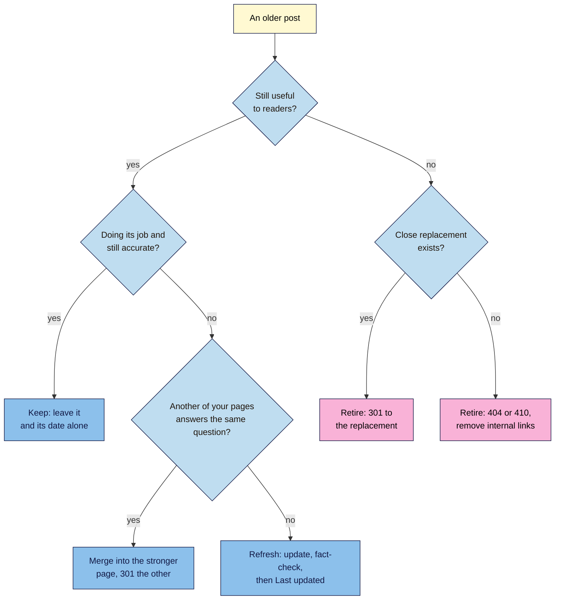

# M07.L06 — Refresh, Merge or Retire: Keeping Old Content Useful
> After this lesson you can spot posts that are fading, overlapping or out of date, decide for each one whether to keep, refresh, merge or retire it, and carry out that decision without soft 404s, redirect mistakes or fake "freshness".

**Time:** ~15 min reading + ~40 min hands-on + ~10 min exercise · **Level:** L2 Practitioner · **Prereqs:** M07.L05, M03.L05, M06.L05 · **Remediate to:** M06.L05
**Verified against:** Google Search Central "Google Search's core updates" and SEO Starter Guide (both last updated 2025-12-10), "Redirects and Google Search" (2026-04-14), "How HTTP status codes, and network and DNS errors affect Google Search" (2026-02-04), "Remove a page hosted on your site from Google" (2025-12-10), "A guide to Google Search ranking systems" (2025-12-10) and "Creating helpful, reliable, people-first content" (2026-10-05); Search Console Help "How are you performing on Google?"; Official Google Blog (3 November 2011); GOV.UK "Retire content"; Search Engine Roundtable (7 February 2022), all on 2026-11-09. Search Console screens weren't tested live.

> ⚠️ **Freshness flag:** the 410-versus-404 debate is old folklore; Google's current status-code page treats them the same. John Mueller's date comment is from 2022 and is quoted from a news report, not the original post.

## Learning objectives
1. **Spot** decaying or overlapping posts with Search Console Performance comparisons and the keyword map. *(O1)*
2. **Choose** refresh, merge (with a 301) or retire (404/410 or redirect) for each post, avoiding soft 404s and fake "freshness". *(O2)*
3. **Explain** when a date change is honest, and when query freshness matters. *(O3)*

## Why it matters
Nila's blog now has 30 posts. Some still bring visitors every week. Some did well in 2024 and have slid since. Two announce the same seasonal roast in different years and compete with each other (Lesson 3.5). One lists five Kochi cafés, three of which have closed. And one is a gift box she stopped selling.

The easy mistakes are all tempting: change every date to this year, delete the weak posts in bulk, or redirect everything old to the home page. None of them helps. Google says plainly that "Deleting content is a last resort", that adding or removing content to look "fresh" won't help ("No, it won't"), and that a date change without real changes is, in John Mueller's words, "just noise & useless". The skill is deciding, post by post, what would help the reader most, and then doing it cleanly.

## Core concept
**Plain version:** every few months, look at your older posts and put each one into one of four piles. **Keep:** it's accurate and doing its job; leave it alone. **Refresh:** it's still the right page, but facts, steps or examples are out of date; update it properly. **Merge:** two or more posts answer the same question; combine them into the best one and redirect the others. **Retire:** it no longer helps anyone and nothing replaces it; remove it with a real 404 or 410, or redirect it if there's a close replacement.

**Analogy:** a shop's shelves. Some products sell steadily (keep). Some need new labels (refresh). Two half-empty shelves of the same thing become one full shelf (merge). Discontinued stock comes off the shelf, and if there's a newer model, a sign points to it (retire, with or without a redirect).

**Precise definitions:**
- **Content decay:** a post's clicks and impressions falling over time, often because facts aged or better pages appeared *(industry term)*.
- **Refresh:** a significant update to an existing post at the same URL: new facts, steps, examples or sections.
- **Merge (consolidate):** combining overlapping posts into one, and permanently redirecting the others to it.
- **Retire:** removing a post that no longer helps, with a 404/410 or a redirect to a close replacement.
- **Query deserves freshness:** Google's "query deserves freshness" systems "show fresher content for queries where it would be expected" (Lesson 7.2).

### What the sources say
| Claim | Verdict | What the source says |
|---|---|---|
| Old content should be checked | **Documented** | "Check in on previously published content and update it as needed, or even delete it if it's not relevant anymore." |
| Improve before you delete | **Documented** | "Consider how you can improve your content in meaningful ways." "Deleting content is a last resort, and only to be considered if you think the content can't be salvaged." |
| Mass deleting makes a site look better | **Warning sign** | "if you're considering deleting entire sections of your site, that's likely a sign those sections were created for search engines first, and not people" |
| Adding or removing content makes a site "fresh" | **False** | "Are you adding a lot of new content or removing a lot of older content primarily because you believe it will help your search rankings overall by somehow making your site seem "fresh?" (No, it won't)" |
| Change the date to look fresh | **False** | Google asks: "Are you changing the date of pages to make them seem fresh when the content has not substantially changed?" |
| When to change the date | **Google public comment (2022)** | John Mueller: "When you write something new, or siginificantly [sic] change something existing, then change the date. Changing the date without doing anything else is just noise & useless." *(via Search Engine Roundtable)* |
| Freshness matters for every search | **False** | "Different searches have different freshness needs" (2011). Google's freshness systems apply "for queries where it would be expected" |
| Merging needs a redirect | **Documented** | Redirect use cases include "You removed a page and you want to send users to a new page." Use permanent redirects "when you're sure that the redirect won't be reverted" |
| 410 removes pages faster than 404 | **Not in the docs** | "All 4xx errors, except 429, are treated the same". Either is fine |
| A retired URL disappears straight away | **False** | "If a URL was previously used but is now returning 4xx status code, Google systems will stop using the URL over time." |
| robots.txt removes a page | **False** | "Don't use robots.txt as a way to block your page." (Lesson 6.2) |
| Quick fixes help after an update | **False** | "Avoid doing "quick fix" changes (like removing some page element because you heard it was bad for SEO)." |

### Keep, refresh, merge or retire?
| Signal | Usually means | Action |
|---|---|---|
| Steady clicks and impressions, facts still right | It works | **Keep.** Don't touch the date |
| Clicks or impressions falling compared with the same period last year, while the topic still matters | Content decay | **Refresh:** check the results page again (Lesson 3.1), update facts and steps, add first-hand detail |
| Two of your pages get impressions for the same phrase (Lesson 3.5) | Overlap | **Merge** into the stronger page; 301 the other |
| Facts or products are wrong now, but the topic is still useful | Out of date | **Refresh** |
| A product or event that's gone, with a close replacement | Replaced | **Retire with a redirect** to the replacement |
| A product or event that's gone, with no replacement | Nothing to send people to | **Retire with a 404 or 410**; remove internal links to it |
| Zero impressions for many months, and it's off-strategy | Not needed by searchers | **Improve or merge** if it can help; **retire** only if it can't be salvaged |
| Still useful to some visitors, but you don't want it in search (an old event recap for members) | Keep for people, not Google | **Keep with `noindex`** (Lesson 6.2), or GOV.UK's "withdraw" model: keep it with a clear "no longer current" note |

**Compare like with like.** A cold brew post always drops in the monsoon months. Compare the last 3 months with the **same 3 months last year** for seasonal topics, not with the months just before (Lesson 3.3) *(observed practice)*.

### Doing each one cleanly
**Refresh** (same URL):
1. Re-run the SERP check (Lesson 7.2): has the intent or format changed?
2. Update facts, steps, prices and screenshots; add new first-hand detail; cut what's no longer true.
3. Run the fact-check log (Lesson 7.4) on everything you changed, and the publish checklist (Lesson 7.5).
4. Then, and only then, show "Last updated [date]" with a one-line note of what changed.

**Merge** (several URLs → one):
1. Pick the stronger page (more clicks, better links, better URL) as the one to keep (Lesson 3.5).
2. Move anything useful from the weaker page into it. Don't paste both whole.
3. 301-redirect the weaker URL to the kept page in a single hop (Lesson 6.5, non-negotiable #8). Google: "if you have consolidated content previously hosted on multiple pages to a new single page, you can redirect the older URLs to that new, consolidated page" (Lesson 3.5).
4. Update internal links to point straight at the kept page, and remove the old URL from your keyword map.

**Retire:**
1. Is there a close replacement a visitor would be glad to land on? **Yes:** 301 to it. **No:** let the URL return 404 or 410.
2. **Never** redirect retired posts in bulk to the home page, and **never** empty a post and leave it live at 200: that's a soft 404 (Lesson 6.1).
3. Remove internal links to it, and check the sitemap no longer lists it (Lesson 6.4).
4. Need it out of Google fast (for example, wrong or private information)? The Search Console **Removals** tool hides it temporarily; "Requests made in the Removals tool last for about 6 months", so still return a 404/410 or `noindex`.

**GOV.UK's model** is a good test for the edge cases. Content can be withdrawn ("this keeps the content on the site", with a banner saying it's no longer current) or unpublished ("this removes the content from the site completely", with an optional redirect). Their test question: "will leaving it as it is get in the way of a non-specialist user?" And their default: "Guidance should usually be updated rather than withdrawn."

## How it works

**In words:** for each older post, first ask whether it's still useful to readers. If it is and it's doing its job accurately, keep it and leave its date alone. If it's useful but not doing its job, check whether another of your pages answers the same question: if so, merge them and 301 the weaker one; if not, refresh it properly and then show "Last updated". If it's no longer useful, retire it: redirect it to a close replacement if there is one, otherwise let it return 404 or 410 and remove internal links to it.

> **Under the hood: what Google does with each choice.** A **refresh** keeps the URL, so links and history stay. Google recrawls it and may pick up the change; your sitemap's `lastmod` helps if it's accurate (Lesson 6.4). A **merge** with a permanent redirect tells Google the old URL has moved, and a permanent redirect makes Google "Show the new redirect target in search results". Links to the old URL now lead to the kept page. A **retire** with a 404 or 410 tells Google the content is gone; it "will stop using the URL over time", so it won't vanish from results the same day. A **soft 404** (an empty page at 200) is the worst option: Google has to guess, and keeps recrawling. And a **date change alone** does nothing useful: Google estimates dates from "several factors", and readers can see when nothing changed.

## Hands-on walkthrough
You'll triage five older posts, decide what to do with each, and carry out one decision end to end. Nila Coffee's posts and figures are illustrative.

**Before you start: which steps apply to you?**
- **Path A (your own site):** use five of your own older posts.
- **Path B (practice site):** your site is probably too new. Use Nila's sample set below for Parts A and B, and do Part C on one of your own posts (a refresh) or on a test post you create and then retire.
- **Path C (client site):** do Parts A and B, then agree every merge and retirement with the client before changing anything.

**Nila's sample set** *(illustrative)*:
| Post | Published | Clicks, last 3 months vs same 3 months last year | Notes |
|---|---|---|---|
| /french-press-ratio | 2024 | 210 → 120 | Steps fine; grind settings are for an old grinder; top results now show a ratio table |
| /monsoon-malabar-arrives | 2024 | 15 → 4 | Shares impressions for "monsoon malabar coffee" with the 2025 post |
| /monsoon-malabar-is-back | 2025 | 40 → 38 | The stronger of the two |
| /kochi-cafe-crawl | 2023 | 9 → 2 | 3 of 5 cafés have closed; no plan to rewrite |
| /diwali-gift-box-2024 | 2024 | 0 → 0 | Product discontinued; a 2026 gift box page exists |

**Part A — Find candidates (12 min)**
1. **Public sites:** in Search Console, open **Performance → Search results**. Click the **Date** filter, then **Compare**, and compare the last 3 months with the same period last year. Open the **Pages** tab.
2. The table shows both periods side by side (column names may vary). Find the pages whose clicks dropped most. Pick five older posts: a mix of droppers, low performers, and anything you know is out of date.
3. Check your **Keyword map** for any two URLs serving the same topic (Lesson 3.5), and your **Crawl findings** tab for posts in **Crawled - currently not indexed** (Lesson 6.6).
   **Expected:** five posts, each with a number or a reason that made you pick it.

**Part B — Decide (13 min)**
1. Add a tab called **Content audit** with these columns: **URL**, **Published**, **Clicks then → now**, **Problem**, **Decision** (Keep, Refresh, Merge into…, Retire 301 to…, Retire 404/410), **Why (one line)**, **Done on**, **4-week check**.
2. Use the flowchart and the signals table to decide each post. Write one line of reasoning per decision.
   **Expected (for Nila's set):** /french-press-ratio → **Refresh** (still useful; settings out of date; results now show a table). /monsoon-malabar-arrives → **Merge into** /monsoon-malabar-is-back (same question; the 2025 post is stronger). /monsoon-malabar-is-back → **Keep** as the merge target, then refresh it with anything useful from the 2024 post. /kochi-cafe-crawl → **Retire 404/410** (out of date, no replacement, not worth rewriting); remove links to it. /diwali-gift-box-2024 → **Retire 301 to** the 2026 gift box page (close replacement).
   > 🖼️ **Image prompt:** Google Sheets tab called Content audit (1280×640) with five rows for coffee blog posts, columns for clicks then and now, a Decision column showing Refresh, Merge into, Keep, Retire 404/410 and Retire 301 to, and a one-line reason for each. Highlight the Decision column with a 3px #F9B2D7 outline; blur any personal details.
   > **Alt text:** A content audit sheet with five posts and a highlighted Decision column showing refresh, merge, keep and retire.

**Part C — Do one decision end to end (15 min)**
Pick one and follow the steps in "Doing each one cleanly":
- **Refresh:** re-run the SERP check, update the post, run the fact-check log and the publish checklist, then add "Last updated [date]: [what changed]".
- **Merge:** move the useful parts, add a single-hop 301 (WordPress: the Redirection plugin, Lesson 6.5), update internal links, and test the old URL in DevTools with **Preserve log**.
- **Retire:** delete or unpublish the post, confirm the URL returns 404 (or 410) in DevTools, remove internal links to it, and check it's gone from the sitemap.
Then fill **Done on**, and add a **4-week check** row in your **Content plan** calendar.
   **Expected:** one completed action, tested, with the date logged.

**Expected output:** a **Content audit** tab with five posts, a decision and a reason for each, and one decision carried out and tested.

## When to use / when not to
**Run a content audit** every 3–6 months, after a big traffic change, and before planning a new cluster (Lesson 7.1) *(course rule of thumb)*.

**Refresh** posts whose topic still matters, especially "best X" posts and anything with prices, versions or dates in it.

**Merge** whenever two of your pages answer the same question.

**Retire** sparingly. Google calls deleting "a last resort".

**Don't** change dates without real changes, delete content in bulk, redirect everything to the home page, or leave emptied pages live at 200.

**The trade-off:** refreshing takes real work and may not bring traffic back if the results page has moved on (new formats, new competitors). Retiring is fast but loses whatever value the page had. Merging usually gives the best return for the effort, because you combine what two pages earned into one stronger page.

## Use AI for this
**Example prompt:**
> "Here's my content audit: for each post, the URL, publish year, clicks now vs the same period last year, and my notes: [paste]. For each, suggest Keep, Refresh, Merge into [URL] or Retire (301 to [URL] or 404/410), with one line of reasoning. Only suggest merge targets and redirect targets from my list. Don't suggest changing dates unless the content changes."

**What AI does well here:** applying a decision rule consistently across a long list, and spotting likely merges from similar titles.
**Where it gets it wrong:** it suggests deleting low-traffic posts in bulk "to improve site quality", invents redirect targets, recommends changing dates to "signal freshness", and can't see seasonality or your business plans.
**How to check:** every merge pair should share the same search results (Lesson 3.5); every redirect target should be a real, close replacement; and every retirement should pass the "can it be salvaged?" test.

## Common mistakes
- **Changing the date without changing the content.**
- **Bulk-deleting** low-traffic posts to "clean up" the site.
- **Redirecting every retired post to the home page.**
- **Emptying a post** and leaving it live (a soft 404).
- **Merging by pasting** two posts together instead of combining the best parts.
- **Forgetting internal links and the sitemap** after a merge or retirement.
- **Comparing a seasonal post** with the months just before.

## Troubleshooting
| Symptom | Likely cause | Fix |
|---|---|---|
| A refreshed post's traffic didn't recover | The results page changed (new intent or format), or the update was small | Re-run the SERP check; match the format; add first-hand value |
| The retired URL still shows in Google | Google drops 4xx URLs "over time" | Wait; use Removals only if it's urgent |
| Search Console shows the merged URL as **Page with redirect** | Expected after a merge | Nothing to fix (Lesson 6.6) |
| The merged page lost rankings for a phrase | Something useful from the old page wasn't moved | Add that section to the kept page |
| A **Soft 404** appears after a retirement | The page was emptied, not removed, or a theme serves 200 for missing pages | Make the URL return a real 404/410 (Lesson 6.1) |
| You can't see last year in Search Console | The site is newer than the comparison period | Compare with the previous period, and note the seasonality risk |

## Exercise
**Task:** complete your **Content audit** tab (Parts A–C). Then answer these. All details are illustrative.
1. Kavya's "Morning yoga routine" post is accurate and steady. A blog says she should change its date every January. Should she?
2. Tomás has "How to fix a dripping tap" (2023) and "Dripping tap repair guide" (2025). Both get impressions for "fix dripping tap". What should he do?
3. Nila stops selling her cold brew jar, and there's no similar product. What should happen to its product page?
4. Amara's client wants to delete 60 old posts with low traffic "so Google sees a higher-quality site". What does Google say?
5. Nila's "best coffee grinders 2024" post is slipping, and the results now show 2026 lists. What should she do, and when can she change the date?
6. Tomás empties an old post's text and leaves the page published with "This post has been removed." Search Console shows a new issue a few weeks later. What is it, and what's the fix?

**Expected outcome:** a complete tab, and these answers:
- **1** No. "Changing the date without doing anything else is just noise & useless." Keep the post and its date.
- **2** Merge: keep the stronger page, move anything useful from the other, 301 the weaker URL to it, and update internal links (Lesson 3.5).
- **3** If there's no close replacement, retire it with a 404 or 410 (not a home-page redirect), and remove internal links. If a newer jar arrives later, redirect then. Shops often keep the page with an "out of stock" notice instead if the product may return *(observed practice)*.
- **4** "Deleting content is a last resort", and mass deletion to look "fresh" won't help ("No, it won't"). Improve or merge first; retire only what can't be salvaged.
- **5** Refresh it: re-test or re-check the picks, update prices and models, and run the fact-check and publish checklist. Change "Last updated" after that real update; "best X" queries are the kind where freshness is expected.
- **6** A **Soft 404**: the page says it's gone but returns 200. Make the URL return a real 404 or 410, or redirect it to a close replacement.

**Stretch goal:** set a recurring reminder for your next content audit in three months, and add it to your **Content plan** calendar.

## Key takeaways
- Every few months, sort older posts into keep, refresh, merge or retire.
- Improve first; "Deleting content is a last resort".
- Merge overlapping posts into the stronger one with a single-hop 301, and update internal links.
- Retire with a real 404/410, or a 301 to a close replacement; never a soft 404 or a home-page redirect.
- Change the date only after a real update; freshness matters for some queries, not as a site-wide trick.

## Teach it back
Explain to a friend in 3 sentences how to decide whether to refresh, merge or retire an old blog post, and why changing the date on an unchanged post doesn't help.

## Glossary terms added
- Content decay — added to `seo-101/glossary.md`
- Content refresh — added to `seo-101/glossary.md`
- Content audit — added to `seo-101/glossary.md`
- Content consolidation (merge) — added to `seo-101/glossary.md`
- *Already in the glossary:* 410 (Gone), Soft 404, Permanent redirect (301), Keyword cannibalisation, Last updated date, Query deserves freshness (QDF)

## Further reading
*All checked 2026-11-09.*
- Google Search Central — Google Search's core updates (improve first; deleting is a last resort): https://developers.google.com/search/updates/core-updates
- Google Search Central — Creating helpful, reliable, people-first content (dates and "fresh"): https://developers.google.com/search/docs/fundamentals/creating-helpful-content
- Google Search Central — Redirects and Google Search: https://developers.google.com/search/docs/crawling-indexing/301-redirects
- Google Search Central — How HTTP status codes affect Google Search: https://developers.google.com/search/docs/crawling-indexing/http-network-errors
- Google Search Central — Remove a page hosted on your site from Google: https://developers.google.com/search/docs/crawling-indexing/remove-information
- Google Search Central — A guide to Google Search ranking systems (freshness): https://developers.google.com/search/docs/appearance/ranking-systems-guide
- Search Console Help — How are you performing on Google? (Compare dates): https://support.google.com/webmasters/answer/10268906
- GOV.UK — Retire content: https://guidance.publishing.service.gov.uk/writing-to-gov-uk-standards/plan-manage-content/retire-content/
- Official Google Blog — Giving you fresher, more recent search results (2011, historical): https://googleblog.blogspot.com/2011/11/giving-you-fresher-more-recent-search.html
- Search Engine Roundtable — Google Says Only Update Dates On Articles When Significantly Change Existing Content (7 February 2022): https://www.seroundtable.com/google-update-content-date-32878.html

> ⚠️ **May change:** Search Console's comparison controls; Google's core updates guidance (revised after major updates).

## Refresher card
*Used by remediation when a learner fails a quiz twice on a later lesson that points back here.*
**Content audit every 3–6 months: Keep / Refresh / Merge / Retire.** Compare clicks with the **same period last year** for seasonal topics (GSC **Date → Compare**). **Keep:** working and accurate; leave the date alone. **Refresh:** same URL; SERP check, update, fact-check, publish checklist, *then* "Last updated" ("Changing the date without doing anything else is just noise & useless"). **Merge:** keep the stronger page, move the useful parts, single-hop 301, update internal links. **Retire:** 301 to a close replacement, else 404/410 ("treated the same"); never a soft 404 or home-page redirect. "Deleting content is a last resort"; mass add/remove to look "fresh": "No, it won't". Freshness is per query.
