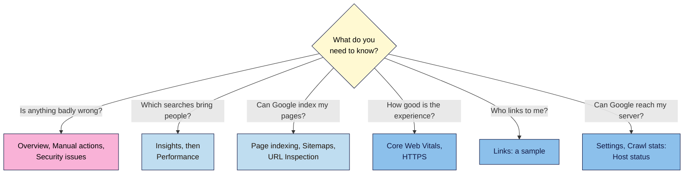

# M08.L01 — Search Console in Depth: Every Report, Links and Crawl Stats
> After this lesson you can find your way around every Search Console report, know which ones to check weekly and which to ignore on a small site, split branded from non-branded searches, mark changes with annotations, and read the Links and Crawl stats reports without over-reading them.

**Time:** ~16 min reading + ~40 min hands-on + ~10 min exercise · **Level:** L2 Practitioner · **Prereqs:** M01.L08, M03.L05, M06.L06 · **Remediate to:** M01.L08
**Verified against:** Search Console Help "Reports at a glance", "Links report", "Crawl Stats report", "Search Console annotations", branded queries filter, "Insights report", "Generative AI performance report (Search)", "Search generative AI control", Recommendations and Achievements; Search Central blog posts on query groups (27 October 2025), branded filter (20 November 2025, updated 11 March 2026), weekly and monthly views (10 December 2025) and generative AI performance reports (3 June 2026), all on 2026-11-09. Help pages carry no "last updated" date. Search Console screens weren't tested live, so labels may differ slightly on yours.

> ⚠️ **Freshness flag:** Search Console changed a lot in 2025–26: Insights moved inside it, and query groups, the branded filter, annotations, weekly and monthly views, and generative AI reports were added. Several are AI-classified and "may not be available to everyone". Expect more changes.

## Learning objectives
1. **Describe** what each report in Search Console's current list is for, and what would make you worry in it. *(O1)*
2. **Use** Insights, the branded filter (or a regex fallback), query groups and annotations to answer an SEO question. *(O2)*
3. **Read** the Links report (a sample) and Crawl stats (Host status, response codes) without over-reading them. *(O3)*

## Why it matters
Tomás opens Search Console once a month. He looks at the Performance chart, sees the line wiggle, and closes it. He doesn't know there's a Manual actions report, never noticed the Shopping reports for his products, and once spent an evening "fixing" 404s in Crawl stats that Google says are fine.

Search Console is the only place Google tells you, directly, how it sees your site: which pages it indexed, which searches showed them, who links to you, and whether anything is badly wrong. You set it up in Lesson 1.8 and used Performance and Page indexing in Modules 3 and 6. This lesson fills in the rest of the map, so you know where to look for each question, and which reports a small site can safely leave alone.

## Core concept
**Plain version:** Search Console has about twenty reports, but they answer only a few questions. **Is anything badly wrong?** (Overview, Manual actions, Security issues.) **Which searches bring people?** (Performance, Insights.) **Can Google index my pages?** (Page indexing, URL Inspection, Sitemaps.) **How good is the experience?** (Core Web Vitals, HTTPS.) **Who links to me?** (Links.) **How does Google crawl me?** (Crawl stats.) Learn which report answers which question, and check the urgent ones often.

**Analogy:** your car's dashboard. A few warning lights (oil, brakes) need attention the moment they come on. The fuel gauge and speedometer you glance at every trip. The service log you read once in a while. Search Console works the same way.

**Precise definitions:**
- **Property:** the site (or part of it) you've verified. Domain properties cover everything; URL-prefix properties cover one address pattern (Lesson 1.8).
- **Branded query:** a search that includes your brand name, such as "nila coffee subscription".
- **Query group:** an AI-made group of similar searches in the Insights report. Google: "The groups are computed using AI; they may evolve and change over time."
- **Annotation:** a dated note on the Performance chart, either your own (custom) or added by Google (system).
- **Host status:** a Crawl stats summary of whether Google could fetch your robots.txt, resolve your domain and connect to your server.

### Every report, and when to worry
| Report | What it answers | Worry if… | Check | Lesson |
|---|---|---|---|---|
| **Overview** | A summary of everything | Any manual action or security issue appears. Google: "If only checking in periodically, check for manual actions or security issues." | Weekly | This one |
| **Insights** | Top and trending content, queries, countries and traffic sources | A key page is "trending down" | Weekly | This one |
| **Performance** (Search; Discover and News if you have enough traffic) | Clicks, impressions, CTR, position by query, page, country, device, date | Clicks to a key page drop compared with the same period last year | Weekly | 3.5, 8.6 |
| **Generative AI performance** | Impressions in AI Overviews and AI Mode | You expected to appear and don't (Module 14) | Monthly | Module 14 |
| **URL Inspection** | "the information that the Google index has about a specific URL" | A key page isn't indexed | When needed | 6.6 |
| **Page indexing** | Indexed and not-indexed pages, with reasons | A sudden jump in not-indexed key pages | Monthly | 6.6 |
| **Video indexing** | Whether pages with videos are indexed as video pages | Videos you care about aren't | If you have videos | Module 12 |
| **Sitemaps** | Whether Google can read your sitemap | Status isn't **Success** | After changes | 6.4 |
| **Removals** | Temporary hiding of URLs from search | A removal you didn't make | When needed | 7.6 |
| **Core Web Vitals** | "how your page performs in real-world usage" | Many URLs **Poor** | Monthly | Module 12 |
| **HTTPS** | Indexed HTTP vs HTTPS URLs (a sample) | Any key page on HTTP | Monthly | 2.1 |
| **Rich results** (and AMP) | Structured data Google found, with errors | Errors on product or article markup | Monthly | Module 12 |
| **Shopping** (online merchants only) | Product snippets, merchant listings, opportunities | Errors on product pages | Monthly (shops) | 4.6, Module 12 |
| **Manual actions** | Penalties applied by a person at Google | Anything listed | Weekly | 1.6 |
| **Security issues** | Hacking, malware, deceptive pages | Anything listed | Weekly | Module 12 |
| **Links** | Who links to you, with what text, and your top internally linked pages | (Rarely urgent; see below) | Quarterly | 4.5, Module 9 |
| **Crawl stats** (in Settings) | How Google crawls your site | Host status not green | Monthly | This one |
| **robots.txt report** (in Settings) | Whether Google fetched your robots.txt | A fetch error | After changes | 6.2 |
| **Recommendations, Achievements** | Optional tips; milestones like 1,000 clicks | Nothing: "Recommendations are optional"; Achievements "wasn't designed to reflect how Google's ranking systems work" | Ignore if busy | — |

Names and where they sit in the menu may differ slightly in your account. Some reports appear only when they apply: Shopping for online merchants, Video indexing for sites with videos, Discover and News when you have enough traffic.

### The new tools (2025–26)
| Tool | What it does | Watch out |
|---|---|---|
| **Insights** | A simple summary inside Search Console: top and trending pages, queries, countries and other traffic sources | "trending" is ordered by the change in clicks, "not the percentage change". It "may not be available to everyone" |
| **Query groups** (in Insights) | Groups similar searches, so "cold brew ratio" and "how much coffee for cold brew" count together | AI-made; groups "may evolve and change over time" and "don't affect ranking" |
| **Branded filter** | Splits queries "based on whether or not the search term included your brand name" | AI-assisted; "Some queries might be incorrectly identified". Not available for sub-properties or "sites with a low number of impressions" |
| **Annotations** | Your own dated notes on the Performance chart (up to 120 characters), plus Google's system notes | They "won't show up in comparison mode or 24-hour views". Deleted after 500 days. No personal data in them |
| **Weekly and monthly views** | Change the chart from **Daily** to weekly or monthly | Google: lets you "compare performance between two periods without getting distracted by day-of-the-week mismatches" |
| **Generative AI performance** | Impressions (only) in AI Overviews and AI Mode | Missing if your site "hasn't received enough impressions" there. Module 14 covers it |
| **Search generative AI control** | A setting under **Settings > Search generative AI** | Affects how your content is used in AI features; Module 14 and Modern SEO 101 cover the trade-offs. Don't change it on a whim |

**No branded filter?** Use a regex filter in Performance instead (Lesson 3.5): **+ Add filter → Query → Custom (regex)**, matching your brand and its common misspellings, such as `nila|nilla|neela`. Google's filter uses AI rather than a pattern, so the numbers won't match exactly.

### Links: a sample, not a census
The Links report shows top linked pages, top linking sites, top linking text, and your most internally linked pages. Three limits to remember:
- "This report isn't a comprehensive list of every link on your site. It shows a sample".
- It includes links found "over time" that may be gone now, and "doesn't specify if a link is marked as nofollow".
- Spammy links aren't an emergency: "For known spam sites, Google typically will ignore the links". Module 9 covers when disavowing is (and isn't) needed.

Its most useful view for this course is **Top internally linked pages**: your most important pages should be near the top (Lesson 4.5).

### Crawl stats: know it exists, check Host status
Google is blunt: "If you have a site with fewer than a thousand pages, you should not need to use this report or worry about this level of crawling detail." For most learners, the one thing worth a monthly glance is **Host status**: robots.txt fetching, DNS resolution and server connectivity. "Ideally your host status should be Green." If it isn't, your host or DNS has a problem, so contact your hosting company. Two other points:
- It's under **Settings → Crawl stats**, and only for "root-level properties" (a Domain property, or a URL-prefix property for the whole site).
- Counts are requests, not pages: "each request in the redirect chain is counted as a separate request". Don't try to fix every 404 it lists (Lesson 6.6).

## How it works

**In words:** start with your question. If you want to know whether anything is badly wrong, check the Overview, Manual actions and Security issues. For which searches bring people, start with Insights, then dig into Performance. For indexing, use Page indexing, Sitemaps and URL Inspection. For experience, use Core Web Vitals and HTTPS. For links, use the Links report, remembering it's a sample. For whether Google can reach your server, check Host status in Crawl stats.

> **Under the hood: why reports disagree with each other.** Search Console's reports count different things. Performance groups data by the canonical URL, Crawl stats counts "the actual URLs requested by Google", and the Links report groups linking sites by root domain. Performance and Insights show your site in Google's results, Page indexing shows what's in the index, and Crawl stats shows fetches. So a page can have clicks in Performance while Crawl stats shows a 404 for an old version of its URL, and both are right. Read each report for the question it answers, and don't add numbers across reports.

## Hands-on walkthrough
You'll tour every report, split branded from non-branded searches, add an annotation, and check Host status. Nila Coffee's values are illustrative.

**Before you start: which steps apply to you?**
- **Path A (your own site):** do every part.
- **Path B (practice site):** use your Blogger site's Search Console property. Many reports will be empty or say there isn't enough data; write that down, as it's a real finding for a new site.
- **Path C (client site):** do every part with the access you were given in Lesson 1.8. Restricted users can view annotations but can't add them; if that's you, write the annotation text for the client to add.

**Part A — The tour (15 min)**
1. Add a tab called **GSC tour** with these columns: **Report**, **What it shows on my site**, **Worry if…**, **Status today**, **Check how often**.
2. Open each report in the left-hand menu, including those under **Settings**. For each, write one line in **Status today**, such as "No issues detected", "3 URLs Poor (mobile)", or "Not available: not enough data".
   **Expected:** a row per report. On a small site, several will say there isn't enough data. Manual actions and Security issues should say no issues.

**Part B — Branded vs non-branded (10 min)**
1. Open **Performance → Search results**, last 3 months. Switch the chart from **Daily** to **Weekly**.
2. Look for the branded queries filter. If you have it, record clicks for **Branded** and **Non-branded**. If you don't, add a **Query** filter with **Custom (regex)** matching your brand and its misspellings, record those clicks, then switch the filter to exclude them.
3. In your tab, write which number is your growth target. For most sites it's **non-branded clicks**: people who found you without already knowing your name.
   **Expected:** two numbers and one sentence. Nila's: branded 410 clicks, non-branded 160 *(illustrative)*. Her brew guides should grow the non-branded number.
   > 🖼️ **Image prompt:** Search Console Performance report (1280×800) in weekly view with a filter showing non-branded queries only, the clicks and impressions totals visible, and a small custom annotation marker on the chart. Highlight the filter chip and the annotation marker with a 3px #F9B2D7 outline; blur any personal details.
   > **Alt text:** Search Console performance chart filtered to non-branded queries, with a custom annotation marker highlighted.

**Part C — Annotate a change (5 min)**
1. On the Performance chart, right-click the date you published your first M07 post, choose **Add annotation**, and write a short note, such as "Published cold brew guide (cluster post 1)". Keep it under 120 characters, with no personal data.
2. Turn on **Compare** for any two periods and notice the annotation disappears; turn it off again.
   **Expected:** a marker on the chart for your publish date.

**Part D — Links and Crawl stats (10 min)**
1. Open **Links**. Note your top three **Top linking sites** and your top five **Top internally linked pages**. Are your most important pages near the top of the internal list?
2. Open **Settings → Crawl stats**. Note **Host status** (green or not) and the total crawl requests for the period.
   **Expected:** a short note per report. Write "sample" next to the Links numbers. If Crawl stats isn't available (for example, on a path-level URL-prefix property), note why.

**Expected output:** a **GSC tour** tab with a row for every report, a branded vs non-branded split with your growth target named, an annotation for your first publish date, and notes from Links and Crawl stats.

## When to use / when not to
**Weekly (5 minutes):** Overview, Manual actions, Security issues, Insights.

**Monthly:** Performance (weekly or monthly view, compared with last year), Page indexing, Core Web Vitals, Host status, Shopping (if you sell).

**After a change:** URL Inspection, Sitemaps, robots.txt report, and an annotation for the change.

**Don't** chase Recommendations or Achievements, fix every 404 in Crawl stats, or treat the Links report as a full list.

**The trade-off:** the AI-powered tools (Insights, query groups, the branded filter) save time and show patterns you'd miss, but they classify data with AI that may be wrong and may change. Use them for direction, and check important numbers in the Performance report with your own filters.

## Use AI for this
**Example prompt:**
> "Here's my Search Console GSC tour: each report's status on my site [paste]. My site is [type], with about [N] pages. Which three reports should I check weekly, which monthly, and which can I ignore for now? Quote Google's Search Console Help where it gives advice, and say which items need a person to check in Search Console."

**What AI does well here:** turning a long list of report statuses into a short routine.
**Where it gets it wrong:** report names and menus changed a lot in 2025–26, so it may describe old menus, claim the Links report shows every link, or treat Achievements as a ranking signal.
**How to check:** compare its advice with each report's Help page, and look at the report yourself before acting.

## Common mistakes
- **Only ever looking at the Performance chart,** and missing a manual action or security issue.
- **Comparing days of the week** instead of using the weekly or monthly view.
- **Treating the Links report as complete,** or panicking about spammy links Google ignores.
- **"Fixing" 404s in Crawl stats** that are fine.
- **Trusting the branded filter blindly** when it's AI-classified and may mislabel queries.
- **Personal data in annotations.**

## Troubleshooting
| Symptom | Likely cause | Fix |
|---|---|---|
| No Insights, branded filter or query groups | Gradual rollout, a sub-property, or too few impressions | Use the regex fallback in Performance |
| Crawl stats is missing | A path-level URL-prefix property | Use a Domain property or a root URL-prefix property |
| Your annotation disappeared | Comparison mode or 24-hour view is on | Turn off Compare; switch to the daily, weekly or monthly view |
| You can't add an annotation | You're a restricted user | Ask an owner or full user to add it |
| No generative AI performance report | Not enough impressions in AI features yet | Nothing to fix; check back later (Module 14) |
| No Shopping reports for a shop | Google hasn't identified the site as an online merchant | Check product structured data (Lesson 4.6, Module 12) |

## Exercise
**Task:** complete your **GSC tour** tab (Parts A–D). Then answer these. All details are illustrative.
1. Kavya has 10 minutes a week for Search Console. Which reports should she check?
2. Tomás's Crawl stats lists 300 404 responses. His site has 300 products and he redirected all his old URLs. Should he worry?
3. Nila's branded clicks went up 40% this quarter and non-branded clicks fell 10%. Is her SEO working?
4. Amara's client says "the Links report shows only 12 sites link to us, but our PR agency got us 40 links." Who's right?
5. Kavya's annotation for "new schedule page" vanished. She'd turned on **Compare**. What happened?
6. Tomás's site is a URL-prefix property for `https://example.com/shop/`. He can't find Crawl stats. Why?

**Expected outcome:** a complete tab, and these answers:
- **1** Overview (for manual actions and security issues), Insights, and a quick look at Performance in the weekly view.
- **2** Probably not. Crawl stats counts requests, and Google says it's "not possible, worthwhile, or even desirable to fix all 404 errors". Check that his own links and sitemap don't point to them (Lesson 6.6).
- **3** Not on its own. Branded growth usually comes from other marketing (Instagram, the café). The non-branded drop is the SEO signal to investigate, page by page (Lesson 8.6).
- **4** Possibly both. The Links report "shows a sample", so it isn't a full count. Check the agency's links exist and are indexed pages; Module 9 covers link audits.
- **5** Annotations "won't show up in comparison mode or 24-hour views". It's still there.
- **6** Crawl stats is only "available only for root-level properties". He needs a Domain property or a root URL-prefix property.

**Stretch goal:** set up a weekly 5-minute calendar reminder with the reports from your "Weekly" rows, and do it for a month.

## Key takeaways
- Search Console's reports answer a few questions: is anything wrong, which searches bring people, can Google index my pages, how good is the experience, who links to me, can Google reach my server.
- Check Manual actions and Security issues often; ignore Recommendations and Achievements if you're busy.
- Use the weekly or monthly view, the branded split (or a regex) and annotations to read trends honestly.
- The Links report is a sample; Crawl stats is for big sites, so just check Host status.
- AI-powered tools (Insights, query groups, branded filter) are helpful but can mislabel; check key numbers yourself.

## Teach it back
Explain to a friend in 3 sentences which three Search Console reports a small business should check every week, and why the Links report and Crawl stats shouldn't worry them much.

## Glossary terms added
- Branded query — added to `seo-101/glossary.md`
- Query group — added to `seo-101/glossary.md`
- Search Console annotation — added to `seo-101/glossary.md`
- Host status — added to `seo-101/glossary.md`
- Insights report — added to `seo-101/glossary.md`
- *Already in the glossary:* Search Console property, URL Inspection, Page indexing report, Manual action

## Further reading
*All checked 2026-11-09.*
- Search Console Help — Reports at a glance: https://support.google.com/webmasters/answer/9133276
- Search Console Help — Links report: https://support.google.com/webmasters/answer/9049606
- Search Console Help — Crawl Stats report: https://support.google.com/webmasters/answer/9679690
- Search Console Help — Search Console annotations: https://support.google.com/webmasters/answer/16530728
- Search Console Help — Branded queries filter: https://support.google.com/webmasters/answer/17011259
- Search Console Help — Insights report: https://support.google.com/webmasters/answer/16308503
- Search Console Help — Generative AI performance report (Search): https://support.google.com/webmasters/answer/16984139
- Search Central blog — Query groups in Search Console Insights (27 October 2025): https://developers.google.com/search/blog/2025/10/search-console-query-groups
- Search Central blog — Weekly and monthly views in Search Console (10 December 2025): https://developers.google.com/search/blog/2025/12/weekly-monthly-views-search-console
- Search Central blog — Generative AI performance reports (3 June 2026): https://developers.google.com/search/blog/2026/06/gen-ai-performance-reports

> ⚠️ **May change:** Search Console menus and report names; the AI-powered features (rolling out and changing); the generative AI report and control (new in 2026).

## Refresher card
*Used by remediation when a learner fails a quiz twice on a later lesson that points back here.*
**Which report?** Something wrong → Overview, **Manual actions**, **Security issues** (weekly). Searches → **Insights**, then **Performance** (weekly/monthly view; compare with last year). Indexing → Page indexing, Sitemaps, URL Inspection. Experience → Core Web Vitals, HTTPS. Links → **Links** ("a sample"; doesn't show nofollow; spam links usually ignored). Server → **Settings → Crawl stats → Host status** (green; sites under ~1,000 pages needn't worry about the rest). **New tools:** branded filter (AI; regex fallback), query groups (AI; "don't affect ranking"), **annotations** (≤120 chars; hidden in compare and 24-hour views; 500-day limit; no personal data). Recommendations and Achievements are optional.
