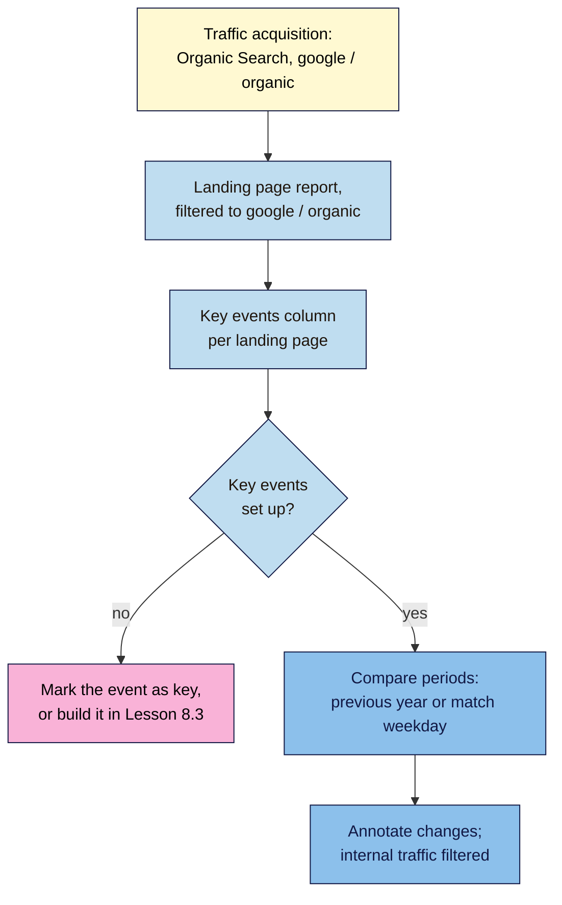

# M08.L02 — GA4 for SEO: Organic Traffic, Landing Pages and Key Events
> After this lesson you can find your organic search visitors in GA4, see which landing pages turn them into subscribers or sign-ups, mark the actions that matter as key events, keep your own visits out of the data, and know what retention, thresholding and annotations do.

**Time:** ~16 min reading + ~45 min hands-on + ~10 min exercise · **Level:** L2 Practitioner · **Prereqs:** M08.L01, M01.L08 · **Remediate to:** M01.L08
**Verified against:** Google Analytics Help "Traffic acquisition", "Default channel group", "Landing page", "Compare date ranges", "Key events", "[GA4] What's new" and its archive, "Data retention", "Filter out internal traffic", "Data filters", "Search Console reports", "Data thresholds", "Annotations" and "Explorations"; Search Central "Using Search Console and Google Analytics data for SEO" (last updated 2026-01-07), all on 2026-11-09. Help pages carry no "last updated" date. GA4 screens weren't tested live, and Google's own pages give different Admin menu names, so yours may differ.

> ⚠️ **Freshness flag:** GA4 renamed "conversions" to **key events** in March 2024; older guides still say conversions. A new **AI Assistant** channel (ChatGPT, Gemini and others) arrived in May 2026, and Dashboards in September 2026. Admin menus have moved more than once.

## Learning objectives
1. **Find** organic search traffic by channel, source/medium and landing page, including the Search Console collection. *(O1)*
2. **Mark** the right key events (a subscription, a sign-up) and read them per landing page. *(O2)*
3. **Set up** an internal-traffic filter (Testing, checked, then Active), and explain retention, thresholding and annotations. *(O3)*

## Why it matters
Nila's Search Console says her cold brew guide got 180 clicks last month. Good. But did any of those people subscribe? Did they read the guide and leave, or click through to the beans? Search Console stops at the click. **GA4 starts there:** it shows what visitors did on the site, which pages they landed on, and which of them did the thing the business needs.

Without GA4, Nila can't tell a guide that brings subscribers from one that brings only readers. And if her own team's visits are counted, or her key events aren't set up, she'll be measuring the wrong thing with great precision. Non-negotiable #2, measurement before changes, needs both tools set up properly.

## Core concept
**Plain version:** Search Console tells you how people **found** you in Google. GA4 tells you what they **did** once they arrived. For SEO, you mostly need three GA4 views: **traffic by channel** (how much came from organic search), **landing pages** (where search visitors started), and **key events** (which visits led to a subscription, sign-up or booking). Everything else is detail.

**Analogy:** Search Console is the count of people who walked through your shop door from the street. GA4 is what they did inside: which shelf they went to first, and whether they reached the till.

**Precise definitions:**
- **Session:** one visit, a group of actions by one person in one sitting.
- **Channel:** GA4's label for how a session arrived. **Organic Search** is "non-ad links in organic-search results, including Google's AI Overviews and AI Mode". **AI Assistant** is visits "from sources like ChatGPT, Gemini, Deepseek, Copilot, or Grok", which "excludes Google's AI Overviews and AI Mode".
- **Source / medium:** a more detailed label, such as `google / organic` or `bing / organic`.
- **Landing page:** "The page path and query string associated with the first pageview in a session."
- **Key event:** an event you've marked as important to the business. Since March 2024: "events that measure actions that are important to the success of your business are now called 'key events.'"
- **Internal traffic:** visits from you, your team or your agency, which you filter out so they don't distort the data.

### What the sources say
| Topic | What the source says | What it means for you |
|---|---|---|
| Organic Google traffic | In **Acquisition > Traffic acquisition**, "search "google / organic"" | Your main SEO segment |
| AI Overviews and AI Mode | Counted in **Organic Search** | No separate GA4 channel for them; Search Console has a generative AI report (Lesson 8.1) |
| ChatGPT, Gemini and others | The **AI Assistant** channel | Watch it; it's new (May 2026) and labels may change |
| Pairing with Search Console | Google suggests a "Landing page report with a filter to include only sessions from google organic" | The core SEO view in GA4 |
| Key events | Mark one "by clicking the star icon next to it", under **Admin > Data display > Events**; "up to 30" per property | Mark only what matters to the business |
| Retention | "The data retention setting only affects explorations and funnel reports", not "standard aggregated reports" | You set 14 months in Lesson 1.8; standard reports keep longer history anyway |
| Internal traffic | Test first: "Testing: Analytics identifies matching data with the "Test data filter name" dimension" | Test, check, then activate |
| Filters are permanent | "Once you apply a data filter, the effect on the data is permanent." "Data filters do not affect historical data." | Get it right in Testing first |
| Thresholding | "Data thresholds are system defined. You can't adjust them." Search-query rows "may be withheld if there aren't enough total users" | Small sites see gaps; widen the date range |
| Search Console reports in GA4 | Metrics work only with "Landing page, Device, Country", and "do not support time-series charts" | Use them for a quick look; use Search Console for detail |
| Annotations | Title up to 60 characters; Analyst role or above to create; visible "across all reports" with line graphs | Mark the same changes as in Search Console |

### Key events for SEO: choose a few
| Site | Good key events | Not key events |
|---|---|---|
| Nila Coffee (shop + blog) | `purchase` (a subscription or order), `sign_up` (email list) | `page_view`, `scroll` |
| Kavya (yoga classes) | `generate_lead` (class enquiry form), a click on the booking link | Every button click |
| Tomás (hardware shop) | `purchase`, `add_to_cart` if sales are rare | Product image clicks |
| Amara's client (B2B blog) | `generate_lead` (contact form), `sign_up` (newsletter) | Time on page |

GA4 marks `purchase` as a key event by default, but only if your shop actually sends a `purchase` event. That depends on your shop plugin or platform integration *(observed practice)*. If an event doesn't exist yet, you'll create it with Google Tag Manager in Lesson 8.3.

## How it works

**In words:** start in Traffic acquisition and find Organic Search and `google / organic`. Open the Landing page report filtered to `google / organic` sessions, and read the key events column for each page. If your key events aren't set up, mark them, or build the missing event in Lesson 8.3. Then compare periods (previous year, or previous period matching the day of the week), annotate your changes, and make sure your own visits are filtered out.

> **Under the hood: why GA4 and Search Console never quite agree.** A Search Console click is counted when someone clicks your result. A GA4 session is counted only if the GA4 tag loads, the visitor accepts tracking where consent is required, and the browser doesn't block it. Some clicks never become sessions; some sessions start from places Search Console doesn't count. GA4 groups by landing page as typed in the browser, while Search Console groups by canonical URL. Lesson 8.4 covers Google's full list of reasons. For now: compare the **trend** in both tools, not the totals.

## Hands-on walkthrough
You'll build a small GA4 view of your organic traffic, mark a key event, filter out your own visits, and add an annotation. Nila Coffee's values are illustrative.

**Before you start: which steps apply to you?**
- **Path A (your own site):** do every part.
- **Path B (practice site):** use the GA4 property on your Blogger site or WordPress practice site (Lesson 1.8). Expect very small numbers and thresholding; that's normal.
- **Path C (client site):** do Parts A, B and E with the access you have. Parts C and D change the client's settings, so get their OK first, or write them up as recommendations. You need the Editor role for C and D, and Analyst for E.

**Part A — Organic traffic by channel (8 min)**
1. In GA4, open **Reports → Acquisition → Traffic acquisition**. Set the date range to the last 28 days.
2. Note sessions and key events for **Organic Search**, and for **AI Assistant** if it appears.
3. In the table's search box, type `google / organic` and press Enter. Note the sessions.
4. Add a tab called **GA4 SEO view**, and record the three numbers with the date range.
   **Expected:** Organic Search as one channel among Direct, Referral, Organic Social and others. On a new site, very few sessions.

**Part B — Landing pages from Google (10 min)**
1. Open **Reports → Engagement → Landing page**.
2. Add a filter (the **Add filter** button near the report title) for **Session source / medium** exactly matching `google / organic`.
3. Record your top five landing pages with sessions and key events.
   **Expected:** your best guides and the home page near the top. Pages with sessions but zero key events are worth a look: do they link to the next step (Lesson 7.1's money page)?
   > 🖼️ **Image prompt:** GA4 Landing page report (1280×800) filtered to Session source / medium google / organic, listing five pages including /cold-brew-guide/ and /french-press-ratio/ with sessions and a key events column. Highlight the filter chip and the key events column with a 3px #F9B2D7 outline; blur any personal details.
   > **Alt text:** GA4 Landing page report filtered to Google organic, with the filter and key events column highlighted.

**Part C — Mark a key event (7 min)**
1. Go to **Admin → Data display → Events**.
2. Find the event that matters most (for example `purchase`, `sign_up` or `generate_lead`) and click its star to mark it as a key event.
3. If the event isn't in the list, note it in your tab as "to build in Lesson 8.3".
   **Expected:** one key event starred, or a clear note of what's missing.

**Part D — Filter out your own visits (12 min)**
1. Find your public IP address (search "what is my IP" in Google).
2. In **Admin**, open **Data streams** (under **Data collection and modification** on Google's current help page; your menu may differ), choose your web stream, then **Configure tag settings → Show more → Define internal traffic**. Create a rule with your IP address.
3. In **Admin → Data filters**, open the **Internal Traffic** filter (or create one) and leave it in **Testing**.
4. Visit your site, then wait. A filter "can take between 24 - 36 hours to apply". The next day, open **Explore**, create a **Free form** exploration with rows **Test data filter name** and **Event name**, and values **Event count**. Rows with your filter's name are your own visits.
5. Once you see your visits identified, change the filter to **Active**. It's permanent and doesn't change past data.
   **Expected:** the filter in **Testing**, checked in Explore, then **Active**, with the date logged. If your IP changes often (mobile data, some home broadband), note that the filter will miss some visits.

**Part E — Annotate and compare (8 min)**
1. On a line chart in **Reports**, right-click the date you published your first M07 post and add an annotation (title up to 60 characters), matching the one you made in Search Console (Lesson 8.1).
2. In the date picker, turn on **Compare** and choose **Previous year** (or **Previous period (match day of week)** if your site is newer than a year).
3. Record organic sessions and key events for both periods.
   **Expected:** an annotation visible on line charts across your reports, and a two-period comparison in your tab.

**Expected output:** a **GA4 SEO view** tab with organic sessions (channel and `google / organic`), the top five organic landing pages with key events, one key event marked (or listed to build), an internal-traffic filter tested and activated, and an annotation plus a period comparison.

## When to use / when not to
**Use GA4** to answer "what did search visitors do?": which pages they landed on, and whether they subscribed, booked or signed up.

**Use Search Console** for "how did they find us?": queries, impressions, positions and indexing. GA4's Search Console reports are a convenience, limited to "Landing page, Device, Country".

**Don't mark everything as a key event.** A handful of business actions is enough; more makes reports harder to read.

**Don't activate a filter you haven't tested.** Its effect is permanent.

**The trade-off:** GA4 shows behaviour that Search Console can't, but it misses visitors who decline tracking or block it, and it hides small numbers behind thresholds. Use it for patterns and comparisons, not exact counts.

## Use AI for this
**Example prompt:**
> "My site is [type]. Its goals are [main and second conversion from my Snapshot]. Which GA4 events should I mark as key events, and which shouldn't I? For each, say whether GA4 collects it automatically or whether I need to create it. Use Google Analytics Help's names for recommended events, and tell me which answers depend on my shop plugin."

**What AI does well here:** mapping business goals to sensible events, and explaining GA4 terms in plain words.
**Where it gets it wrong:** it often uses Universal Analytics terms ("goals", "bounce rate as the main metric", "views"), says "conversions" for key events, describes old Admin menus, and assumes your shop sends `purchase` events when it may not.
**How to check:** look for the event in **Admin → Data display → Events** before relying on it, and test it in DebugView (Lesson 8.3).

## Common mistakes
- **Reading "Direct" or total traffic** instead of Organic Search and `google / organic`.
- **No key events,** so you can see visitors but not results.
- **Marking every event as key.**
- **Activating an internal-traffic filter without testing it.**
- **Panicking at thresholded or "(not set)" rows** on a small site.
- **Comparing this month with last month** for a seasonal business, instead of last year.
- **Expecting GA4 sessions to equal Search Console clicks** (Lesson 8.4).

## Troubleshooting
| Symptom | Likely cause | Fix |
|---|---|---|
| A thresholding message on a report | Few users, or search-query data | Widen the date range: it "may increase the number of users" |
| No **Library** to publish Search Console reports | You don't have Edit permission | Ask an Editor or Administrator |
| `purchase` never appears | The shop doesn't send it | Check the shop's GA4 integration; build events in Lesson 8.3 |
| Your visits still appear after activating the filter | Your IP changed, or the filter isn't active yet | Wait 24–36 hours; check your current IP; add a range |
| Organic Search sessions far below Search Console clicks | Consent, blockers, tag on some pages only | Lesson 8.4 |
| An event is starred but key events show 0 | It hasn't happened yet in this date range, or happened before you marked it | Wait for new data; key events count from when you mark them *(observed practice)* |

## Exercise
**Task:** complete your **GA4 SEO view** tab (Parts A–E). Then answer these. All details are illustrative.
1. Nila's guide has 400 organic sessions and 0 key events. What should she check first?
2. Kavya wants to know how many visitors came from ChatGPT. Where should she look?
3. Tomás marks 25 events as key events "to be safe". What's the problem?
4. Amara's client's report shows "(other)" and missing query rows in GA4's Search Console report. Is the tag broken?
5. Nila activated an internal-traffic filter yesterday without testing. Today she notices the IP address was wrong. Can she undo it for yesterday's data?
6. Kavya's Organic Search sessions doubled after Google's AI Mode launched in her country. Does GA4 show AI Mode as a separate channel?

**Expected outcome:** a complete tab, and these answers:
- **1** That a key event exists and is marked (Part C); then whether the guide links to the next step (Lesson 7.1).
- **2** The **AI Assistant** channel in Traffic acquisition.
- **3** Too many key events make reports noisy and dilute what matters. Mark only actions that measure business success.
- **4** Probably not. Thresholds hide rows "if there aren't enough total users". Use Search Console's own Performance report for queries.
- **5** No. "Once you apply a data filter, the effect on the data is permanent." She should fix the rule and test it before reactivating.
- **6** No. Organic Search includes "Google's AI Overviews and AI Mode". Search Console's generative AI report shows impressions there (Lesson 8.1, Module 14).

**Stretch goal:** in **Explore**, build a free-form exploration with **Landing page** as rows, **Session source / medium** as a filter (`google / organic`), and **Sessions** and **Key events** as values, for the last 3 months.

## Key takeaways
- Search Console shows how people found you; GA4 shows what they did.
- Your core SEO view: Organic Search and `google / organic`, the Landing page report filtered to it, and key events per page.
- Mark a few business actions as key events; build missing ones in Lesson 8.3.
- Filter your own visits: Testing, check in Explore, then Active (it's permanent).
- Small sites see thresholds and gaps. Compare trends and periods, not exact totals.

## Teach it back
Explain to a friend in 3 sentences the difference between what Search Console and GA4 tell you, and why a guide with lots of visitors might still be failing the business.

## Glossary terms added
- Session (GA4) — added to `seo-101/glossary.md`
- Key event — added to `seo-101/glossary.md`
- Default channel group — added to `seo-101/glossary.md`
- Landing page (GA4) — added to `seo-101/glossary.md`
- Internal traffic filter — added to `seo-101/glossary.md`
- Data thresholding — added to `seo-101/glossary.md`
- *Already in the glossary:* GA4 property, Measurement ID

## Further reading
*All checked 2026-11-09.*
- Google Analytics Help — Traffic acquisition report: https://support.google.com/analytics/answer/12923437
- Google Analytics Help — Default channel group: https://support.google.com/analytics/answer/9756891
- Google Analytics Help — Landing page report: https://support.google.com/analytics/answer/12931766
- Google Analytics Help — Key events: https://support.google.com/analytics/answer/13128484
- Google Analytics Help — Filter out internal traffic: https://support.google.com/analytics/answer/10104470
- Google Analytics Help — Data retention: https://support.google.com/analytics/answer/7667196
- Google Analytics Help — Data thresholds: https://support.google.com/analytics/answer/9383630
- Google Analytics Help — Search Console reports in GA4: https://support.google.com/analytics/answer/10737381
- Google Analytics Help — Annotations: https://support.google.com/analytics/answer/15884203
- Google Search Central — Using Search Console and Google Analytics data for SEO: https://developers.google.com/search/docs/monitor-debug/google-analytics-search-console

> ⚠️ **May change:** GA4 Admin menu names (Google's own pages disagree); the AI Assistant channel and Dashboards (new in 2026).

## Refresher card
*Used by remediation when a learner fails a quiz twice on a later lesson that points back here.*
**GA4 for SEO:** **Acquisition → Traffic acquisition** (Organic Search includes "Google's AI Overviews and AI Mode"; ChatGPT, Gemini and others are the **AI Assistant** channel; search `google / organic`). **Engagement → Landing page** filtered to `google / organic`, read **key events** per page. **Key events** (renamed from conversions, March 2024): **Admin → Data display → Events**, star icon, up to 30; `purchase` only if the shop sends it. **Internal traffic:** define the IP rule → filter in **Testing** → check "Test data filter name" in Explore → **Active** (permanent, not retroactive; 24–36 hours). Retention affects only explorations and funnels. Thresholds: "You can't adjust them"; widen dates. Annotations: title ≤60 characters, Analyst or above.
