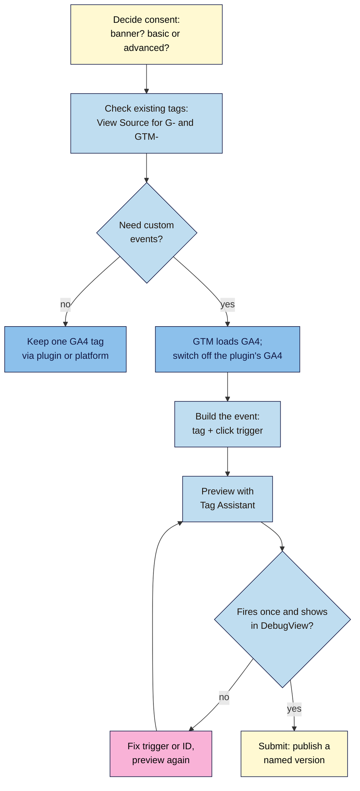

# M08.L03 — Consent Mode and Google Tag Manager Basics
> After this lesson you can decide how your site handles tracking consent, explain what Google's consent mode does, install Google Tag Manager once without double-counting, and build, test and publish one tracked event, such as a newsletter sign-up.

**Time:** ~18 min reading + ~45 min hands-on + ~10 min exercise · **Level:** L2 Practitioner · **Prereqs:** M08.L02 · **Remediate to:** M08.L02
**Verified against:** Google Analytics Help "About consent mode" and "Behavioral modeling for consent mode"; Google tag platform "Consent mode overview" (last updated 2026-07-30), "Tags that are already on your site" and "Install the Google tag" (both 2026-11-06); Tag Manager Help on EU consent changes, setting up GA4 in Tag Manager, GA4 events, Preview and debug, publishing and versions, and gtag.js with Tag Manager; Google's EU user consent policy, all on 2026-11-09. Tag Manager and GA4 screens weren't tested live.

> ⚠️ **Freshness flag:** Google changed its tag installation snippet on 2026-11-06: new snippets load `gtm.js?id=…`, and "The gtag('config') command is deprecated". Old snippets "will continue to work", so you'll see both kinds on real sites. Tag Manager now recommends a "Google Analytics Destination" tag; most tutorials still show the older Google tag. Consent rules change; this lesson is not legal advice.

## Learning objectives
1. **Explain** basic vs advanced consent mode, where Google requires consent signals, and why small sites rarely get modelled data. *(O1)*
2. **Install** Google Tag Manager once, with a single GA4 setup (no duplicate tags), and know which snippet version you're looking at. *(O2)*
3. **Build, preview and publish** one click event (a newsletter sign-up) with a named version. *(O3)*

## Why it matters
Nila wants to know how many readers of her brew guides join the email list. GA4 can't see that on its own: the sign-up box is a click, not a page. She could ask a developer to add code, or she could use **Google Tag Manager (GTM)** to add the tracking herself, test it, and undo it if it's wrong.

Meanwhile, some of Nila's customers live in Europe. If her site uses Google's measurement or ads tags for them, Google expects her to collect consent and pass it on. And if she gets either job wrong (two GA4 tags, or a banner that blocks everything), her numbers will be quietly off for months. This lesson sets both up properly, once.

## Core concept
**Plain version:** **consent** is about whether you're allowed to track a visitor. A **consent banner** asks them; **consent mode** passes their answer to Google's tags, which then adjust what they collect. **Google Tag Manager** is a free tool that holds all your tracking in one place (a **container**), so you can add events like "clicked Subscribe" without editing your site's code, preview them, and publish them as numbered **versions** you can roll back.

**Analogy:** GTM is a fuse box for tracking. Everything runs through one box with labelled switches, instead of wires taped behind the walls. Consent is the rule about which switches each visitor allows you to turn on.

**Precise definitions:**
- **Consent banner (CMP):** the pop-up that asks visitors to accept or decline cookies. "Consent mode does not provide a consent banner or widget. Rather, it interacts with it."
- **Consent mode:** Google's way for tags to receive the visitor's choice. "basic … blocks tags until consent; and advanced … loads tags with default settings and adjusts behavior based on consent".
- **GTM container:** the box that holds your tags, triggers and variables. Its ID starts with `GTM-`.
- **Tag:** what to send (for example, a GA4 event). **Trigger:** when to send it (for example, a click on "Subscribe").
- **Version:** "a snapshot of a container configuration at a particular time." Publishing creates one.
- **Measurement ID / Tag ID:** your GA4 property's code starts with `G-` (the Measurement ID). A Google tag can also have its own `GT-` Tag ID. Use whichever ID the screen you're on asks for.

### What the sources say: consent
| Topic | What the source says | What it means for you |
|---|---|---|
| Who must collect consent | For Google tags used for measurement, ad personalisation and remarketing, "you must collect consent for use of personal data from end users based in the EEA and share consent signals with Google". Google's policy covers "the European Economic Area, the UK and Switzerland" | If you have visitors there and use Google tags, you need a banner and consent signals |
| Everywhere else | Not a Google question | **Check your local law** (for example, India's DPDP Act). This course can't advise on it |
| Basic mode | "when the user doesn't consent, no data is transferred to Google at all – not even the consent status" | Simple and strict; you lose all data from people who decline |
| Advanced mode | Tags load, and "While consent is denied, the Google tags send measurements without cookies" | More data for modelling; more set-up and more to explain in your privacy policy |
| Modelled data | Needs "at least 1,000 events per day with analytics_storage='denied' for at least 7 days" and "at least 1,000 daily users" who consent | Small sites won't get modelling: declines simply mean fewer sessions *(course inference from the thresholds)* |
| No ads personalisation? | "If you already use consent mode and don't engage in personalized advertising, such as remarketing, you don't need to take any action." | Most small content sites need only the basics |
| Google's stated best practice | "Load Google tags in all cases, not only if the user consents", and set a default state per region | That's the advanced approach; basic is still a valid, simpler choice. Either way, set region defaults yourself |

**How to set up the banner on WordPress:** WordPress 101, Module 8, Lesson 3 (`wordpress-101/lessons/m08-l03-cookie-consent.md`) walks through listing your cookies and setting up one consent plugin. This lesson covers only what changes for Google's tags.

### What the sources say: Tag Manager
| Topic | What the source says |
|---|---|
| New installs | "If you are installing a Google tag for the first time, we recommend using Google Tag Manager." |
| GA4 in GTM | "Add the Google Analytics Destination (recommended)", or the Google tag as an alternative, triggered on "Initialization - All Initialization Events" |
| One tag per site | "Ensure you create a unique Google tag for each website." |
| Don't add gtag.js too | "there is no need to deploy additional code using gtag.js on your site if Tag Manager is already in use" |
| Check what's there first | "assess the tags that already exist on your website … so you don't add any redundant tags" |
| Events | "configure a Google Analytics: GA4 Event tag and then create a trigger" |
| Preview | "click Preview (top right) to launch Google Tag Assistant"; the debug panel "is not visible to your regular website visitors" |
| Publish | **Submit** → "Select Publish and Create Version" → name it → **Publish** |
| Undo | "you can revert your workspace to an earlier version and publish it" |

**The duplicate trap:** if a plugin (such as Site Kit) installs GA4 *and* your GTM container also loads GA4 for the same `G-` ID, each visit can be counted twice *(observed practice; widely reported, not stated in these words by Google)*. **Choose one method** for the GA4 tag:
- **Simple sites:** keep the plugin's GA4 tag and skip GTM, unless you need custom events.
- **Sites that need events:** let GTM load GA4 *and* the events, and switch off GA4 in the plugin (or the platform's own GA4 setting).

## How it works

**In words:** first decide how you handle consent. Then check which Google tags are already on your site. If you don't need custom events, keep one GA4 tag from your plugin or platform. If you do, let GTM load GA4 and switch off the plugin's GA4. Build the event as a tag plus a click trigger, and preview it with Tag Assistant. If it doesn't fire exactly once and appear in GA4's DebugView, fix the trigger or the ID and preview again. When it works, submit and publish a named version.

> **Under the hood: what the new snippet changes.** Older Google tag snippets loaded `gtag/js?id=G-…` and then ran `gtag('config', 'G-…')`. Since 2026-11-06, Google's default snippet loads `gtm.js?id=…`, and `gtag('config')` "is deprecated and no longer included in default installation snippets". Google has "upgraded all the Google tags (gtag.js) to include the capabilities of Google Tag Manager", so the line between "gtag" and "GTM" is blurring. For you, two things matter: an old snippet still works, so don't rip it out in a panic; and when you search your page source for tags, look for `googletagmanager.com`, `G-` and `GTM-`, which catch both versions.

## Hands-on walkthrough
You'll decide your consent approach, check your existing tags, then build, test and publish one event in GTM. Nila Coffee's details are illustrative.

**Before you start: which steps apply to you?**
- **Path A (your own site):** do every part on your live site.
- **Path B (practice site):** use your WordPress practice site if it's public (on hosting). Blogger doesn't make GTM easy (it needs theme code edits), and Tag Assistant needs a site it can open; a local or Playground site wasn't tested. If neither works, do Parts A and B, then build the GTM event in a container without publishing.
- **Path C (client site):** do Parts A and B as an audit. Build Part C only with the client's OK and Editor access to their GTM, and publish only with their sign-off.

**Part A — Decide consent (8 min)**
1. Add a tab called **Tracking setup**. Write: **Visitors from EEA, UK or Switzerland?** (check GA4's **Reports → User attributes** or your audience), **Google tags used** (GA4, Ads?), **Personalised ads or remarketing?**, **Local law checked?** (with a link to your country's guidance), **Banner plugin**, **Consent mode: basic / advanced / not needed**.
2. If you have EEA, UK or Swiss visitors and use Google tags, you need a banner that sends consent signals. Follow WordPress 101, Module 8, Lesson 3 to set it up.
3. Choose **basic** unless you have a reason (and the know-how) for advanced. Note that your site is unlikely to meet the modelling thresholds.
   **Expected:** a short, honest record of your consent decision and why.

**Part B — Check your existing tags (7 min)**
1. Open your home page, View Source (`Ctrl+U` / `Cmd+Option+U`), and search for `googletagmanager.com`, then `G-`, then `GTM-`. Note every match.
2. Check your plugins or platform settings for GA4 (for example, Site Kit's Analytics module, or Blogger's GA4 setting).
3. Decide your **one** GA4 method, and write it in your tab.
   **Expected:** one `G-` ID, loaded one way. If you find two ways (a plugin *and* a pasted snippet, or a plugin *and* GTM), fix it now, or flag it for Lesson 8.4.

**Part C — Build one event in GTM (20 min)**
1. Go to tagmanager.google.com, create an account and a **Web** container for your site, and install it using GTM's instructions or your platform's GTM option. If GTM will load GA4, add a **Google Analytics** tag (the **Destination**, as Google recommends) with your `G-` ID, triggered on **Initialization - All Initialization Events**, and switch off GA4 in your plugin.
2. Create a new tag: **Google Analytics: GA4 Event**, with your Measurement ID and the event name `sign_up`.
3. Add a trigger: **Click - All Elements** → **Some Clicks** → **Click Text** contains the text on your sign-up button (for example, "Subscribe"). If **Click Text** isn't in the list, enable it under **Variables → Configure** (built-in click variables). If your sign-up goes to a thank-you page, a **Page View** trigger on that page is simpler.
4. Save the tag.
   **Expected:** one GA4 setup and one event tag with a click trigger in your workspace, not yet live.

**Part D — Preview, check and publish (10 min)**
1. Click **Preview**, enter your site's address, and click **Connect**. Your site opens in a new window, connected to Tag Assistant.
2. Click your sign-up button. In Tag Assistant, check your `sign_up` tag shows under **Tags Fired**, **once**.
3. In GA4, open **DebugView** (in Admin; the menu location may vary) and look for `sign_up`.
   > 🖼️ **Image prompt:** Google Tag Assistant preview (1280×800) after a click on a "Subscribe" button, with the summary panel showing a GA4 Event tag named "GA4 event – sign_up" under Tags Fired, fired once. Highlight the fired tag with a 3px #F9B2D7 outline; blur any personal details.
   > **Alt text:** Tag Assistant showing a GA4 sign-up event tag fired once after a click, with the tag highlighted.
4. Back in GTM, click **Submit** → **Publish and Create Version**. Name it, for example "2026-11 sign_up event", add a one-line description, and click **Publish**.
5. In GA4, mark `sign_up` as a key event (Lesson 8.2) once it appears in **Admin → Data display → Events**. Add an annotation for the date.
6. Record the container ID, version name and date in your **Tracking setup** tab.
   **Expected:** the tag fires once in Preview, appears in DebugView, and is published as a named version; `sign_up` becomes a key event.

**Expected output:** a **Tracking setup** tab with your consent decision, your one GA4 install method, the GTM container ID, and a published, named version with a working `sign_up` event marked as key.

## When to use / when not to
**Use GTM** when you need events your plugin or platform doesn't track (sign-up clicks, outbound clicks, file downloads), or when several people manage tracking.

**Skip GTM** on a simple site that only needs page views and a purchase event your shop already sends. Fewer moving parts, fewer ways to break.

**Use basic consent mode** unless you need ad modelling and can maintain advanced mode properly.

**Don't publish untested changes.** Preview every change, and name every version so you can roll back.

**The trade-off:** GTM gives you control without a developer, but it's another system to keep tidy. One stray tag or an unpublished change can skew your data for months. Keep your container small, and log every version in your **Tracking setup** tab.

## Use AI for this
**Example prompt:**
> "I use WordPress with [plugins]. My site has a newsletter form with a button that says '[text]', and after signing up people [stay on the page / go to /thank-you/]. In Google Tag Manager, which trigger should I use for a GA4 event called sign_up, and why? Use Google Tag Manager Help's current names, and remind me what to check in Preview."

**What AI does well here:** choosing between a click trigger and a page-view trigger, and explaining GTM's tag–trigger–variable model.
**Where it gets it wrong:** it describes the old "GA4 Configuration" tag (now replaced), mixes up Universal Analytics settings, assumes the snippet still uses `gtag('config')`, and gives legal advice on consent with false confidence.
**How to check:** follow Tag Manager Help's current pages, test every change in Preview and DebugView, and check consent law with an official source for your country.

## Common mistakes
- **GA4 installed twice** (plugin + GTM, or plugin + pasted snippet).
- **Publishing without Preview.**
- **Forgetting to Submit:** the change works in Preview but never goes live.
- **Unnamed versions,** so nobody knows what changed or when.
- **A banner that blocks everything by default for everyone,** worldwide, without a reason.
- **Assuming consent mode is a banner.** It "does not provide a consent banner or widget".
- **A click trigger on text that changes** (a button renamed from "Subscribe" to "Join"), so the event silently stops.

## Troubleshooting
| Symptom | Likely cause | Fix |
|---|---|---|
| Tag Assistant won't connect | Site blocks the debug parameter, or it's not reachable | Uncheck "Include debug signal in the URL", or use a public site |
| The tag fires twice per click | Two triggers, or the button is inside another clickable element | Narrow the trigger (Click Text **equals**, or add a Page URL condition) |
| Works in Preview, not for visitors | Changes not published | **Submit** → **Publish and Create Version** |
| Event in DebugView but not in reports | Reports lag behind | Wait 24–48 hours |
| Organic sessions dropped after adding a banner | Visitors declining, in basic mode | Expected; note it as a data caveat (Lesson 8.6) |
| A published version broke tracking | A bad change | Revert to the previous version and publish it |

## Exercise
**Task:** complete your **Tracking setup** tab (Parts A–D). Then answer these. All details are illustrative.
1. Kavya's site has Site Kit's GA4 on, and she adds GTM with a GA4 tag for the same ID. What will happen, and what should she do?
2. Tomás's shop ships to Germany and uses Google Ads remarketing. Does he need to collect consent for German visitors?
3. Nila's site gets 80 visitors a day. Will advanced consent mode give her modelled data for visitors who decline?
4. Amara built an event in GTM, saw it fire in Preview, and closed the tab. A week later, GA4 shows nothing. Why?
5. Tomás sees `gtag('config', 'G-…')` in his theme's code and reads that it's deprecated. Should he remove it today?
6. Nila's newsletter button changed from "Subscribe" to "Join the list", and `sign_up` events stopped. Why?

**Expected outcome:** a complete tab, and these answers:
- **1** GA4 may count visits twice *(observed practice)*. Choose one: switch off GA4 in Site Kit and let GTM handle it, or remove the GA4 tag from GTM.
- **2** Yes. Google requires consent for "end users based in the EEA" for measurement, ad personalisation and remarketing, with consent signals shared with Google.
- **3** Almost certainly not. Modelling needs "at least 1,000 daily users" consenting and 1,000 denied events a day. Declines simply mean fewer sessions.
- **4** She didn't **Submit** and publish a version, so real visitors never got the change.
- **5** No. "Existing snippets containing gtag('config') will continue to work". Plan any change carefully, and never add a second copy.
- **6** The trigger matched the old button text. Update the trigger, preview, and publish a new version. Better: use the thank-you page view, or a stable button ID.

**Stretch goal:** add a second event for clicks on your money page's main button (for example, "Start subscription"), preview it, and publish it as a new named version.

## Key takeaways
- Consent mode passes the visitor's choice to Google's tags; it isn't a banner. Google requires consent signals for EEA, UK and Swiss visitors; check your own local law.
- Basic mode blocks tags until consent; advanced sends cookieless pings. Small sites won't get modelled data.
- Install GA4 **one** way: plugin, platform or GTM, never two.
- In GTM: tag + trigger → **Preview** → DebugView → **Submit** a named version.
- Google's snippet changed on 2026-11-06; old `gtag('config')` snippets still work.

## Teach it back
Explain to a friend in 3 sentences what Google Tag Manager does, why you'd preview every change before publishing, and why installing GA4 twice is a problem.

## Glossary terms added
- Consent mode — added to `seo-101/glossary.md`
- Consent banner (CMP) — added to `seo-101/glossary.md`
- Google Tag Manager (GTM) — added to `seo-101/glossary.md`
- Tag and trigger (GTM) — added to `seo-101/glossary.md`
- Container version — added to `seo-101/glossary.md`
- *Already in the glossary:* Measurement ID, Key event

## Further reading
*All checked 2026-11-09.*
- Google Analytics Help — About consent mode: https://support.google.com/analytics/answer/9976101
- Google tag platform — Consent mode overview: https://developers.google.com/tag-platform/security/concepts/consent-mode
- Tag Manager Help — Changes to consent in the EEA: https://support.google.com/tagmanager/answer/13695607
- Google Analytics Help — Behavioral modeling for consent mode: https://support.google.com/analytics/answer/11161109
- Google — EU user consent policy: https://www.google.com/about/company/user-consent-policy/
- Tag Manager Help — Set up Google Analytics in Tag Manager: https://support.google.com/tagmanager/answer/9442095
- Tag Manager Help — Set up events (GA4): https://support.google.com/tagmanager/answer/13034206
- Tag Manager Help — Preview and debug containers: https://support.google.com/tagmanager/answer/6107056
- Tag Manager Help — Publishing, versions and approvals: https://support.google.com/tagmanager/answer/6107163
- Google tag platform — Install the Google tag (2026 snippet): https://developers.google.com/tag-platform/gtagjs/install
- Google tag platform — Tags that are already on your site: https://developers.google.com/tag-platform/devguides/existing
- WordPress 101, Module 8, Lesson 3 — Cookie consent where required: `wordpress-101/lessons/m08-l03-cookie-consent.md`

> ⚠️ **May change:** consent rules and regions; the 2026 tag snippet and the Destination tag; GTM and GA4 menus. This lesson isn't legal advice.

## Refresher card
*Used by remediation when a learner fails a quiz twice on a later lesson that points back here.*
**Consent:** a banner asks; **consent mode** passes the answer to Google's tags (it "does not provide a consent banner"). Google requires consent signals for EEA, UK and Swiss users of its measurement/ads tags; elsewhere, check local law. **Basic:** tags blocked until consent, nothing sent on decline. **Advanced:** tags load, cookieless pings on decline; modelling needs ≥1,000 consenting daily users, so small sites get none. **GTM:** container (`GTM-`) → tags (what) + triggers (when) → **Preview** (Tag Assistant) → DebugView → **Submit → Publish and Create Version** (named) → revert if needed. **One GA4 install only** (plugin, platform *or* GTM). New 2026 snippet: `gtm.js?id=…`; `gtag('config')` deprecated but still works.
