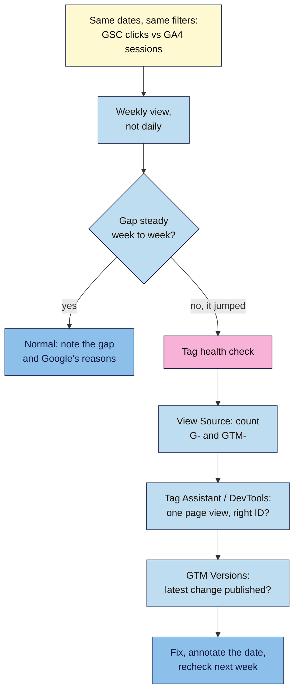

# M08.L04 — Why the Numbers Don't Match (and How to Catch a Broken Tag)
> After this lesson you can explain why Search Console clicks and GA4 sessions never match, compare them fairly, and run a 10-minute tag health check that catches the three most common tracking faults: a duplicated tag, a wrong measurement ID, and GTM changes that never went live.

**Time:** ~15 min reading + ~40 min hands-on + ~10 min exercise · **Level:** L2 Practitioner · **Prereqs:** M08.L03 · **Remediate to:** M08.L03
**Verified against:** Google Search Central "Using Search Console and Google Analytics data for SEO" (last updated 2026-01-07); Search Console Help on data discrepancies; Google Analytics developer guide "Troubleshoot your GA4 implementation" (last updated 2026-10-14); Google tag platform "Install the Google tag" (2026-11-06); Tag Assistant Help; Analytics Help "Find your Measurement ID"; Tag Manager Help on publishing, all on 2026-11-09. Network request details (`tid`, `en`) aren't documented by Google; they're labelled observed practice.

> ⚠️ **Freshness flag:** Google's tag snippet changed on 2026-11-06 (Lesson 8.3), so the requests you see in DevTools may differ from older tutorials. Tag Assistant's extensions were merged into one. What stays the same: look for your `G-` ID and count the page views.

## Learning objectives
1. **Explain** Google's documented reasons why Search Console clicks and GA4 sessions differ. *(O1)*
2. **Compare** the two fairly: same dates, same filters, weekly not daily, with time zones in mind. *(O2)*
3. **Diagnose** a duplicated GA4 tag, a wrong measurement ID and unpublished GTM changes with View Source, Tag Assistant, DevTools and DebugView. *(O3)*

## Why it matters
Nila puts two numbers side by side for last month: **Search Console: 620 clicks. GA4 organic sessions from Google: 410.** Where did 210 visitors go? She spends a weekend convinced something is broken.

Some of the gap is normal. Google says so directly, and lists the reasons. But a gap can also hide a real fault: a tag missing from some pages, two tags counting everything twice, or a typo in the ID sending data nowhere. This lesson teaches you to tell the difference: what's expected, what's a fault, and how to check in ten minutes instead of a weekend.

## Core concept
**Plain version:** Search Console counts **clicks on Google's results**. GA4 counts **visits where its tag ran**. They're measured in different places, in different ways, so they will never match. Google says: "Although the total counts don't match exactly, what's important is that the general trends have the same pattern." Compare their **trends**, not their totals. If the trends split apart, or the gap suddenly jumps, check your tags.

**Analogy:** a shop's door counter and its till. The door counter counts everyone who walks in. The till counts only people who reach it, and misses anyone who pays in a way the till doesn't record. The numbers never match, but if footfall rises and the till stays flat, something's up.

**Precise definitions:**
- **Click (Search Console):** a click on your result in Google Search. "Search Console counts every click in Google Search."
- **Session (GA4):** a visit in which the GA4 tag ran and sent data.
- **Source of truth:** "The source of truth for Search performance will always be Search Console, while the source of truth for behavior inside your site will be Google Analytics."
- **Tag health check:** a quick check that exactly one GA4 tag, with the right ID, runs on every page, and that your GTM changes are published.

### Google's reasons the numbers differ
| Reason | What Google says | Makes GA4 lower or higher? |
|---|---|---|
| **Tag missing on some pages** | "there could be pages on your website where the Analytics tag is missing" | Lower |
| **Consent** | "If your site is asking users to accept tracking, and users opt out, that can skew Google Analytics data." | Lower |
| **Blockers and JavaScript** | GA4 tracks "only from users who have enabled JavaScript"; "Some browser extensions can block Google Analytics scripts" | Lower |
| **Time zones** | "the default time zone is Pacific Time (PT)" in Search Console; GA4 uses yours | Shifts days, not totals |
| **Canonical URLs** | Search Console "reports only on the Google Search canonical URL", GA4 "on any URL that includes the tracking code" | Page totals differ |
| **Bots** | GA4 "automatically excludes traffic from known bots", Search Console "doesn't necessarily" | Lower in GA4 |
| **Non-HTML files** | Search Console includes PDFs "by default"; the GA4 tag can't run in a PDF | Lower in GA4 |
| **Privacy and processing** | "the Performance report does not show all data", and data is "usually available in 2–3 days" | Either way |

**How big a gap is normal?** Google gives no number: "If the difference is small, you can ignore the discrepancies." In this course, treat a **steady** gap as normal, and a gap that **changes suddenly** (from 30% to 60% in a week) as a reason to run the tag health check *(course rule of thumb, not a Google figure)*.

**Time zones in practice:** India Standard Time is 12.5 hours ahead of Pacific Time (13.5 when the US is on standard time). A click at 9 am in Mumbai on Monday is logged on **Sunday** evening in Search Console. Daily comparisons will never line up; weekly and monthly ones mostly will.

### The three tag faults
| Fault | What you see | How to catch it |
|---|---|---|
| **Duplicate tag** (plugin + GTM, or plugin + pasted code) | Two `page_view` events per page load; engagement looks oddly low or high | View Source: count `G-` and `GTM-`. Tag Assistant: the same ID twice. DevTools: two `collect` requests with a page view for one load *(observed practice)* |
| **Wrong measurement ID** (a typo) | Realtime stays empty, though requests still fire | Compare the `G-` ID in the request with **Admin → Data streams → Measurement ID**. Google: "Typos in the Measurement ID are one of the most common and easy-to-make setup mistakes" |
| **GTM change not published** | Works for you in Preview; real visitors aren't tracked | GTM **Versions**: "look for entries with a date in the Published column" |

## How it works

**In words:** put Search Console clicks next to GA4 sessions from `google / organic`, with the same dates and filters, by week. If the gap is steady, it's normal: note it and Google's reasons. If it suddenly jumps, run the tag health check: count Google tags in the page source, check in Tag Assistant or DevTools that one page view goes to the right ID, and check that your latest GTM change is published. Fix what you find, annotate the date, and recheck next week.

> **Under the hood: what a GA4 hit looks like.** When the GA4 tag records a page view, the browser sends a request to `google-analytics.com/g/collect` or `analytics.google.com/g/collect`; Google says "A 200 OK or 204 No Content status code indicates a successful transmission." The request's address carries your property's ID (as `tid=G-…`) and the event name (as `en=page_view`). Google doesn't document these parameter names, so treat them as observed practice. A status of 204 only means the request was received, not that the ID is yours, so a typo'd ID still returns 204 and quietly sends data to nobody's property.

## Hands-on walkthrough
You'll build a 4-week clicks vs sessions comparison, then run a tag health check. Nila Coffee's values are illustrative.

**Before you start: which steps apply to you?**
- **Path A (your own site):** do every part.
- **Path B (practice site):** do every part. Numbers will be tiny, so focus on the method; the tag health check works the same way on Blogger or WordPress.
- **Path C (client site):** do every part. The tag health check needs no logins (View Source and DevTools work on any public page); GTM Versions needs at least Read access.

**Part A — A fair comparison (15 min)**
1. Add a tab called **Tag health** with columns **Week starting**, **GSC clicks**, **GA4 sessions (google / organic)**, **Gap %**, **Notes**.
2. In Search Console **Performance**, set **Weekly** view and the last 4 full weeks. Record clicks per week. Use no filters (or, if you filter, use the same filter in GA4: Google says "pick the same filter for both data sources").
3. In GA4, open **Traffic acquisition**, set the same 4 weeks, search `google / organic`, and record sessions. (Set the chart to **Week**, or read each week's dates.)
4. Work out **Gap %** = (clicks − sessions) ÷ clicks × 100.
   **Expected:** a gap that's roughly steady week to week. Nila's: 34%, 31%, 36%, 33% *(illustrative)*. Write in **Notes** which of Google's reasons probably apply (consent banner, PDFs, time zone).

**Part B — Tag health check (20 min)**
1. **View Source.** Open your home page and a blog post. In each, View Source (`Ctrl+U` / `Cmd+Option+U`) and search for `googletagmanager.com`, `G-` and `GTM-`. Write down every ID and how many times each appears.
2. **Find your real ID.** In GA4, go to **Admin → Data streams**, choose your web stream, and copy the **Measurement ID** (it starts with `G-`). Does it match what's on the page, character for character?
3. **Tag Assistant.** Go to tagassistant.google.com, click **Add domain**, enter your site's address and **Connect**. Check that your `G-` ID appears under **Google tags found**, once. (Tag Assistant adds a debug parameter, `_dbg`, to your URL so events also show in GA4's DebugView.)
4. **DevTools.** Open Chrome DevTools (**F12**), go to the **Network** tab, type `collect` in the filter box, and refresh. Count the requests for this one page load that carry your `G-` ID and a page view.
   > 🖼️ **Image prompt:** Chrome DevTools Network tab (1280×720) filtered to "collect", showing two requests to analytics.google.com/g/collect for one page load, both with status 204, and one request URL expanded showing tid=G-ABC123XYZ and en=page_view. Highlight the two matching rows with a 3px #F9B2D7 outline; blur any personal details.
   > **Alt text:** DevTools Network tab showing two GA4 page view requests for one page load, a sign of a duplicated tag.
5. **GTM Versions** (if you use GTM). Open **Versions** and check that your latest change has a date in the **Published** column.
   **Expected:** one `G-` ID that matches GA4, found once in Tag Assistant, one page view per load in DevTools, and your latest GTM version published. Record each check as ✅ or ❌ in your tab.

**Part C — Fix and annotate (5 min)**
1. If any check failed, fix it: remove the extra tag (Lesson 8.3), correct the ID, or publish the GTM version.
2. Add an annotation in both GA4 and Search Console for the fix date ("Removed duplicate GA4 tag").
   **Expected:** a fix logged with the date, or "all checks passed" with the date.

**Expected output:** a **Tag health** tab with 4 weeks of clicks vs sessions and the gap explained, plus a dated tag health check (View Source, Measurement ID match, Tag Assistant, DevTools, GTM Versions) and any fixes annotated.

## When to use / when not to
**Run the tag health check:** after installing or changing any plugin, theme or GTM container; when the clicks-vs-sessions gap jumps; and once a quarter anyway.

**Compare clicks and sessions:** weekly or monthly, with the same dates and filters. Google calls them "the most comparable" pair.

**Don't** try to make the totals match, compare single days, or report GA4 sessions as "search traffic" without saying which source you used.

**The trade-off:** a perfect reconciliation is impossible and not worth chasing. Spend your time on the trend, and on the one-off checks that catch real faults.

## Use AI for this
**Example prompt:**
> "Here are 4 weeks of Search Console clicks and GA4 google / organic sessions for my site [paste], plus my set-up: [consent banner? PDFs? GTM? plugins]. Which of Google's documented reasons for the gap probably apply? Quote Google's 'Using Search Console and Google Analytics data for SEO' page, and tell me if the pattern suggests a tracking fault I should check."

**What AI does well here:** matching your set-up to Google's list of reasons, and spotting a gap that changes suddenly.
**Where it gets it wrong:** it may invent a "normal" percentage gap, or claim a specific number proves a fault. It can't see your page source or Tag Assistant.
**How to check:** run the tag health check yourself; trust the checks, not the AI's guess.

## Common mistakes
- **Expecting totals to match,** and "fixing" a normal gap.
- **Comparing different dates** (GSC "last 28 days" vs GA4 "last month").
- **Comparing daily numbers** across Pacific Time and your own time zone.
- **Reading a 204 status as "tracking works".** It means the request arrived, not that the ID is right.
- **Fixing a tag without annotating it,** so next month's jump looks like an SEO change.
- **Checking only the home page.** Tags can be missing from blog posts or product pages.

## Troubleshooting
| Symptom | Likely cause | Fix |
|---|---|---|
| GA4 sessions roughly double after a plugin change | Duplicate tag | Remove one install (Lesson 8.3); annotate |
| Realtime is empty, but DevTools shows `collect` requests | Wrong `G-` ID | Copy the ID from **Data streams** and correct it |
| GA4 sessions far lower for blog posts only | Tag missing from the blog template | View Source on a post; add the tag to that template, or use one site-wide method |
| Tag Assistant won't connect | Site blocks the debug parameter | Use DevTools and View Source instead |
| Gap jumped after adding a cookie banner | Visitors declining tracking | Expected; note it as a caveat (Lesson 8.6) |
| Clicks and sessions disagree by day | Time zones | Compare by week or month |

## Exercise
**Task:** complete your **Tag health** tab (Parts A–C). Then answer these. All details are illustrative.
1. Nila's gap has been about 33% for months. Is something broken?
2. Kavya's gap went from 25% to −50% (GA4 now higher than Search Console) the week she installed GTM. What's the likely cause, and how does she confirm it?
3. Tomás sees `collect` requests with status 204, but GA4 Realtime is empty. What should he check?
4. Amara's client compares Monday's clicks with Monday's sessions and finds a 50% gap. Monday's clicks were from India. What's going on?
5. Nila's site has 40 PDF brew cards that get clicks from Google. How does that affect the gap?
6. Tomás's GTM sign-up event works in Preview, but no real visitors trigger it. What's the first check?

**Expected outcome:** a complete tab, and these answers:
- **1** Probably not. A steady gap is normal; Google lists reasons such as consent, blockers and bots. Note it and watch the trend.
- **2** A duplicate GA4 tag (plugin + GTM) *(observed practice)*. Confirm with View Source (`G-` twice), Tag Assistant, or DevTools (two page views per load). Remove one; annotate.
- **3** The Measurement ID. Compare the `G-` ID in the request with **Admin → Data streams**. "Typos in the Measurement ID are one of the most common" mistakes.
- **4** Time zones. Search Console uses Pacific Time, so Indian Monday-morning clicks fall on Sunday there. Compare weeks.
- **5** It widens the gap. Search Console includes PDFs "by default"; the GA4 tag can't run inside a PDF.
- **6** GTM **Versions**: is the latest version published (a date in the **Published** column)?

**Stretch goal:** repeat Part B on your three most important page types (home, a blog post, a product or service page) and on mobile (DevTools' device toolbar).

## Key takeaways
- Search Console clicks and GA4 sessions never match; compare their trends. Google: "the general trends have the same pattern."
- Google's reasons: missing tags, consent, blockers, time zones (PT), canonical URLs, bots, PDFs, privacy and processing.
- Compare fairly: same dates, same filters, weekly or monthly.
- A steady gap is normal; a sudden jump means run the tag health check.
- Tag health: one `G-` ID, matching GA4, one page view per load, latest GTM version published.

## Teach it back
Explain to a friend in 3 sentences why Search Console and GA4 never show the same number, and what would make you suspect a broken tag.

## Glossary terms added
- Data discrepancy (GSC vs GA4) — added to `seo-101/glossary.md`
- Tag health check — added to `seo-101/glossary.md`
- Tag Assistant — added to `seo-101/glossary.md`
- DebugView — added to `seo-101/glossary.md`
- *Already in the glossary:* Session (GA4), Measurement ID, Google Tag Manager (GTM), Container version

## Further reading
*All checked 2026-11-09.*
- Google Search Central — Using Search Console and Google Analytics data for SEO: https://developers.google.com/search/docs/monitor-debug/google-analytics-search-console
- Search Console Help — Why your data may differ: https://support.google.com/webmasters/answer/17010575
- Google Analytics developers — Troubleshoot your GA4 implementation: https://developers.google.com/analytics/devguides/collection/ga4/troubleshoot
- Google tag platform — Install the Google tag (verify section): https://developers.google.com/tag-platform/gtagjs/install
- Tag Assistant Help — Get started with Tag Assistant: https://support.google.com/tagassistant/answer/10039345
- Google Analytics Help — Find your Measurement ID: https://support.google.com/analytics/answer/9539598
- Tag Manager Help — Publishing, versions and approvals: https://support.google.com/tagmanager/answer/6107163

> ⚠️ **May change:** the Google tag snippet and its network requests; Tag Assistant's interface; the "normal gap" is a course rule of thumb, not a Google figure.

## Refresher card
*Used by remediation when a learner fails a quiz twice on a later lesson that points back here.*
**Clicks ≠ sessions.** Compare trends: "the general trends have the same pattern". Search Console is the source of truth for search, GA4 for on-site behaviour. **Reasons:** tag missing on pages, consent opt-outs, blockers/no JavaScript, **time zone (GSC = PT)**, canonical vs any URL, bots (GA4 excludes), PDFs (GSC includes), privacy/processing. **Fair comparison:** same dates and filters, weekly or monthly. **Steady gap = normal; sudden jump = check tags.** **Tag health check:** View Source (count `G-`, `GTM-`) → **Admin → Data streams** ID matches → Tag Assistant "Google tags found" once → DevTools Network `collect`: one page view per load (204 ≠ right ID) → GTM **Versions** published. Fix and annotate.
