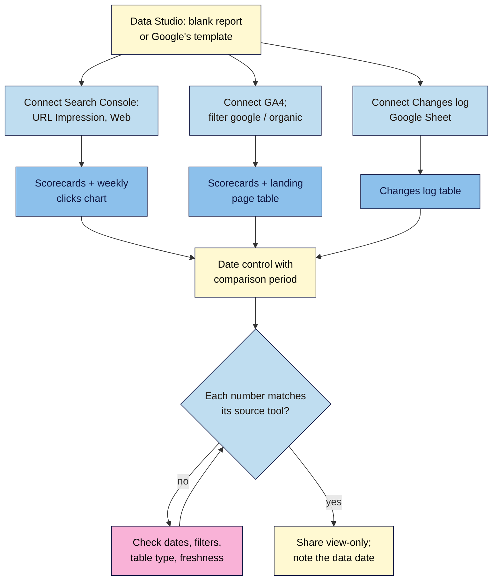

# M08.L05 — A Data Studio SEO Dashboard
> After this lesson you have a one-page, free SEO dashboard in Data Studio (formerly Looker Studio) that shows Search Console and GA4 side by side, with a date control, a comparison period, a changes log, and every number checked against its source.

**Time:** ~14 min reading + ~50 min hands-on + ~10 min exercise · **Level:** L2 Practitioner · **Prereqs:** M08.L04 · **Remediate to:** M08.L01
**Verified against:** Data Studio documentation (Google Cloud): welcome page, release notes, "Connect to Search Console", "Connect to Google Analytics", "Manage data freshness", "About Data Studio Pro" and comparison metrics (all last updated 2026-10-26); Google Search Central "Using Search Console and Google Analytics data for SEO" (last updated 2026-01-07, which still says "Looker Studio"), all on 2026-11-09. Data Studio's screens weren't tested live; menu labels may differ slightly.

> ⚠️ **Freshness flag:** "In April 2026, the Looker Studio product name returned to its original name: Data Studio." The address is now datastudio.google.com, and "lookerstudio.google.com will automatically redirect to the new domain". Many guides, templates and even some Google pages still say Looker Studio; it's the same tool.

## Learning objectives
1. **Connect** Search Console (Site or URL impression tables) and GA4 to Data Studio, and know how fresh each source's data is. *(O1)*
2. **Build** a one-page dashboard: core search metrics, organic landing pages with key events, a date control with a comparison, and matching filters. *(O2)*
3. **Add** a changes log, and check each dashboard number against its source tool. *(O3)*

## Why it matters
Every month, Nila opens Search Console, then GA4, copies numbers into a sheet, and works out the changes by hand. It takes an hour, and the dates never quite match. Her business partner, Ravi, doesn't want to learn either tool and just wants one page.

A **dashboard** puts the numbers that matter on one page, updated automatically, with the same dates and filters for both sources. Google's own advice is that the dashboard's job is "not to dive deep into the data; it's for quickly spotting changes in traffic." When something changes, you dive into Search Console or GA4 (Lessons 8.1–8.2). The dashboard just tells you where to look.

## Core concept
**Plain version:** **Data Studio** is Google's free reporting tool. You connect **data sources** (Search Console, GA4, a Google Sheet), then add **charts** that read from them: number boxes (scorecards), a line over time, a table of pages. A **date range control** changes the dates for every chart at once, and a **comparison period** shows the change against last period or last year.

**Analogy:** a car's dashboard again (Lesson 8.1), but one you build yourself, showing only the gauges you need.

**Precise definitions:**
- **Data source:** a saved connection to one data set, such as one Search Console property's URL impression table.
- **Connector:** the type of connection: Search Console, Google Analytics, Google Sheets and others.
- **Site impression vs URL impression:** two Search Console tables. Site impression counts by site, URL impression by page. "a single data source can only use one of these"; create two data sources if you need both.
- **Scorecard:** a chart that shows one number, optionally with its change against a comparison period.
- **Data freshness:** how often Data Studio fetches new data from a source.

### What the sources say
| Topic | What the source says | What it means for you |
|---|---|---|
| Cost | Data Studio "is a no-cost tool"; "Data Studio Pro is the paid version" (team workspaces, scheduled delivery to Chat and Slack, alerts) | Free is enough for this course |
| Search Console table | "In the Tables panel, choose either Site Impression or URL Impression" | Use **URL Impression** for page-level reports, as Google's own template does |
| Anonymised queries | "Data Studio may aggregate these queries into a single row with a blank value" | A blank query row is normal (Lesson 3.5) |
| Access | Sign in "with the same Google Account" you use for Search Console, with at least view permission; GA4 needs at least **Read & Analyze** | Use one account for all three tools |
| GA4 filter | Google's template data "is already filtered to include only sessions from Session source = google and Session medium = organic" | Filter GA4 to `google / organic` in your dashboard too |
| Matching filters | "pick the same filter for both data sources" | If you filter GSC by country, filter GA4 by the same country |
| Freshness | Google products "refresh every 12 hours" by default; GA4 sources can be set to 1 or 4 hours; "Report editors and viewers can also manually refresh the data" | Don't expect today's numbers. Search Console is "delayed by a couple of days" anyway |
| GA4 quotas | Reports "are subject to Google Analytics Data API (GA4) quotas"; too many charts can show an error | Keep the page lean |
| GA4 limits | "Google Analytics 4 segments and comparisons are not available using the Google Analytics connector" | Use Data Studio's own comparison date range, not GA4's comparisons |
| Known bug | GA4 sessions can be "double-counted" in stacked bar charts using "ISO Year ISO Week" | Use **Date**, **Week** or **Month** dimensions, and check against GA4 |
| Annotations | No native annotations feature found in Data Studio's docs | Keep a **Changes log** sheet and show it as a table *(observed practice)* |

### The one-page SEO dashboard
| Section | Chart | Source | Why |
|---|---|---|---|
| **Top row** | Scorecards: Clicks, Impressions, CTR | Search Console (URL Impression, Web) | How you appear in Google |
| | Scorecards: Sessions, Key events | GA4, `google / organic` | What search visitors did |
| **Middle** | Time series: Clicks by week, with comparison | Search Console | Spot changes over time |
| **Lower left** | Table: Landing page, Sessions, Key events | GA4, `google / organic` | Which pages bring results |
| **Lower right** | Table: Date, Change, Page | Google Sheet: Changes log | Explains the bumps |
| **Header** | Date range control, title, "Data as of" note | — | Same dates for every chart |

Average position is deliberately left off. It's easy to misread (Lesson 8.6).

## How it works

**In words:** start a blank report (or Google's template). Connect three data sources: Search Console with the URL Impression table, GA4 filtered to `google / organic`, and a Changes log sheet. Add scorecards and a weekly clicks chart from Search Console, scorecards and a landing page table from GA4, and a table from the changes log. Add a date range control with a comparison period. Then check every number against its source tool; if one doesn't match, check dates, filters, the table type and data freshness. When they match, share the dashboard view-only, with a note of how fresh the data is.

> **Under the hood: why a dashboard number can differ from the tool.** Data Studio asks Search Console and GA4 for data through their APIs, then caches it (by default for up to 12 hours for Google sources). So a dashboard can lag the tool by hours. The Search Console API's Site and URL tables count differently: by site, a search with three of your pages counts as one impression; by URL, it counts as three. That's why Site Impression and URL Impression totals don't match, and why Google says you can't mix them in one data source. Pick one table per chart, and label it.

## Hands-on walkthrough
You'll build Nila's one-page dashboard. Values are illustrative.

**Before you start: which steps apply to you?**
- **Path A (your own site):** do every part.
- **Path B (practice site):** do every part with your practice site's properties. Many charts will show tiny numbers or "No data"; the build is what you're practising.
- **Path C (client site):** do every part with the access you have (Search Console view access and GA4 **Read & Analyze** or above). Keep the report in your account and share it view-only with the client, or build it in the client's account if they prefer to own it.

**Part A — Set up the changes log (5 min)**
1. In your **SEO 101 project** sheet, add a tab called **Changes log** with columns **Date**, **Change**, **Page**, **Lesson**.
2. Add every change you've made so far: your M07 publishes, the GTM event (Lesson 8.3), any tag fix (Lesson 8.4), with dates. Copy your annotations from Search Console and GA4.
   **Expected:** at least three dated rows.

**Part B — Connect the data (10 min)**
1. Go to datastudio.google.com and create a **Blank report**.
2. Add data: choose the **Search Console** connector, pick your property, choose **URL Impression**, and **Web** as the search type. Add it.
3. Add a second data source: the **Google Analytics** connector, your GA4 property.
4. Add a third: the **Google Sheets** connector, your project sheet, the **Changes log** tab.
   **Expected:** three data sources listed under **Resource → Manage added data sources** (or similar).

**Part C — Build the page (25 min)**
1. **Header:** add a title ("Nila Coffee SEO — monthly"), a **date range control** set to **Last 28 days**, and a text box: "Search Console data is delayed 2–3 days; Data Studio refreshes about every 12 hours."
2. **Scorecards (Search Console):** add three scorecards: **Url Clicks**, **Impressions**, **URL CTR** (names may differ slightly). In each, set **Comparison date range** to **Previous year** (or **Previous period** if your site is newer).
3. **Scorecards (GA4):** add **Sessions** and **Key events**. Add a filter to both: **Session source / medium** equals `google / organic`. Set the same comparison.
4. **Time series:** Search Console clicks with **Date** as the dimension (set to **Week**), with the comparison period shown as a second line.
5. **Landing page table (GA4):** dimension **Landing page**, metrics **Sessions** and **Key events**, the same `google / organic` filter, sorted by sessions, 10 rows.
6. **Changes log table:** from the Google Sheet, columns **Date**, **Change**, **Page**, sorted newest first.
   > 🖼️ **Image prompt:** A one-page Data Studio SEO dashboard (1440×900) with a header and date control, five scorecards (Clicks, Impressions, CTR, Sessions, Key events) each with a green or red change arrow, a weekly clicks line chart with a dotted previous-year line, a landing page table and a changes log table. Highlight the date range control with a 3px #F9B2D7 outline; blur any personal details.
   > **Alt text:** A one-page Data Studio SEO dashboard with scorecards, a weekly clicks chart, a landing page table and a changes log.

**Part D — Check every number (10 min)**
1. Pick the same dates in Search Console's Performance report (Web, no filters). Compare total clicks and impressions with your scorecards.
2. In GA4's Traffic acquisition, same dates, `google / organic`: compare sessions and key events.
3. In your project sheet, add a tab called **Dashboard checks** with columns **Number**, **Dashboard**, **Source tool**, **Match?**, **If not, why**.
   **Expected:** matches, or small differences you can explain (freshness, URL vs Site table, a different filter). Anything you can't explain, fix before sharing.
4. Click **Share**, and give Ravi (or your client) **view** access only.

**Expected output:** a one-page Data Studio dashboard with header and date control, five scorecards with comparisons, a weekly clicks chart, a GA4 landing page table, a changes log table, and a **Dashboard checks** tab showing each number checked against its source.

## When to use / when not to
**Use a dashboard** for a monthly check-in, for people who don't use Search Console or GA4, and to keep the dates and filters consistent every month.

**Use the source tools** for diagnosis: why a page dropped, which queries changed, whether a tag is broken.

**Don't** build a 10-page dashboard nobody reads, add average position as a headline, or share edit access when view is enough.

**The trade-off:** a dashboard saves time and keeps reports consistent, but it hides detail and can lag. Its numbers are only as good as its filters, so check them once after building, and again whenever you change a chart.

## Use AI for this
**Example prompt:**
> "I'm building a one-page SEO dashboard in Data Studio (formerly Looker Studio) for [audience]. Sources: Search Console (URL Impression), GA4 filtered to google / organic, and a changes log sheet. Suggest a layout with no more than 8 charts, and for each, the exact dimension and metric. Point out anything that could make a number differ from Search Console or GA4, using Data Studio's documentation."

**What AI does well here:** suggesting a clean layout and naming the right dimensions and metrics.
**Where it gets it wrong:** it may still call it "Looker Studio" with old menu names, invent metrics that don't exist in the connector, or suggest average position as a KPI.
**How to check:** build it, then do Part D: every number checked against its source tool.

## Common mistakes
- **Mixing Site and URL impression data** and expecting totals to match.
- **Filtering GA4 but not Search Console** (or the other way round).
- **Trusting the dashboard over the source tool** without checking.
- **Too many charts,** hitting GA4 quotas or burying the message.
- **No date or freshness note,** so readers think the numbers are live.
- **Sharing with edit access,** so someone moves a filter by accident.
- **ISO week dimensions in stacked bar charts** with GA4 sessions (the documented double-count bug).

## Troubleshooting
| Symptom | Likely cause | Fix |
|---|---|---|
| Clicks don't match Search Console | Site vs URL table, search type, or a filter | Match table, search type (Web) and filters |
| Yesterday's data is missing | Search Console delay; 12-hour refresh | Normal; or refresh the data manually |
| GA4 charts show a quota error | Too many GA4 charts or viewers | Fewer charts; longer refresh; fewer dimensions |
| Sessions higher than in GA4 | ISO week in a stacked bar, or a missing filter | Use Date or Month; check the filter |
| A blank query row in a query table | Anonymised queries grouped | Normal; label it "anonymised queries" |
| "Can't access data source" | Different Google account, or no permission | Use one account; ask for view (GSC) or Read & Analyze (GA4) |

## Exercise
**Task:** build your dashboard and complete **Dashboard checks** (Parts A–D). Then answer these. All details are illustrative.
1. Ravi asks why the dashboard says 1,240 impressions when Search Console says 980. Nila used Site Impression in Search Console and URL Impression in the dashboard. Explain.
2. Kavya's dashboard shows nothing for the last two days. Is it broken?
3. Tomás wants to add 25 charts so "everything is in one place". What would you advise?
4. Amara's client's dashboard shows sessions from all channels next to Search Console clicks. What's wrong?
5. Nila's traffic jumped on 14 October. How does her dashboard help her explain it?
6. Kavya is building her first dashboard. Should she pay for Data Studio Pro?

**Expected outcome:** a working dashboard, a complete checks tab, and these answers:
- **1** URL Impression counts each of your pages shown in a search; Site Impression counts the site once. They're different tables, so they don't match. Use one and label it.
- **2** Probably not. Search Console is "delayed by a couple of days", and Google sources refresh about every 12 hours.
- **3** Keep one page for spotting changes; Google says the dashboard's goal "is not to dive deep into the data". Too many GA4 charts can hit quotas.
- **4** Unequal filters. Filter GA4 to `google / organic`, as Google's template does: "pick the same filter for both data sources".
- **5** The **Changes log** table shows what changed that day, for example "Published cold brew guide", so the jump has a likely cause.
- **6** No. Data Studio "is a no-cost tool"; Pro adds team workspaces, scheduled delivery and alerts.

**Stretch goal:** add a second page with a Search Console **Query** table filtered to non-branded queries (a regex that excludes your brand, Lesson 8.1), top 20 by clicks, with a comparison column.

## Key takeaways
- Data Studio (formerly Looker Studio) is free, and the right home for a one-page SEO dashboard.
- Connect Search Console (URL Impression, Web), GA4 filtered to `google / organic`, and a Changes log sheet.
- Same dates, same filters, comparison periods, and a freshness note.
- Check every number against its source once after building, and after every change.
- The dashboard spots changes; the source tools explain them.

## Teach it back
Explain to a friend in 3 sentences what a one-page SEO dashboard should show, and why you'd still open Search Console and GA4 when something changes.

## Glossary terms added
- Data Studio (formerly Looker Studio) — added to `seo-101/glossary.md`
- Data source (Data Studio) — added to `seo-101/glossary.md`
- Site impression vs URL impression — added to `seo-101/glossary.md`
- Scorecard — added to `seo-101/glossary.md`
- Changes log — added to `seo-101/glossary.md`

## Further reading
*All checked 2026-11-09.*
- Data Studio — Welcome (including the April 2026 rename): https://docs.cloud.google.com/data-studio/welcome
- Data Studio — Connect to Search Console: https://docs.cloud.google.com/data-studio/connect-to-search-console
- Data Studio — Connect to Google Analytics: https://docs.cloud.google.com/data-studio/connect-to-google-analytics
- Data Studio — Manage data freshness: https://docs.cloud.google.com/data-studio/manage-data-freshness
- Data Studio — About Data Studio Pro: https://docs.cloud.google.com/data-studio/about-pro
- Data Studio — Comparison metrics: https://docs.cloud.google.com/data-studio/add-comparison-metrics-and-running-totals
- Google Search Central — Using Search Console and Google Analytics data for SEO (includes Google's dashboard template): https://developers.google.com/search/docs/monitor-debug/google-analytics-search-console

> ⚠️ **May change:** the product name and address (renamed April 2026); connector field names; freshness options; the documented ISO-week bug may be fixed.

## Refresher card
*Used by remediation when a learner fails a quiz twice on a later lesson that points back here.*
**Data Studio** (formerly Looker Studio, renamed April 2026; datastudio.google.com; free). **Sources:** Search Console (**URL Impression** for pages, Web; one table per data source), GA4 (**filter `google / organic`**; needs Read & Analyze), a **Changes log** sheet (no native annotations). **Page:** date control + freshness note; scorecards (Clicks, Impressions, CTR, Sessions, Key events) with comparison (previous year); weekly clicks chart; landing page table; changes log table. **Freshness:** Google sources ~12 hours (GA4 can be 1 or 4); manual refresh; GSC delayed 2–3 days. **Check every number** against its source; share view-only. Avoid ISO-week stacked bars with GA4 sessions.
