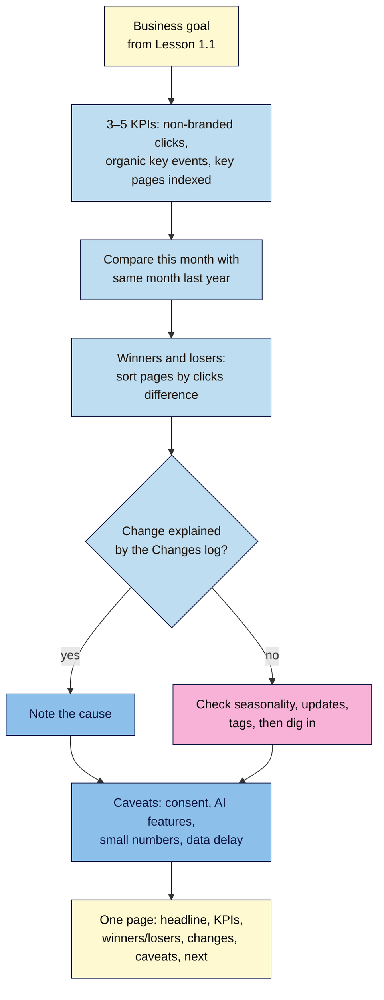

# M08.L06 — KPIs and an Honest Monthly SEO Report
> After this lesson you can choose 3–5 SEO KPIs that match your business goal, find the pages that won and lost this month with a fair comparison, and write a one-page monthly report that says what happened, what you did, what you're unsure of and what's next.

**Time:** ~15 min reading + ~40 min hands-on + ~10 min exercise · **Level:** L2 Practitioner · **Prereqs:** M08.L05, M01.L02 · **Remediate to:** M08.L05
**Verified against:** Google Search Central "Debugging drops in Google Search traffic" (last updated 2025-12-10) and "Using Search Console and Google Analytics data for SEO" (last updated 2026-01-07); Search Console Help "Performance report (Search results)" and data aggregation; Search Central blog on the branded queries filter (20 November 2025) and weekly and monthly views (10 December 2025), all on 2026-11-09. Google publishes no monthly report template; the report structure here is the course's.

> ⚠️ **Freshness flag:** AI Overviews and AI Mode change how many searches lead to clicks, so click-based KPIs may shift without any change on your site. Module 14 covers AI visibility; this lesson keeps to Search Console and GA4 measures.

## Learning objectives
1. **Choose** 3–5 KPIs tied to the business goal (such as non-branded clicks, key events from organic, key pages indexed), and explain why average position and site-wide averages mislead. *(O1)*
2. **Find** winning and losing pages with like-for-like comparisons (year over year, matching weekdays). *(O2)*
3. **Write** a one-page monthly report: headline, KPIs, winners and losers, changes made, caveats and next actions. *(O3)*

## Why it matters
Amara's agency used to send clients a 14-page PDF every month: 40 charts, a keyword ranking table, and "average position improved from 18.4 to 16.9!" Clients skimmed it, didn't understand it, and one cancelled because "we can't tell if SEO is working." The client was right: the report never said.

A good monthly report answers three questions on one page: **Is SEO helping the business? What changed and why? What are we doing next?** It uses a handful of numbers tied to the goal you set in Lesson 1.1, compares them fairly, and is honest about what the data can't tell you. That honesty is what makes clients and bosses trust the next report.

## Core concept
**Plain version:** a **KPI** (key performance indicator) is a number you've agreed shows whether you're reaching a goal. For SEO, good KPIs measure **people who found you through search without already knowing you** (non-branded clicks) and **what they did** (key events from organic search). Track a few, compare them with the same period last year, find the pages behind any change, and write it up on one page.

**Analogy:** a doctor's check-up. They don't measure everything; they check a few vital signs, compare them with last time, and explain anything unusual. A report with 40 charts is like reading out every lab result: thorough, and useless.

**Precise definitions:**
- **KPI:** a number that shows progress towards a business goal, with a target or a direction.
- **Vanity metric:** a number that looks good but doesn't tell you whether the goal is being reached (total impressions, average position, number of keywords "ranking").
- **Year over year (YoY):** this period compared with the same period last year, which removes seasonal swings.
- **Winners and losers:** the pages that gained or lost the most clicks between two periods.

### What the sources say
| Topic | What the source says | What it means for you |
|---|---|---|
| What success is | "you shouldn't focus too much on your absolute position. Impressions and clicks are ultimately the measure of success for your site." | Report clicks (and key events), not rankings |
| Average position | "a complex metric that can be misleading"; "A link must get an impression for its position to be recorded"; "your position might be different than the average" | Never a headline KPI |
| Site-wide averages | CTR and average position "are generally higher when aggregating by property" | Averages hide page-level changes; look at pages |
| Branded vs non-branded | Branded queries get "higher click-through rates, whereas non-branded queries offer organic growth" | Non-branded clicks are the main SEO growth KPI |
| Google's dashboard metrics | Sessions, Engagement rate, Returning users (GA4); Clicks, CTR (Search Console) | A sensible starting set |
| Share of organic traffic | "There's no good or bad percentage, as this depends on your audience and your business." | Don't benchmark against other sites |
| Finding losers | "comparing the pages that lost a significant amount of clicks. Select Clicks Difference to order it based on pages that lost the most traffic." | The core of winners and losers |
| Seasonality | Use the last 16 months to "make sure it's not a drop that happens every year due to a festivity or a trend" | Compare year over year |
| Weekdays | Weekly and monthly views avoid "day-of-the-week mismatches" | Compare full weeks or months |

### Choosing KPIs: the goal comes first
| Business goal (Lesson 1.1) | Good SEO KPIs | Not KPIs (vanity) |
|---|---|---|
| Nila: more coffee subscriptions | Non-branded clicks; organic key events (`purchase`); clicks to the brew guide cluster | Total impressions; "keywords in top 10" |
| Kavya: more class enquiries | Non-branded clicks (local); organic `generate_lead`; key pages indexed | Average position; sessions from all channels |
| Tomás: online sales | Organic `purchase` and revenue; non-branded clicks to product pages; product pages indexed | Total pages indexed; domain authority |
| Amara's B2B client: leads | Organic `generate_lead`; non-branded clicks to service pages | Blog page views from all channels |

**Three to five KPIs is enough.** One for visibility (non-branded clicks), one for results (organic key events), and one for health (key pages indexed, from Lesson 6.6) cover most sites.

### The one-page monthly report
| Section | What goes in it | Length |
|---|---|---|
| **1. Headline** | One sentence: did SEO help the goal this month? | 1 sentence |
| **2. KPIs** | 3–5 numbers: this month, same month last year, change | A small table |
| **3. Winners and losers** | Top 3 pages up and top 3 down by clicks, with a likely reason for each | 6 lines |
| **4. What we changed** | Dated changes from the Changes log (Lesson 8.5) | 3–5 lines |
| **5. Caveats** | What the data can't tell you, or what may be skewing it | 2–4 lines |
| **6. Next actions** | 3 actions, each with an owner and a date | 3 lines |

Google publishes no template for this; it's the course's structure, built from Google's advice on what to measure and how to compare.

## How it works

**In words:** start from the business goal you set in Lesson 1.1, and pick 3–5 KPIs that measure it. Compare this month with the same month last year. Sort pages by their change in clicks to find winners and losers. For each, check the Changes log for a cause; if there isn't one, check seasonality, Google updates and your tags before digging deeper. Note the caveats that affect the data, then write one page: headline, KPIs, winners and losers, changes, caveats and next actions.

> **Under the hood: why averages hide what matters.** Suppose Nila's cold brew guide moves from position 8 to 3 for "cold brew ratio", and she also starts appearing at position 45 for 200 new long-tail searches. Her **average** position gets worse, because all those new, deep impressions pull it down, even though both changes are good news. Site-wide CTR does the same thing: more impressions at low positions lower the average CTR. That's why Google calls position "a complex metric", and why this report uses clicks and key events per page, not averages.

## Hands-on walkthrough
You'll choose KPIs, find winners and losers, and write your first monthly report. Nila Coffee's values are illustrative.

**Before you start: which steps apply to you?**
- **Path A (your own site):** do every part with real data.
- **Path B (practice site):** do every part. With less than a year of data, compare with the previous period (matching weekdays) and say so in the caveats.
- **Path C (client site):** do every part, and send the report to the client only after they've agreed the KPIs (Part A).

**Part A — Choose KPIs (10 min)**
1. Open your Lesson 1.1 snapshot and copy the main business goal.
2. Add a tab called **KPIs** with columns **KPI**, **Source and filter**, **Why it matters to the goal**, **Target or direction**.
3. Choose 3–5. Start with: **Non-branded clicks** (Search Console, branded filter or regex, Lesson 8.1); **Organic key events** (GA4, `google / organic`, Lesson 8.2); **Key pages indexed** (Search Console Page indexing or URL Inspection, Lesson 6.6).
   **Expected:** 3–5 KPIs, each tied to the goal in one sentence. No average position.

**Part B — Winners and losers (15 min)**
1. In Search Console **Performance**, set **Compare → Last 3 months year over year** (or the previous period, matching weekdays, if your site is newer).
2. Open the **Pages** tab and sort by the change in clicks. (Google calls this **Clicks Difference**; the column name may differ slightly in your account.)
3. Record the top three gainers and top three losers with their click change.
4. For each, look in your **Changes log** (Lesson 8.5) and note a likely reason, or "unknown".
   **Expected:** six pages with a reason or "unknown". Nila's: `/cold-brew-guide/` +140 clicks (published in the cluster, Lesson 7.1); `/french-press-ratio/` −60 (merged into the brew guide, Lesson 7.6) *(illustrative)*.
   > 🖼️ **Image prompt:** Search Console Performance report (1280×800) in compare mode, last 3 months vs the same period last year, Pages tab sorted by clicks difference with the biggest losers at the top. Highlight the clicks difference column header with a 3px #F9B2D7 outline; blur any personal details.
   > **Alt text:** Search Console pages compared year over year and sorted by clicks difference, with the column header highlighted.

**Part C — Write the report (15 min)**
1. Add a tab (or a document) called **Monthly report – [month]**. Use the six sections from the table above.
2. **Headline:** one sentence a non-expert can understand, such as: "Non-branded search visits rose 22% on last November, and organic subscriptions rose from 9 to 14, mostly from the new brew guides."
3. **Caveats:** at least two. Examples: "Search Console data for the last 2–3 days is incomplete"; "GA4 misses visitors who decline tracking (Lesson 8.4)"; "AI Overviews may reduce clicks for some questions without our rankings changing"; "Numbers under 20 are too small to read trends from."
4. **Next actions:** three, each with an owner and date.
   **Expected:** a report that fits on one screen, with every number traceable to the dashboard (Lesson 8.5) or a source tool.

**Expected output:** a **KPIs** tab with 3–5 agreed KPIs, a winners-and-losers list with reasons, and a one-page **Monthly report** with a headline, KPI table, winners and losers, dated changes, caveats and three next actions.

## When to use / when not to
**Monthly:** this report, for your own decisions, a boss or a client.

**Quarterly:** revisit the KPIs and targets. Do they still match the goal?

**Don't** report average position as a KPI, compare a seasonal month with the month before, cherry-pick only the winners, or hide caveats.

**The trade-off:** a short, honest report is less impressive than a 14-page PDF, and sometimes it says "we don't know yet". But it's the one people read, and the one that builds trust when the news is bad.

## Use AI for this
**Example prompt:**
> "Here are my SEO KPIs for [month] vs the same month last year [paste], my top 3 winning and losing pages with click changes [paste], and my changes log [paste]. Draft a one-page monthly report with: a one-sentence headline a business owner understands, a KPI table, winners and losers with likely reasons (only from my changes log; say 'unknown' otherwise), at least two data caveats, and three next actions. Don't invent numbers or causes."

**What AI does well here:** turning a pile of numbers into a clear headline and a tidy structure.
**Where it gets it wrong:** it invents causes ("due to Google's latest update"), rounds numbers inconsistently, adds average position because older guides do, and drops caveats to sound confident.
**How to check:** trace every number to the dashboard or source tool, every cause to your changes log or a dated Google update, and put back any caveat it removed.

## Common mistakes
- **Average position as the headline.**
- **Month-on-month comparisons** for seasonal businesses.
- **Too many KPIs,** so none of them matter.
- **Branded and non-branded mixed together,** so other marketing hides SEO's real effect.
- **Causes without evidence** ("the drop was the algorithm").
- **No caveats,** so the next surprise destroys trust.
- **No next actions,** so the report changes nothing.

## Troubleshooting
| Symptom | Likely cause | Fix |
|---|---|---|
| Clicks down, rankings "up" | More impressions at low positions; AI features | Report clicks per page; note the AI caveat |
| A loser with no clear reason | Seasonality, a Google update, a tag fault, or competitors | Check last 16 months, Google's status dashboard (Lesson 1.6), the tag health check (Lesson 8.4) |
| Client asks "what's our ranking?" | Old habits | Show the clicks and key events KPIs, and explain why position misleads |
| Numbers too small to show trends | A new or small site | Compare quarters; say so in caveats |
| KPI went up but sales didn't | The KPI doesn't measure the goal | Revisit the KPIs (Part A) |
| Branded filter not available | Too few impressions, or a sub-property | Use the regex fallback (Lesson 8.1) |

## Exercise
**Task:** complete your **KPIs** tab and your first **Monthly report** (Parts A–C). Then answer these. All details are illustrative.
1. Amara's client wants "average position" as the main KPI. What would you suggest instead, and why?
2. Kavya's yoga studio gets more searches every January. Her December-to-January clicks rose 60%. Is that SEO success?
3. Nila's total clicks rose 15%, but non-branded clicks fell 5%. What should the headline say?
4. Tomás's average position got worse this month, but clicks rose. How is that possible?
5. A page lost 80 clicks, and nothing in the changes log explains it. What should the report say?
6. Which three caveats would you add for a small site with a cookie banner?

**Expected outcome:** a KPIs tab, a one-page report, and these answers:
- **1** Non-branded clicks and organic key events. Google says "Impressions and clicks are ultimately the measure of success", and calls position "a complex metric that can be misleading".
- **2** Not on its own; January is seasonal for her. Compare January with last January.
- **3** The honest version: "Total search clicks rose 15%, driven by branded searches; non-branded clicks fell 5%, so new-customer discovery needs work." Branded growth usually reflects other marketing.
- **4** New impressions at low positions pull the average down while better rankings for key pages bring more clicks. Averages hide page-level changes.
- **5** "Cause unknown; checking seasonality, Google updates and tracking", with a next action and date. Don't invent a cause.
- **6** For example: GA4 misses visitors who decline tracking; numbers are small, so trends are uncertain; Search Console's last 2–3 days are incomplete.

**Stretch goal:** set a monthly calendar reminder, and write next month's report in under 30 minutes using your dashboard (Lesson 8.5) and this structure.

## Key takeaways
- Choose 3–5 KPIs from the business goal: non-branded clicks, organic key events, key pages indexed.
- Average position and site-wide averages mislead; Google says clicks and impressions are "the measure of success".
- Compare year over year (or matching weekdays), and sort pages by clicks difference to find winners and losers.
- Explain changes from your changes log; say "unknown" rather than inventing a cause.
- One page: headline, KPIs, winners and losers, changes, caveats, next actions.

## Teach it back
Explain to a friend in 3 sentences why "average position improved" isn't a good headline for an SEO report, and what you'd report instead.

## Glossary terms added
- KPI (key performance indicator) — added to `seo-101/glossary.md`
- Vanity metric — added to `seo-101/glossary.md`
- Year over year (YoY) — added to `seo-101/glossary.md`
- Winners and losers (pages) — added to `seo-101/glossary.md`
- Average position — added to `seo-101/glossary.md`
- *Already in the glossary:* Branded query, Key event, Changes log

## Further reading
*All checked 2026-11-09.*
- Google Search Central — Debugging drops in Google Search traffic: https://developers.google.com/search/docs/monitor-debug/debugging-search-traffic-drops
- Google Search Central — Using Search Console and Google Analytics data for SEO: https://developers.google.com/search/docs/monitor-debug/google-analytics-search-console
- Search Console Help — Performance report (Search results): https://support.google.com/webmasters/answer/7042828
- Search Console Help — How data is aggregated: https://support.google.com/webmasters/answer/17011364
- Search Central blog — Branded queries filter (20 November 2025): https://developers.google.com/search/blog/2025/11/search-console-branded-filter

> ⚠️ **May change:** how AI features affect clicks; Search Console column names in compare mode; the report structure is the course's, not Google's.

## Refresher card
*Used by remediation when a learner fails a quiz twice on a later lesson that points back here.*
**KPIs:** 3–5, from the Lesson 1.1 goal: **non-branded clicks** (visibility), **organic key events** (results), **key pages indexed** (health). Not average position: "a complex metric that can be misleading"; Google: "Impressions and clicks are ultimately the measure of success". Averages hide page changes. **Compare:** year over year (seasonality), full weeks or months (weekdays). **Winners and losers:** Performance → Compare → Pages → sort by clicks difference; reasons from the Changes log, else "unknown". **One-page report:** headline · KPIs (this month, last year, change) · top 3 up/down · dated changes · caveats (consent, small numbers, data delay, AI features) · 3 next actions with owner and date.
