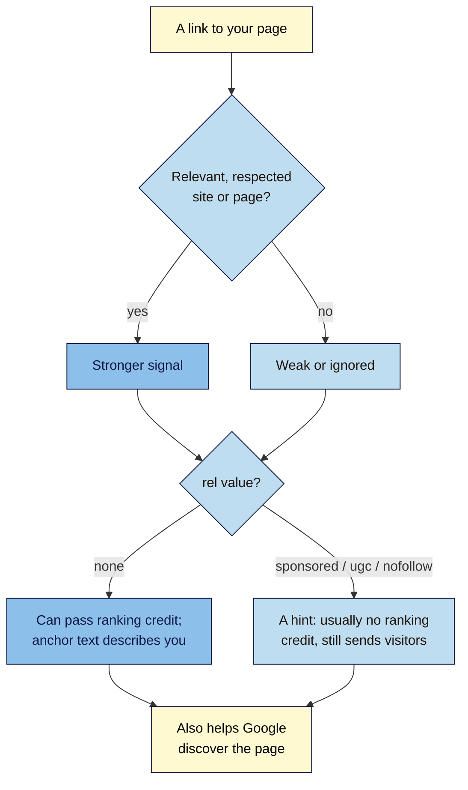

# M09.L01 — How Links Work: PageRank, Anchor Text and Link Attributes
> After this lesson you can explain in plain words why links from other sites matter to Google (and why they're not everything), read the anchor text and `rel` value of any link, and pick the right `rel` value for links on your own site.

**Time:** ~15 min reading + ~35 min hands-on + ~10 min exercise · **Level:** L2 Practitioner · **Prereqs:** M02.L05, M01.L06 · **Remediate to:** M02.L05
**Verified against:** Brin and Page, "The Anatomy of a Large-Scale Hypertextual Web Search Engine" (1998, Wayback Machine copy); Google Search Central "A guide to Google Search ranking systems", "SEO Starter Guide", "Link best practices" and "Qualify your outbound links" (all last updated 2025-12-10); Search Central blog "Evolving nofollow" (10 September 2019); How Search Works "Ranking results"; Googler comments as reported by Search Engine Roundtable (2020, 2023), all on 2026-11-09.

> ⚠️ **Freshness flag:** Google staff have said in recent years that links matter less than they used to. Those remarks were reported second-hand and partly walked back; Google's own docs still say PageRank "continues to be part of our core ranking systems". Treat links as one important signal, not the top one.

## Learning objectives
1. **Explain** PageRank in plain words (the "random surfer"), and why links are one signal among many, not the top factor. *(O1)*
2. **Judge** anchor text in links to your site and in your own links (descriptive, not keyword-stuffed). *(O2)*
3. **Choose** the right `rel` value (`sponsored`, `ugc`, `nofollow`, or none) and explain the 2019–2020 "hints" change. *(O3)*

## Why it matters
A local food blogger writes about Nila's single-origin beans and links to the product page. A week later, a stranger emails offering "50 high-quality backlinks for ₹3,000". Kavya's client wants to know why their competitor "has more links". Tomás wonders whether the `nofollow` link he got from a big newspaper is "worthless".

All four questions turn on one idea: **links from other sites are votes, but not all votes count the same, and Google decides how to count them.** You learnt how to write links in Lesson 2.5, and in Lesson 1.6 that paid links must be marked. This module is about links *to* your site: how they work, how to see them, how to earn them honestly, and what not to do. This lesson builds the foundation.

## Core concept
**Plain version:** when another site links to yours, it's a bit like a recommendation. Google's original **PageRank** idea counted those recommendations, giving more weight to links from pages that were themselves well recommended. The words in the link (**anchor text**) tell Google what the linked page is about. A `rel` value on the link (`sponsored`, `ugc`, `nofollow`) tells Google what kind of link it is. Today, PageRank is still part of Google's ranking, but it's one signal among many.

**Analogy:** a restaurant recommendation. "You must try Nila's cold brew" from a respected food critic carries more weight than the same words on a flyer. The critic's words also tell you *what* to try. And if the critic was paid, they should say so: that's `sponsored`.

**Precise definitions:**
- **Backlink:** "a link on a page from another site that links to a page on your site" (Search Console Help).
- **Referring domain:** a whole site that links to you; ten links from one site is one referring domain.
- **PageRank:** Google's original link-analysis algorithm. The 1998 paper: "a page can have a high PageRank if there are many pages that point to it, or if there are some pages that point to it and have a high PageRank."
- **Anchor text:** "the visible text of a link. This text tells people and Google something about the page you're linking to." For image links, Google uses the image's `alt` text.
- **Link attribute (`rel` value):** a label on a link, such as `rel="sponsored"`, that tells Google what kind of link it is.

### PageRank in plain words
The 1998 paper describes a **random surfer**: someone who starts on a random page and keeps clicking links, never pressing back, until they get bored and jump somewhere new. "The probability that the random surfer visits a page is its PageRank." Pages that many links lead to, especially from pages that are themselves visited often, get visited more. As the paper puts it: "pages that are well cited from many places around the web are worth looking at."

Two more ideas from the paper still matter:
- A page **shares** its vote among all the links on it. One link from a page with three links passes more than one link from a page with three hundred.
- **Anchor text describes the target.** Google associates link text "with the page the link points to", because "anchors often provide more accurate descriptions of web pages than the pages themselves."

### What Google says today
| Topic | What Google says | What it means for you |
|---|---|---|
| PageRank now | "How PageRank works has evolved a lot since then, and it continues to be part of our core ranking systems." | Links still matter |
| One signal among many | "there's much more to Google Search than just links. We have many ranking signals, and PageRank is just one of those." | Don't chase links before content and technical basics |
| Links as quality | Google checks "if other prominent websites link or refer to the content". "This is generally a good sign that the information is trustworthy." | Links from respected, relevant sites matter most |
| Links for discovery | "Google uses links as a signal when determining the relevancy of pages and to find new pages to crawl." | New pages get found faster when linked |
| Natural links | "Other sites linking to you is something that happens naturally over time" | Earning links is normal; buying them isn't (Lesson 9.5) |
| Link spam in the past | Penguin, the old link spam system, "was integrated into our core ranking systems in 2016" | Spam detection is built in now (SpamBrain, Lesson 9.5) |
| Googlers on weight | Mueller (2020): "we do use PageRank internally, among many, many other signals". Illyes (2023, as reported): "It's absolutely possible to rank without links" | Links help; they're not the only way to rank |

### Anchor text: in your links and in theirs
You learnt to write good anchor text in Lesson 2.5. Google: "Good anchor text is descriptive, reasonably concise, and relevant to the page that it's on and to the page it links to." The same applies to links others give you, with one twist: you **don't control** their words, and you **shouldn't try to**. Asking for exact-match keyword anchors ("best coffee beans online India") is a classic link scheme sign (Lesson 9.5). Google warns: "resist the urge to cram every keyword that's related to the page that you're linking to".

**Natural anchor text** for Nila looks like a mix: "Nila Coffee", "nilacoffee.example", "this cold brew guide", "a small roaster in Bengaluru", and the odd "here". A profile where most anchors are the same money keyword looks manufactured.

### Link attributes and the "hints" change
| Value | Use it for | Example on Nila's site |
|---|---|---|
| *(none)* | Normal links you vouch for: "you don't need to add a rel attribute" | A link to the Coffee Board's brewing guide |
| `sponsored` | "advertisements or paid placements"; "sponsored is preferred" over `nofollow` | A paid link to a grinder brand; affiliate links (course rule, Lesson 2.5) |
| `ugc` | "user-generated content (UGC) links, such as comments and forum posts" | Links in blog comments |
| `nofollow` | When "other values don't apply" and you don't want to vouch for the page | A link to a site you're criticising |

You can combine values, such as `rel="ugc nofollow"`: "You may specify multiple rel values as a space- or comma-separated list."

**What changed in 2019–2020.** Until 2019, Google ignored `nofollow` links entirely. Then: "All the link attributes—sponsored, ugc, and nofollow—are treated as hints about which links to consider or exclude within Search." For ranking, that applied from 10 September 2019; "For crawling and indexing purposes, nofollow will become a hint as of March 1, 2020." Why? "Links contain valuable information that can help us improve search, such as how the words within links describe content they point at." In practice, "We'll generally treat them as we did with nofollow before and not consider them for ranking purposes."

**So is a `nofollow` link worthless?** No. It can send real visitors, it's a normal part of a natural link profile (most social and forum links carry it), and Google may use it as a hint. Treat it as a good link that probably doesn't pass ranking credit.

## How it works

**In words:** for any link to your page, first ask whether it comes from a relevant, respected site; that makes it a stronger signal, while unrelated or spammy links are weak or ignored. Then check the `rel` value. A link with none can pass ranking credit, and its anchor text helps describe your page. A `sponsored`, `ugc` or `nofollow` link is a hint that usually passes no ranking credit but still sends visitors. Either way, links help Google discover your pages.

> **Under the hood: why one link isn't one vote.** In the original formula, each page's PageRank is split among all its outgoing links, and a "damping factor" (the paper used 0.85) models the surfer getting bored and jumping to a random page. That's why a link from a focused page with a few links can pass more than a link from a page listing hundreds, and why endless link lists are weak. Google says the system has "evolved a lot" since 1998, and Mueller (2020) added that it's "not quite the same as the original paper": Google also discounts ignored and disavowed links. So you can't calculate your PageRank, and no tool can either (Lesson 9.2).

## Hands-on walkthrough
You'll inspect five real links (three to your site, two from it) and record what each tells Google. Nila Coffee's details are illustrative.

**Before you start: which steps apply to you?**
- **Path A (your own site):** do every part.
- **Path B (practice site):** your practice site may have no backlinks yet. Use Part A on a site you know links to a well-known page (for example, a news article linking to a government site), and do Part B on your own pages.
- **Path C (client site):** do every part; Search Console view access is enough.

**Part A — Three links to your site (15 min)**
1. In Search Console, open **Links → Top linking sites** (Lesson 8.1). Pick three sites, and click through to find the page that links to you.
2. On each linking page, find the link, right-click it and choose **Inspect** (Chrome). Read the `<a>` element: the `href` (where it points), the anchor text, and any `rel` value.
3. Add a tab called **Links 101** with columns **Direction** (in/out), **From page**, **To page**, **Anchor text**, **rel**, **Relevant site?**, **What it tells Google**.
   **Expected:** three rows. Nila's: a food blog → product page, anchor "Nila's Chikmagalur beans", no `rel` (a normal editorial link); a Reddit thread → home page, `rel="ugc nofollow"` (visitors, a hint); a local news site → home page, anchor "Nila Coffee", no `rel` *(illustrative)*.
   > 🖼️ **Image prompt:** Chrome DevTools Elements panel (1280×720) beside a blog post, with an `<a href="https://nilacoffee.example/beans/chikmagalur/" rel="ugc nofollow">Nila's Chikmagalur beans</a>` element selected. Highlight the rel attribute with a 3px #F9B2D7 outline; blur any personal details.
   > **Alt text:** DevTools showing a link element with its href, anchor text and rel value, with the rel attribute highlighted.

**Part B — Two links from your site (10 min)**
1. Open one of your blog posts. Inspect one link to another site (a source you cite) and, if you have one, one paid or affiliate link.
2. Record them. Is the cited source free of `rel` (you vouch for it)? Is the paid or affiliate link marked `sponsored`?
   **Expected:** two rows. Fix any paid or affiliate link without `sponsored`, and any trusted source you marked `nofollow` for no reason.

**Part C — Read the anchor text mix (10 min)**
1. In Search Console, open **Links → Top linking text**. Note the top ten anchor texts.
2. Sort them into **brand** (your name or URL), **descriptive** (what the page is about), **generic** ("click here", "website") and **exact-match keyword**.
   **Expected:** mostly brand and descriptive. If exact-match keywords dominate, note it for the audit (Lesson 9.3), as it may point to past link buying.

**Expected output:** a **Links 101** tab with five inspected links (three in, two out), each with anchor text, `rel` value and a one-line verdict, plus your anchor text mix in four groups.

## When to use / when not to
**Leave `rel` off** links you trust and want to vouch for, such as sources you cite and partners you genuinely recommend.

**Use `sponsored`** for every paid, gifted or affiliate link, **`ugc`** for comments and forum posts, and **`nofollow`** only when you don't want to vouch for a page.

**Don't** add `nofollow` to every external link "to keep your PageRank" (Google: "not for every external link on your site"), ask others for keyword anchors, or treat a `nofollow` link as a failure.

**The trade-off:** links are worth earning, but they take time and depend on other people. A site with useful content and sound technical basics can rank for many searches with few links; a site with weak content won't be saved by links.

## Use AI for this
**Example prompt:**
> "Here are the top 10 anchor texts pointing to my site from Search Console [paste], and the five links I inspected [paste, with rel values]. Group the anchors into brand, descriptive, generic and exact-match keyword. Tell me if anything looks unnatural, and which rel value each of my outbound links should have, using Google's 'Qualify your outbound links' page."

**What AI does well here:** grouping anchor texts quickly and explaining `rel` values.
**Where it gets it wrong:** it may still say `nofollow` links are "ignored completely" (true before 2019), recommend "anchor text ratios" as if Google publishes them (it doesn't), or call links "the #1 ranking factor".
**How to check:** compare with Google's link best practices and the 2019 "Evolving nofollow" post.

## Common mistakes
- **"Links are the #1 ranking factor."** Google says PageRank is "just one" of many signals.
- **`nofollow` on every outbound link.**
- **Asking for exact-match keyword anchors.**
- **Thinking a `nofollow` link from a big site is worthless.** It still sends visitors.
- **Counting links instead of referring domains.** 500 links from one site's footer is one site.
- **Paid or gifted links without `sponsored`** on your own site (Lesson 1.6).

## Troubleshooting
| Symptom | Likely cause | Fix |
|---|---|---|
| Search Console shows links you can't find on the page | The link was removed, or it's in a menu or footer | Check the whole page; the report "includes links that Google has found over time" |
| Search Console doesn't say if a link is `nofollow` | It never does | Inspect the live page (Part A) |
| Top linking text shows "(empty)" | Image links with no `alt` text | Normal; check the image's `alt` if it's your own link |
| A competitor has far more links | Older site, more press, or bought links | Compare referring domains, not raw links (Lesson 9.3) |
| You found a paid link on your site without `sponsored` | Older post or a plugin default | Add `rel="sponsored"` |

## Exercise
**Task:** complete your **Links 101** tab (Parts A–C). Then answer these. All details are illustrative.
1. Tomás got a `nofollow` link from a national newspaper. Was it worth getting?
2. Kavya's competitor has 2,000 backlinks; she has 150. Is the competitor bound to outrank her?
3. Nila's blogger friend offers to link to her with the anchor "best coffee beans online India". Should she ask for that wording?
4. Amara's client adds `nofollow` to all outbound links "to keep PageRank". What would you tell them?
5. A food blog links to Nila from a page that lists 400 links to coffee shops. Is that link as strong as one from a focused review?
6. Nila pays a coffee festival to list her logo with a link. What `rel` value should the festival use?

**Expected outcome:** a complete tab, and these answers:
- **1** Yes. It can send real visitors and readers who may link later, and since 2019 Google treats `nofollow` "as hints". It's a normal part of a natural link profile.
- **2** No. Links are one signal among many, raw counts mislead (count referring domains), and content and relevance matter more.
- **3** No. Natural anchors are the friend's own words. Keyword-rich anchors in exchanged links look like a scheme (Lesson 9.5).
- **4** Google says use `nofollow` "only when you don't trust the source, and not for every external link". Citing good sources "can help establish trustworthiness".
- **5** Probably not. In PageRank's design, a page splits its vote across all its links, so a page with 400 links passes less per link than a focused review.
- **6** `sponsored` (or `nofollow`): it's a paid placement.

**Stretch goal:** find one page on a respected site in your field that links to a competitor but not to you. Note why they linked (a guide? a study? a local list?). You'll use this in Lesson 9.4.

## Key takeaways
- PageRank counts links as votes, weighted by the linking page's own importance; it "continues to be part of our core ranking systems", but "PageRank is just one" signal.
- Links help Google judge quality and discover pages; links from relevant, respected sites count most.
- Anchor text describes the target page. Don't ask others for keyword anchors.
- `sponsored` for paid, `ugc` for user content, `nofollow` when you won't vouch, nothing for links you trust.
- Since 2019–2020 these are "hints". A `nofollow` link isn't worthless.

## Teach it back
Explain to a friend in 3 sentences what PageRank is, why a link from a respected site in your field counts more than a link from a random directory, and what `rel="sponsored"` is for.

## Glossary terms added
- Backlink — added to `seo-101/glossary.md`
- Referring domain — added to `seo-101/glossary.md`
- Link attribute (rel value) — added to `seo-101/glossary.md`
- Natural link profile — added to `seo-101/glossary.md`
- *Already in the glossary:* PageRank, Anchor text (link text)

## Further reading
*All checked 2026-11-09.*
- Brin and Page — The Anatomy of a Large-Scale Hypertextual Web Search Engine (1998, archived): https://web.archive.org/web/2024id_/http://infolab.stanford.edu/~backrub/google.html
- Google Search Central — A guide to Google Search ranking systems: https://developers.google.com/search/docs/appearance/ranking-systems-guide
- Google Search Central — Link best practices: https://developers.google.com/search/docs/crawling-indexing/links-crawlable
- Google Search Central — Qualify your outbound links: https://developers.google.com/search/docs/crawling-indexing/qualify-outbound-links
- Search Central blog — Evolving "nofollow" (10 September 2019): https://developers.google.com/search/blog/2019/09/evolving-nofollow-new-ways-to-identify
- Google — How Search Works: Ranking results: https://www.google.com/search/howsearchworks/how-search-works/ranking-results/
- Search Engine Roundtable — Google still uses PageRank (Mueller, February 2020): https://www.seroundtable.com/google-still-uses-pagerank-29056.html

> ⚠️ **May change:** how much weight links carry (Googlers' comments vary); how Google treats `rel` hints.

## Refresher card
*Used by remediation when a learner fails a quiz twice on a later lesson that points back here.*
**Links = votes, weighted.** PageRank (1998): the "random surfer"; a page splits its vote across its links; anchors describe the target. Today it "continues to be part of our core ranking systems", but "PageRank is just one" signal. Count **referring domains**, not raw links. **Anchor text:** descriptive, concise; natural mix of brand, URL and descriptive; never ask for keyword anchors. **rel:** none = you vouch · `sponsored` = paid/gifted/affiliate · `ugc` = comments/forums · `nofollow` = won't vouch. Since 2019 (ranking) and 1 March 2020 (crawling) they're **hints**; usually no ranking credit, but `nofollow` links still send visitors and are normal.
