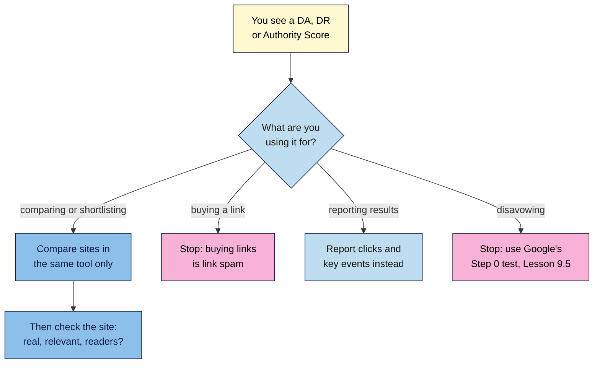

# M09.L02 — "Authority" Scores Are Estimates (DA, DR, Authority Score)
> After this lesson you can explain what Moz Domain Authority, Ahrefs Domain Rating and Semrush Authority Score actually measure, why Google doesn't use any of them, and the one sensible way to use them: comparing and shortlisting sites, never buying or disavowing links.

**Time:** ~12 min reading + ~25 min hands-on + ~10 min exercise · **Level:** L2 Practitioner · **Prereqs:** M09.L01, M01.L07 · **Remediate to:** M01.L07
**Verified against:** Moz "What is Domain Authority?" (no date shown); Ahrefs Help "What is Domain Rating (DR)?" (3 September 2026); Semrush Knowledge Base "Authority Score" (modified 2025-05-28); Google Search Central "Do you need an SEO?" (last updated 2026-06-05); John Mueller's comments as reported by Search Engine Roundtable (2020, 2022, 2023), all on 2026-11-09. Each vendor's description of its own metric is quoted from its own docs; this course doesn't test or endorse any of them.

> ⚠️ **Freshness flag:** vendors change how their scores are calculated, and free lookup limits change often. The principle doesn't change: these are tools' estimates, and Google says they "don't have access to Google's internal ranking data".

## Learning objectives
1. **Describe** how Moz DA, Ahrefs DR and Semrush Authority Score are calculated, from each vendor's own docs. *(O1)*
2. **Explain** why Google doesn't use them, and why scores change without anything happening to your site. *(O2)*
3. **Use** a score only to compare and shortlist prospects, never to buy links or disavow. *(O3)*

## Why it matters
Tomás gets an email: "Boost your DA from 12 to 40 in 30 days! Guaranteed DA 50+ backlinks, ₹4,000 each." Kavya's agency proudly reports "Domain Rating up 3 points". Amara's client's SEO tool flags 60 links as "toxic" and suggests disavowing them all.

Each of these treats a third-party score as if it were Google's. It isn't. In Lesson 1.7 you learnt that "Domain Authority affects Google rankings" is a myth. This lesson shows *why*, using each vendor's own description, so you can explain it to a client and spend your time on what Google actually uses.

## Core concept
**Plain version:** SEO tool companies crawl the web themselves, build their own map of who links to whom, and turn it into a 0–100 score. Moz calls theirs **Domain Authority (DA)**, Ahrefs **Domain Rating (DR)**, and Semrush **Authority Score (AS)**. They're useful for one thing: **comparing sites against each other** in the same tool. Google doesn't use them, can't see them, and doesn't care what they say.

**Analogy:** a credit score from a private agency. It tries to predict how a bank will judge you, using the data it can see. Different agencies give different scores. The bank uses its own system, and improving your agency score by gaming it doesn't change what the bank thinks.

**Precise definitions:**
- **Third-party SEO metric:** a score made by a tool company from its own data, not by Google.
- **Domain Authority (Moz):** "It predicts how likely a website is to rank on search engine results pages (SERPs) compared to competitors."
- **Domain Rating (Ahrefs):** "shows the strength of a website's backlink profile compared to the others in our database on a 100-point scale."
- **Authority Score (Semrush):** "our compound metric that grades the overall quality of a website or a webpage."

### What the vendors say about their own scores
| Score | How it's built (vendor's words) | Key caveat (vendor's words) |
|---|---|---|
| **Moz DA** | A machine learning model "primarily focusing on backlink data" (linking root domains, link quality and other signals) | "Domain Authority is not a Google ranking factor and has no effect on the SERPs." Use it "as a comparative metric rather than an absolute one" |
| **Ahrefs DR** | Based on links from other domains; "The source domain splits its rating equally amongst the domains it links to" | "You should never judge the quality of a website on site-wide "authority" alone." |
| **Semrush AS** | Three facets: "Link Power: quality and quantity of backlinks", organic traffic estimates, and spam factors | Updated "once every two weeks"; flags like "Unnaturally high % of dofollow domains" are Semrush's own rules, not Google's |

### What Google says
| Source | What Google says |
|---|---|
| "Do you need an SEO?" (2026) | "Google doesn't evaluate or endorse third-party SEO tools, and these tools don't have access to Google's internal ranking data." |
| Mueller, February 2020 | "We don't use domain authority at all in our algorithms." |
| Mueller, 2022 | "you do not need DA for Google Search. Google doesn't use it *at all*." |
| Mueller, May 2023 (on disavowing by tool scores) | "That seems like a terrible idea. (also, none of those metrics are things Google cares about…)" |

### Why scores move when nothing happened
These scores are **relative**: they compare you with every other site in the tool's database. Ahrefs answers its own FAQ "I didn't lose any backlinks. Why did my DR drop?" with: "Most likely, other websites gained a lot of backlinks." Moz notes "it's easier to grow your score from 20 to 30 than it is to grow it from 70 to 80". So:
- Your score can drop because **other sites grew**, or because **the tool changed its model**.
- The same site gets **different scores in different tools**, because each crawls a different part of the web.
- A score going up doesn't mean Google rankings went up, and the other way round.

### The one good use: comparing and shortlisting
| Good use | Bad use |
|---|---|
| Quickly comparing ten possible outreach targets in **one tool** to see which are established sites | Buying links because a site has "DA 50+" |
| Spotting that a competitor's link profile is far bigger than yours | Reporting "DR up 3" as an SEO result |
| A rough first filter before you look at the site yourself | Disavowing links because a tool calls them "toxic" |
| | Comparing a DA from Moz with a DR from Ahrefs |

Always look at the actual site after the score: is it real, relevant to your audience, and would a reader click through to you?

## How it works

**In words:** when you see an authority score, ask what you're using it for. If you're comparing or shortlisting sites, compare them in the same tool only, then check each site yourself: is it real, relevant and read by people? If you're about to buy a link because of the score, stop: buying links is link spam. If you're reporting results, report clicks and key events instead. If you're about to disavow because of a score, stop and use Google's Step 0 test (Lesson 9.5).

> **Under the hood: why tools can't copy Google.** A tool's score is built from the tool's own crawl, which covers only part of the web. It can't see which links Google ignores as spam, which ones were disavowed, which are `nofollow` hints Google chose to use, or the hundreds of other signals Google combines. Moz describes DA as predicting rankings from "signals that correlate with rankings", which is a correlation with search results, not a reading of Google's system. That's why DA, DR and AS can disagree with each other, and with Google, for the same site.

## Hands-on walkthrough
You'll look up your project site and three competitors in two tools and write what the scores can and can't tell you. Values are illustrative.

**Before you start: which steps apply to you?**
- **Path A (your own site):** do every part.
- **Path B (practice site):** a new practice site will score at or near the bottom ("New websites always start with a Domain Authority of 1", Moz). Look up your Snapshot's competitors instead, and note your own score as the baseline.
- **Path C (client site):** do every part; no access needed. Explain the results to the client with the "credit score" analogy.

**Part A — Look up four sites in two tools (15 min)**
1. Pick your site and three competitors from your keyword research (Module 3).
2. Use two free checkers from different vendors (for example, Moz's free domain analysis and Ahrefs' free website authority checker). Free limits and sign-up rules change; use what's available today.
3. Add a tab called **Authority scores** with columns **Site**, **Tool 1 score**, **Tool 2 score**, **Referring domains (if shown)**, **Real, relevant site?**, **What this can tell me**, **What it can't**.
   **Expected:** four rows with two different scores each. Nila's: nilacoffee.example DA 14, DR 9; a national roaster DA 38, DR 45 *(illustrative)*. The two tools won't agree.
   > 🖼️ **Image prompt:** A Google Sheets tab named "Authority scores" (1280×600) with four sites, two different tool scores per site that clearly disagree, and columns for "What this can tell me" and "What it can't". Highlight the two disagreeing scores for one site with a 3px #F9B2D7 outline; blur any personal details.
   > **Alt text:** A sheet comparing two tools' authority scores for four sites, with one pair of disagreeing scores highlighted.

**Part B — Write the "can and can't" (10 min)**
1. For each site, write one sentence in **What this can tell me** (for example, "The national roaster has a much bigger link profile than us") and one in **What it can't** (for example, "Whether Google trusts their links, or whether they'll outrank us for 'cold brew ratio'").
2. Under the table, write one line you could send a client who asks "How do we get our DA up?"
   **Expected:** honest sentences, and a client line such as "DA is Moz's estimate, not Google's. We'll focus on earning links from sites your customers read, and track clicks and enquiries."

**Expected output:** an **Authority scores** tab with four sites scored in two tools, a "can and can't" sentence for each, and a one-line client answer.

## When to use / when not to
**Use scores** to compare sites quickly in one tool, to shortlist outreach targets (then check them yourself), and to see the rough size of a competitor's link profile.

**Don't use scores** to choose links to buy, to report SEO success, to decide what to disavow, or to compare numbers across different tools.

**The trade-off:** scores save time when you're looking at dozens of sites. But a high score can hide a site that sells links, and a low one can hide a small, perfect local blog your customers actually read. The score starts the judgement; it doesn't make it.

## Use AI for this
**Example prompt:**
> "A client asks why their Domain Authority is lower than a competitor's and how to raise it. Write a short, friendly reply (under 120 words) that explains DA is Moz's estimate, quotes Google's 'Do you need an SEO?' page on third-party tools, and suggests what we'll focus on instead. No jargon."

**What AI does well here:** turning a technical explanation into a friendly client reply.
**Where it gets it wrong:** it may say DA is "used by Google", give tips to "increase DA fast", or invent a Google quote.
**How to check:** compare any quote with the "Do you need an SEO?" page and Moz's own DA page.

## Common mistakes
- **Buying "high DA" links.** It's link spam, and DA isn't Google's.
- **Reporting score changes as SEO results.**
- **Comparing DA from one tool with DR from another.**
- **Panicking when a score drops** because other sites grew.
- **Disavowing links a tool calls "toxic".**
- **Ignoring a small but perfectly relevant site** because its score is low.

## Troubleshooting
| Symptom | Likely cause | Fix |
|---|---|---|
| Your DR dropped, but no links were lost | Other sites gained links, or the model changed | Ignore it; check Search Console clicks |
| Two tools give very different scores | Different crawls and formulas | Compare only within one tool |
| A tool flags many "toxic" links | The tool's own heuristic | Use Google's Step 0 test (Lesson 9.5) |
| A seller offers "DA 50+ guest posts" | A link scheme | Decline (Lesson 9.5) |
| Your new site scores 1 | New sites start at the bottom | Normal; earn links over time |

## Exercise
**Task:** complete your **Authority scores** tab (Parts A–B). Then answer these. All details are illustrative.
1. Tomás is offered "guaranteed DA 50+ backlinks" at ₹4,000 each. What two problems does this offer have?
2. Kavya's agency reports "DR up 3 points this month". Is that a good KPI?
3. Nila's DR fell from 12 to 10, and Search Console shows no lost links. What probably happened?
4. Amara's tool says 60 links to her client are "toxic". Should she disavow them?
5. A local café blog with DA 8 links to Nila's beans, and its readers buy coffee. Is it a worse link than a DA 60 generic directory?
6. Which is the sensible use of authority scores in outreach?

**Expected outcome:** a complete tab, and these answers:
- **1** Buying links for ranking is link spam (Lesson 9.5), and DA isn't used by Google: "We don't use domain authority at all in our algorithms."
- **2** No. It's a tool's estimate. Report clicks and key events (Lesson 8.6).
- **3** Other sites gained links, or the model changed: "Most likely, other websites gained a lot of backlinks."
- **4** Not because of a tool's label. Mueller called disavowing by third-party metrics "a terrible idea"; use the Step 0 test (Lesson 9.5).
- **5** No, probably better: it's relevant, real and sends buyers. The directory may be a "low-quality directory" link (Lesson 9.5).
- **6** To compare and shortlist targets in one tool, then check each site yourself.

**Stretch goal:** find the "Domain Authority", "Domain Rating" or "Authority Score" page of each vendor and note one thing each vendor says its score is *not*.

## Key takeaways
- DA (Moz), DR (Ahrefs) and AS (Semrush) are tools' own 0–100 estimates from their own crawls.
- Google: these tools "don't have access to Google's internal ranking data"; Mueller: "We don't use domain authority at all".
- Scores are relative, differ between tools, and move when other sites change.
- Use them only to compare and shortlist in one tool, then check the site yourself.
- Never buy, report or disavow because of a score.

## Teach it back
Explain to a friend in 3 sentences what Domain Authority is, why Google doesn't use it, and the one thing it's useful for.

## Glossary terms added
- Third-party SEO metric — added to `seo-101/glossary.md`
- Domain Rating (DR) — added to `seo-101/glossary.md`
- Authority Score (AS) — added to `seo-101/glossary.md`
- *Already in the glossary:* Domain Authority (DA)

## Further reading
*All checked 2026-11-09.*
- Moz — What is Domain Authority?: https://moz.com/learn/seo/domain-authority
- Ahrefs Help — What is Domain Rating (DR)?: https://help.ahrefs.com/en/articles/1409408-what-is-domain-rating-dr
- Semrush — Authority Score: https://www.semrush.com/kb/747-authority-score
- Google Search Central — Do you need an SEO?: https://developers.google.com/search/docs/fundamentals/do-i-need-seo
- Search Engine Roundtable — Mueller: you do not need DA for Google Search (2022): https://www.seroundtable.com/google-advice-on-increasing-your-da-33158.html
- Search Engine Roundtable — Mueller on disavowing by third-party metrics (2023): https://www.seroundtable.com/google-disavow-links-third-party-metrics-35331.html

> ⚠️ **May change:** each vendor's formula and free limits.

## Refresher card
*Used by remediation when a learner fails a quiz twice on a later lesson that points back here.*
**DA (Moz), DR (Ahrefs), AS (Semrush)** = tool companies' 0–100 estimates from their own crawls. Moz: "not a Google ranking factor". Google: tools "don't have access to Google's internal ranking data"; Mueller: "We don't use domain authority at all in our algorithms." **Relative:** scores drop when other sites grow ("other websites gained a lot of backlinks"); tools disagree. **Use:** compare and shortlist in **one** tool, then check the site (real? relevant? readers?). **Never:** buy "DA 50+" links, report score changes as results, or disavow on "toxic" scores ("a terrible idea").
