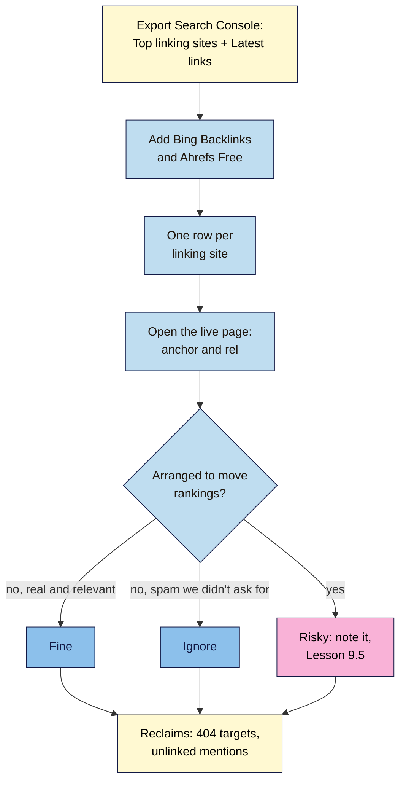

# M09.L03 — Auditing Your Backlinks for Free
> After this lesson you can export the links to your site from Search Console, add Bing Webmaster Tools and Ahrefs Free, sort every linking site into fine, ignore or risky, and find quick wins: links pointing at broken pages and mentions that never linked.

**Time:** ~14 min reading + ~45 min hands-on + ~10 min exercise · **Level:** L2 Practitioner · **Prereqs:** M09.L02, M08.L01 · **Remediate to:** M08.L01
**Verified against:** Search Console Help "Links report" and "Manual actions report"; Bing Webmaster blog "Announcing the new Bing Webmaster Tools" (29 July 2020); Ahrefs Free page and Ahrefs Help on verifying ownership (3 September 2026); Ahrefs blog on unlinked mentions (modified 2025-12-18), all on 2026-11-09. None of the three tools' screens were tested live; menu names come from their help pages and may differ.

> ⚠️ **Freshness flag:** Ahrefs Webmaster Tools is now **Ahrefs Free**, and its limits ("up to 1000 backlinks at once") may change. Bing's backlink feature is described in a 2020 announcement; check it's still where the help says. Search Console's Links report hasn't changed much, but it's always "a sample".

## Learning objectives
1. **Export** links from Search Console (Top linking sites; Latest links), and add Bing Webmaster Tools and Ahrefs Free (verified sites only). *(O1)*
2. **Sort** each linking site into fine, ignore or risky, checking `rel` on the live page (Search Console doesn't show it). *(O2)*
3. **Find** reclaim opportunities: links to pages that now return 404, and unlinked mentions. *(O3)*

## Why it matters
Kavya took over her studio's website from a previous agency. She has no idea what links they built. Tomás gets an email saying his site has "312 toxic backlinks" and needs an urgent clean-up for €300. Nila wonders why a magazine that wrote about her didn't link.

A backlink audit answers three practical questions: **Who links to us? Is anything risky we need to deal with? What easy links are we missing?** Most of the time, the answers are "a handful of real sites, nothing risky, and two or three quick wins". That's worth knowing before anyone sells you a clean-up, and before you start outreach in Lesson 9.4.

## Core concept
**Plain version:** no tool sees every link to your site. Search Console shows Google's own sample, Bing shows Bing's, and Ahrefs shows its crawler's. Put them together, look at each **linking site** (not each link), check the live page, and label it **fine** (a real, relevant link), **ignore** (spam or scrapers Google already ignores) or **risky** (a link someone arranged to manipulate rankings). Then look for **reclaims**: good links pointing at broken pages, and mentions without links.

**Analogy:** checking your post. You don't read every flyer; you sort it into letters you want, junk you bin, and anything that needs action. A few minutes a quarter is enough.

**Precise definitions:**
- **Backlink audit:** a review of who links to your site, sorted by what (if anything) to do.
- **Fine:** a real link from a real site, given freely (or paid and marked `sponsored`).
- **Ignore:** spammy, scraped or random links you didn't ask for. Google says "For known spam sites, Google typically will ignore the links".
- **Risky:** links bought, swapped or built to manipulate rankings, often by a previous agency (Lesson 9.5).
- **Link reclamation:** asking for a fix where a good link exists but points at a broken page, or where a site mentioned you without linking.
- **Unlinked mention:** "online mentions (citations) of your brand … that do not link back to your site" (Ahrefs).

### The three free tools
| Tool | What you get | Limits (from their docs) |
|---|---|---|
| **Search Console → Links** | Top linked pages, Top linking sites, Top linking text; exports of "Latest links" and "More sample links" | "Tables are limited to 1,000 rows"; exports up to 100,000 rows; "a sample"; grouped "by root domain"; "doesn't specify if a link is marked as nofollow" |
| **Bing Webmaster Tools → Backlinks** | Backlinks, referring domains and anchor text; "Backlinks lists backlinks for any site, including similar sites" | Bing's crawl, not Google's; described in a 2020 post, so check the menu |
| **Ahrefs Free** (formerly Ahrefs Webmaster Tools) | Backlinks for your **verified** sites, including "Link type data (nofollow, UGC, sponsored)" | "up to 1000 backlinks at once"; competitors need a paid plan; verify "in the same mode as it is added to GSC" (www or not) |

You'll get **different numbers from each**. That's normal: each tool sees a different part of the web. Compare referring domains, and treat all three as samples.

### Sorting rules
| Label | Looks like | Action |
|---|---|---|
| **Fine** | A blog, news site, supplier, customer, association or directory your audience uses; descriptive or brand anchor; paid links marked `sponsored` | None. Thank them, or build on the relationship (Lesson 9.4) |
| **Ignore** | Scraper sites copying your posts, random foreign spam pages, "SEO stats" sites listing every domain | None. Don't disavow (Lesson 9.5) |
| **Risky** | Links you (or an agency) paid for without `sponsored`; link swaps; keyword-stuffed anchors across many sites; a network of thin blogs; widget or footer links | Note it. Ask for removal or `sponsored` if you arranged it; Lesson 9.5 covers when (rarely) to disavow |

**The key question for "risky"** is not "is this site ugly?" but "**did someone arrange this link to move rankings?**" Ugly links you didn't ask for go in **ignore**.

### Quick wins: reclaim
1. **Links to broken pages.** In **Links → Top linked pages**, check each target URL. If it now returns 404, either redirect it to the best current page (Lesson 6.5 and non-negotiable #8) or ask the linking site to update the link.
2. **Unlinked mentions.** Search Google for your brand while excluding your own site, for example `"Nila Coffee" -site:nilacoffee.example`. Note pages that mention you but don't link, and where a link would genuinely help their readers (Lesson 9.4 covers the email).

## How it works

**In words:** export your links from Search Console (Top linking sites and Latest links), then add what Bing and Ahrefs Free show. Make one row per linking site. Open each linking page and check the anchor text and `rel` value. Ask whether someone arranged the link to move rankings. If not, and it's real and relevant, it's fine; if it's spam you didn't ask for, ignore it. If it was arranged, mark it risky for Lesson 9.5. Finally, list reclaims: good links pointing at broken pages, and mentions without links.

> **Under the hood: why the tools disagree.** Each tool has its own crawler, visiting different pages at different times. Search Console shows links Google found "over time", including some that "may have since been removed", groups them "by root domain", and samples them. Ahrefs shows its own index, filtered to 1,000 at a time on the free plan. Bing shows Bing's crawl. A link can exist in one and not the others, and a removed link can linger. That's why you **check the live page** before acting, and why no tool's total is "the" number.

## Hands-on walkthrough
You'll build a backlink audit for your project site. Nila Coffee's values are illustrative.

**Before you start: which steps apply to you?**
- **Path A (your own site):** do every part.
- **Path B (practice site):** your practice site may have no backlinks. Do Part A to see the empty report, then do Parts B–D on the sample list in the M09 capstone (Task 7), and Part D's mention search on any brand you know.
- **Path C (client site):** do every part with Search Console view access. Adding the site to Ahrefs Free needs verification, so ask the client (it can import from Search Console).

**Part A — Export from Search Console (10 min)**
1. Open **Links**. Note the totals for external links and top linking sites.
2. Click **Top linking sites → More → Export** to Google Sheets. Then click **Export external links → Latest links** (Google's own path in its manual actions help).
3. Add a tab called **Backlink audit** with columns **Linking site**, **Example linking page**, **Target page**, **Anchor**, **rel (live)**, **Label**, **Action**, **Seen in** (GSC / Bing / Ahrefs).
4. Paste one row per linking site from the Top linking sites export.
   **Expected:** a list of linking sites. A small site may have 10–60. Nila's: 34 linking sites *(illustrative)*.

**Part B — Add Bing and Ahrefs Free (15 min)**
1. In Bing Webmaster Tools (set up in Lesson 1.8), open **Backlinks** and note referring domains and any sites missing from your list.
2. Create an Ahrefs Free account, add your site by importing from Search Console, and open its backlinks report. Note referring domains, and which links it marks `nofollow`, `ugc` or `sponsored`.
3. Add any new linking sites to your tab, and fill **Seen in**.
   **Expected:** three different totals. Nila's: GSC 34 sites, Bing 21, Ahrefs 47 *(illustrative)*. Write one line on why they differ.

**Part C — Check and label (15 min)**
1. For each linking site (or the top 20 if you have many), open the example page, find the link, and record the anchor text and `rel` value (right-click → **Inspect**, Lesson 9.1).
2. Label it **Fine**, **Ignore** or **Risky** with the sorting rules, and write the action ("none", "thank them", "ask for `sponsored`", "note for Lesson 9.5").
   > 🖼️ **Image prompt:** A Google Sheets tab named "Backlink audit" (1280×720) with about 15 linking sites, columns for anchor, rel (live), Label and Action, most rows labelled Fine, several Ignore, and one Risky row reading "ask for sponsored". Highlight the Risky row with a 3px #F9B2D7 outline; blur any personal details.
   > **Alt text:** A backlink audit sheet with linking sites labelled fine, ignore or risky, with the one risky row highlighted.
   **Expected:** mostly Fine and Ignore. If you find Risky links you didn't know about, note who might have arranged them (a previous agency, a paid review).

**Part D — Find reclaims (5 min)**
1. In **Links → Top linked pages**, check each target URL in your browser (or with URL Inspection). Note any that return 404.
2. Search Google for `"your brand" -site:yourdomain` and note up to five pages that mention you without a link.
3. Add a short **Reclaim list** under your table: URL, what's wrong, and the fix (redirect, or ask for a link update).
   **Expected:** zero to five reclaims. Nila's: an old `/shop/chikmagalur` URL with 3 linking sites, now 404 (fix: 301 to the current product page); a magazine roundup mentioning Nila with no link *(illustrative)*.

**Expected output:** a **Backlink audit** tab with every linking site (or the top 20) checked live, labelled fine, ignore or risky with an action, the three tools' totals explained, and a reclaim list.

## When to use / when not to
**Audit:** when you take over a site, before any outreach campaign, after any "SEO agency" work you didn't watch closely, if you get a manual action (Lesson 9.5), and otherwise once a quarter.

**Don't** audit weekly, chase every spam link, or pay for a "toxic link clean-up" without a manual action.

**The trade-off:** a careful audit takes an hour on a small site. Skipping it means you might miss a risky link pattern someone else built, or easy reclaims. Doing it every week wastes time on links Google already ignores.

## Use AI for this
**Example prompt:**
> "Here's my backlink audit [paste the linking site, anchor, rel and a one-line description of each site]. For each row, suggest Fine, Ignore or Risky using these rules: Fine = real and relevant or paid and marked sponsored; Ignore = spam I didn't ask for; Risky = arranged to move rankings. Explain each Risky label. Don't recommend disavowing anything; I'll decide that with Google's Step 0 test."

**What AI does well here:** applying simple rules to a long list quickly, and spotting keyword-stuffed anchors.
**Where it gets it wrong:** it can't see the live pages, so it guesses at `rel` values and site quality; it may call every ugly site "toxic" and push for disavowing.
**How to check:** open every Risky row's live page yourself before acting.

## Common mistakes
- **Treating one tool's total as the truth.**
- **Trusting Search Console for `nofollow`.** It "doesn't specify if a link is marked as nofollow".
- **Labelling ugly spam as "risky"** when you didn't ask for it. That's **ignore**.
- **Paying for a "toxic link" clean-up** without a manual action.
- **Missing reclaims:** good links pointing at pages you deleted.
- **Auditing links, not linking sites.** A footer link on 500 pages is one site.

## Troubleshooting
| Symptom | Likely cause | Fix |
|---|---|---|
| Search Console shows no links | A new site, or Google hasn't found any yet | Normal; recheck in a month |
| A linking page doesn't contain your link | Removed since Google saw it | Mark "gone"; no action |
| Ahrefs won't verify | www vs non-www mismatch with Search Console | Add the site "in the same mode as it is added to GSC" |
| Bing Backlinks not where the help says | Menu changed | Search Bing Webmaster Tools help for "Backlinks" |
| Hundreds of links from one site | Footer, sidebar or blogroll link | One row; check whether it was arranged |
| A good link points to a 404 | You removed or moved the page | 301 redirect (Lesson 6.5), or ask them to update it |

## Exercise
**Task:** complete your **Backlink audit** tab (Parts A–D). Then answer these. All details are illustrative.
1. Search Console shows 34 linking sites, Bing 21, Ahrefs 47. Which is right?
2. Tomás's audit finds 80 links from foreign scraper sites he's never heard of. Fine, ignore or risky?
3. Kavya finds 12 links from thin "yoga tips" blogs with the anchor "best yoga classes Bengaluru", all built by her old agency. Fine, ignore or risky?
4. A food magazine wrote about Nila but didn't link. What's the opportunity, and what's the polite way to approach it?
5. Search Console lists a link from a page that no longer mentions Amara's client. What should she do?
6. Why must you check `rel` on the live page rather than in Search Console?

**Expected outcome:** a complete tab, and these answers:
- **1** None of them is "right"; each is a sample from a different crawl. Compare referring domains and check live pages.
- **2** Ignore. "For known spam sites, Google typically will ignore the links." He didn't arrange them.
- **3** Risky: arranged by her agency, with keyword-stuffed anchors on thin sites. Note them for Lesson 9.5's decision.
- **4** An unlinked mention. Email the editor once, thank them, and suggest a link if it helps their readers (Lesson 9.4). No pressure.
- **5** Mark it "gone": the report "includes links that Google has found over time" that "may have since been removed".
- **6** Search Console's Links report "doesn't specify if a link is marked as nofollow".

**Stretch goal:** in Bing Webmaster Tools, look up the backlinks of one competitor ("any site, including similar sites"). Note three sites that link to them but not to you; they're candidates for Lesson 9.4.

## Key takeaways
- Every tool shows a sample: Search Console, Bing and Ahrefs Free will disagree. Compare linking sites, not totals.
- Check anchor text and `rel` on the live page; Search Console doesn't show `nofollow`.
- Label each linking site **fine**, **ignore** (spam you didn't ask for) or **risky** (arranged to move rankings).
- Look for reclaims: good links to 404 pages, and mentions without links.
- Audit when you take over a site, before outreach, and quarterly, not weekly.

## Teach it back
Explain to a friend in 3 sentences how to check who links to their website for free, and the difference between a link to ignore and a link that's risky.

## Glossary terms added
- Backlink audit — added to `seo-101/glossary.md`
- Link reclamation — added to `seo-101/glossary.md`
- Unlinked mention — added to `seo-101/glossary.md`
- Ahrefs Free (formerly Ahrefs Webmaster Tools) — added to `seo-101/glossary.md`
- *Already in the glossary:* Backlink, Referring domain, Search Console property

## Further reading
*All checked 2026-11-09.*
- Search Console Help — Links report: https://support.google.com/webmasters/answer/9049606
- Search Console Help — Manual actions report (unnatural links steps): https://support.google.com/webmasters/answer/9044175
- Bing Webmaster blog — Announcing the new Bing Webmaster Tools (29 July 2020): https://blogs.bing.com/webmaster/july-2020/Announcing-the-new-Bing-Webmaster-Tools-(migration-complete)
- Ahrefs — Ahrefs Free (formerly Ahrefs Webmaster Tools): https://ahrefs.com/webmaster-tools
- Ahrefs Help — Verifying ownership of your project or website: https://help.ahrefs.com/en/articles/3275938-verifying-ownership-of-your-project-or-website
- Ahrefs blog — Unlinked mentions: https://ahrefs.com/blog/unlinked-mentions/

> ⚠️ **May change:** Ahrefs Free's name and limits; Bing Webmaster Tools menus; Search Console export options.

## Refresher card
*Used by remediation when a learner fails a quiz twice on a later lesson that points back here.*
**Free tools, all samples:** Search Console **Links** (1,000-row tables; exports up to 100,000; grouped by root domain; no `nofollow` info) · **Bing Backlinks** (any site, incl. competitors) · **Ahrefs Free** (verified sites; 1,000 visible; shows link types). **One row per linking site → check the live page (anchor, rel) → label:** **Fine** (real, relevant; paid = `sponsored`) · **Ignore** (spam you didn't ask for; Google "typically will ignore") · **Risky** (arranged to move rankings → Lesson 9.5). **Reclaims:** good links to 404 targets (301 or ask to update); unlinked mentions (`"brand" -site:yourdomain`). Audit on takeover, before outreach, quarterly.
