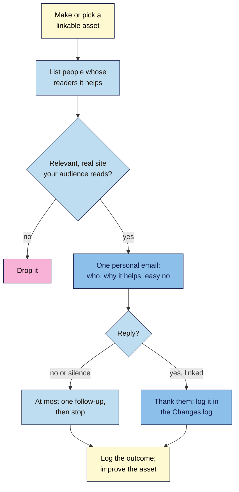

# M09.L04 — Earning Links the Right Way
> After this lesson you can plan one genuinely useful "linkable asset", list 10 realistic people or sites who might cite it, write an honest outreach email that's easy to say no to, and know where guest posts, broken-link fixing, unlinked mentions, digital PR and social media fit.

**Time:** ~16 min reading + ~45 min hands-on + ~10 min exercise · **Level:** L2 Practitioner · **Prereqs:** M09.L03, M07.L01 · **Remediate to:** M09.L01
**Verified against:** Google Search Central "SEO Starter Guide" (last updated 2025-12-10), "Link best practices" (2025-12-10) and "Do you need an SEO?" (2026-06-05); Search Central blog "A reminder about links in large-scale article campaigns" (25 May 2017); US FTC "CAN-SPAM Act: A Compliance Guide for Business" (August 2023, edited January 2024; read through a fetch tool because the site blocks scripts); Ahrefs blog posts on broken link building, unlinked mentions and digital PR (labelled *observed practice*); Googler comments as reported by Search Engine Roundtable (2015, 2018, 2020, 2025), all on 2026-11-09.

> ⚠️ **Freshness flag:** Google has no page endorsing broken-link building, digital PR or unlinked-mention outreach by name; these are common, ethical industry practices, labelled as such here. Email rules differ by country, and this lesson is not legal advice: check the rules where you and your recipients are.

## Learning objectives
1. **Plan** one linkable asset and 10 realistic people or sites who'd cite it (local, industry, press). *(O1)*
2. **Write** an honest, personal outreach email (who you are, why it helps them, an easy way to say no), avoiding "aggressive or repeated" requests. *(O2)*
3. **Explain** guest content done right, broken-link fixing, unlinked mentions, digital PR basics, and where social signals and mentions fit. *(O3)*

## Why it matters
Kavya's old agency "built links" by sending 400 identical emails a month: "Dear Webmaster, I loved your article! Please link to my yoga site." Almost nobody replied, a few people reported it as spam, and the links she did get came from sites nobody reads.

Nila got her best link without asking: a Bengaluru food writer used her **brew-ratio chart** in an article because it was the clearest one online. That's the model for this lesson. Google's own advice: "focus on improving your site's content and everything—including links —will follow". In practice, "will follow" usually needs a nudge: making something worth citing, and telling the few people who'd genuinely want to know.

## Core concept
**Plain version:** people link to things that help **their** readers. So: (1) make or have something worth citing, (2) find the people whose readers it helps, (3) tell them once, personally and honestly, and (4) accept "no" or silence. Real relationships (suppliers, customers, local press, your industry) are your best sources. Everything that skips step 1 or turns step 3 into mass mail drifts towards spam.

**Analogy:** getting your café into a local guidebook. You don't post 400 letters to every guidebook in the country. You make something worth recommending, then tell the two or three local writers who cover cafés like yours.

**Precise definitions:**
- **Linkable asset:** a page people want to cite: original data, a tool or calculator, a clear guide, a map, a chart, local information nobody else has.
- **Outreach:** contacting a specific person to tell them about something that may help their readers.
- **Guest content:** an article you write for another site. Fine when it informs their audience; spam when "the main intent is to build links in a large-scale way".
- **Broken-link building:** "finding a dead page and asking linkers to swap the links to a working page on your site" *(Ahrefs; observed practice)*.
- **Digital PR:** using public-relations tactics online (stories, data, comment for journalists) to earn coverage, which often includes links *(observed practice)*.

### What Google says
| Topic | What Google says | What it means for you |
|---|---|---|
| Promotion is normal | "Effectively promoting your new content will lead to faster discovery"; ways include "Social media promotion", "Community engagement" and advertising | Telling people about good content is fine |
| Word of mouth | "One of the most effective and lasting ways is word of mouth" | Real customers and partners talk and link |
| Offline | Put your URL "on your business cards, letterhead, posters, and other materials" | Nila's bags and tasting-room cards |
| Don't overdo it | "you can overdo promoting your site and actually harm it" | Few, relevant contacts; no blasts |
| Guest posts | Fine when they "inform users, educate another site's audience or bring awareness to your cause or company" | Write for their readers |
| Guest post red flags | "Stuffing keyword-rich links"; publishing "across many different sites"; writers who "aren't knowledgeable"; the same content everywhere | One great article beats twenty thin ones |
| Outreach | Site owners "prefer not to receive aggressive or repeated "Post my article!" requests" | One personal email, no chasing |
| Citing others | External links "can help establish trustworthiness (for example, citing your sources)" | Make your asset easy to cite |
| Natural links | Mueller (2025): if people link "for normal reasons … it could be useful to engage with them" | Thank linkers; build relationships |

### The link-earning menu
| Method | How it works | Fits Nila because… | Watch out |
|---|---|---|---|
| **Linkable asset** | A chart, tool, data or guide others cite | Her brew-ratio chart and an "Indian coffee estates" map | Must be genuinely better or unique |
| **Real relationships** | Suppliers, stockists, partners, associations list you | Cafés that stock her beans; farm partners; a roasters' association | Don't require links in contracts (Lesson 9.5) |
| **Local** | Local press, events, community groups, sponsorships (marked `sponsored`) | A tasting-room opening; a city food festival | Paid = `sponsored` |
| **Digital PR** | A story, data or expert comment for journalists | "Bengaluru's cold brew habits": her survey of 300 customers | Real data only; no stunts |
| **Guest content** | One expert article for a relevant site | A brewing guide for a respected food blog | For their readers, not your anchors |
| **Broken-link fixing** | Find a dead resource that people link to; offer your working page | A defunct coffee-ratio page linked by 15 blogs | Only where your page is a true replacement |
| **Unlinked mentions** | Ask a site that named you to add a link | A magazine roundup naming Nila | One polite ask; fine if they say no |

### Social media and mentions, in perspective
- **Social signals:** asked whether social signals affect rankings, Mueller (2015) said "Not directly, no." Social posts help people **find** your content, and some of those people link to it.
- **Mentions without links:** Mueller (2018): a mention is "not a link, it doesn't pass any PageRank". Asked (2020) whether unlinked citations help, he said "usually not, imo". Google's How Search Works does say quality systems look at whether prominent sites "link or refer to the content", but doesn't explain "refer". So treat mentions as good for people and reputation, and as a chance for a link, not as a ranking lever.

### Honest outreach: the checklist
Google's warning ("aggressive or repeated" requests) and the FTC's CAN-SPAM guide point the same way. The FTC's headings include "Don't use deceptive subject lines.", "Tell recipients where you're located." and "Tell recipients how to opt out of receiving future marketing email from you.", and "The law makes no exception for business-to-business email." Whether a one-to-one link request counts as "commercial" under that US law depends on its "primary purpose"; this course doesn't give legal advice, so follow the safe practice below everywhere, and check your own country's rules.

| ✅ Do | ❌ Don't |
|---|---|
| Write to one named person, about their specific page | "Dear Webmaster" to hundreds of sites |
| Say who you are, your business and where you're based | Hide who you are or pretend to be a reader |
| Explain why it helps **their readers** | Ask for a link "to help my SEO" |
| Use an honest subject line | "Re: our conversation" when there wasn't one |
| Make it easy to say no ("No worries if it's not a fit") | Follow up again and again |
| Follow up **once** at most, then stop; stop at once if asked | Offer money or free products for a link (Lesson 9.5) |
| Let them choose the anchor text | Request keyword anchors |

## How it works

**In words:** start with something worth citing. List people whose readers it would genuinely help, and drop any that aren't real, relevant sites your audience reads. Send each one a single personal email that says who you are, why it helps their readers, and that "no" is fine. If they link, thank them and log it. If they say no or don't reply, follow up once at most, then stop. Log every outcome, and use what you learn to improve the asset.

> **Under the hood: why mass outreach fails twice.** It fails with people: editors get dozens of templated requests a week, recognise them instantly, and some report them (Google invites reports of "aggressive or repeated" requests). And it fails with Google: the links that mass outreach does win tend to come from sites that say yes to everyone, which are exactly the "low-quality" or link-selling sites SpamBrain is built to spot and neutralise (Lesson 9.5). Ten well-chosen contacts usually beat 400 random ones on both counts.

## Hands-on walkthrough
You'll plan one linkable asset, list 10 targets, and draft one email. Nila Coffee's details are illustrative.

**Before you start: which steps apply to you?**
- **Path A (your own site):** do every part. Send emails only when your asset is live and you're happy with it.
- **Path B (practice site):** do every part as planning. Don't send outreach for a practice site; draft the emails only.
- **Path C (client site):** do every part, and get the client's OK on the asset, the target list and the email before anything is sent in their name.

**Part A — The asset (15 min)**
1. Look at your **Content plan** (Lesson 7.1) and **Backlink audit** (Lesson 9.3). Which of your pages already gets links or mentions? What do competitors get linked for (Lesson 9.3 stretch goal)?
2. Choose one asset: an existing page you'll improve, or a new one. Write a short brief in a tab called **Outreach**: **Asset**, **Who it helps**, **Why it's better or unique**, **What it needs before outreach** (for example, "add the printable chart", "fact-check log done").
   **Expected:** one asset with a clear "only we have this" reason. Nila's: a printable brew-ratio chart for 8 methods, tested in her roastery *(illustrative)*.

**Part B — 10 realistic targets (15 min)**
1. Find 10 people or sites whose readers would use it: local food writers, coffee and cooking blogs, cafés and stockists, associations, resource pages that list brewing guides, and anyone in your **Reclaim list** (Lesson 9.3).
2. For each, record **Site**, **Person (if known)**, **Specific page**, **Why their readers would care**, **Contact route** (contact page, editor email), **Method** (asset, relationship, local, PR, guest, broken link, mention).
3. Drop any target that's not a real site your audience reads, or that sells links.
   **Expected:** 10 targets, each with a specific page and a reason. No "Dear Webmaster" lists.

**Part C — Draft one email (15 min)**
1. Pick your best target and write a short email (under 150 words) with: an honest subject line, who you are and where you're based, the specific page of theirs you read, what your asset is and why it helps their readers, and an easy no.
2. Check it against the honesty checklist above and tick each line.
   > 🖼️ **Image prompt:** A short email draft (1280×720) from "Nila, Nila Coffee, Bengaluru" to a named food writer with the subject "A brew-ratio chart for your cold brew guide", four short paragraphs and the closing line "No worries at all if it's not a fit." Highlight the closing line with a 3px #F9B2D7 outline; blur any personal details.
   > **Alt text:** A short, personal outreach email draft ending with an easy way to say no, with that closing line highlighted.
   **Expected:** one honest email, ticked against the checklist. If you send it (Path A), log the date, and plan at most one follow-up.

**Expected output:** an **Outreach** tab with one linkable asset brief, 10 realistic targets with reasons and methods, and one email draft checked against the honesty checklist.

## When to use / when not to
**Do outreach** when you have something genuinely useful, for a small list of people whose readers it helps, and when relationships already exist (suppliers, stockists, press who covered you).

**Don't** send templates in bulk, offer payment or free products for links, chase repeatedly, or start outreach before the asset is ready.

**The trade-off:** honest outreach is slow, and most emails get no reply. But each link it earns is from a real site that real customers read, and it never risks a manual action. Bought or mass-mailed links are fast and mostly worthless, or worse (Lesson 9.5).

## Use AI for this
**Example prompt:**
> "Here's my linkable asset [describe] and one target: [site, page, why their readers would care]. Draft a personal outreach email under 150 words: honest subject line, who I am and where I'm based, one sentence showing I read their page, why my asset helps their readers, and an easy way to say no. No flattery, no 'Dear Webmaster', no request for specific anchor text, no offer of payment."

**What AI does well here:** a tight first draft, and cutting a long email down.
**Where it gets it wrong:** it adds fake flattery ("I'm a huge fan of your work!"), invents details about their page, slips in "for SEO purposes", or writes subject lines that mislead.
**How to check:** read their page yourself, delete anything you can't stand behind, and tick the honesty checklist.

## Common mistakes
- **Outreach without an asset.** "Please link to my homepage" helps no one.
- **Mass, templated emails.** Google warns about "aggressive or repeated" requests.
- **Asking for keyword anchor text.**
- **Paying or gifting for links** without `sponsored` (Lesson 9.5).
- **Guest posting at scale** with the same article and keyword links.
- **Chasing repeatedly** after silence or a no.
- **Counting social shares as SEO results.** Social helps discovery, "Not directly" rankings.

## Troubleshooting
| Symptom | Likely cause | Fix |
|---|---|---|
| No replies at all | Generic targets, or an asset that isn't better | Improve the asset; narrow to people whose readers need it |
| A site asks for payment to link | It sells links | Decline, or buy an ad marked `sponsored` (Lesson 9.5) |
| A site offers a link swap | A link exchange | Decline unless it's a genuine, occasional partner link |
| They linked with a different anchor than you hoped | Normal | Thank them; natural anchors are good |
| Someone asks you to stop emailing | They're not interested | Stop at once; note it |
| An agency promises "50 links a month" | Likely bought or low-quality links | Ask how; "You should never have to link to an SEO" (Google) |

## Exercise
**Task:** complete your **Outreach** tab (Parts A–C). Then answer these. All details are illustrative.
1. Kavya's old agency sent 400 identical emails a month. Name two problems.
2. A food blog offers Nila a guest post spot "with two keyword links of your choice". What should she do?
3. A magazine named Tomás's shop in a roundup but didn't link. What's a fair approach?
4. Amara's client wants to count Instagram likes as SEO results. What would you tell them?
5. Nila finds a dead "coffee ratios" page that 15 blogs link to. How could she use it ethically?
6. Which three things should every outreach email include?

**Expected outcome:** a complete tab, and these answers:
- **1** Google says site owners "prefer not to receive aggressive or repeated" requests (and may report them), and the few links won tend to come from low-quality sites. It may also break email rules where the recipients are.
- **2** Write one genuinely useful article for that blog's readers, and let the editor choose any links and anchors. Keyword-stuffed links in guest posts are a link spam example (Lesson 9.5).
- **3** One polite email thanking them, suggesting a link if it helps their readers, and making "no" easy. That's unlinked-mention outreach.
- **4** Mueller: social signals affect rankings "Not directly, no." Social helps people discover content; report it separately from SEO KPIs.
- **5** If her page is a true replacement, email each linking blog once, saying the old page is gone and hers covers the same thing (broken-link building, *observed practice*).
- **6** For example: who you are and where you're based, why it helps their readers, and an easy way to say no (plus an honest subject line).

**Stretch goal:** send your first email (Path A), log the date in your **Changes log** (Lesson 8.5), and check four weeks later whether the link appeared in Search Console's Latest links.

## Key takeaways
- People link to things that help their readers. Start with a linkable asset.
- Real relationships (suppliers, stockists, press, associations) are the best sources.
- One personal, honest email per person: who you are, why it helps, an easy no. Follow up once at most.
- Guest posts are fine for the host's readers; at scale, with keyword links, they're link spam.
- Social and mentions help people find you; they're not a direct ranking lever.

## Teach it back
Explain to a friend in 3 sentences how to earn a link honestly, and why sending the same email to 400 sites is a bad idea.

## Glossary terms added
- Linkable asset — added to `seo-101/glossary.md`
- Outreach — added to `seo-101/glossary.md`
- Guest post — added to `seo-101/glossary.md`
- Broken-link building — added to `seo-101/glossary.md`
- Digital PR — added to `seo-101/glossary.md`
- *Already in the glossary:* Unlinked mention, Link reclamation

## Further reading
*All checked 2026-11-09.*
- Google Search Central — SEO Starter Guide ("Promote your website"): https://developers.google.com/search/docs/fundamentals/seo-starter-guide
- Search Central blog — A reminder about links in large-scale article campaigns (25 May 2017): https://developers.google.com/search/blog/2017/05/a-reminder-about-links-in-large-scale
- Google Search Central — Do you need an SEO?: https://developers.google.com/search/docs/fundamentals/do-i-need-seo
- US FTC — CAN-SPAM Act: A Compliance Guide for Business: https://www.ftc.gov/business-guidance/resources/can-spam-act-compliance-guide-business
- Ahrefs blog — Broken link building (observed practice): https://ahrefs.com/blog/broken-link-building/
- Ahrefs blog — Digital PR (observed practice): https://ahrefs.com/blog/digital-pr/
- Search Engine Roundtable — Mueller on social signals (2015): https://www.seroundtable.com/google-social-signals-ranking-20803.html

> ⚠️ **May change:** email law (the FTC's penalty figure is inflation-adjusted yearly; other countries differ); Googlers' views on mentions. Not legal advice.

## Refresher card
*Used by remediation when a learner fails a quiz twice on a later lesson that points back here.*
**Earn, don't build.** Google: "focus on improving your site's content and everything—including links —will follow". **Menu:** linkable asset (data, tool, chart, guide) · real relationships (suppliers, stockists, associations) · local (press, events; paid = `sponsored`) · digital PR (real stories, real data) · guest content (for their readers; not "large-scale", no keyword links) · broken-link fixing · unlinked mentions. **Outreach:** one named person, honest subject, who and where you are, why it helps their readers, easy no, ≤1 follow-up; never pay, never ask for anchors. Avoid "aggressive or repeated" requests. **Social:** "Not directly" a ranking factor. **Mentions:** "not a link"; a chance to ask for one.
