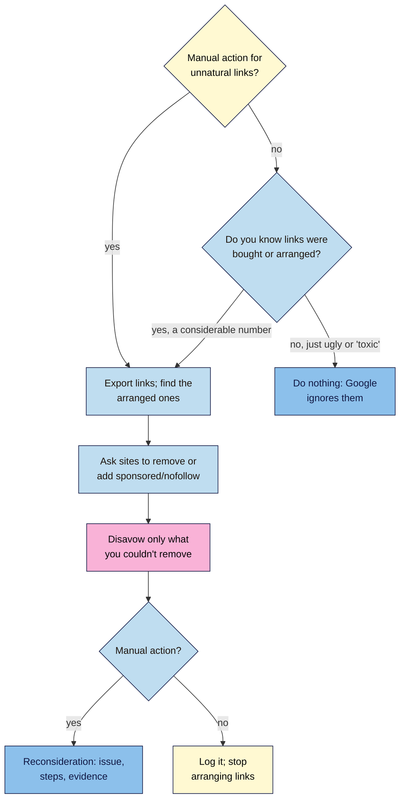

# M09.L05 — Link Schemes, Penalties and Disavow
> After this lesson you can spot every kind of link scheme in Google's spam policy, explain what happens to sites that use them, fix an "Unnatural links" manual action with a good reconsideration request, and decide (usually "no") whether to disavow.

**Time:** ~16 min reading + ~35 min hands-on + ~10 min exercise · **Level:** L2 Practitioner · **Prereqs:** M09.L04, M01.L06 · **Remediate to:** M01.L06
**Verified against:** Google Search Central "Spam policies for Google web search" (last updated 2026-08-28); Search Central blog "December 2022 link spam update" (14 December 2022); Search Console Help "Manual actions report" and "Disavow links to your site" (no dates shown); John Mueller's comments as reported by Search Engine Roundtable (May 2024) and Search Engine Journal (April 2025), all on 2026-11-09. Search Console's disavow and manual action screens weren't tested live.

> ⚠️ **Freshness flag:** Google's spam policies were updated on 2026-08-28 and now also mention manipulating "generative AI responses". John Mueller said of the disavow tool in 2024: "At some point, I'm sure we'll remove it." Bing reportedly removed its own in 2023. Check the tool still exists before relying on it.

## Learning objectives
1. **Recognise** every type of link spam in Google's policy (paid, exchanges, PBNs, widgets, footers, press-release anchors, ToS links, directories) and SpamBrain's "neutralise" effect. *(O1)*
2. **Describe** the two "Unnatural links" manual actions and a good reconsideration request. *(O2)*
3. **Decide** whether to disavow with Google's "Step 0" test, and build a correctly formatted disavow file (practice only). *(O3)*

## Why it matters
In one month, Nila gets five offers: "DA 50+ guest posts, ₹4,000 each"; "Swap links with our 40 partner sites"; "Free coffee calculator widget for your blog"; "300 directory submissions for ₹999"; and "We'll put your link in the footer of 200 sites". Each sounds like a shortcut. Each is on Google's list of link spam.

Meanwhile Kavya, whose old agency built links for her, opens Search Console and sees a **manual action: "Unnatural links to your site"**. And Tomás reads online that he must "disavow toxic links every month". This lesson gives you the rules (non-negotiable #11: **earn links, never buy them**), what really happens when they're broken, and the one narrow case where disavowing makes sense.

## Core concept
**Plain version:** **link spam** is "creating links to or from a site primarily for the purpose of manipulating search rankings". Paying for links, swapping them at scale, or building fake sites to link from all count. Today, Google mostly **neutralises** such links automatically (they simply stop counting, so the money is wasted). In worse cases, a person at Google applies a **manual action**, and some or all of your pages drop until you clean up and ask for **reconsideration**. The **disavow** tool tells Google to ignore specific links, but "most sites will not need to use this tool".

**Analogy:** fake reviews. Most review sites quietly filter them out (neutralised: you wasted your money). If you're caught running a fake-review operation, your listing gets flagged (manual action), and you have to show you've stopped before it's lifted (reconsideration).

**Precise definitions:**
- **Link scheme / link spam:** links made "primarily for the purpose of manipulating search rankings".
- **SpamBrain:** Google's "AI-based spam-prevention system", which since 2022 "can now detect both sites buying links, and sites used for the purpose of passing outgoing links".
- **Manual action:** a penalty applied when "a human reviewer at Google has determined that pages on the site are not compliant with Google's spam policies".
- **Reconsideration request:** asking Google to review your site after you've fixed a manual action.
- **Disavow:** a file listing links or domains you want Google to ignore. "This is an advanced feature and should only be used with caution."
- **PBN (private blog network):** an industry name for a set of sites built to link to one another or to a client. Google doesn't use the term; it falls under "Creating low-value content primarily for the purposes of manipulating linking and ranking signals".

### Google's link spam list, with Nila's offers
| Google's example (quoted) | Nila's version | Is it OK? |
|---|---|---|
| "Buying or selling links for ranking purposes" (money, goods, services, or "Sending someone a product in exchange for them writing about it and including a link") | "DA 50+ guest posts, ₹4,000 each"; free beans for a review with a followed link | ❌, unless the link is marked `sponsored` or `nofollow` |
| "Excessive link exchanges" or "partner pages exclusively for the sake of cross-linking" | "Swap links with our 40 partner sites" | ❌ (an occasional genuine partner link is fine) |
| "Using automated programs or services to create links to your site" | "300 directory submissions for ₹999" | ❌ |
| "Requiring a link as part of a Terms of Service, contract, or similar arrangement" without letting the other site qualify it | Requiring stockists to link to Nila in their supply contract | ❌ |
| "Text advertisements or text links that don't block ranking credit" | A paid text link on a café blog, no `rel` | ❌ (✅ with `sponsored`) |
| Advertorials with links that pass ranking credit, or "links with optimized anchor text in articles, guest posts, or press releases distributed on other sites" | A press release with "best coffee beans online India" as a link | ❌ (press releases themselves are fine) |
| "Low-quality directory or bookmark site links" | Mass "free SEO directories" | ❌ (a real association directory is fine) |
| "Keyword-rich, hidden, or low-quality links embedded in widgets that are distributed across various sites" | "Free coffee calculator widget" with a hidden keyword link | ❌ |
| "Widely distributed links in the footers or templates of various sites" | "Your link in the footer of 200 sites" | ❌ |
| "Forum comments with optimized links in the post or signature" | Keyword links in forum signatures | ❌ |
| "Creating low-value content primarily for the purposes of manipulating linking and ranking signals" | A network of 12 thin "coffee blogs" (a PBN) | ❌ |

**What's allowed:** "It's not a violation of our policies to have such links as long as they are qualified with a rel="nofollow" or rel="sponsored" attribute value". Paid advertising and sponsorship are normal; hiding them isn't. And the rule covers links "to or from" a site: selling followed links on your own blog breaks it too.

**Expired domain abuse** is related: buying an expired domain and reusing it "primarily to manipulate search rankings by hosting content that provides little to no value to users". PBNs are often built this way *(observed practice)*.

### What happens if you break it
| Outcome | What Google says | What it means |
|---|---|---|
| **Neutralised** (most common) | SpamBrain works "to neutralize the impact of unnatural links"; "any credit passed by these unnatural links are lost" | You paid for nothing; rankings that relied on the links fall |
| **Ranks lower** | "Sites that violate our policies may rank lower in results or not appear in results at all." | Automatic, no message |
| **Manual action** | Shown in Search Console's **Manual actions** report and message centre | A person reviewed it; some or all pages affected |

### The two "Unnatural links" manual actions
| Manual action | What Google says | The fix |
|---|---|---|
| **Unnatural links to your site** | "Google has detected a pattern of unnatural, artificial, deceptive, or manipulative links pointing to your site." | Export links; ask sites to remove them or add `nofollow`/`sponsored`; disavow only what you can't remove; then request review |
| **Unnatural links from your site** | "…manipulative outbound links on your site." | Remove the links or add `sponsored`/`nofollow` on your own site; then request review |

**A good reconsideration request** "Explains the exact quality issue on your site. Describes the steps you've taken to fix the issue. Documents the outcome of your efforts." Google adds: "Blindly adding all backlinks to the disavow file is not considered a good-faith effort", "Make sure that you don't disavow organic links", and "Fixing the issue on just some pages will not earn you a partial return". Link-related reviews "may take longer than usual". If you bought a site that already had the problem, say so in the request.

### Disavow: the Step 0 test
Google's disavow page starts with "Step 0: Decide if this is necessary": "In most cases, Google can assess which links to trust without additional guidance, so most sites will not need to use this tool." Disavow **only if both** are true:
1. "You have a considerable number of spammy, artificial, or low-quality links pointing to your site, AND"
2. "The links have caused a manual action, or likely will cause a manual action, on your site."

"Likely will" means you know links were **bought or arranged** (say, by a previous agency), not that a tool scored them as "toxic". Google staff have been blunt:
- Mueller (2024): "Most spammy / paid / placed / swapped links are just ignored nowadays."
- Mueller (2025): "internally we don't have a notion of toxic backlinks", and disavow "is not something that you need to do on a regular basis. It's not a part of normal site maintenance."

**If you do need it** (Google's rules):
- One URL or `domain:example.com` per line; lines starting `#` are comments ("ignored by Google").
- A UTF-8 or 7-bit ASCII text file whose name ends in `.txt`.
- One list per property; "Uploading a new list for a property will replace any existing list".
- "The disavow links tool does not support Domain properties", so you'll need a URL-prefix property (Lesson 1.8).
- "it can take a few weeks for Google to incorporate your list"; disavowed links still appear in the Links report.

## How it works


**In words:** if you have a manual action for unnatural links, or you know a considerable number of links were bought or arranged, export your links and find the arranged ones. Ask those sites to remove the links or mark them `sponsored` or `nofollow`, and disavow only what you couldn't get removed. If there's a manual action, then send a reconsideration request that explains the issue, the steps you took and the evidence. If you only have ugly or "toxic"-labelled links you didn't arrange, do nothing: Google ignores them.

> **Under the hood: why disavow can hurt.** A disavow file tells Google to treat those links as if they didn't exist. If you include links that were helping (a real food blog a tool happened to dislike), you throw that value away. That's why Google warns that "If used incorrectly, this feature can potentially harm your site's performance", and why mass-disavowing on a tool's "toxic" score is risky as well as pointless. Because each upload "will replace any existing list", one careless upload can also wipe out a careful earlier file.

## Hands-on walkthrough
You'll apply the policy to five offers, run the disavow decision on three scenarios, and write a practice disavow file. Details are illustrative.

**Before you start: which steps apply to you?**
- **Path A (your own site):** do every part. Also check your Search Console **Manual actions** report and record what it says.
- **Path B (practice site):** do every part.
- **Path C (client site):** do every part, and check the client's **Manual actions** report with their access.

**Part A — "Is this a link scheme?" (10 min)**
1. Add a tab called **Link schemes** with columns **Offer**, **Which Google example?**, **Scheme?**, **Allowed alternative**.
2. Fill it for Nila's five offers in **Why it matters**, plus any real offers you've received.
   **Expected:** all five are schemes. Alternatives, for example: the guest post → write one for a relevant blog with no link conditions; the widget → offer it with a visible, branded `nofollow` credit link, or none.

**Part B — The disavow decision drill (10 min)**
Apply Step 0 to each scenario and write **Disavow? Yes/No** and why:
1. Tomás: no manual action; Semrush flags 140 "toxic" links from foreign scraper sites.
2. Kavya: a manual action, "Unnatural links to your site"; her old agency bought 60 guest posts with keyword anchors.
3. Amara's client: no manual action; their previous SEO firm admits buying 200 links from a link network last year.
   **Expected:** 1 No (no manual action, nothing arranged). 2 Yes, after removal requests, then reconsideration. 3 Possibly yes: a "considerable number" of bought links that "likely will cause a manual action"; ask for removals first.

**Part C — A practice disavow file (15 min)**
1. For Kavya's scenario, write a file in a plain text editor called `disavow-practice.txt` with comments and entries, for example:
   ```text
   # Kavya Yoga — disavow, prepared 2026-11-09
   # Removal requested 2026-10-20 to 2026-11-01; no reply from these sites
   domain:yoga-tips-blog-network.example
   domain:best-wellness-guestposts.example
   https://random-health-blog.example/2025/05/top-yoga-studios/
   ```
2. Check it against Google's rules: `.txt` name, one entry per line, `domain:` prefix for whole sites, `#` for comments.
3. **Don't upload it.** In your tab, note which property type you'd need (URL-prefix, not Domain) and that a new upload replaces the old list.
   > 🖼️ **Image prompt:** A plain text editor (1280×600) showing a file named disavow-practice.txt with two comment lines starting with #, two lines starting with domain:, and one full URL. Highlight the two domain: lines with a 3px #F9B2D7 outline; blur any personal details.
   > **Alt text:** A practice disavow text file with comment lines, two domain entries and one URL, with the domain lines highlighted.
   **Expected:** a correctly formatted practice file and a note of the rules.

**Expected output:** a **Link schemes** tab with five offers matched to Google's examples and allowed alternatives, the three disavow decisions with reasons, and a correctly formatted (not uploaded) practice disavow file. If you checked your own **Manual actions** report, record its status.

## When to use / when not to
**Disavow** only with a manual action for unnatural links, or when you know a considerable number of links were bought or arranged and a manual action is likely. Try removal first.

**Request reconsideration** only after you've fixed everything the manual action lists, on all pages.

**Don't** disavow on tool scores, as routine maintenance, or "just in case" for spam you didn't arrange. Don't buy, swap or automate links, and don't accept paid links on your own site without `sponsored`.

**The trade-off:** a disavow file is a blunt tool: it can remove a real problem, or remove good links by mistake. For almost every small site, the right action is to keep earning links honestly and leave the rest to Google.

## Use AI for this
**Example prompt:**
> "I've received this offer: [paste]. Using Google's 'Spam policies for Google web search' link spam examples, tell me which example (if any) it matches, quoting the policy line. Then suggest an allowed alternative that achieves the same business goal without breaking the policy."

**What AI does well here:** matching offers to the policy list and suggesting honest alternatives.
**Where it gets it wrong:** it may recommend regular "toxic link" disavows, invent "safe" link-buying methods, or misquote the policy.
**How to check:** read the matched line on Google's spam policies page yourself.

## Common mistakes
- **Buying "high-DA" links or guest posts.**
- **Link exchanges at scale,** or "partners" pages that exist only to swap links.
- **Requiring links in contracts** without letting the other site use `sponsored` or `nofollow`.
- **Disavowing on tool scores,** or monthly "just in case".
- **Uploading a disavow file to a Domain property** (not supported) or overwriting an earlier list.
- **Requesting reconsideration before fixing everything.**
- **Selling followed links on your own blog.** The policy covers links "to or from" a site.

## Troubleshooting
| Symptom | Likely cause | Fix |
|---|---|---|
| Rankings fell after a link-buying campaign | Links neutralised | Stop; nothing to disavow unless there's a manual action; earn links |
| Manual action: Unnatural links to your site | Bought or arranged links | Export, request removals, disavow the rest, reconsideration with evidence |
| Manual action: Unnatural links from your site | Paid or swapped outbound links | Remove or add `sponsored`/`nofollow`; reconsideration |
| You can't find the disavow tool for your property | Domain properties aren't supported | Add a URL-prefix property (Lesson 1.8) |
| Reconsideration rejected | Partial clean-up or no evidence | Fix all pages; document removal attempts; try again |
| A tool says you have "toxic links" | The tool's own label | Apply Step 0; usually do nothing |

## Exercise
**Task:** complete your **Link schemes** tab and practice file (Parts A–C). Then answer these. All details are illustrative.
1. Nila sends free beans to a blogger, who reviews them with a followed link and no disclosure. What's wrong, and how is it fixed?
2. Tomás bought links last year, and his rankings fell, but he has no manual action. What most likely happened?
3. Kavya's reconsideration request says only "We fixed it, please review." Why might it fail?
4. Amara's client has a Domain property and wants to disavow. What's the problem?
5. A café that stocks Nila's beans links to her on its "Our suppliers" page. Is that a link exchange?
6. A seller offers Nila "a link in the footer of 200 sites". Which policy example is it?

**Expected outcome:** a complete tab and file, and these answers:
- **1** "Sending someone a product in exchange for them writing about it and including a link" is link spam unless the link is qualified. Fix: `rel="sponsored"` (and a clear disclosure for readers).
- **2** The links were neutralised: "any credit passed by these unnatural links are lost". He should stop and earn links; no disavow is needed without a manual action, unless a manual action is likely.
- **3** A good request "Explains the exact quality issue", "Describes the steps you've taken" and "Documents the outcome". Hers does none of these.
- **4** "The disavow links tool does not support Domain properties." They need a URL-prefix property.
- **5** No. It's a natural link from a real business relationship, with no swap required.
- **6** "Widely distributed links in the footers or templates of various sites."

**Stretch goal:** write a short "link policy" for your site (or a client): what you'll accept (sponsorships marked `sponsored`, genuine partners), what you'll decline, and who decides. Add it to your **Link schemes** tab.

## Key takeaways
- Link spam is links made "primarily for the purpose of manipulating search rankings": buying, swapping, automating, widgets, footers, keyword anchors in guest posts and press releases, PBNs.
- Paid links are fine when marked `sponsored` or `nofollow`. The rule covers links to **and from** your site.
- Usually, SpamBrain just neutralises bad links (wasted money); manual actions are the worse case.
- Fix a manual action by removing links first, disavowing only the rest, and sending a request that explains, describes and documents.
- Step 0: "most sites will not need to use this tool". No manual action and nothing arranged means don't disavow.

## Teach it back
Explain to a friend in 3 sentences why buying links is a waste even if you never get caught, and when (if ever) they should use Google's disavow tool.

## Glossary terms added
- Link scheme — added to `seo-101/glossary.md`
- SpamBrain — added to `seo-101/glossary.md`
- Private blog network (PBN) — added to `seo-101/glossary.md`
- Disavow file — added to `seo-101/glossary.md`
- *Already in the glossary:* Manual action, Link spam, Reconsideration request, Link attribute (rel value)

## Further reading
*All checked 2026-11-09.*
- Google Search Central — Spam policies for Google web search (link spam): https://developers.google.com/search/docs/essentials/spam-policies
- Search Central blog — December 2022 link spam update: https://developers.google.com/search/blog/2022/12/december-22-link-spam-update
- Search Console Help — Manual actions report: https://support.google.com/webmasters/answer/9044175
- Search Console Help — Disavow links to your site: https://support.google.com/webmasters/answer/2648487
- Search Engine Roundtable — Mueller: Google will remove the disavow tool one day (May 2024): https://www.seroundtable.com/google-will-remove-its-disavow-link-tool-37336.html
- Search Engine Journal — Disavow not part of normal site maintenance (April 2025): https://www.searchenginejournal.com/google-says-disavow-tool-not-part-of-normal-site-maintenance/543861/

> ⚠️ **May change:** the spam policies (updated 2026-08-28); the disavow tool's future; how fast reconsideration reviews take.

## Refresher card
*Used by remediation when a learner fails a quiz twice on a later lesson that points back here.*
**Link spam** = links "primarily for the purpose of manipulating search rankings": buying/selling (money, goods, free products), excessive exchanges, automated links, required ToS links, unqualified text ads, keyword anchors in guest posts/press releases, low-quality directories, widget and footer links, forum signatures, PBNs. **Allowed:** paid links marked `sponsored`/`nofollow`. Covers links **to or from** you. **Outcomes:** neutralised by SpamBrain (most common) → rank lower → **manual action**. **Fix:** export → request removal → disavow the rest → reconsideration that explains, describes, documents. **Disavow Step 0:** only with a manual action or a likely one from bought/arranged links; "most sites will not need" it; not on "toxic" scores; not for Domain properties; `.txt`, `domain:`, `#`; new upload replaces the old.
