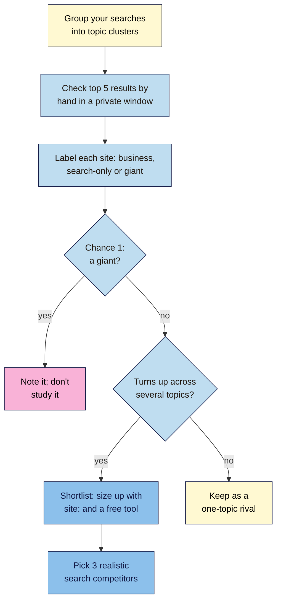

# M10.L01 — Who Are Your Real Search Competitors?
> After this lesson you can tell your search competitors from your business competitors for each topic you care about, rule out the giants you can't realistically beat, and choose three search competitors worth studying, using only free checks.

**Time:** ~14 min reading + ~35 min hands-on + ~10 min exercise · **Level:** L2 Practitioner · **Prereqs:** M01.L05, M03.L04 · **Remediate to:** M01.L05
**Verified against:** Google Search Central "site: search operator" (last updated 2025-12-10), the Search Central "Latest updates" log (the `related:` and `cache:` removals), "Spam policies for Google web search" (2026-08-28) and Google Trends Help "FAQ about Google Trends data"; Moz's free SEO tools page, all on 2026-11-09. Moz's blog on SERP-based competitors couldn't be opened on 2026-11-09 (the site blocked our tools), so its ideas are paraphrased here as *observed practice*, not quoted.

> ⚠️ **Freshness flag:** Google retired the `related:` operator (2023) and `cache:` (2024). Older tutorials still teach both. Free tool limits change often; recheck Moz's before relying on it.

## Learning objectives
1. **Distinguish** search competitors from business competitors, per topic cluster. *(O1)*
2. **Identify** 3 realistic search competitors from private-window results, ruling out giants with a low Chance score. *(O2)*
3. **Size up** each competitor with free checks (`site:` as a sample, a free competitive research tool), without treating estimates as facts. *(O3)*

## Why it matters
Ask Nila who her competitors are and she'll name two other Indian roasters, "BeanCraft" and "Monsoon Roast" *(illustrative)*. Ask Google, and you get a different answer. For `how to make cold brew`, the first page is food blogs, a recipe site and a YouTube video. For `buy coffee beans online india`, it's big marketplaces and a few roasters. For `coffee roastery near me`, it's a local pack of cafés.

If Nila studies only BeanCraft, she learns nothing about why a food blog beats her cold brew guide. That's the trap this module starts with: you can't learn from the sites that outrank you until you know who they are, topic by topic. You met the idea in Lesson 1.5. Now you'll do it properly, for every part of your site, and pick three competitors to study through Module 10.

## Core concept
**Plain version:** a **business competitor** sells what you sell. A **search competitor** ranks for the searches you want. They overlap only sometimes. Because each topic has its own results, you'll have different search competitors for your shop pages, your blog and your local searches. From all of them, pick the few you could realistically catch up with, not the giants.

**Analogy:** a bakery on a busy street. Its business rivals are other bakeries. But at breakfast time it competes with the café and the supermarket. Different moments, different rivals.

**Precise definitions:**
- **Search competitor:** "any site that ranks for the searches you want, which may be a blog, video or directory rather than a similar business" (course definition, Lesson 1.5; Google doesn't publish one).
- **Business competitor:** a company selling the same products or services to the same customers. It may or may not rank.
- **Search-only competitor:** a site that ranks for your searches but doesn't sell what you sell (a food blog, a forum, a news site).
- **Giant:** a site so strong across the board (a marketplace, a national publisher, Wikipedia) that, for a small site, Chance is 1 for most of the searches where it ranks (Lesson 3.4).
- **Topic cluster** (here): a group of your searches with the same intent and page type, such as "shop", "brew guides" or "local".

### What the sources say
| Source | What it says | What it means for you |
|---|---|---|
| Moz blog (2022) *(observed practice; paraphrased, page not readable on 2026-11-09)* | Search results often show different rivals from the ones a business expects. Moz's Ford example found content publishers, not other carmakers, among Ford's top search competitors. A mismatch is an opportunity. Tool data is national, not local | Your rivals in search may be publishers. Local results need a local check |
| Moz free SEO tools (2026-11-09) | "Enter any site in our free competitive research tool to see a list of your top SERP competitors." DA is "a Moz proprietary metric" | A free starting list; check it against real results; DA is Moz's estimate (Lesson 9.2) |
| Google, `site:` docs | "The list of URLs returned is not always exhaustive." "Bigger sites shouldn't expect to see all their URLs in the results." | `site:` is a sample, never a page count |
| Google, `site:` docs | `site:https://example.com/ lemon` "Shows which URLs on the site can show up for the term" | `site:rival.example cold brew` shows their pages on a topic |
| Google, spam policies | Machine-generated traffic "includes scraping results for rank-checking purposes or other types of automated access to Google Search conducted without express permission" | Check results by hand, not with scraping scripts |
| Google, updates log | `related:` removed "as it's no longer supported"; "The cache: search operator no longer works in Google Search." | Don't use them; Lesson 10.2 uses the Wayback Machine instead |
| Google Trends Help | "search terms with low volume appear as "0."" and Trends data is "one data point among others" | Small brands often can't be compared in Trends |

### Three questions for every result
For each site in the top results, ask:
1. **Does it sell what I sell?** Yes → a business competitor too. No → search-only.
2. **Could I realistically beat this page?** Use Lesson 3.4's Chance: 3 open, 2 possible, 1 locked.
3. **Does it rank across several of my topics?** Sites that turn up again and again are the ones worth studying.

A giant ranks everywhere but scores Chance 1. A realistic search competitor turns up across your topics **and** has pages you could beat. That's who you'll study.

## How it works

**In words:** group your searches into topic clusters. For each one, check the top five results by hand in a private window, and label every site as a business competitor, a search-only competitor or a giant. Note the giants but don't study them. Sites that turn up across several topics and have pages you could beat go on a shortlist. Size those up with `site:` and a free tool, then pick three.

> **Under the hood: why your results differ from your friend's.** Results vary by location, language and device, and local searches vary from street to street. A private window removes your signed-in history, but not your location. So record where and how you checked (city, device, date). Competitor tools use their own crawls of results, usually for a whole country, so they can miss local rivals entirely *(observed practice)*.

## Hands-on walkthrough
You'll check 5 searches, label every result, and choose 3 search competitors. Nila's results are illustrative.

**Before you start: which steps apply to you?**
- **Path A (your own site):** use searches from your **Keyword map** (Lesson 3.5) or Search Console.
- **Path B (practice site):** use searches from your **Keyword map**.
- **Path C (client site):** use the client's priority searches, and ask the client who *they* think their competitors are, so you can compare.

**Part A — 5 searches, top 5 results (15 min)**
1. Pick 5 searches across your topic clusters: 2 "shop" (or service), 2 "blog" (how-to or guide), 1 local (if you serve a place).
2. Add a tab called **Competitors** with columns: **Search**, **Cluster**, **Position (1–5)**, **Site**, **Page type**, **Label** (business / search-only / giant), **Chance (1–3)**, **Checked (city, device, date)**.
3. Search each one by hand in a private window. Record the top 5 organic results (skip ads; note any local pack separately).
   > 🖼️ **Image prompt:** A Google Sheets tab named "Competitors" (1280×720) with 25 rows: 5 searches × top 5 results, columns for site, page type, label and Chance, with "giant" rows shaded pink. Highlight the Label column with a 3px #F9B2D7 outline; blur any personal details.
   > **Alt text:** A competitor sheet listing the top five results for five searches, each labelled business, search-only or giant.
   **Expected:** 25 rows. Nila: the shop searches show marketplaces (giants) and two roasters; the blog searches show food blogs and a recipe site; the local search shows a pack of cafés.

**Part B — Find who recurs (10 min)**
1. Count how often each site appears across your 5 searches. Use a pivot table or `COUNTIF`.
2. Drop the giants (Chance 1 almost everywhere). Note them in a line: "Not studying: Amazon, Wikipedia, …".
3. Shortlist the sites that appear in 2+ searches, or that rank #1–3 for a search you care most about.
   **Expected:** a shortlist of 4–6 sites. Nila's: a food blog ("BrewAtHome" — 3 searches), a roaster ("BeanCraft" — 2), a recipe site (2), a coffee magazine (1, but #1 for her top guide) *(illustrative)*.

**Part C — Size them up, then choose 3 (10 min)**
1. For each shortlisted site, run `site:theirdomain.example` and `site:theirdomain.example cold brew` (your topic). Note **roughly** how many results, and which pages show for your topic.
2. Optional: enter your own domain in Moz's free competitive research tool and see which sites it lists. Compare it with your hand-made list. Note any site it finds that you missed, and any it lists that doesn't fit (national vs local).
3. Choose **3 search competitors**: at least one search-only competitor, ideally one business competitor, and none of the giants. For each, write one sentence: "We'll study X because …".
   **Expected:** three named competitors with a reason each, for example "BrewAtHome: ranks for 3 of our 5 searches with guides that are good but have no first-hand testing."

**Expected output:** a **Competitors** tab with 25 labelled results (with where and when you checked), a count of who recurs, a "not studying" line for giants, and 3 chosen search competitors, each with a reason.

## When to use / when not to
**Use this** at the start of any competitor work, when you add a new section to your site, and once or twice a year, because results change.

**Don't** copy a client's list of business rivals without checking the results. Don't study giants you can't catch. Don't scrape Google with scripts to save time.

**The trade-off:** checking by hand is slow and covers only a handful of searches, but it shows you exactly what searchers see. Tools cover thousands of searches quickly, but they're national, estimated and sometimes out of date. Start by hand; use tools to widen the list.

## Use AI for this
**Example prompt:**
> "Here are the top 5 results I recorded for 5 searches, with my labels: [paste table]. Count which sites appear most, flag any site I may have labelled wrongly (business vs search-only), and suggest which 3 are realistic to study for a small site. Use only my table; don't add sites or numbers."

**What AI does well here:** counting, grouping and spotting a mislabelled row.
**Where it gets it wrong:** it may invent competitors, traffic numbers or DA scores, or "remember" results from its training data that are out of date.
**How to check:** every site must appear in your own table, with a date.

## Common mistakes
- **Treating business rivals as search rivals.** For many searches, you're up against blogs and videos.
- **Picking giants.** You can't learn a realistic plan from Amazon.
- **One search only.** Different topics have different competitors.
- **Reading `site:` as a page count.** It's a sample.
- **Using `related:` or `cache:`.** Both are gone.
- **Ignoring location.** Local results differ from national tools.

## Troubleshooting
| Symptom | Likely cause | Fix |
|---|---|---|
| Every result is a giant | The search is too broad | Pick narrower searches from your Keyword map (Lesson 3.4) |
| A tool lists competitors you never see | It uses national or different data | Trust your hand checks; record city and device |
| Your results look different on your phone | Device and location differ | Record both; use the device most of your customers use |
| `site:` shows different counts each time | It's a sample | Note "roughly"; never compare counts precisely |
| Trends shows "0" for every brand | Low search volume | Normal for small brands; use other evidence |
| The client insists on a rival who doesn't rank | A business competitor only | Keep them in a "business only" line; study who ranks |

## Exercise
**Task:** complete your **Competitors** tab (Parts A–C). Then answer these. All details are illustrative.
1. Nila's top cold brew competitor is a food blog. Is it a business competitor, a search competitor, or both?
2. Amazon ranks #1 for 3 of Tomás's 5 searches. Should he study it?
3. `site:brewathome.example` shows "about 312 results". What can Nila conclude?
4. Kavya checks `yoga classes adyar` in Bengaluru, but her studio is in Chennai. What's wrong?
5. An old tutorial says to use `related:beancraft.example`. What should Amara do instead?
6. Name two reasons a site belongs on the shortlist.

**Expected outcome:** a complete tab, and these answers:
- **1** A search-only competitor: it ranks for her searches but doesn't sell coffee.
- **2** No. It's a giant (Chance 1). Note it, and study sites he could realistically beat.
- **3** Only that Google shows roughly that many in a sample: "The list of URLs returned is not always exhaustive."
- **4** Local results change with location. She should check from Chennai (or note the difference) and record where she checked.
- **5** `related:` no longer works. Check the results by hand, or use a free competitive research tool, and compare.
- **6** It recurs across several of your searches, and it has pages you could realistically beat (Chance 2–3).

**Stretch goal:** compare your hand-made list with the client's (or your own) "business competitors" list. Write two sentences on the biggest surprise.

## Key takeaways
- Business competitors sell what you sell; search competitors rank for what you want. They overlap only sometimes.
- Each topic cluster has its own search competitors.
- Drop the giants; study sites that recur and that you could beat.
- Check by hand in a private window, and record city, device and date. Don't scrape.
- `site:` is a sample. `related:` and `cache:` are gone.

## Teach it back
Explain to a friend in 3 sentences why a coffee roaster's biggest search competitor might be a food blog, and how they'd find their own.

## Glossary terms added
- Business competitor — added to `seo-101/glossary.md`
- Search-only competitor — added to `seo-101/glossary.md`
- *Already in the glossary:* Search competitor, Search operator, Google Trends

## Further reading
*All checked 2026-11-09.*
- Google Search Central — site: search operator: https://developers.google.com/search/docs/monitor-debug/search-operators/all-search-site
- Google Search Central — Latest updates (operator removals): https://developers.google.com/search/updates
- Google Search Central — Spam policies (machine-generated traffic): https://developers.google.com/search/docs/essentials/spam-policies
- Google Trends Help — FAQ about Google Trends data: https://support.google.com/trends/answer/4365533
- Moz — Free SEO tools (competitive research): https://moz.com/free-seo-tools
- Moz blog — When your SEO competitors don't match what you know (2022; couldn't be opened on 2026-11-09): https://moz.com/blog/competitors-dont-match

> ⚠️ **May change:** free tool limits and features; the operators Google supports; results by location and device.

## Refresher card
*Used by remediation when a learner fails a quiz twice on a later lesson that points back here.*
**Business competitor** = sells what you sell. **Search competitor** = ranks for your searches (often blogs, videos, directories). **Per topic cluster**, check the top 5 by hand in a private window; record city, device, date. **Label** business / search-only / giant. **Drop giants** (Chance 1). **Shortlist** sites that recur and are beatable; size up with `site:` (a sample: "not always exhaustive") and a free tool (national, estimated). **Pick 3.** No scraping Google. `related:` and `cache:` are retired.
