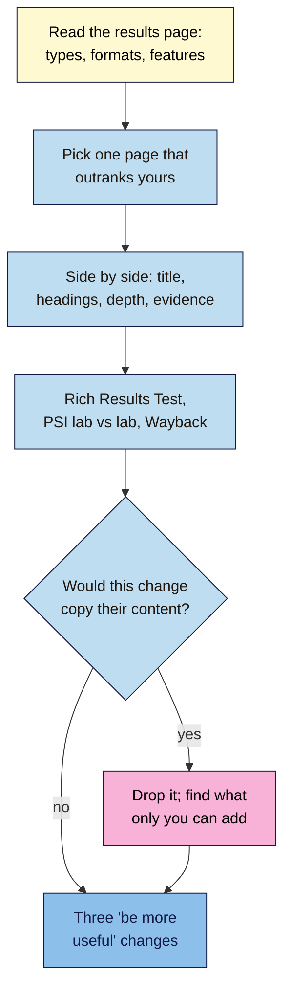

# M10.L02 — Reading the SERP and the Pages That Win
> After this lesson you can read a results page for what it rewards, take apart a competitor page that outranks you with free tools, and turn what you find into three "be more useful" changes, without copying a word.

**Time:** ~16 min reading + ~45 min hands-on + ~10 min exercise · **Level:** L2 Practitioner · **Prereqs:** M10.L01, M03.L01 · **Remediate to:** M03.L01
**Verified against:** Google Search Central "Spam policies for Google web search" (2026-08-28) and "Creating helpful, reliable, people-first content" (2026-10-05); PageSpeed Insights "About" (2024-10-21); Chrome "CrUX methodology" (2024-06-20); Search Console Help "Rich Results Test"; Internet Archive Help "Using the Wayback Machine"; Screaming Frog pricing and configuration guide; a Google spokesperson quoted by Search Engine Roundtable on the Wayback link (12 September 2024), all on 2026-11-09. No tool was run live for this lesson.

> ⚠️ **Freshness flag:** Google added Wayback Machine links to "About this page" in September 2024; check the link is still there before you rely on it. PageSpeed Insights and CrUX change their metrics from time to time (INP replaced FID in 2024). Module 12 covers speed and structured data in depth.

## Learning objectives
1. **Record** page types, formats and SERP features for a query, and what they say about intent. *(O1)*
2. **Compare** a winning page with yours: title, headings, depth, first-hand evidence, schema (Rich Results Test), speed (PageSpeed Insights lab vs field) and history (Wayback Machine). *(O2)*
3. **Follow** ethical limits: no copying, respect robots.txt, keep any crawl small. *(O3)*

## Why it matters
Nila's French press guide sits at #9. "BrewAtHome", the food blog from her **Competitors** tab, is #2 *(illustrative)*. Her first idea: "I'll take their guide, reword it, and add my products." That's the most common mistake in competitor analysis, and Google's spam policy names it.

The useful question isn't "what did they write?" but "**why does this page fit the search better than mine, and what could only I add?**" Maybe their guide has step-by-step photos and a ratio table, and hers is three paragraphs. Maybe theirs was rewritten last year and hers is from 2022. Those are things she can learn from, and beat with her own roastery's tests. This lesson gives you a repeatable **page teardown** to find them.

## Core concept
**Plain version:** first read the whole results page: what kinds of pages win, in what format, with what features around them? That tells you what Google thinks the searcher wants (Lesson 3.1). Then take one winning page apart and set it beside yours, using free tools that show real data: your own eyes, the page source, the Rich Results Test, PageSpeed Insights and the Wayback Machine. Finish with changes that make your page **more useful**, not more similar.

**Analogy:** a chef eating at a rival's restaurant. They notice the portion size, the menu layout and the service, then go home and cook their own dish better. They don't steal the recipe card.

**Precise definitions:**
- **Page teardown:** a side-by-side check of a competitor page and yours, element by element *(course term)*.
- **Lab data:** a speed test run once, in a simulated setup (Lighthouse in PageSpeed Insights). Useful for finding problems.
- **Field data:** real users' experience over "the previous 28-day collection period", from the Chrome UX Report (CrUX). Only shown when a page or site has enough visitors.
- **Wayback Machine:** the Internet Archive's free archive of past snapshots of web pages.
- **Scraping (Google's sense):** "taking content from other sites, often through automated means, and hosting it with the purpose of manipulating search rankings".

### Step 1: read the results page
| Look at | Record | What it tells you |
|---|---|---|
| **Page types** in the top 5 | Guide, product, category, video, forum, tool | Which type to make (Lesson 3.1) |
| **Format** | Steps, list, table, comparison, calculator | How to structure it |
| **Freshness** | Dates shown on results | Whether recent updates seem to matter for this search |
| **Features** | Featured snippet, People also ask, video strip, images, local pack, AI Overview | Extra places to appear, or reasons organic clicks are lower (Lesson 1.5) |
| **Who** | From your **Competitors** tab | Search-only, business, giant |

### Step 2: the teardown checklist
| Element | How to check (free) | Real or estimate? |
|---|---|---|
| Title, description, `<h1>`, headings | View source (Ctrl+U / Cmd+Option+U) or the page itself | Real |
| Depth and format | Read it: steps, tables, photos, video, FAQs | Real (your judgement) |
| First-hand evidence | Own photos, tests, numbers, named author with experience | Real (your judgement) |
| Structured data | **Rich Results Test**: "shows which rich result types were found on the page" | Real, if Google can crawl it |
| Speed | **PageSpeed Insights**: lab always; field only with enough CrUX data | Lab = a test; field = real users |
| Internal links to it | `site:theirdomain.example "french press"`, plus their menus | A sample |
| History | **Wayback Machine** snapshots from a year ago | Real, if archived |

### Three rules for fair comparisons
1. **Lab vs lab, field vs field.** If a page lacks data, PSI "will fall back to origin-level granularity", and sometimes "will be unable to show any real-user experience data". Small sites often have none: CrUX includes only pages and origins that meet a popularity threshold, and "An exact number is not disclosed". Never compare your lab score with their field data.
2. **The Rich Results Test can't see everything.** If a page is blocked by robots.txt or `noindex`, "the page cannot be tested with this tool".
3. **The Wayback Machine has gaps.** Pages may be missing if they were "blocked by robots.txt", password-protected, or excluded at the owner's request.

### Learn, don't copy
Google's spam policy lists, as scraping: "Copying content from other sites, modify it only slightly (for example, by substituting synonyms or using automated techniques ), and republish it". Its scaled content abuse examples include "Stitching or combining content from different web pages without adding value". And the helpful content guidance asks: "If the content draws on other sources, does it avoid simply copying or rewriting those sources, and instead provide substantial additional value and originality?" Crediting them doesn't fix it: "Attribution or giving credit to other sources doesn't replace the need for original effort."

| ✅ Learn from | ❌ Don't take |
|---|---|
| "Their guide has a ratio table and step photos" | Their table, photos or wording, paraphrased or not |
| "They answer 'how coarse should the grind be?'" | Their answer, reworded |
| "Their page is laid out as numbered steps" | Their page, run through an AI rewriter |
| "Their title names the time it takes" | Their exact title |

Copying text, photos or product descriptions can also break copyright law. This course isn't legal advice: if you think someone copied you, or you're unsure about reuse, get proper advice.

### Crawling a competitor: keep it light
Screaming Frog's free version crawls up to 500 URLs. By default it "will obey robots.txt protocol and is set to 'Respect robots.txt'". Ignoring robots.txt is an option "which is down to the responsibility of the user": on a site you don't own, **don't**. The free version also can't slow its requests down, so crawl only a small list or one section, check the site's terms first, or skip the crawl. For one teardown, you rarely need it.

## How it works

**In words:** read the whole results page first: the page types, formats and features. Pick one page that outranks yours and put it beside yours: title, headings, depth and first-hand evidence. Then check its structured data, its speed (comparing lab with lab) and how it has changed over time. For each idea, ask whether it would copy their content. If it would, drop it and find what only you can add. End with three changes that make your page more useful.

> **Under the hood: why "same as theirs" rarely wins.** If your page says the same things as the pages already ranking, it adds nothing new for Google to show. Google asks whether content provides "substantial value when compared to other pages in search results". So the teardown's job is to find the **gaps** in the winning page (no testing, no local detail, old information) as much as its strengths. Your edge is what they can't easily copy back: your own tests, photos, data and experience.

## Hands-on walkthrough
You'll read one results page and tear down one competitor page against yours. Nila's details are illustrative.

**Before you start: which steps apply to you?**
- **Path A (your own site):** use a search where a competitor from your **Competitors** tab outranks a page you have.
- **Path B (practice site):** pick a search from your Keyword map and a page you've drafted (or plan to).
- **Path C (client site):** as Path A, using the client's page; share the teardown with them before changing anything.

**Part A — Read the results page (10 min)**
1. Search your query in a private window. Add a tab called **Page teardown**.
2. Record the top 5: page type, format, date shown (if any), and the features on the page.
   **Expected:** Nila's `how to use a french press`: 4 step-by-step guides and 1 video; a video strip, People also ask, and no shop pages. The format is clear: numbered steps with photos.

**Part B — The side-by-side teardown (25 min)**
1. Pick the result that outranks you and fits your type best. Make two columns: **Theirs** and **Mine**.
2. Fill in: title, `<h1>`, main headings, word count (roughly), format, photos/video, first-hand evidence, author, date updated.
3. Run both URLs through the **Rich Results Test**. Record the rich result types found (or "none" / "can't test").
4. Run both through **PageSpeed Insights**. Record lab Performance and LCP for each, and whether field data exists ("no field data" is a valid answer). Compare lab with lab.
   > 🖼️ **Image prompt:** A PageSpeed Insights report (1280×800) for a small site where the real-user (field) data section says there's not enough data, and the lab section below shows scores. Highlight the no-data message with a 3px #F9B2D7 outline; blur any personal details.
   > **Alt text:** A PageSpeed Insights report with no real-user data available and lab scores shown below, with the no-data message highlighted.
5. Open their URL in the **Wayback Machine** (web.archive.org). Look at a snapshot from about a year ago. Note what changed (new photos, a table, a new date).
   **Expected:** a filled two-column table. Nila finds: theirs has 9 numbered steps with photos, a ratio table, HowTo-style structure but no rich results, lab Performance 71 vs her 64, no field data for either, and a Wayback snapshot showing they added the ratio table this year.

**Part C — Three changes, none copied (10 min)**
1. List what their page does better, and what it's **missing** that you could add from your own experience.
2. Write three changes for your page. For each, tick: **doesn't copy their words, photos or structure line by line**.
   **Expected:** Nila's: (1) rebuild the guide as numbered steps with her own photos; (2) add a grind-and-ratio table from her roastery's tests, with the date she tested; (3) add a short "what we got wrong" section from customer questions. None of these copies BrewAtHome.

**Expected output:** a **Page teardown** tab with your results-page notes, a two-column teardown (including Rich Results Test, lab-vs-lab speed and a Wayback note), and three "be more useful" changes ticked as not copied.

## When to use / when not to
**Do a teardown** when a specific competitor page outranks yours for a search you care about, and before you rewrite an important page.

**Don't** treat the winning page as a template to copy, compare your lab score with their field data, or crawl a whole competitor site with robots.txt ignored.

**The trade-off:** a teardown of one page takes about half an hour and gives specific, actionable changes. A full-site crawl gives broad data, but takes longer, puts load on their server and is rarely needed for a small site.

## Use AI for this
**Example prompt:**
> "Here's my two-column teardown of a competitor page and mine: [paste table, not their content]. Suggest three changes to my page that would make it more useful to searchers, based on my own experience: [paste notes on your tests, photos, customer questions]. Don't suggest copying or rewording anything from their page."

**What AI does well here:** spotting patterns in your table and suggesting structures.
**Where it gets it wrong:** asked to "rewrite this competitor page", it produces exactly the synonym-swapped copy the spam policy describes. It can't see field data or rich results.
**How to check:** run your own tools, and tick "not copied" for each change.

## Common mistakes
- **Paraphrasing a competitor's page** (or running it through AI). That's scraping.
- **Comparing lab with field data.**
- **Assuming no field data means a slow site.** It often means too few visitors.
- **Ignoring the format.** If every winner is numbered steps, a wall of text won't fit.
- **Crawling a competitor with robots.txt ignored.**
- **Studying one page and ignoring the results page.** The features and formats around it matter.

## Troubleshooting
| Symptom | Likely cause | Fix |
|---|---|---|
| PSI shows no real-user data for either page | Not enough visitors in CrUX | Compare lab with lab; say so |
| The Rich Results Test can't test their page | Blocked by robots.txt or `noindex`, or not public | Note "can't test"; check view-source for JSON-LD |
| The Wayback Machine has no snapshots | Not archived, blocked or excluded | Note it; skip history |
| Every winner is a video | Video intent | Consider a video, or accept a lower Chance |
| Your changes all look like their page | You're copying structure, not adding value | Start from what only you know |
| The site blocks your crawler | Robots.txt or server limits | Stop; one teardown doesn't need a crawl |

## Exercise
**Task:** complete your **Page teardown** tab (Parts A–C). Then answer these. All details are illustrative.
1. Nila's lab score is 64. BrewAtHome's PSI shows field data marked "good". What's wrong with comparing them?
2. Tomás plans to put a rival's tap-repair guide through an AI rewriter. What does Google's spam policy say?
3. The Rich Results Test says a competitor's page "cannot be tested". Give one likely reason.
4. Kavya notices every top result for her search is a numbered list with photos. What should she take from that?
5. Amara wants to crawl a competitor's 4,000-page site with the free crawler, ignoring robots.txt. What would you advise?
6. Name two things the Wayback Machine can show you about a competitor page.

**Expected outcome:** a complete tab, and these answers:
- **1** It's lab vs field. Compare lab with lab, or field with field when both exist.
- **2** "Copying content from other sites, modify it only slightly (for example, by substituting synonyms or using automated techniques ), and republish it" is scraping.
- **3** It's blocked by robots.txt or `noindex`, or not publicly accessible.
- **4** The format the results reward: numbered steps with her own photos (not their photos or wording).
- **5** Don't ignore robots.txt ("down to the responsibility of the user"); the free version stops at 500 URLs and can't slow down. Crawl a small section, check their terms, or skip it.
- **6** For example: what the page looked like a year ago, and what they've added or changed since (a table, photos, a new date).

**Stretch goal:** repeat Part B for a second competitor on the same search. Do both winning pages share something yours lacks?

## Key takeaways
- Read the whole results page first: page types, formats, features.
- Tear down one winning page beside yours: title, headings, depth, first-hand evidence, rich results, speed, history.
- Compare lab with lab. No field data often just means few visitors.
- Learn from patterns; never copy or paraphrase. Credit doesn't make copying OK.
- Respect robots.txt and keep crawls small, or skip them.

## Teach it back
Explain to a friend in 3 sentences how to learn from a competitor's page without copying it.

## Glossary terms added
- Page teardown — added to `seo-101/glossary.md`
- Lab data — added to `seo-101/glossary.md`
- Field data — added to `seo-101/glossary.md`
- Wayback Machine — added to `seo-101/glossary.md`
- *Already in the glossary:* Structured data, Core Web Vitals, SERP feature

## Further reading
*All checked 2026-11-09.*
- Google Search Central — Spam policies (scraping, scaled content abuse): https://developers.google.com/search/docs/essentials/spam-policies
- Google Search Central — Creating helpful, reliable, people-first content: https://developers.google.com/search/docs/fundamentals/creating-helpful-content
- PageSpeed Insights — About: https://developers.google.com/speed/docs/insights/v5/about
- Chrome for Developers — CrUX methodology: https://developer.chrome.com/docs/crux/methodology
- Search Console Help — Rich Results Test: https://support.google.com/webmasters/answer/7445569
- Internet Archive Help — Using the Wayback Machine: https://help.archive.org/help/using-the-wayback-machine/
- Screaming Frog — SEO Spider configuration (robots.txt): https://www.screamingfrog.co.uk/seo-spider/user-guide/configuration/

> ⚠️ **May change:** PSI and CrUX metrics; the Wayback link in "About this page"; free crawler limits. Not legal advice on copyright.

## Refresher card
*Used by remediation when a learner fails a quiz twice on a later lesson that points back here.*
**Read the SERP:** page types, format, dates, features, who. **Teardown** (theirs vs mine): title, `<h1>`, headings, depth, format, first-hand evidence, author, date; **Rich Results Test** (can't test if blocked/`noindex`); **PSI** lab vs lab (field only with enough CrUX data; threshold undisclosed); **Wayback** (gaps possible). **Output:** three "be more useful" changes. **Never copy:** synonym-swapping is scraping; "Attribution … doesn't replace the need for original effort." **Crawls:** respect robots.txt; free tool 500 URLs; keep it small.
