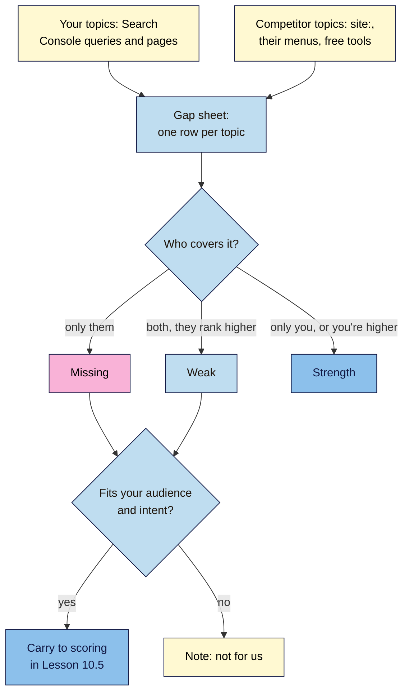

# M10.L03 — Keyword and Content Gaps with Free Tools
> After this lesson you can list the topics your three search competitors cover, compare them with your own real search data to find missing, weak and strong topics, and treat every traffic number for someone else's site as the estimate it is.

**Time:** ~16 min reading + ~45 min hands-on + ~10 min exercise · **Level:** L2 Practitioner · **Prereqs:** M10.L02, M03.L05 · **Remediate to:** M03.L05
**Verified against:** Ahrefs Help "What is organic traffic in Ahrefs" and "Why don't the organic traffic numbers … match" (both dated 3 September 2026), the Ahrefs blog study on traffic estimate accuracy (May 2022) and its content gap guide (November 2023), Ahrefs' free Keyword Generator page; Semrush KB "Semrush Data & Metrics" and "Subscriptions", and its blog on free accounts (December 2025); Google Ads Help "Use Keyword Planner"; Google's `site:` docs, all on 2026-11-09. No tool was run live for this lesson.

> ⚠️ **Freshness flag:** free limits change often. Semrush's help page says "10 reports per day across all vital tools", while its December 2025 blog lists "10 queries/day" per tool; plan for the stricter reading. Ahrefs' accuracy study is from 2022, covers only US traffic, and was run by Ahrefs itself.

## Learning objectives
1. **Build** a topic list per competitor from `site:` searches and free keyword tools, budgeting limited queries. *(O1)*
2. **Compare** it with your own Search Console queries to find missing, weak and strong topics. *(O2)*
3. **Explain** why third-party traffic estimates are estimates, and check one against your own real clicks. *(O3)*

## Why it matters
Nila's intern comes back excited: "BrewAtHome gets 48,213 visits a month, and ranks for 2,140 keywords!" *(illustrative)*. Both numbers came from a free tool, and both are estimates. Neither tells Nila what to write next.

What does help is a simpler question: **which topics do my search competitors cover that I don't, or cover better?** BrewAtHome has guides on AeroPress, moka pot and decaf; Nila doesn't. Both have a cold brew guide, but theirs ranks higher. Only Nila has guides on South Indian filter coffee. Those three groups (missing, weak, strong) are the raw material for her next three months of content, and finding them needs mostly free, real data.

## Core concept
**Plain version:** list the topics each competitor covers, list the topics you cover (from your own Search Console), and compare. Topics only they cover are **gaps**. Topics you both cover, where they rank higher, are **weak** spots. Topics only you cover are **strengths**. Use tools to widen the list, but treat their numbers as rough estimates, and never as facts.

**Analogy:** comparing your shop's shelves with the shop down the road. You can see what they stock and you don't. You can't see their till receipts: any "sales figure" for them is somebody's guess.

**Precise definitions:**
- **Keyword gap:** searches a competitor ranks for that you don't *(observed practice)*.
- **Content gap:** "the process of finding topics your competitors have covered but you haven't" *(Ahrefs blog)*. We'll use it for the topics themselves.
- **Weak topic:** a topic you both cover, where they rank higher *(course term)*.
- **Strength:** a topic only you cover, or where you rank higher *(course term)*.
- **Traffic estimate:** a tool's guess at another site's search visits. Ahrefs: "an estimation of how many clicks from google your target website, subfolder or URL gets each month".

### Real data vs estimates
| Data | Source | Real or estimate? |
|---|---|---|
| **Your** queries, clicks, pages | Search Console (Lesson 8.1) | **Real** |
| Which competitor pages exist on a topic | `site:rival.example topic` | **Real, but a sample** |
| Keyword ideas for a competitor's page | Keyword Planner "Start with a website" (needs billing details); Ahrefs Keyword Generator | Google's / Ahrefs' **ideas**, not the rival's rankings |
| A competitor's ranking keywords | Semrush free, Moz free, Ahrefs free checkers | **Estimate** (from the tool's own crawls) |
| A competitor's traffic | Ahrefs Traffic Checker, Semrush, Similarweb | **Estimate** |

### How traffic estimates are made, and how wrong they get
Ahrefs explains its own: it finds the keywords a site ranks for, then estimates traffic "based on its ranking position, monthly search volume, and our estimated CTR for that position", and adds it up. Every step is a guess, and "Ahrefs doesn't track ALL the keywords that a website is ranking for … We track the most popular ones."

| Source | What it says |
|---|---|
| Ahrefs Help | "treat the organic traffic estimations in Ahrefs as precisely that: estimations"; "can't be treated as the actual search traffic data of a website" |
| Ahrefs Help | The keywords and top pages a competitor ranks for are "much more accurate than our "big picture" traffic estimation" |
| Ahrefs Help | Estimates "work incredibly well for comparison" *(the vendor's own claim)* |
| Ahrefs study (2022, US only, its own tool) | Median error "49.52%": "most of the time you can expect Ahrefs to misreport a website's U.S. traffic by up to half of its value". "For some websites, we are off by less than 5%. For some others, we can be off by more than 1,000%." |
| Semrush KB | Its panel-based method produces "a realistic and accurate estimation"; data updates "range from once a day to once a month", and "smaller databases can take a little longer" |

**What to do with that:** use estimates to say "bigger or smaller than us", and never as "they get 48,213 visits". Write numbers like this: *"Ahrefs estimates roughly 50k organic visits a month (estimate, checked 2026-11-09)."* The best test: compare a tool's estimate **for your own site** with your real Search Console clicks. That shows you how far off it is for a site your size.

### Budget your free queries
| Tool | Free limit (checked 2026-11-09) | Plan |
|---|---|---|
| Semrush Free | "10 reports per day across all vital tools" (help page) | 3 competitors + yours = 4 reports, keep 6 spare |
| Moz Link Explorer | 10 queries per month (Lesson 10.4 uses these) | Save them for backlinks |
| Ahrefs Keyword Generator | No number published | Use for topic ideas; don't rely on it as a count |
| Keyword Planner | Free, but needs billing details | Optional (Lesson 3.3) |
| `site:` and Search Console | No query limit for normal use | Your main tools |

Write down **which domain each query is for before you start**, so you don't burn your daily quota on typos.

## How it works

**In words:** list your own topics from Search Console, and each competitor's topics from `site:` searches, their menus and free tools. Put them all in one sheet, one row per topic. Mark each topic as missing (only they cover it), weak (you both do, and they rank higher) or a strength (only you do, or you rank higher). Check each missing or weak topic fits your audience and its intent. Carry those that fit to scoring in Lesson 10.5; mark the rest "not for us".

> **Under the hood: why estimates are worst for small sites.** An estimate multiplies a tool's guessed volume by a guessed click rate for a guessed position, over the keywords the tool happens to track. For a big site, many errors average out. For a small site with a few dozen ranking searches, one wrong volume or a missing local keyword can swing the total wildly. That's why Ahrefs' own study found errors from under 5% to over 1,000%, and why your own Search Console beats any tool for your site.

## Hands-on walkthrough
You'll build a Gap sheet for your three competitors and run one estimate reality check. Nila's details are illustrative.

**Before you start: which steps apply to you?**
- **Path A (your own site):** use your Search Console data and do every part.
- **Path B (practice site):** use your **Keyword map** (Lesson 3.5) as "your topics", and skip Part C's Search Console comparison (use any small site you know has published traffic, or skip it).
- **Path C (client site):** use the client's Search Console with their access; label every competitor number as an estimate in anything you send them.

**Part A — Your topics (10 min)**
1. In Search Console → **Performance**, set the last 3 months, open **Pages**, and export (Lesson 8.1).
2. Group your pages into topics (one row each). Use your **Keyword map** to help.
3. Add a tab called **Gap sheet** with columns: **Topic** · **You (page + clicks)** · **Comp A** · **Comp B** · **Comp C** · **Gap type** (missing / weak / strength) · **Intent** · **Fits us?** · **Evidence** · **Source + date**.
   **Expected:** 10–20 topic rows. Nila's include cold brew, French press, filter coffee, single-origin beans, gift boxes.

**Part B — Their topics (20 min)**
1. For each of your 3 competitors, look at their menus and blog categories, then run `site:` searches for your main topics: `site:brewathome.example aeropress`, `… moka pot`, `… decaf`. Record which pages exist, and **roughly**.
2. Optional, within limits: one Semrush Free report per competitor (Domain Overview or Organic Research) to see the top keywords and pages it thinks they rank for. Note the date and "estimate".
3. Optional: enter a competitor's best page into the Ahrefs Keyword Generator or Keyword Planner "Start with a website" for related topic ideas.
4. Add every new topic as a row, and fill in which competitors cover it.
   > 🖼️ **Image prompt:** A Google Sheets tab named "Gap sheet" (1280×720) with about 15 topic rows, columns for You, Comp A, Comp B, Comp C and Gap type, with "missing" cells shaded pink, "weak" sky blue and "strength" blue. Highlight the Gap type column with a 3px #F9B2D7 outline; blur any personal details.
   > **Alt text:** A gap sheet comparing one site's topics with three competitors, each topic labelled missing, weak or strength.
   **Expected:** a fuller sheet. Nila's new rows: AeroPress, moka pot, decaf, grinder guides, coffee for beginners.

**Part C — Mark the gaps, and an estimate reality check (15 min)**
1. Fill **Gap type** for every row. For "weak" rows, check by hand who ranks higher (private window, Lesson 10.1).
2. Fill **Fits us?**: does the topic fit your audience, and can you serve its intent (Lesson 3.1)? Nila sells coffee, not machines: "espresso machine reviews" → No.
3. **Estimate reality check (Path A/C):** enter your own domain in a free traffic checker (Ahrefs Traffic Checker or Semrush). Compare its monthly estimate with your Search Console clicks for the same month. Write the difference as a percentage.
   **Expected:** a complete Gap sheet with 5–10 "missing" or "weak" topics marked **Fits us: Yes**, and one line like: *"Ahrefs estimated 1,200 visits for us; Search Console showed 2,950 clicks (−59%). So I'll treat competitor estimates as rough."*

**Expected output:** a **Gap sheet** with your topics and your competitors' topics, each marked missing / weak / strength with evidence and a dated source, a "fits us" decision for each, and an estimate reality check for your own site.

## When to use / when not to
**Use a gap analysis** when planning the next few months of content, or when a competitor seems to be growing fast.

**Don't** fill every gap. A topic that doesn't fit your audience or business is a distraction, however much traffic a tool says it gets. And don't report estimates as facts.

**The trade-off:** free tools and `site:` give an incomplete picture; paid gap tools give a fuller, but still estimated, one. For a small site, a hand-built sheet of 15–30 topics is usually enough to plan a quarter.

## Use AI for this
**Example prompt:**
> "Here's my Gap sheet: [paste]. Group the 'missing' and 'weak' topics into themes, flag any that don't fit a small Indian coffee roaster selling beans online, and suggest which page type each would need. Use only my sheet; don't add traffic or volume numbers."

**What AI does well here:** grouping topics into themes and spotting ones that don't fit.
**Where it gets it wrong:** it invents competitor traffic, keyword counts or rankings, and states them confidently.
**How to check:** every number in your sheet needs a tool name and a date; anything without one gets deleted.

## Common mistakes
- **Reporting estimates as facts** ("they get 48,213 visits").
- **Filling every gap,** including topics that don't fit.
- **Comparing tools' numbers with each other** as if they measured the same thing.
- **Burning the daily quota** on unplanned queries.
- **Ignoring strengths.** Topics only you cover are worth defending and building on.
- **Skipping the hand check on "weak" topics.** Tools may have old positions.

## Troubleshooting
| Symptom | Likely cause | Fix |
|---|---|---|
| The tool shows "0" or no data for a competitor | Too small for the tool's database | Use `site:` and their menus instead |
| Two tools give very different traffic | Different data and methods | Use one tool, for "bigger or smaller" only |
| The estimate for your site is far off | Normal for small sites | Record the gap; apply the same caution to competitors |
| "Daily limit reached" | Free quota used | Plan queries; try tomorrow |
| Keyword Planner asks for billing details | Account setup | Optional; use the Ahrefs Keyword Generator instead (Lesson 3.3) |
| A "missing" topic gets lots of tool traffic but doesn't fit | Wrong audience | Mark "Fits us: No"; move on |

## Exercise
**Task:** complete your **Gap sheet** (Parts A–C). Then answer these. All details are illustrative.
1. Nila covers cold brew, and so does BrewAtHome, which ranks higher. What gap type is it?
2. The intern writes "BrewAtHome gets 48,213 visits a month (Ahrefs)". Rewrite it honestly.
3. A tool says "espresso machine reviews" drives lots of traffic for a competitor. Should Nila write it?
4. Tomás's Ahrefs estimate is 800 visits; his Search Console shows 2,000 clicks. What does that tell him?
5. Kavya has 10 Semrush Free reports today and 3 competitors. How should she plan?
6. What does Ahrefs say is more accurate than its big-picture traffic estimate?

**Expected outcome:** a complete sheet, and these answers:
- **1** Weak: you both cover it, and they rank higher.
- **2** "Ahrefs estimates roughly 50k organic visits a month (estimate, checked 2026-11-09)."
- **3** Probably not. It doesn't fit what she sells; mark "Fits us: No".
- **4** The estimate is about 60% low for his site, so competitor estimates of a similar size are rough at best.
- **5** List the domains first: one report each for 3 competitors and her own site (4), keeping the rest for follow-ups. The limit may be shared "across all vital tools".
- **6** "the actual keywords that your competitor is ranking for and the pages that bring them the most traffic from search".

**Stretch goal:** for your top 3 "missing" topics, look at the results page for each (Lesson 10.2) and note the page type you'd need.

## Key takeaways
- Gaps come in three kinds: missing, weak and strengths.
- Your Search Console data is real; every number for a competitor is an estimate or a sample.
- Ahrefs' own study: a typical estimate is off by about half, and some by over 10×.
- Write estimates with the tool name, "estimate" and the date.
- Plan your free queries, and only keep gaps that fit your audience and intent.

## Teach it back
Explain to a friend in 3 sentences how to find content gaps with free tools, and why "they get 48,213 visits a month" shouldn't go in a report.

## Glossary terms added
- Keyword gap — added to `seo-101/glossary.md`
- Content gap — added to `seo-101/glossary.md`
- Traffic estimate — added to `seo-101/glossary.md`
- *Already in the glossary:* Keyword map, Search intent

## Further reading
*All checked 2026-11-09.*
- Ahrefs Help — What is organic traffic in Ahrefs and how do we calculate it?: https://help.ahrefs.com/en/articles/1863206-what-is-organic-traffic-in-ahrefs-and-how-do-we-calculate-it
- Ahrefs Help — Why don't Ahrefs' traffic numbers match GA or GSC?: https://help.ahrefs.com/en/articles/431381-why-don-t-the-organic-traffic-numbers-reported-by-ahrefs-match-those-i-see-in-google-analytics-or-gsc
- Ahrefs blog — How accurate are website traffic estimators? (2022, vendor study): https://ahrefs.com/blog/traffic-estimations-accuracy/
- Ahrefs blog — Content gap analysis (observed practice): https://ahrefs.com/blog/content-gap-analysis/
- Semrush KB — Semrush Data & Metrics: https://www.semrush.com/kb/997-semrush-data
- Semrush KB — Subscriptions (free plan limit): https://www.semrush.com/kb/1011-subscriptions
- Google Ads Help — Use Keyword Planner: https://support.google.com/google-ads/answer/7337243

> ⚠️ **May change:** free tool limits; tool methods and databases; Keyword Planner access rules.

## Refresher card
*Used by remediation when a learner fails a quiz twice on a later lesson that points back here.*
**Gap types:** missing (only them) · weak (both; they rank higher) · strength (only you, or you're higher). **Your data** (Search Console) = real. **Theirs** = `site:` (sample), keyword ideas (not their rankings), tool rankings and traffic (estimates). Ahrefs: estimates "can't be treated as the actual search traffic data"; its own 2022 study: median error 49.52%, some over 1,000%. Write "Tool estimates ~X (estimate, date)". **Reality check:** a tool's estimate for your site vs your real clicks. **Budget** free queries (Semrush: "10 reports per day across all vital tools"). Keep only gaps that **fit** your audience and intent.
