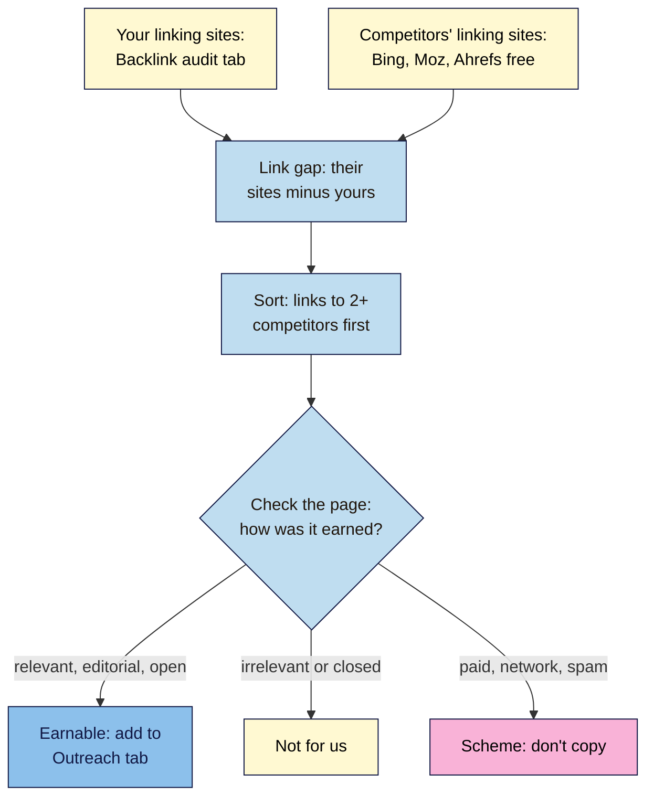

# M10.L04 — The Backlink Gap
> After this lesson you can find sites that link to your search competitors but not to you using free tools, sort them into links you could honestly earn, links that aren't for you, and schemes to avoid, and add the best ones to your outreach plan.

**Time:** ~14 min reading + ~35 min hands-on + ~10 min exercise · **Level:** L2 Practitioner · **Prereqs:** M10.L03, M09.L03 · **Remediate to:** M09.L03
**Verified against:** Moz "Link Explorer" page, Ahrefs "Backlink Checker" and "Ahrefs Free" pages, the Bing Webmaster blog post announcing Backlinks (2020), and Google's "Spam policies for Google web search" (2026-08-28), all on 2026-11-09. No tool was run live for this lesson; free limits come from each vendor's public page.

> ⚠️ **Freshness flag:** Moz's free Link Explorer limit ("10 free queries per month") and Ahrefs' free checker can change without notice; Ahrefs doesn't publish its free checker's cap. Bing's Backlinks tool is described in a 2020 announcement, so check the menu.

## Learning objectives
1. **Find** sites linking to competitors but not to you, with free tools (Bing Backlinks, Moz Link Explorer within its monthly limit, Ahrefs' free checker). *(O1)*
2. **Judge** which of those links you could earn honestly (relevant, editorial, open to you) and which you can't or shouldn't. *(O2)*
3. **Explain** why link counts differ between tools and what a gap can't tell you. *(O3)*

## Why it matters
In Lesson 9.4, Nila listed 10 outreach targets from her own head. Useful, but limited: she only knew the sites she already knew. Her search competitors have been earning links for years. Somewhere in their backlinks are a coffee association's member list, a "best Indian roasters" roundup by a food magazine, and a Bengaluru events page. Nila could be on all three, and has never heard of them.

That's a **backlink gap**: sites that link to your competitors but not to you. It's one of the most practical things competitor analysis gives you, as long as you remember Module 9: you're looking for links you could **earn**, not a shopping list to **buy**.

## Core concept
**Plain version:** collect the sites linking to each of your three search competitors, take away the sites already linking to you, and look closely at what's left, especially sites linking to **two or more** competitors. For each, ask: is it relevant, did they earn it, and could I earn it too? Feed the best into your outreach plan.

**Analogy:** a new café owner reading which local guides and newspapers have reviewed the other cafés on the street. They don't bribe the reviewers. They invite them to visit.

**Precise definitions:**
- **Backlink gap:** sites linking to one or more competitors but not to you *(industry term)*.
- **Link intersect:** sites linking to two or more of your competitors. They're often the most relevant to your niche *(observed practice)*.
- **Earnable link:** a link from a real, relevant site that gives links on merit or through a relationship you could have (a member list, a resource page, a roundup, local press) *(course term)*.

### Free tools for the competitor side
| Tool | What's free | Notes |
|---|---|---|
| **Bing Webmaster Tools → Backlinks** | "Backlinks lists backlinks for any site, including similar sites" (Bing, 2020) | Uses Bing's crawl; you need your own verified site first (Lesson 1.8) |
| **Moz Link Explorer** | "Get 10 free queries per month." Includes "Competitor backlinks you're missing out on" | Needs a free account ("Verify your email"); **budget**: 3 competitors + you = 4 |
| **Ahrefs Backlink Checker** | "Try the free version of Ahrefs' Backlink Checker"; shows referring domains, backlinks, DR | Free cap not published; shows only part of the list |
| **Ahrefs Free** | Full backlink data for **your** verified site only; "1 K backlinks & keywords visible at once" | Your side of the comparison, with your **Backlink audit** tab (Lesson 9.3) |

### Why counts differ between tools
Each tool uses its **own crawler and its own index**. They find different links, at different times, and drop dead ones at different speeds. So Moz might say a competitor has 1,200 backlinks and Ahrefs 3,400, and neither is "broken". Lesson 9.3's rule applies: **compare linking sites, not totals**, and compare competitors **within one tool**.

### What a backlink gap can't tell you
- **Which links Google counts.** Some of a competitor's links may be neutralised as spam (Lesson 9.5). A link in a tool isn't proof it helps.
- **Whether links explain their rankings.** Content, intent and other factors matter too (Lesson 10.2).
- **How they got the link.** A link from a blog may be a genuine review or a paid post. Look at the page.
- **New links.** Tools take time to find them.

### Sorting the gap
| Label | Signs | Action |
|---|---|---|
| ✅ **Earnable** | Relevant; editorial or relationship-based; open to you (resource page, roundup, association, local press, supplier or stockist list) | Add to your **Outreach** tab (Lesson 9.4) |
| ➖ **Not for us** | Irrelevant to your audience, or based on a relationship you can't have (their own sister company, a sponsor deal you can't afford) | Note and move on |
| ❌ **Scheme** | Paid posts without `sponsored`, link networks, low-quality directories, widget or footer links | Don't copy. "Buying or selling links for ranking purposes" is link spam (Lesson 9.5) |

## How it works

**In words:** take your own linking sites from your Backlink audit, and your competitors' linking sites from free tools. Remove any site that already links to you. Look first at sites linking to two or more competitors. Open each linking page and ask how the link was earned. Relevant, editorial links that are open to you go into your Outreach tab. Irrelevant or closed ones are "not for us". Paid, network or spammy ones are schemes: don't copy them.

> **Under the hood: why intersects matter.** A site that links to one competitor might be a one-off (a friend's blog). A site that links to three is likely a resource for your whole niche: an association, a supplier list, a "best of" roundup. Those are exactly the sites whose readers are your audience, which is what makes a link worth having (Lesson 9.1). It's also why a few intersect links beat a long list of random ones.

## Hands-on walkthrough
You'll build a link gap for your three competitors and pick 3–5 new outreach targets. Nila's details are illustrative.

**Before you start: which steps apply to you?**
- **Path A (your own site):** do every part; use your **Backlink audit** tab for your side.
- **Path B (practice site):** your side is probably empty, so every competitor link is a gap. Do every part, and note "practice: no outreach sent".
- **Path C (client site):** use the client's Search Console and Bing access for their side, and your own free accounts for competitors.

**Part A — Plan your queries (5 min)**
1. In a tab called **Link gap**, write which tool you'll use for each competitor and for yourself, before you start. Moz: 4 of your 10 monthly queries.
   **Expected:** a short plan, e.g. "Bing Backlinks: A, B, C. Moz: A, B, C, us. Ahrefs free checker: spot checks."

**Part B — Collect and compare (15 min)**
1. For each competitor, open Bing Webmaster Tools → **Backlinks** and look up their domain; export or copy the referring domains.
2. Run each competitor in Moz Link Explorer and look at "Competitor backlinks you're missing out on" (if your domain is set up as the comparison), or their linking domains.
3. Put all the linking domains in one column, with columns **Links to A?**, **Links to B?**, **Links to C?**, **Links to us?** and **Count** (how many competitors).
4. Remove every row where **Links to us?** is Yes. Sort by **Count**, highest first.
   > 🖼️ **Image prompt:** A Google Sheets tab named "Link gap" (1280×720) with about 20 linking domains, tick columns for competitors A, B, C and "us", a Count column sorted high to low, and a Label column with Earnable, Not for us and Scheme values. Highlight the rows with Count 3 with a 3px #F9B2D7 outline; blur any personal details.
   > **Alt text:** A link gap sheet sorting domains that link to competitors but not the site, with domains linking to all three highlighted.
   **Expected:** a sorted list. Nila's top rows: a coffee association member list (3), a food magazine roundup (2), a Bengaluru events listing (2), a "guest post" site selling posts (2), a resource page of brewing guides (1).

**Part C — Sort and pick (15 min)**
1. For the top 15–20 rows, open the linking page and add **Label** (Earnable / Not for us / Scheme) and a **Why**.
2. For each Earnable row, note **How we'd earn it**: join the association, pitch the roundup editor, list the next event, suggest the brewing guide to the resource page.
3. Copy the best 3–5 Earnable rows into your **Outreach** tab (Lesson 9.4), with the reason their readers would care.
   **Expected:** Nila: association (join, then ask to be listed), magazine roundup (pitch her single-origin range for the next edition), events listing (list her tasting nights), resource page (suggest her brew-ratio chart). The "guest post" site is a Scheme: it sells followed links.

**Expected output:** a **Link gap** tab with your query plan, the linking domains for 3 competitors minus yours, sorted by how many competitors they link to, each top row labelled Earnable / Not for us / Scheme with a reason, and 3–5 new targets added to your **Outreach** tab.

## When to use / when not to
**Use a backlink gap** after your gap analysis (Lesson 10.3), when planning outreach, and once or twice a year.

**Don't** treat it as a list to buy or copy, compare totals across tools, or burn all your free queries on one competitor.

**The trade-off:** free tools show only part of each competitor's links, so you'll miss some. But the links they do show are usually the most prominent, and the intersect method surfaces the best ones. For a small site, a dozen earnable targets is plenty.

## Use AI for this
**Example prompt:**
> "Here's my link gap table: [paste domains, counts and my notes on each page]. Group them into types (associations, press, resource pages, directories, blogs), flag any that look like paid or link-network sites based on my notes, and suggest an honest way to approach each earnable one. Don't invent sites or metrics."

**What AI does well here:** grouping and suggesting outreach angles.
**Where it gets it wrong:** it can't see the linking pages, so it may call a paid post "earnable", or invent DA scores and "link opportunities".
**How to check:** open every linking page yourself before labelling it.

## Common mistakes
- **Copying a competitor's paid or network links.**
- **Comparing totals across tools.** Each has its own index.
- **Skipping the page check.** The domain name alone won't tell you how a link was earned.
- **Chasing every gap.** Irrelevant sites won't help, even if a competitor has them.
- **Wasting Moz queries** on unplanned checks.
- **Assuming links explain their rankings.** They're one factor.

## Troubleshooting
| Symptom | Likely cause | Fix |
|---|---|---|
| Moz says you've used your queries | Free monthly limit | Wait for the reset; plan next month's |
| A competitor shows almost no links | Small site, or the tool hasn't crawled it | Try another tool; compare linking sites |
| Bing Backlinks won't open | You need a verified site first | Verify your own site (Lesson 1.8) |
| The linking page doesn't mention the competitor | The link was removed, or it's in a footer or widget | Check the live page; mark it "gone" or "Scheme" |
| Every intersect is a directory | Low-quality directories | Mark Scheme or Not for us; look for real resource pages |
| Ahrefs' free checker shows only part of the list | The free version is limited | Use it for spot checks only |

## Exercise
**Task:** complete your **Link gap** tab (Parts A–C). Then answer these. All details are illustrative.
1. Moz says a competitor has 1,200 backlinks; Ahrefs says 3,400. Which is broken?
2. A coffee association links to all three of Nila's competitors. Why look at it first?
3. A blog links to BeanCraft in a post marked "sponsored", with `rel="sponsored"`. Earnable?
4. Tomás has 10 Moz queries this month and 3 competitors. How should he plan?
5. A site sells "DA 60 guest posts" and links to two competitors. Label it.
6. Name two things a backlink gap can't tell you.

**Expected outcome:** a complete tab, and these answers:
- **1** Neither. Each tool has its own crawler and index. Compare linking sites, within one tool.
- **2** An intersect site is likely a resource for the whole niche, so its readers are Nila's audience.
- **3** Not earnable by merit; it's paid. Nila could buy a clearly marked sponsorship if it suits her business, but it's an ad, not an earned link.
- **4** Plan before running: 3 competitors plus his own site = 4 queries, keeping 6 spare.
- **5** Scheme: "Buying or selling links for ranking purposes" (Lesson 9.5).
- **6** For example: which links Google actually counts, how each link was earned, whether links explain their rankings, and links too new to be found.

**Stretch goal:** run your top 3 Earnable targets through the honest outreach checklist from Lesson 9.4 and draft one email.

## Key takeaways
- A backlink gap lists sites linking to competitors but not to you; intersects (2+ competitors) come first.
- Free tools: Bing Backlinks (any site), Moz Link Explorer (10 a month: budget them), Ahrefs' free checker (partial).
- Tools disagree on counts. Compare linking sites, within one tool.
- Open each page, and label it Earnable, Not for us or Scheme.
- Earnable links go to your Outreach plan. Never copy schemes.

## Teach it back
Explain to a friend in 3 sentences how to use a competitor's backlinks to find links they could earn, and what they must never do with that list.

## Glossary terms added
- Backlink gap — added to `seo-101/glossary.md`
- Link intersect — added to `seo-101/glossary.md`
- *Already in the glossary:* Referring domain, Link spam, Linkable asset

## Further reading
*All checked 2026-11-09.*
- Moz — Link Explorer (free limits and features): https://moz.com/link-explorer
- Ahrefs — Backlink Checker (free version): https://ahrefs.com/backlink-checker
- Ahrefs — Ahrefs Free (formerly Ahrefs Webmaster Tools): https://ahrefs.com/free
- Bing Webmaster Tools: https://www.bing.com/webmasters
- Google Search Central — Spam policies (link spam): https://developers.google.com/search/docs/essentials/spam-policies

> ⚠️ **May change:** free query limits; which tools show competitor links for free; Bing's menu.

## Refresher card
*Used by remediation when a learner fails a quiz twice on a later lesson that points back here.*
**Backlink gap** = sites linking to competitors, not you. **Tools:** Bing Backlinks (any site; your site verified first) · Moz Link Explorer ("10 free queries per month"; budget 4) · Ahrefs free checker (partial; cap unpublished) · your side from Ahrefs Free + Search Console. **Method:** collect → remove sites linking to you → sort by how many competitors (intersects first) → open each page → label **Earnable** (relevant, editorial, open) / **Not for us** / **Scheme** (never copy) → best 3–5 into Outreach. **Counts differ** by tool: compare linking sites. A gap can't show which links Google counts or why they rank.
