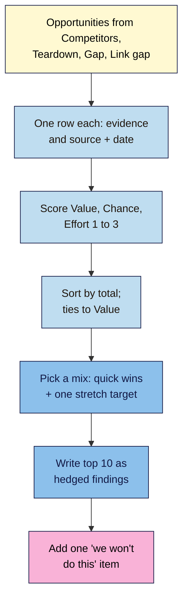

# M10.L05 — Turning Findings into Priorities
> After this lesson you can turn everything from your competitor research into a short, scored list of opportunities, each backed by evidence and a dated source, write findings that are honest about what you know, and check any AI summary against your own data.

**Time:** ~14 min reading + ~40 min hands-on + ~10 min exercise · **Level:** L2 Practitioner · **Prereqs:** M10.L04, M03.L04 · **Remediate to:** M03.L04
**Verified against:** ProductPlan glossary "ICE Scoring Model" (observed practice); Google Gemini Apps Privacy Hub; Google Search Central "Creating helpful, reliable, people-first content" (2026-10-05) and "Do you need an SEO?"; and the Value / Chance / Effort score from Lesson 3.4, all on 2026-11-09.

> ⚠️ **Freshness flag:** priorities go stale. Results, competitors and tool data change, so date every score and recheck your list every quarter. Who invented the ICE score is disputed, so this lesson doesn't name an inventor.

## Learning objectives
1. **Score** opportunities with Value / Chance / Effort (from M03.L04), with evidence and a dated source for each. *(O1)*
2. **Compare** this with ICE and impact × effort, and choose one method for the project. *(O2)*
3. **Write** findings as honest, hedged statements, and check any AI summary against the tools. *(O3)*

## Why it matters
Nila now has four tabs of competitor research: **Competitors**, **Page teardown**, **Gap sheet** and **Link gap**. Together they hold about 40 ideas: new guides, rewrites, links to chase, page fixes. She can't do 40 things this quarter. And when she shows the owner of a café chain she consults for a similar list, the first question is "Which three first, and why?"

This lesson turns research into decisions. You'll reuse the score you already know from Lesson 3.4, add two columns that keep you honest (**Evidence** and **Source + date**), and write the findings so that nobody mistakes an estimate for a fact. That's what makes a competitor analysis useful, rather than just long.

## Core concept
**Plain version:** list every opportunity from your research, one per row. Score each from 1 to 3 for **Value**, **Chance** and **Effort**, exactly as in Lesson 3.4, and add them up (out of 9). Next to each, write the **evidence** (what you saw) and its **source and date**. Sort, pick a mix of quick wins and a stretch target, and write the top ten as plain, honest statements. Add one thing you've decided **not** to do, and why.

**Analogy:** a doctor's notes. Each finding says what was observed, how, and when ("blood pressure 140/90, measured 9 Nov"), and the plan follows from it. "Probably fine, I think" or "definitely 140, always" both fail.

**Precise definitions:**
- **Opportunity:** one specific action from your research (a new page, a rewrite, a link to earn, a fix) *(course term)*.
- **Value / Chance / Effort:** Lesson 3.4's 1–3 scores. Value = how close to a sale or booking; Chance = how beatable the results are; Effort = 3 for a small change, 1 for a big new build. Total out of 9; ties go to higher Value *(course rule of thumb)*.
- **Evidence:** the finding that supports the opportunity, in your own words.
- **Hedged statement:** a finding written with its source and certainty ("Ahrefs estimates…", "In our check on 9 Nov…").

### Where opportunities come from
| Tab | Typical opportunity | Example (Nila, illustrative) |
|---|---|---|
| **Competitors** (10.1) | A search where a beatable site ranks | "BrewAtHome ranks #2 for French press with a dated guide" |
| **Page teardown** (10.2) | A rewrite or addition to one of your pages | "Rebuild French press guide as numbered steps with own photos" |
| **Gap sheet** (10.3) | A missing or weak topic that fits | "New AeroPress guide (missing; 2 of 3 rivals have one)" |
| **Link gap** (10.4) | An earnable link | "Join the roasters' association; ask to be listed" |

### Value / Chance / Effort vs other methods
| Method | How it scores | Strengths | Weaknesses |
|---|---|---|---|
| **Value / Chance / Effort** (this course) | Three 1–3 scores, **added**, out of 9 | Simple; written definitions from Lesson 3.4; Chance comes from reading real results | Coarse: many ties |
| **ICE** *(observed practice)* | Impact, Confidence, Ease, each 1–10; "those three numbers are multiplied" | Quick; common in product and growth teams | Needs "a consistent definition of the 1-10 scale"; can favour "low hanging fruit" over bigger, long-term projects |
| **RICE** *(observed practice)* | "Reach * Impact * Confidence / Effort" | Adds reach | More numbers to guess |
| **Impact × effort matrix** *(common practice)* | Plot on a 2×2 grid: high impact/low effort first | Visual; good in meetings | Ignores confidence |

They're close relatives: **Value ≈ Impact**, **Chance ≈ Confidence**, **Effort ≈ the opposite of Ease**. ProductPlan describes Confidence as "the certainty that the project will actually have the predicted Impact", and Chance plays that role here. For this course, **keep one system**: Value / Chance / Effort, so your keyword targets (Lesson 3.4) and competitor opportunities can sit in the same list. Use ICE if your team or client already does, and write down your 1–10 definitions.

### Writing findings honestly
| ❌ Overclaims | ✅ Honest |
|---|---|
| "BrewAtHome gets 48,213 visits a month." | "Ahrefs estimates roughly 50k organic visits a month (estimate, checked 2026-11-09)." |
| "This page will rank #1 in 3 months." | "We think this could move into the top 5, because the results are mostly older guides (Chance 3)." "No one can guarantee a #1 ranking on Google." |
| "Their links are why they rank." | "They have links from 3 niche sites we don't; links are one likely factor." |
| "Competitor has 312 pages." | "`site:` shows roughly 300 results (a sample)." |

**AI summaries need the same care.** Google's own Gemini help says AI tools "can hallucinate and present inaccurate information as factual". If you ask a chatbot "how much traffic does BrewAtHome get?", it may give a confident number no tool ever produced. Only give AI your own collected data, ask it to summarise or spot patterns, and check every number it returns against your sheet.

### A "we won't do this" item
Every good priority list says no to something, in writing. For example: "We won't target 'coffee' (a giant's search, Chance 1)", "We won't copy BrewAtHome's AeroPress guide", or "We won't buy the guest posts BeanCraft uses." It shows the client you thought about it, and protects them from someone else's bad idea later.

## How it works

**In words:** gather every opportunity from your four research tabs, one row each, with the evidence and its source and date. Score Value, Chance and Effort from 1 to 3, sort by the total, and break ties by Value. Pick a mix of quick wins and one stretch target. Write the top ten as honest, hedged findings, and add one thing you won't do and why.

> **Under the hood: why adding beats multiplying here.** ICE multiplies, so one low score drags the whole item down: 10 × 10 × 1 = 100, while 5 × 5 × 5 = 125. That suits teams with fine-grained 1–10 judgements. With coarse 1–3 scores and a lot of uncertainty, adding is gentler and easier to explain: a high-value page that takes effort (3 + 2 + 1 = 6) isn't wiped out. Whatever you choose, the scores are your written judgement, not predictions (Lesson 3.4).

## Hands-on walkthrough
You'll gather your opportunities, score them, and write your top ten. Nila's details are illustrative.

**Before you start: which steps apply to you?**
- **Path A (your own site):** do every part.
- **Path B (practice site):** do every part; your evidence may be thinner, so say so.
- **Path C (client site):** do every part, and use the hedged wording in anything the client sees.

**Part A — Gather (10 min)**
1. Add a tab called **Opportunities** with columns: **#** · **Opportunity** · **From tab** · **Evidence** · **Source + date** · **Value** · **Chance** · **Effort** · **Total** · **Type** (quick win / stretch) · **Next action**.
2. Copy in every opportunity from your **Competitors**, **Page teardown**, **Gap sheet** (Fits us: Yes only) and **Link gap** (Earnable only) tabs. One action per row.
   **Expected:** 15–30 rows. If you have more than 30, merge near-duplicates.

**Part B — Score (15 min)**
1. Score each row using Lesson 3.4's table. For Chance, look back at your own hand-checked results notes, not a tool's difficulty score.
2. Fill **Total** (`=F2+G2+H2`), sort by Total (then Value), and mark **Type**: high Chance + low Effort = quick win; high Value + low Chance = stretch.
   > 🖼️ **Image prompt:** A Google Sheets tab named "Opportunities" (1280×720) with 15 rows sorted by a Total column, showing Evidence and "Source + date" columns filled in, and the top 10 rows shaded sky blue. Highlight the "Source + date" column with a 3px #F9B2D7 outline; blur any personal details.
   > **Alt text:** An opportunities sheet sorted by total score, with evidence and dated sources for each row and the top ten shaded.
   **Expected:** a spread of totals. If most rows score 8–9, look again at Chance (Lesson 3.4).

**Part C — Top 10 and one "won't do" (15 min)**
1. Pick your top 10: mostly quick wins, plus one or two stretch targets. Check they aren't all one type (all new guides, or all links).
2. Rewrite each as a one-line hedged finding with its next action. Example: *"New AeroPress guide (missing; 2 of 3 rivals have one; results are mostly 2023 guides, checked 2026-11-09). V3 C3 E2 = 8. Next: test 3 recipes in the roastery."*
3. Add one **"We won't do this"** row with the reason.
4. Optional: paste your sheet (your data only) into an AI tool and ask it to group the top 10 into themes. Check every number in its reply against your sheet.
   **Expected:** 10 hedged findings with scores and next actions, and one written "won't do".

**Expected output:** an **Opportunities** tab with every opportunity scored with Value / Chance / Effort, evidence and a dated source, a top 10 written as hedged findings with next actions, and one "won't do" item.

## When to use / when not to
**Use this** at the end of any competitor analysis, and whenever you need to explain your plan to someone else.

**Don't** score without evidence, present scores as predictions, or let an AI tool fill in numbers you didn't collect.

**The trade-off:** a scored list takes time and can look more precise than it is. But it makes your reasoning visible, so others can challenge a score instead of a vague opinion. Keep it simple, dated and honest.

## Use AI for this
**Example prompt:**
> "Here's my Opportunities sheet with my scores, evidence and sources: [paste]. Point out any scores that don't seem to match the evidence, any rows that look like duplicates, and whether my top 10 is too similar. Use only my sheet; don't add traffic numbers, rankings or new competitors."

**What AI does well here:** spotting mismatched scores and duplicates, and grouping themes.
**Where it gets it wrong:** it "can hallucinate and present inaccurate information as factual", including competitor metrics it never saw.
**How to check:** every number in its reply must already be in your sheet.

## Common mistakes
- **Scoring without evidence.**
- **No dates on sources.** Next quarter, nobody will know how old the data is.
- **Overclaiming:** estimates as facts, rankings as promises.
- **All quick wins, or all stretch targets.**
- **Switching between methods** (ICE here, V/C/E there) so scores can't be compared.
- **Letting AI supply numbers.**

## Troubleshooting
| Symptom | Likely cause | Fix |
|---|---|---|
| Everything scores 8 or 9 | Generous on Chance | Recheck results by hand (Lesson 3.4) |
| Too many ties | Coarse 1–3 scale | Break ties by Value, then by Effort |
| The client wants a forecast | They want certainty | Give ranges and reasons; no guarantees |
| The top 10 is all new content | Ignoring rewrites and links | Add the best teardown and link-gap rows |
| An AI summary mentions numbers you don't have | Hallucination | Delete them; use only your sheet |
| The client already uses ICE | Different method | Use ICE, with written 1–10 definitions |

## Exercise
**Task:** complete your **Opportunities** tab (Parts A–C). Then answer these. All details are illustrative.
1. Nila's AeroPress guide scores V3 C3 E2. A new "coffee" homepage push scores V2 C1 E1. Totals, and which first?
2. Rewrite honestly: "This guide will rank #1 by March."
3. In ICE, why can one low score sink an item?
4. ChatGPT tells Amara a rival "gets 30% of its traffic from Instagram". What should she do?
5. Tomás's top 10 are all new blog posts. What's missing?
6. Give one good "we won't do this" item for Nila.

**Expected outcome:** a complete tab, and these answers:
- **1** 8 vs 4. The AeroPress guide first.
- **2** For example: "We think this could reach the top 5, because the results are mostly older guides (Chance 3, checked 2026-11-09)." No one can guarantee a ranking.
- **3** "those three numbers are multiplied", so a 1 multiplies everything down.
- **4** Don't use it. AI tools "can hallucinate and present inaccurate information as factual". Only use numbers from a named tool, with a date.
- **5** A mix: page rewrites from the teardown, earnable links from the link gap, and at least one stretch target.
- **6** For example: "We won't target 'coffee' (a giant's search, Chance 1)" or "We won't buy guest posts like BeanCraft's."

**Stretch goal:** score your top 5 again with ICE (1–10, multiplied). Does the order change? Write one sentence on why.

## Key takeaways
- Gather every opportunity from your research tabs, one action per row.
- Score with Value / Chance / Effort (1–3, added), with evidence and a dated source.
- ICE, RICE and impact × effort are relatives. Pick one system and define its scale.
- Write findings as hedged statements: tool, "estimate", date, "we think … because …".
- AI can summarise your data, but never supply numbers. Always add a "won't do".

## Teach it back
Explain to a friend in 3 sentences how to turn a pile of competitor research into a top-10 list a client can trust.

## Glossary terms added
- Opportunity (competitor analysis) — added to `seo-101/glossary.md`
- ICE score — added to `seo-101/glossary.md`
- Hedged statement — added to `seo-101/glossary.md`
- *Already in the glossary:* Quick win, Stretch target

## Further reading
*All checked 2026-11-09.*
- ProductPlan — ICE Scoring Model (observed practice): https://www.productplan.com/glossary/ice-scoring-model
- Google — Gemini Apps Privacy Hub (accuracy): https://support.google.com/gemini/answer/13594961
- Google Search Central — Creating helpful, reliable, people-first content: https://developers.google.com/search/docs/fundamentals/creating-helpful-content
- Google Search Central — Do you need an SEO? (no guaranteed rankings): https://developers.google.com/search/docs/fundamentals/do-i-need-seo

> ⚠️ **May change:** results and tool data behind every score; AI tools' accuracy disclaimers.

## Refresher card
*Used by remediation when a learner fails a quiz twice on a later lesson that points back here.*
**Opportunities** from Competitors, Page teardown, Gap sheet (fits only), Link gap (earnable only). **One row each:** evidence + source + date. **Score** Value / Chance / Effort 1–3, **add** (out of 9), ties → Value. **Mix** quick wins + 1–2 stretch. **Relatives:** ICE (1–10, "multiplied"; define the scale; favours "low hanging fruit"), RICE, impact × effort. **Hedge:** "Tool estimates ~X (estimate, date)", "we think … because …"; no guaranteed rankings. **AI** "can hallucinate": your data in, no numbers out. Always one "won't do".
