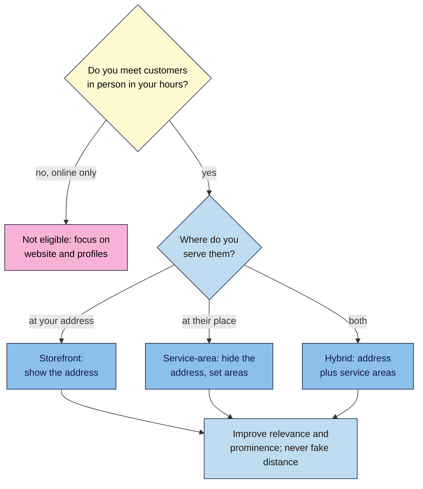

# M11.L01 — How Local Results Work (and Is Local SEO for You?)
> After this lesson you can explain how Google chooses the businesses in the map and local pack, decide whether your business can have a Business Profile (and which type), and check your local visibility by hand from several places.

**Time:** ~14 min reading + ~35 min hands-on + ~10 min exercise · **Level:** L2 Practitioner · **Prereqs:** M10.L05, M01.L05 · **Remediate to:** M01.L05
**Verified against:** Google Business Profile Help "Tips to improve your local ranking on Google", "Business eligibility and ownership guidelines", "Guidelines for representing your business on Google", "Manage your service areas for service-area & hybrid businesses" and "How Google sources business information"; Google Search Help "Understand & manage your location when you search on Google"; Whitespark's 2026 Local Search Ranking Factors survey (observed practice), all on 2026-11-09. Google's help pages show no "last updated" date.

> ⚠️ **Freshness flag:** Google's local ranking page now opens with "relevance, distance, and popularity", but still uses **Prominence** as the heading for the third factor. Business Profile features change often; this module was checked on 2026-11-09 and is due for review every 6 months.

## Learning objectives
1. **Explain** relevance, distance and prominence (popularity), and that you can't pay for a better local ranking. *(O1)*
2. **Classify** a business as storefront, service-area, hybrid or not eligible, quoting Google's rule. *(O2)*
3. **Run** a manual local rank check from several places and log it. *(O3)*

## Why it matters
In Lesson 1.5, Kavya wrote: "I could aim for the local pack, because I have a real studio address; I need a Business Profile and reviews." Now's the time. When someone in Adyar searches `yoga classes near me`, the map and the three businesses under it get most of the attention. Kavya's website, however good, sits below them.

But local search plays by different rules from the organic results you've studied so far. Where the searcher **is** matters as much as what they type. A business only qualifies if it meets people face to face. And the shortcuts people try (a fake address nearer the city centre, a keyword-stuffed name) can get a profile suspended. This lesson explains how local results are chosen, who qualifies, and how to check where you stand without paying for a tool.

## Core concept
**Plain version:** for local searches, Google shows nearby businesses from its map, mostly using three things: how well a business **matches** the search (relevance), how **close** it is to the searcher (distance), and how **well known** it is (prominence: reviews, links, reputation). You can improve relevance and prominence. You can't change distance, and you mustn't fake it. And only businesses that meet customers in person can have a Business Profile.

**Analogy:** asking a local for "a good bakery". They'll name one that sells what you want (relevance), that's near where you are (distance), and that people talk about (prominence). Nobody recommends a bakery that only exists as a postbox.

**Precise definitions:**
- **Local pack:** the map with a few local businesses shown for searches with local intent (Lesson 1.5).
- **Google Business Profile (GBP):** a business's free listing on Google Search and Maps.
- **Storefront business:** customers come to you at your address.
- **Service-area business:** "A business that visits or delivers to customers directly but doesn't serve customers at their business address" (a plumber, a mobile yoga teacher).
- **Hybrid business:** "A business that serves customers at its business address but also directly visits or delivers to them" (a shop that also delivers).

### What Google says about local ranking
| Factor | Google's words | What you can do |
|---|---|---|
| **Relevance** | "how well a Business Profile matches what someone is searching for" | Accurate category, services, description, website (Lesson 11.3) |
| **Distance** | "how far each business is from the customer who's searching. If a customer doesn't share where they are, Google uses what it knows about their location." | Nothing. Never fake an address |
| **Prominence** (now also "popularity") | "how well-known a business is"; "based on info like how many websites link to your business and how many reviews you have" | Reviews (11.4), links and mentions (Module 9), consistent details (11.5) |
| **Paying** | "There's no way to request or pay for a better local ranking on Google." | Ignore anyone selling "guaranteed #1 on Maps" |
| **Completeness** | "Businesses with complete and accurate info are more likely to show up in local search results." | Fill in everything that's true |

Google builds a profile from more than what you type: crawled web content (including your website), "Licensed data from third parties", users' edits and photos, and the owner's own details. That's why mismatched details elsewhere on the web matter (Lesson 11.5).

Industry surveys agree on the big three. Whitespark's 2026 survey of local SEO experts ranks "Primary GBP Category" and "Proximity of Address to the Point of Search" at the top. But it's an opinion survey: "None of the experts have special access to the internal workings of Google's local search algorithm." *(observed practice)*

### Who can have a Business Profile?
Google's rule: "To qualify for a Business Profile, a business must make in-person contact with customers during its stated hours." Not eligible, among others: "Brands, organizations, artists, and other online-only businesses"; "Lead generation agents or companies"; "An ongoing service, class, or meeting at a location that you don't own or have the authority to represent"; and virtual offices: a rented mailing address you don't operate from "isn't eligible for a Business Profile". "There should only be one profile per business".

| Persona | Situation | Type |
|---|---|---|
| **Nila** | Tasting room in Bengaluru where customers visit; also ships online | **Storefront** for the tasting room (the online shop doesn't need a profile) |
| **Kavya** | Her own studio in Adyar, Chennai, with signage | **Storefront** (hours need care: Lesson 11.3) |
| **Tomás** | Family hardware shop in Lisbon; delivers to local builders | **Hybrid**: shows the shop address, plus service areas |
| **Amara** | Junior content writer in Lagos, working online for clients | **Not eligible** (online-only). Her route: a good website and consistent social profiles |

For service-area businesses, Google says: "If you don't serve customers at your business address, remove your address from your Business Profile." You can then set "up to 20 service areas".

## How it works

**In words:** first ask whether you meet customers in person during your hours. If you work only online, you can't have a Business Profile, so put your effort into your website and other profiles. If you do meet customers, decide where: at your address (storefront), at theirs (service-area, with the address hidden), or both (hybrid). Then work on what you can change, relevance and prominence, and never fake your distance.

> **Under the hood: why your own search isn't the truth.** Google estimates your location from "Your device location", your Google Account's home or work address, past activity, and "The IP address of your Internet connection". It may even reuse your last location from a cookie "set to expire after 6 hours". So the pack Kavya sees at her studio isn't what a student two kilometres away sees. Google shows "how your location was estimated at the bottom of the results page". That line belongs in every rank log.

## Hands-on walkthrough
You'll decide your business type and log a manual local rank check. Nila's details are illustrative.

**Before you start: which steps apply to you?**
- **Path A (your own business):** do every part for your business.
- **Path B (practice site):** use **Nila Coffee's tasting room** (Indiranagar, Bengaluru) as your business, and check results for a real city you know.
- **Path C (client business):** do every part for the client, using their address and searches.

**Part A — Your business type (10 min)**
1. Add a tab called **Local** to your **SEO 101 project** sheet. In the first rows, answer: Do you meet customers in person during your hours? Where (your address, theirs, both)? Do you have permanent signage?
2. Write your type (storefront, service-area, hybrid, not eligible) and quote the Google line that decides it.
   **Expected:** one decision with a quoted rule. Nila (Path B): "Storefront: customers visit the tasting room during its hours."

**Part B — Your local searches (5 min)**
1. Pick 3–5 searches a local customer would type: one "near me", one with your area name, and one or two service or product searches. Nila: `coffee roasters near me`, `coffee roasters indiranagar`, `filter coffee beans bengaluru`.

**Part C — A manual rank check (20 min)**
1. Add a **Local rank log** below, with columns: **Date** · **Search** · **Where (area)** · **Device** · **Signed in?** · **Pack position (1–3 or "not in pack")** · **Top 3 names** · **Location line** (from the bottom of the results page).
2. Search each one on your phone, with location on, from 4–6 spots around your business (walk, or ask friends or staff in other neighbourhoods to send screenshots).
   > 🖼️ **Image prompt:** A phone screenshot (1080×1920) of a Google local pack for "coffee roasters near me" with three businesses and a map, plus the location line at the very bottom of the results page. Highlight the location line with a 3px #F9B2D7 outline; blur any personal details.
   > **Alt text:** A local pack on a phone with three businesses, and the location line at the bottom of the results page highlighted.
3. Also search once on Google Maps and use "Search this area" over your neighbourhood. Note where you appear.
   **Expected:** 12–30 rows. Nila's pattern: in the pack for `coffee roasters near me` within about a kilometre of the tasting room, but not 4 km away; never in the pack for `filter coffee beans bengaluru`.

**Expected output:** a **Local** tab with your business type (and the quoted rule), 3–5 local searches, and a dated rank log from 4–6 places, each with the location line.

## When to use / when not to
**Use local SEO** if customers visit you, or you visit them, in a defined area.

**Don't** create a profile for an online-only business, a rented mailbox, or a co-working desk you don't staff; don't try to "move" closer to the city centre; and don't pay for "guaranteed" map rankings.

**The trade-off:** a Business Profile is free and can bring the most valuable local customers. But it comes with strict rules, and breaking them risks suspension. Distance is out of your hands, so you'll rarely appear across a whole city, and that's normal.

## Use AI for this
**Example prompt:**
> "Here's how my business works: [describe where and how you meet customers]. Using Google's Business Profile eligibility rules, which type am I: storefront, service-area, hybrid, or not eligible? Quote the rule that decides it, and say what I should do if I'm not eligible."

**What AI does well here:** applying a clear rule to a description.
**Where it gets it wrong:** it may suggest "using a virtual office address" or a keyword name to rank better, both of which break the rules, and it may describe removed features (such as chat).
**How to check:** read Google's eligibility guidelines yourself.

## Common mistakes
- **Judging rankings from your own desk.** Distance changes everything.
- **Using a virtual office or co-working address** to look central.
- **Creating a profile for an online-only business.**
- **Paying for "guaranteed" Maps rankings.**
- **Two profiles for one business** (one per phone number, say).
- **Showing a home address** when you only visit customers.

## Troubleshooting
| Symptom | Likely cause | Fix |
|---|---|---|
| You rank #1 at the shop but not 3 km away | Distance | Normal; improve relevance and prominence |
| No local pack for your search | Search not seen as local | Add the area or "near me" (Lesson 1.5) |
| Results differ between you and a friend | Different locations or signed-in data | Log location, device and signed-in status |
| Your location line shows the wrong city | IP or cookie location | Turn on device location, or note it |
| An agency offers "guaranteed #1 on Maps" | Not possible | "There's no way to request or pay for a better local ranking on Google." |
| You're online-only | Not eligible | Focus on your website, Bing and Apple brand presence, social profiles |

## Exercise
**Task:** complete your **Local** tab (Parts A–C). Then answer these. All details are illustrative.
1. Name Google's three local ranking factors. Which one can't you change?
2. Amara writes for clients from home and never meets them. Can she have a Business Profile?
3. Tomás's shop also delivers to builders. Which type is it?
4. A plumber in Chennai works from home and never has customers there. What should the profile do with the address?
5. Kavya appears #1 when she searches at her studio. Is that her ranking?
6. An email offers Nila "#1 on Google Maps in 30 days, guaranteed". What does Google say?

**Expected outcome:** a complete tab, and these answers:
- **1** Relevance, distance, prominence (now also called popularity). Distance can't be changed.
- **2** No: "online-only businesses" aren't eligible. She should focus on her website and consistent profiles.
- **3** Hybrid: "serves customers at its business address but also directly visits or delivers to them".
- **4** "If you don't serve customers at your business address, remove your address from your Business Profile", then set service areas.
- **5** Only from that spot. Results depend on the searcher's location; she needs checks from several places.
- **6** "There's no way to request or pay for a better local ranking on Google."

**Stretch goal:** repeat your rank log in a month at the same spots and times, and compare.

## Key takeaways
- Local results mainly use relevance, distance and prominence (Google now also says popularity).
- You can't pay for a better local ranking; you can't change distance; you can improve relevance and prominence.
- Only businesses that meet customers in person qualify: storefront, service-area or hybrid.
- Virtual offices, online-only businesses and duplicate profiles aren't allowed.
- Check rankings from several places, and log the location line.

## Teach it back
Explain to a friend in 3 sentences why their café shows in the map when they search from inside it, but not from across town, and what they can do about it.

## Glossary terms added
- Google Business Profile — added to `seo-101/glossary.md`
- Service-area business — added to `seo-101/glossary.md`
- Hybrid business — added to `seo-101/glossary.md`
- Local ranking factors (relevance, distance, prominence) — added to `seo-101/glossary.md`
- *Already in the glossary:* Local pack

## Further reading
*All checked 2026-11-09.*
- Google Business Profile Help — Tips to improve your local ranking on Google: https://support.google.com/business/answer/7091
- Google Business Profile Help — Business eligibility and ownership guidelines: https://support.google.com/business/answer/13763036
- Google Business Profile Help — Guidelines for representing your business on Google: https://support.google.com/business/answer/3038177
- Google Business Profile Help — Manage your service areas: https://support.google.com/business/answer/9157481
- Google Search Help — Understand & manage your location when you search: https://support.google.com/websearch/answer/179386
- Whitespark — Local Search Ranking Factors 2026 (expert survey, observed practice): https://whitespark.ca/local-search-ranking-factors/

> ⚠️ **May change:** Google's wording for the third factor; eligibility details; how location is estimated. Help pages show no update dates.

## Refresher card
*Used by remediation when a learner fails a quiz twice on a later lesson that points back here.*
**Local ranking:** relevance (profile matches the search) · distance (can't change, never fake) · prominence/"popularity" (links, reviews, reputation). "There's no way to request or pay for a better local ranking on Google." **Eligible** only with "in-person contact with customers during its stated hours". **Types:** storefront (show address) · service-area (remove address; up to 20 areas) · hybrid (both). **Not eligible:** online-only, lead generators, virtual offices; one profile per business. **Rank checks:** by hand from several spots; log date, place, device, signed in, pack position, top 3, location line.
