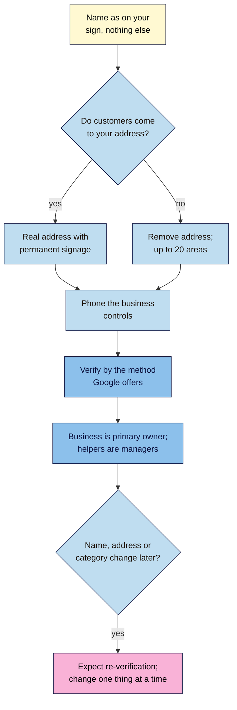

# M11.L02 — Set Up and Verify a Business Profile the Right Way
> After this lesson you can set up (or check) a Google Business Profile with a name, address and phone that follow Google's rules, choose a verification route and avoid re-verification surprises, and make sure the business, not a helper, owns the profile.

**Time:** ~15 min reading + ~40 min hands-on + ~10 min exercise · **Level:** L2 Practitioner · **Prereqs:** M11.L01 · **Remediate to:** M11.L01
**Verified against:** Google Business Profile Help "Guidelines for representing your business on Google", "Business eligibility and ownership guidelines", "Verify your business on Google", "Edit your Business Profile", "Manage your service areas" and "Manage your Business Profile owners & managers", all on 2026-11-09. Google's help pages show no "last updated" date. No profile was created or verified live for this lesson.

> ⚠️ **Freshness flag:** verification options are set by Google per business and change often. Google says verification methods "are automatically determined by Google and can't be changed". Screens in the Business Profile dashboard may not match older tutorials.

## Learning objectives
1. **Follow** Google's name and address rules (no keywords, taglines or virtual offices). *(O1)*
2. **Choose** a verification route, and know what triggers re-verification. *(O2)*
3. **Set** ownership correctly: the business owns the profile; helpers get manager access. *(O3)*

## Why it matters
Nila's freelancer sends a draft profile: name **"Nila Coffee – Best Coffee Roasters Bengaluru"**, address a co-working desk in Koramangala "because it's more central", phone a call-centre number, and the freelancer as the only owner *(illustrative)*. Every one of those choices is against Google's guidelines. Any one could get the profile suspended, or leave Nila locked out of her own listing when the freelancer moves on.

Setting up a profile takes an hour. Fixing a suspended one, or recovering one an ex-agency owns, can take weeks. This lesson gets the foundations right: the real name, the real address, a phone the business controls, a verification route that works, and the business as owner.

## Core concept
**Plain version:** your profile should describe your business exactly as it exists in the real world: the name on your sign, the address where you meet customers (or service areas if you go to them), and a phone you answer. Google then checks you're real (verification). And the business owner, not an agency or freelancer, should own the profile, adding helpers as managers.

**Analogy:** registering a shop with the local council. You give the name on the sign and the address of the premises, not a catchy slogan or a friend's office across town. If you change the name or move, you re-register.

**Precise definitions:**
- **Verification:** Google's check that you run the business at that location. "When you verify your business on Google, you gain ownership of your Business Profile".
- **Owner / primary owner:** "As the owner, you have full control over the profile." "A Business Profile can have multiple owners but only one primary owner."
- **Manager:** "Managers … have mostly the same access to the profile as owners. The only exception is they can't add or remove users or remove the profile."
- **Re-verification:** a new check Google may ask for after big edits (name, address, category).

### Name, address, phone: the rules
| Detail | Google's rule | ❌ Not allowed | ✅ Fix (Nila) |
|---|---|---|---|
| **Name** | "Your name should reflect your business's real-world name, as used consistently on your storefront, website, stationery, and as known to customers." | Keywords, places, taglines, phone numbers, "Repeated Bilingual Names / Script Transliterations" | "Nila Coffee" |
| **Penalty** | "Including unnecessary information in your business name isn't permitted, and could result in the suspension of your Business Profile." | "Nila Coffee – Best Coffee Roasters Bengaluru" | Put category, area and hours in their own fields |
| **Address** | Your "actual, real-world location"; showing it means you "should maintain permanent fixed signage of their business name at the address" | Virtual offices; P.O. boxes; a co-working desk unless it "maintains clear signage, receives customers at the location during business hours, and is staffed during business hours" | The tasting room in Indiranagar |
| **Landmarks** | Allowed "in regions where the official street address doesn't accurately pinpoint the business's location"; you can also pin the location on the map | Keywords or URLs in address lines | "Near the 12th Main signal" only if the street address isn't precise enough |
| **Service areas** | "up to 20 service areas"; "shouldn't be more than about 2 hours of driving time"; "You can't set your service area as a radius distance" | A home address shown when you only visit customers | Remove the address; list areas |
| **Phone** | "The phone number must be under the direct control of the business." "Use a local phone number instead of a central call center helpline number whenever possible." | Call-centre or lead-generation numbers; numbers that redirect elsewhere | The tasting room's own number |

### Verification
- **Methods vary.** "Verification methods are automatically determined by Google and can't be changed." Options can include phone or text, email, a live video call, or a postcard.
- **Video is recommended where offered:** "If your business is eligible for video verification, we recommend that you use this option." You'll need to "Show outside signs, nearby businesses, or a street sign that confirms your business location", plus products, equipment or staff-only areas. That's why a fake address fails: there's nothing real to film.
- **Postcards:** "Most codes arrive within 14 days." "Verification codes expire after 30 days." While you wait: "Do not edit your business name, address, or category on your Business Profile. If you do, the code we sent you won't work."
- **Reviews take time:** "verification reviews take up to 5 business days".
- **A shortcut:** verification can be instant in some cases, for example when "You verify your website with Google Search Console" (Lesson 1.8).
- **Scams:** "Google will never ask for your verification code."
- **India:** "In India and some places, we'll double-check your phone number to make sure it's correct."

**What triggers re-verification:** "If you move your business to a new address after it's verified, you must verify your business again." "If you change your business name after it's verified, you might need to verify your business again." Changing categories can do the same (Lesson 11.3). So plan edits: fix the name, wait for it to settle, then change other things.

### Ownership: the business owns it
Google's rules for anyone helping a business: "Never claim a Business Profile without express consent from the business owner", and "always transfer Business Profile ownership to the business owner immediately upon request". The business's phone and website should be "verifiable by the business owner".

| Role | Who | Can do |
|---|---|---|
| **Primary owner** | The business owner (Nila) | Everything, including adding and removing users |
| **Owner** | A co-owner or partner | Full control |
| **Manager** | An agency, freelancer, staff member (Path C: you) | Edit the profile; can't add or remove users or remove the profile |

## How it works

**In words:** use the name on your sign and nothing else. If customers come to you, give your real address, with permanent signage there. If they don't, remove the address and list up to 20 service areas. Add a phone the business controls. Verify by whichever method Google offers. Make the business owner the primary owner, and add any agency or freelancer as a manager. If you later change the name, address or category, expect to verify again, so change one thing at a time.

> **Under the hood: why Google is strict about names and addresses.** Profiles feed Maps, Search and directions for millions of people, and fake or stuffed listings are a long-running spam problem (lead-generation "locksmiths", fake offices). Google cross-checks profiles with web content, licensed data and users' edits (Lesson 11.1), and verification proves someone is really there. A keyword name might seem to help for a while, but anyone can suggest an edit, and a suspension removes the profile from results altogether.

## Hands-on walkthrough
You'll audit a profile's foundations against Google's rules. Nila's details are illustrative.

**Before you start: which steps apply to you?**
- **Path A (your own business):** if you have a profile, audit it; if not, plan it with this checklist before you create it.
- **Path B (practice):** audit **Nila Coffee's draft** from **Why it matters** (name, co-working address, call-centre phone, freelancer as only owner).
- **Path C (client business):** audit the client's profile with the access they give you; you should be a **manager**, not the owner.

**Part A — Name, address, phone (15 min)**
1. Add a tab called **Profile audit** with columns: **Item** · **Current** · **Google's rule (quoted)** · **OK?** · **Fix** · **Done**.
2. Check the name against the photo of your sign or your stationery. Remove anything else.
3. Check the address: is it where you meet customers, with permanent signage? If you only visit customers, plan to remove it and list service areas (max 20, no radius).
4. Check the phone: does the business control it? Is it local, not a call centre?
   > 🖼️ **Image prompt:** The "Business name" field in a Business Profile edit screen (1280×600) showing "Nila Coffee – Best Coffee Roasters Bengaluru", with an arrow to a corrected version "Nila Coffee". Highlight the extra words in the wrong name with a 3px #F9B2D7 outline; blur any personal details.
   > **Alt text:** A business name field showing a keyword-stuffed name and its corrected version with only the real business name.
   **Expected:** Nila's draft fails all three. Fixes: "Nila Coffee"; the Indiranagar tasting room address; the tasting room's own number.

**Part B — Verification plan (10 min)**
1. Note which method Google offers (Path A/C: in the dashboard; Path B: assume video).
2. Write a video checklist: the sign outside, a nearby street sign, the roaster and coffee bags, the counter, and proof you can open a staff-only area.
3. Note the rule: don't change name, address or category while a code or review is pending.
   **Expected:** a short plan, e.g. "Video call during opening hours: sign → street → roaster → till → stockroom."

**Part C — Ownership (10 min)**
1. List every user on the profile and their role (Path A/C: **Business Profile settings → People and access**, or similar).
2. Make sure the business owner is the **primary owner**. Helpers (agency, freelancer, you on Path C) should be **managers**.
3. Remove users who no longer work with the business.
   **Expected:** Nila is primary owner; the freelancer becomes a manager, then is removed when the work ends.

**Expected output:** a **Profile audit** tab covering name, address (or service areas), phone, verification plan and users, each with Google's rule quoted, whether it's OK, and the fix.

## When to use / when not to
**Use this checklist** before creating a profile, when taking over a profile from an agency, and after any rebrand or move.

**Don't** create a second profile to "fix" a problem with the first, add keywords to the name, list a mailing address you don't operate from, or let a helper be the only owner.

**The trade-off:** the honest name and real address may feel less "optimised" than a keyword name and a central address. But they're permanent, they pass verification, and they don't risk a suspension that removes you from the map entirely.

## Use AI for this
**Example prompt:**
> "Here's my draft Business Profile: name '[ ]', address '[ ]', phone '[ ]', my business works like this: [describe]. Check each against Google's 'Guidelines for representing your business on Google' and quote the rule for any problem. Don't suggest keywords in the name."

**What AI does well here:** spotting taglines, places and keywords in names.
**Where it gets it wrong:** it may suggest "SEO-friendly" names or co-working addresses, invent verification options, or describe old dashboard screens.
**How to check:** compare with Google's guidelines page, and use only the verification method Google offers you.

## Common mistakes
- **Keywords or places in the name.**
- **Virtual office or unstaffed co-working address.**
- **A call-centre or redirecting phone number.**
- **Editing the name or address while a postcard code is pending.**
- **An agency as the only owner.**
- **Duplicate profiles** for one business.

## Troubleshooting
| Symptom | Likely cause | Fix |
|---|---|---|
| Postcard code doesn't work | Name, address or category edited while waiting | Request a new code; don't edit until verified |
| Asked to verify again | Name, address or category changed | Verify; next time, change one thing at a time |
| Profile suspended after adding keywords | Name rule broken | Restore the real name; request reinstatement |
| You can't add users | You're a manager, not an owner | Ask the primary owner |
| An old agency owns the profile | Ownership never transferred | Ask them to transfer ownership; they "always transfer … immediately upon request" |
| Someone asks for your verification code | Scam | "Google will never ask for your verification code." |

## Exercise
**Task:** complete your **Profile audit** tab (Parts A–C). Then answer these. All details are illustrative.
1. Kavya wants her name to be "Kavya Yoga Studio – Best Yoga Classes Adyar". What should it be, and why?
2. Tomás's postcard code is due, and he renames "Ferragens Silva" to "Ferragens Silva Lisboa". What happens?
3. Nila wants to use a co-working desk as her address. When could that be allowed?
4. Amara is helping a client with their profile. What role should she have?
5. A Chennai plumber wants a 30 km radius. What's wrong?
6. An email "from Google" asks Kavya for her verification code. What should she do?

**Expected outcome:** a complete tab, and these answers:
- **1** Her real-world name, e.g. "Kavya Yoga Studio" if that's on the sign. Keywords and places "could result in the suspension of your Business Profile".
- **2** The code won't work: "Do not edit your business name, address, or category … If you do, the code we sent you won't work." And adding a city to the name breaks the name rules anyway.
- **3** Only if the office "maintains clear signage, receives customers at the location during business hours, and is staffed during business hours".
- **4** Manager. The business owns the profile; helpers never claim it without consent and transfer ownership on request.
- **5** "You can't set your service area as a radius distance"; use up to 20 areas within about 2 hours' drive.
- **6** Ignore it: "Google will never ask for your verification code."

**Stretch goal:** if you're on Path A and already verified, check Search Console is verified for the same website (Lesson 1.8). It can make future verification easier.

## Key takeaways
- The name is the real-world name only; keywords "could result in the suspension".
- Use your real address with signage, or remove it and set up to 20 service areas.
- A phone the business controls; no call centres or redirects.
- Verification methods are chosen by Google; video is recommended; don't edit while waiting.
- The business is the primary owner; helpers are managers.

## Teach it back
Explain to a friend in 3 sentences why their Business Profile name should match their shop sign, and who should own the profile.

## Glossary terms added
- Verification (Business Profile) — added to `seo-101/glossary.md`
- Primary owner (Business Profile) — added to `seo-101/glossary.md`
- Manager (Business Profile) — added to `seo-101/glossary.md`
- *Already in the glossary:* Google Business Profile, Service-area business, Hybrid business

## Further reading
*All checked 2026-11-09.*
- Google Business Profile Help — Guidelines for representing your business on Google: https://support.google.com/business/answer/3038177
- Google Business Profile Help — Business eligibility and ownership guidelines: https://support.google.com/business/answer/13763036
- Google Business Profile Help — Verify your business on Google: https://support.google.com/business/answer/7107242
- Google Business Profile Help — Edit your Business Profile: https://support.google.com/business/answer/3039617
- Google Business Profile Help — Manage your Business Profile owners & managers: https://support.google.com/business/answer/3403100

> ⚠️ **May change:** verification methods and timings; dashboard menus; India-specific checks.

## Refresher card
*Used by remediation when a learner fails a quiz twice on a later lesson that points back here.*
**Name** = real-world name only (no keywords, places, taglines, bilingual repeats) or risk suspension. **Address** = where you meet customers, with signage; no virtual offices; co-working only if signed, staffed and open to customers; landmarks only where the address isn't precise. **Service-area** = remove address; ≤20 areas; ≤~2 h drive; no radius. **Phone** = controlled by the business; local; no call centres. **Verify** by Google's method (video recommended); postcards ≤14 days, expire after 30; don't edit while waiting; up to 5 business days for reviews. **Re-verify** after moving (must) or renaming (might). **Ownership:** business = primary owner; helpers = managers.
