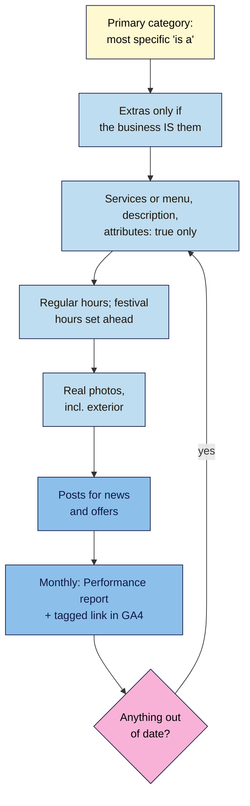

# M11.L03 — Optimise the Profile: Categories, Services, Hours, Photos, Posts
> After this lesson you can choose the right categories, fill in every true detail Google allows (services or menu, description, attributes, hours and festival hours, real photos), use posts for what they're good at, and measure what the profile brings in.

**Time:** ~16 min reading + ~45 min hands-on + ~10 min exercise · **Level:** L2 Practitioner · **Prereqs:** M11.L02 · **Remediate to:** M11.L02
**Verified against:** Google Business Profile Help "Tips to improve your local ranking on Google", "Guidelines for representing your business on Google", "Edit your Business Profile", "Choose a business category", "Business Profile photos and videos", "Posts on your Business Profile", "Set holiday and special hours", "Business Profile chat and call history changes" and "Business Profile performance"; Google for Developers "Q&A API change log" (last updated 2026-08-28); Google Analytics Help "Collect campaign data with custom URLs", all on 2026-11-09. No profile was edited live for this lesson.

> ⚠️ **Freshness flag:** Business Profile features change faster than any other part of this course. Chat was removed on 31 July 2024; the Q&A API was discontinued on 3 November 2025, and Google's Q&A help page now returns an error; products and featured posts aren't offered in India. **Don't follow tutorials from 2023 or earlier without checking your own dashboard.**

## Learning objectives
1. **Pick** a primary category and a few true extras ("is a", not "has a"). *(O1)*
2. **Complete** services or menu, description, attributes, hours (including festival hours) and real photos within the rules. *(O2)*
3. **Read** the Performance report, and tag the profile's website link for GA4. *(O3)*

## Why it matters
With a verified, rule-following profile (Lesson 11.2), Nila is on the map. But a half-empty profile loses twice. Google says "Businesses with complete and accurate info are more likely to show up in local search results", and customers who do find it can't tell whether the tasting room is open on Diwali, has parking, or sells pour-overs.

The other trap is overdoing it: nine categories "for SEO", a description full of offers and links, stock photos of latte art. Those break Google's rules. This lesson is about filling in everything that's true, in the places Google provides, and nothing that isn't.

## Core concept
**Plain version:** your **primary category** tells Google what you are, and it's one of the strongest choices you'll make. Then fill in every true detail: services or menu, a plain description, attributes (like Wi-Fi or wheelchair access), correct hours (and festival hours ahead of time), and real photos. Posts are for news and offers, not rankings. Finally, measure what the profile does, with its own report and a tagged website link.

**Analogy:** a shop window. The sign says what you are (category); the window shows what's inside (services, photos); the door shows when you're open (hours). A window crammed with slogans doesn't bring more people in.

**Precise definitions:**
- **Primary category:** the first category on the profile, which best describes the business. "The categories you select affect your local ranking on Google."
- **Additional categories:** "You can select up to 9 more categories", but only ones the business **is**.
- **Attributes:** factual features like outdoor seating or accessibility.
- **Special hours:** temporary changes for holidays or events, for up to 6 days in a row.
- **UTM parameters:** tags added to a link so GA4 can tell where a visit came from (`utm_source`, `utm_medium`, `utm_campaign`).

### Categories: "is a", not "has a"
Google: "Select categories that complete the statement: "This business IS a" rather than "this business HAS a."" and "Do not use categories solely as keywords or to describe attributes of your business." Pick the most specific option: "instead of "Salon," choose "Nail salon."" And "Do not select a category for every product or service."

| Business | ✅ Primary | ✅ Extra (if true) | ❌ Don't add |
|---|---|---|---|
| Nila's tasting room | The most specific coffee roaster option in the list | Coffee shop (it serves drinks) | Wi-Fi spot, Parking, Bakery (it buys pastries in) |
| Kavya's studio | Yoga studio | Meditation centre (if she runs sessions) | Gym, Health food |
| Tomás's shop | Hardware store | Tool store (if it fits) | Plumber (he doesn't do plumbing) |

Category names vary by country; type in the field and pick from the list Google offers. Changing categories can trigger re-verification: "If you add or edit an existing category, you might be asked to verify your business again."

### Everything else: what's allowed
| Field | Google's rule | Nila's version |
|---|---|---|
| **Description** | "Do not exceed 750 characters in the description field." "Focus primarily on details about your business instead of details about promotions, prices, or sales." "Do not include URLs or HTML code." | What she roasts, where the beans come from, what you can do in the tasting room. No offers, no links |
| **Menu / services** | "Menu URLs can't be direct links to third-party ordering or delivery services." | Her own menu, not a delivery app link |
| **Attributes** | Factual ones you can set (like outdoor seating); subjective ones come from users | Wi-Fi, wheelchair access, if true |
| **Website** | "Make sure that Googlebot isn't blocked on your site." | Link to the tasting room page (Lesson 11.5) |
| **Hours** | "Provide your regular customer-facing hours of operation." | Real opening hours, never "24 hours" to rank at night |
| **Special hours** | For closures or changes "for up to 6 days in a row"; "confirm your hours for official holidays, even if they're the same"; 7+ days closed → "Temporarily closed" | Diwali, Pongal, Ganesh Chaturthi set weeks ahead |
| **Photos** | JPG or PNG, "Between 10 KB and 5 MB", "Recommended resolution: 720 px tall, 720 px wide"; "the image should represent reality". "When you add an exterior photo, it helps customers recognize your business" | Real photos: the shopfront, the roaster, the counter. No stock images |

**Kavya's hours puzzle.** Google says some businesses "shouldn't provide hours, including those with varied hours (like schedules for different types of activities, including showtimes, worship services, or classes) and those that operate only by appointment." If Kavya's front desk is staffed at set times, she can list those hours honestly. If the studio only opens for classes, it's safer to leave hours out and link to her timetable. Google doesn't spell out this exact case, so choose the honest option and note why.

### Posts, Q&A and features that have gone
- **Posts:** "Updates", "Offers" and "Events". "Posts older than 6 months are archived unless a date range is set." Google's local ranking tips don't list posts. Use them to tell customers about events and offers, not as a ranking trick *(course inference)*.
- **Q&A:** the old help page is gone, the API "was discontinued on November 3, 2025", and the current help text says Q&A features are "available only for select business categories and regions". Put common answers (parking, prices, what to bring) on your website and in your profile fields instead.
- **Removed:** "As of July 31, 2024, the chat and call history features are no longer available in your Business Profile." Free Business Profile websites (`*.business.site`) were also retired in 2024 (reported by industry press). Replace any such links (Lesson 11.5).
- **Not in India (as of 2026-11-09):** in-store products (US, CA, UK and IE only) and featured posts from social media (some food and drink businesses in five countries).

### Measuring it
- **Performance report:** "Performance data is available only for verified Business Profiles." It shows searches, views, calls, directions, website clicks and bookings. Note: it "includes views, searches, and actions from both organic search results and Google Ads". "The searches metric is updated at the start of each month."
- **Tagged website link:** add UTM parameters to the profile's website link so GA4 shows those visits separately (Lesson 8.2). Google's examples: `utm_source` ("Referrer, for example: google"), `utm_medium` ("Marketing medium") and `utm_campaign`. For example: `https://nilacoffee.example/tasting-room/?utm_source=google&utm_medium=organic&utm_campaign=gbp` *(a common pattern; choose one and keep it)*.

## How it works

**In words:** choose the most specific primary category, and add extras only if the business really is them. Fill in services or menu, a plain description and attributes, with only true details. Set regular hours, and festival hours well ahead. Add real photos, including the outside. Use posts for news and offers. Each month, read the Performance report and the tagged visits in GA4, and update anything that's out of date.

> **Under the hood: why the category matters so much.** Relevance is how well a profile "matches what someone is searching for" (Lesson 11.1), and the category is Google's clearest signal of what you are. Industry experts rank "Primary GBP Category" as the top local factor *(Whitespark survey, observed practice)*. Google also reads categories from elsewhere: it "can also detect category information from your website and from mentions about your business throughout the web". So the category, your website and your other listings should all tell the same story (Lesson 11.5).

## Hands-on walkthrough
You'll complete your profile's details and set up measurement. Nila's details are illustrative.

**Before you start: which steps apply to you?**
- **Path A (your own business):** make the edits in your profile, one area at a time (categories last, as they can trigger re-verification).
- **Path B (practice):** plan Nila's tasting-room profile in your sheet; don't create a real profile.
- **Path C (client business):** propose the changes in your sheet; make them as a manager only after the client agrees.

**Part A — Categories (10 min)**
1. In your **Profile audit** tab, add a **Categories** section. Type candidate categories into the profile's category field (Path A/C) and note the options Google offers.
2. Look up the primary categories of the top 3 businesses in your local pack (shown under each name in Maps).
3. Choose one primary and 0–3 extras, each passing the "This business IS a…" test.
   **Expected:** Nila: a specific coffee roaster category as primary, "Coffee shop" as an extra, nothing else.

**Part B — Every true detail (20 min)**
1. Write the description (under 750 characters, no links, prices or offers).
2. List services or menu items, attributes, and the website link (to the right page).
3. Set regular hours. Add special hours for the next three festivals or holidays.
4. Plan 10 real photos: exterior (so people recognise it), interior, products, team, and the roaster at work.
   > 🖼️ **Image prompt:** A Business Profile on a phone (1080×1920) showing the tasting room's exterior photo, opening hours with a "Diwali: closed" special-hours line, and the category under the name. Highlight the special-hours line with a 3px #F9B2D7 outline; blur any personal details.
   > **Alt text:** A Business Profile on a phone with an exterior photo, category and a holiday special-hours line highlighted.
   **Expected:** a complete plan in your sheet, with each field marked done or to-do.

**Part C — Measurement (15 min)**
1. Build a tagged website link with `utm_source=google`, `utm_medium=organic` and `utm_campaign=gbp`. Use it as the profile's website link (Path A/C).
2. Path A/C: open the Performance report, note last month's searches, calls, directions and website clicks, and the top search terms. Add them to a **GBP monthly** row in your **Changes log** (Lesson 8.5).
3. After a week (Path A/C), find the tagged visits in GA4's Traffic acquisition report.
   **Expected:** a dated baseline. Path B: the tagged link written out, and a blank monthly row ready.

**Expected output:** an updated **Profile audit** tab with categories, description, services, attributes, hours and festival hours, a photo plan, a tagged website link, and a Performance baseline (Path A/C).

## When to use / when not to
**Do this** right after verification, before every festival season, and as a short monthly check.

**Don't** add categories you aren't, put offers or links in the description, list "24 hours" to rank at night, upload stock or edited-beyond-reality photos, or rely on posts as a ranking trick.

**The trade-off:** a complete, accurate profile takes a couple of hours and a little monthly care. Keyword-stuffed categories or fake hours might look like shortcuts, but they break Google's rules and mislead customers, who then leave bad reviews.

## Use AI for this
**Example prompt:**
> "Write a Google Business Profile description for my business: [facts: what, where, since when, what's special]. Under 750 characters, no URLs, no prices, no offers, no superlatives like 'best', plain friendly English. Use only my facts."

**What AI does well here:** a tidy first draft that fits the limit.
**Where it gets it wrong:** it adds "best in town", invented history, offers, or keywords; it may suggest categories you aren't, or features that no longer exist (chat, Q&A, business.site websites).
**How to check:** count the characters, delete anything you can't prove, and check each feature in your own dashboard.

## Common mistakes
- **Categories as keywords** ("Wi-Fi spot", "Parking").
- **Offers, prices or links in the description.**
- **"24 hours"** or other false hours.
- **Forgetting festival hours,** then getting "closed when it said open" reviews.
- **Stock photos.**
- **Following old tutorials** for chat, Q&A or business.site websites.
- **Linking the profile to the homepage** when a location page fits better (Lesson 11.5).

## Troubleshooting
| Symptom | Likely cause | Fix |
|---|---|---|
| Asked to verify again | Category edited | Verify; change categories rarely |
| Special hours don't show | Main hours not set | Set the business to "Open with main hours" first |
| A customer photo is the cover | Your photo is low-quality, or others suggest a better one | Add better real photos |
| Q&A section missing | Feature limited or being changed | Put answers on your website and in profile fields |
| Performance report empty | Profile not verified, or data delayed | Verify; searches update monthly, up to 5 days late |
| GBP visits not visible in GA4 | Link not tagged | Add UTM parameters to the website link |

## Exercise
**Task:** complete your **Profile audit** additions (Parts A–C). Then answer these. All details are illustrative.
1. Nila's freelancer added "Wi-Fi spot" and "Parking" as categories. What's wrong?
2. Rewrite this description problem: "Best coffee in Bengaluru!!! 20% OFF this week at nilacoffee.example/shop".
3. Kavya's studio only opens for scheduled classes. What should she do about hours?
4. Tomás's shop closes for 10 days in August. Special hours or something else?
5. A 2022 tutorial tells Amara's client to "turn on chat". What should she tell them?
6. Why tag the website link with UTM parameters?

**Expected outcome:** completed additions, and these answers:
- **1** Categories should complete "This business IS a…"; they mustn't be used "solely as keywords or to describe attributes". Wi-Fi and parking are attributes.
- **2** Remove the superlative, the offer and the link: Google says to focus on the business, not "promotions, prices, or sales", and "Do not include URLs". Describe what Nila roasts and what visitors can do.
- **3** Google says businesses with class schedules "shouldn't provide hours". She can list front-desk hours only if someone's really there; otherwise leave hours out and link to the timetable.
- **4** "Temporarily closed": for "7 or more days in a row".
- **5** Chat and call history were removed on 31 July 2024. Check the dashboard; don't follow old tutorials.
- **6** So GA4 shows visits from the profile separately, instead of mixing them with other Google traffic.

**Stretch goal:** compare your category and photo count with the top 3 businesses in your local pack. Note one true thing they show that you don't.

## Key takeaways
- The primary category is one of your strongest choices: most specific, "IS a", not "HAS a".
- Fill in every true detail: services or menu, a plain description (≤750 characters, no links or offers), attributes, website.
- Real hours, festival hours ahead of time, "Temporarily closed" for 7+ days.
- Real photos only, including the exterior. Posts are for news, not rankings.
- Check your own dashboard: chat, Q&A, business.site and some features are gone or limited.

## Teach it back
Explain to a friend in 3 sentences how to choose categories for their shop, and why "24 hours" and stock photos are bad ideas.

## Glossary terms added
- Primary category — added to `seo-101/glossary.md`
- Special hours — added to `seo-101/glossary.md`
- UTM parameters — added to `seo-101/glossary.md`
- *Already in the glossary:* Google Business Profile, Verification (Business Profile)

## Further reading
*All checked 2026-11-09.*
- Google Business Profile Help — Choose a business category: https://support.google.com/business/answer/7249669
- Google Business Profile Help — Edit your Business Profile: https://support.google.com/business/answer/3039617
- Google Business Profile Help — Business Profile photos and videos: https://support.google.com/business/answer/6103862
- Google Business Profile Help — Posts on your Business Profile: https://support.google.com/business/answer/7342169
- Google Business Profile Help — Set holiday and special hours: https://support.google.com/business/answer/6303076
- Google Business Profile Help — Business Profile performance: https://support.google.com/business/answer/9918094
- Google Analytics Help — Collect campaign data with custom URLs: https://support.google.com/analytics/answer/10917952

> ⚠️ **May change:** almost everything here: features, limits, country availability, the Q&A section. Recheck every 6 months.

## Refresher card
*Used by remediation when a learner fails a quiz twice on a later lesson that points back here.*
**Category:** most specific primary; extras ≤9 but only "IS a" (not "HAS a"), never keywords or attributes; edits may trigger re-verification. **Description:** ≤750 characters; no URLs, prices, offers. **Menu:** no delivery-app URLs. **Hours:** real customer-facing hours; classes/appointment-only businesses may leave hours out; special hours ≤6 days; 7+ days → Temporarily closed; set festivals ahead. **Photos:** real ("represent reality"), exterior, JPG/PNG 10 KB–5 MB, 720×720 recommended. **Posts:** news/offers; archived after 6 months; not a ranking lever. **Gone/limited:** chat (2024), business.site (2024), Q&A API (2025), products/featured posts (not India). **Measure:** Performance report (organic + Ads) and a UTM-tagged website link in GA4.
