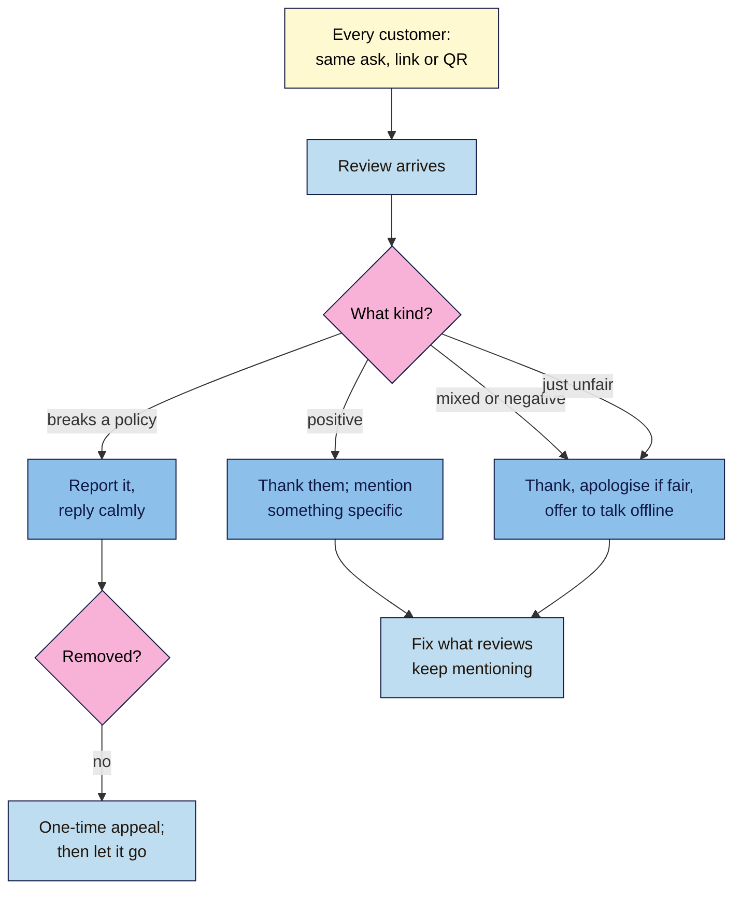

# M11.L04 — Reviews: Get Them Honestly, Reply Well, Stay Legal
> After this lesson you can spot the review tactics Google bans (and some countries make illegal), set up one fair way to ask every customer for a review, and reply to good, mixed, bad and suspicious reviews without making things worse.

**Time:** ~15 min reading + ~40 min hands-on + ~10 min exercise · **Level:** L2 Practitioner · **Prereqs:** M11.L03 · **Remediate to:** M11.L03
**Verified against:** Google Maps "Prohibited and restricted content" policy; Google Business Profile Help "Tips to get more reviews", "Read and reply to reviews", "Report inappropriate reviews" and "Restrictions for fake engagement"; Google blog (Maps, 2023-11-22); US FTC press release (2024-08-14); UK CMA short guide on fake reviews (2025); India PIB release on IS 19000:2022 (2022-11-21), all on 2026-11-09. Not legal advice.

> ⚠️ **Freshness flag:** review rules are tightening in several countries. The UK's ban on fake and hidden-incentive reviews applies from April 2025. The US FTC rule was announced in August 2024. India's IS 19000:2022 standard was **voluntary at launch** for platforms; we couldn't confirm whether that has changed. Google's enforcement tools (warnings on profiles, review pauses) are newer than most tutorials.

## Learning objectives
1. **Recognise** the review practices Google bans (incentives, gating, staff quotas, fake or family reviews) and the penalties. *(O1)*
2. **Build** an asking process that treats every customer the same. *(O2)*
3. **Write** replies for positive, mixed, negative and suspected-fake reviews, and report instead of arguing. *(O3)*

## Why it matters
Reviews are part of prominence, the third local factor (Lesson 11.1). Google says "More reviews and positive ratings can help your business's local ranking." They also decide whether someone actually walks into Nila's tasting room after finding it.

That's why review shortcuts are tempting, and why they're policed hard. A coffee voucher for a 5-star review, a "happy? → Google, unhappy? → private form" funnel, or asking staff to collect 10 reviews each can get reviews removed, new reviews blocked, and a warning shown on the profile. In the UK and US, some of these are also illegal.

## Core concept
**Plain version:** ask **every** customer, the same way, with no reward and no hint about what to write. Reply to reviews briefly and personally, especially the unhappy ones. Report only reviews that break Google's rules, never the ones you just don't like.

**Analogy:** a suggestion box. If you only hand the pen to smiling customers, or pay people to write "great!", the box stops telling anyone the truth, and Google treats the box as rigged.

**Precise definitions:**
- **Fake engagement:** Google's policy name for reviews that aren't genuine, including "Reviews or ratings that have been paid for, directly or in kind".
- **Review gating:** asking only happy customers for public reviews and sending unhappy ones somewhere else. Google bans it: merchants may not "Discourage or prohibit negative reviews, or selectively solicit positive reviews from customers".
- **Incentivised review:** a review given in return for money, a discount, a freebie or entry into a prize draw.
- **Conflict of interest:** a reviewer connected to the business, such as "current or former employment", a contract, competitors or "familial relationships".

### What Google bans (and allows)
| ❌ Banned | Google's wording | Example |
|---|---|---|
| Rewards | Merchants may not "Offer incentives - such as payment, discounts, free goods and/or services - in exchange for posting any review or revision or removal of a negative review." | "Free cookie for a 5-star review", "10% off if you update your review" |
| Gating | "Discourage or prohibit negative reviews, or selectively solicit positive reviews from customers" | A "Loved it? → Google · Not happy? → tell us privately" page |
| Pressure and scripts | Merchants "should not require or pressure users to leave ratings or write reviews while on the premises, nor should they request that specific content be included." | "Please mention 'best yoga in Adyar'" |
| Staff quotas | "Merchants requesting that staff solicit a certain number of reviews", or reviews "that identifies a staff member" | "10 reviews per barista this month" |
| Insiders | "Content that is based on a conflict of interest" | Staff, family, the agency writing reviews |
| Attacks | "Post content on a competitor's place or business to undermine that business' or product's reputation." | 1-star reviews on a rival café |

✅ **Allowed:** "Solicit or encourage the posting of content that does represent a genuine experience, without offering incentives to do so or attempting to influence the rating or the contents of the review." Google even suggests how: "you can ask customers to visit a Google link or scan a QR code."

### What happens if you break the rules
Google says that if a business owner "has violated our Fake Engagement policy", it may remove the reviews and add restrictions such as:
- the "Business Profile will not be able to receive new reviews or ratings for set period of time";
- "existing reviews or ratings will be unpublished for set period of time";
- the profile "will display a warning to let consumers know that fake reviews were removed".

Google's Maps team says its "systems are constantly monitoring for unusual patterns in contributed content" (Google blog, 2023). A burst of 5-star reviews from new accounts after a voucher campaign is just such a pattern *(course inference)*.

### The law (summary, not legal advice)
| Where | What | Who it affects |
|---|---|---|
| 🇺🇸 US | FTC final rule (announced 14 Aug 2024) to "combat fake reviews and testimonials by prohibiting their sale or purchase and allow the agency to seek civil penalties against knowing violators". It also covers incentives "conditioned on the writing of consumer reviews expressing a particular sentiment, either positive or negative", and review suppression through threats | Businesses selling to US customers |
| 🇬🇧 UK | CMA guidance under the DMCC Act (from April 2025) bans "fake reviews" and "concealed incentivised reviews", and businesses must not be "writing or commissioning others to write fake reviews". A star rating in search results counts as a review | Businesses and sites that publish reviews |
| 🇮🇳 India | IS 19000:2022 standard for online reviews, "applicable to every online platform which publishes consumer reviews"; it was to "initially be voluntary" | Mainly platforms; check its current status |
| 🇵🇹 🇳🇬 Elsewhere | Check your own consumer-protection rules | Tomás (EU), Amara's clients |

**Course rule:** buying, swapping or bribing reviews breaks Google's rules everywhere and the law in the US and UK. In India, treat it as at least an unfair-trade-practice risk.

## How it works

**In words:** ask every customer the same way, with the same link or QR code. When a review arrives, decide what kind it is. Thank positive reviewers and mention something specific. For mixed or negative reviews, thank them, apologise if it's fair, and offer to talk offline. A review that's unfair but not against the rules gets the same calm reply. Report only reviews that break Google's policies; if a report fails, you can appeal once, then let it go. Fix what reviews keep mentioning.

> **Under the hood: what happens to your reply.** "Before you can reply to reviews, you must verify your business." Google checks each reply against its policies: "Replies usually take up to 10 minutes to review, but sometimes a review can take up to 30 days." Your reply shows as the business, and "your personal name won't be shown". The reviewer is told you replied, and "Customers can still change their review after reading your reply." A kind reply can turn a 2-star review into a 4-star one; a rude one never will *(observed practice)*.

## Hands-on walkthrough
You'll build a **Review kit** tab in your audit sheet. Nila's details are illustrative.

**Before you start: which steps apply to you?**
- **Path A (your own business):** use your real review link and recent reviews.
- **Path B (practice):** build Nila's kit with the made-up reviews below.
- **Path C (client business):** draft the kit for the client to approve; replies go out under their name.

**Part A — One fair way to ask (15 min)**
1. Path A/C: in your Business Profile, find the option to share a review request link or QR code. Copy the link.
   > 🖼️ **Image prompt:** The Business Profile "Ask for reviews" panel on desktop (1280×800) showing the review link and QR code option. Highlight the copy-link control with a 3px #F9B2D7 outline; blur any personal details.
   > **Alt text:** The Business Profile panel for sharing a review link or QR code, with the copy-link control highlighted.
2. Write one neutral script for every customer. Nila's: "If you have a minute, we'd love your honest review on Google. Here's the QR code." No reward, no "5 stars please", no words to include.
3. List where the ask happens for **every** customer: a counter card, the receipt, the order email. Not a filter that picks happy people.
   **Expected:** one link, one script, two or three places, no rewards or gating.

**Part B — Reply templates (20 min)**
Write five templates (fill-in-the-blank, never copy-paste the same text to everyone):
1. **Positive:** thank by name, mention one specific thing, sign off. "Thanks, Priya! Glad the Chikmagalur pour-over hit the spot. — Nila"
2. **Mixed:** thank, take the point, say what's changing.
3. **Negative and fair:** thank, apologise, explain without excuses, offer to talk ("call or email us at …"), sign off.
4. **Negative and unfair:** calm facts, no blame, invite them to talk. Never share private details.
5. **Suspected fake** (no record of the customer): a calm reply such as "We can't find a visit matching this. Please contact us at …", then report it.
   **Expected:** five short templates, each checked against Google's tips: short, personal, "conversational, not promotional", no offers.

**Part C — Practice (5 min, Path B)**
Reply to these made-up reviews for Nila using your templates:
- ★★★★★ "Lovely tasting session, Arun explained everything."
- ★★ "Waited 25 minutes for a coffee on Saturday."
- ★ "Worst coffee ever" (no record of this person; posted the same day as five other 1-star reviews from new accounts)

**Expected output:** a **Review kit** tab: the link and QR plan, one asking script, five reply templates, and three practice replies.

## When to use / when not to
**Do this** from day one, and reply to reviews regularly (Google says "Respond in a timely manner").

**Don't** offer rewards, ask only happy customers, give staff targets, ask for specific words, have friends or family review you, or argue in public.

**The trade-off:** honest asking brings fewer 5-star reviews at first, and you'll get some criticism. But "A mix of positive and negative feedback often feels more trustworthy", and the reviews can't be taken away.

## Use AI for this
**Example prompt:**
> "Draft a reply to this Google review for my coffee tasting room: [paste review]. Under 60 words, thank them by name, take the point seriously, no excuses, no offers or discounts, invite them to contact us at [email], sign off as Nila. Plain, warm English."

**What AI does well here:** calm first drafts, especially for angry reviews you'd rather not answer when you're upset.
**Where it gets it wrong:** it adds discounts ("next coffee on us"), admits to things you didn't do, sounds the same every time, or invents details about the visit.
**How to check:** remove offers and anything you can't confirm, add one real detail, and read it as the reviewer would.

## Common mistakes
- **"Free cookie for a review"**, even without asking for 5 stars: still an incentive.
- **Gating funnels** in review tools that send only happy customers to Google.
- **Staff targets** or asking customers to name staff.
- **Family, staff or the agency** reviewing the business.
- **Reporting every bad review**: "Do not report a review just because you disagree with it or dislike it."
- **Arguing in public**, or sharing the customer's order details.
- **The same "Thank you!"** on every review.

## Troubleshooting
| Symptom | Likely cause | Fix |
|---|---|---|
| Can't reply to reviews | Profile not verified | Verify (Lesson 11.2) |
| Reply not showing | Still being checked (up to 30 days) or rejected | Wait; edit it if asked |
| Reported review still there | "only those that violate Google policies are eligible for removal" | Submit the one-time appeal if it really breaks a rule; otherwise reply calmly |
| Sudden wave of 1-star reviews from new accounts | Review attack or extortion attempt | Report each; Google's help page has a separate route for extortion scams |
| New reviews blocked or a warning on the profile | Fake engagement restriction | Stop the tactic; remove any gating; follow the email from Google |
| Reviews missing for your business | Not available for some categories or regions | "availability of reviews may change over time"; build reviews on other trusted sites too |

## Exercise
**Task:** finish your **Review kit** (Parts A–C). Then answer these. All details are illustrative.
1. Kavya's front desk offers "₹200 off your next class if you leave us a Google review". Is it fine if she doesn't ask for 5 stars?
2. A review tool asks "How was your visit?" and sends 4–5 stars to Google and 1–3 stars to a private form. What's the problem?
3. Tomás asks his staff to collect 15 reviews each this month. What's wrong?
4. A 1-star review says "rude staff". Nila's records show the visit, and the complaint is fair. Report it?
5. Amara's client wants their cousin and two employees to write reviews "to get started". What should Amara say?
6. A customer in the UK writes a review after receiving a free bag of beans that wasn't mentioned. Which UK rule does this touch?

**Expected outcome:** a completed kit, and these answers:
- **1** No. Any reward is an incentive: "payment, discounts, free goods and/or services" are banned, whatever the rating.
- **2** It's gating: "selectively solicit positive reviews". Ask everyone the same way, with the same link.
- **3** Google lists "Merchants requesting that staff solicit a certain number of reviews" as not allowed. Use one ask for every customer instead of quotas.
- **4** No. It doesn't break a policy, so reply: thank, apologise, say what's changing, offer to talk. Then fix the issue.
- **5** Not allowed: "conflict of interest" includes employment and "familial relationships".
- **6** "Concealed incentivised reviews" under the UK CMA guidance. Don't give freebies for reviews.

**Stretch goal:** read your last 20 reviews (or a competitor's). List the three things people mention most, good or bad, and one change you'd make because of them.

## Key takeaways
- Ask every customer the same way: link or QR code, no rewards, no gating, no scripts, no staff quotas.
- No reviews from staff, family, agencies or rivals.
- Breaking the rules can mean removed reviews, blocked new reviews and a public warning, and in the US and UK it can break the law.
- Reply short, personal and calm; take hard conversations offline; never offer deals in a reply.
- Report only reviews that break Google's rules; appeal once, then move on.

## Teach it back
Explain to a shop owner in 3 sentences why "a free coffee for a review" and "only ask happy customers" are bad ideas, and what to do instead.

## Glossary terms added
- Fake engagement — added to `seo-101/glossary.md`
- Review gating — added to `seo-101/glossary.md`
- Incentivised review — added to `seo-101/glossary.md`
- *Already in the glossary:* Earned media, Google Business Profile

## Further reading
*All checked 2026-11-09.*
- Google Maps — Prohibited and restricted content: https://support.google.com/contributionpolicy/answer/7400114
- Google Business Profile Help — Tips to get more reviews: https://support.google.com/business/answer/3474122
- Google Business Profile Help — Read and reply to reviews: https://support.google.com/business/answer/3474050
- Google Business Profile Help — Report inappropriate reviews: https://support.google.com/business/answer/4596773
- Google Business Profile Help — Restrictions for fake engagement: https://support.google.com/business/answer/14114287
- Google blog — How Google Maps protects against fake content (2023-11-22): https://blog.google/products-and-platforms/products/maps/how-google-maps-protects-against-fake-content/
- FTC — Final rule banning fake reviews and testimonials (2024-08-14): https://www.ftc.gov/news-events/news/press-releases/2024/08/federal-trade-commission-announces-final-rule-banning-fake-reviews-testimonials
- UK CMA — Fake reviews: short guide for businesses: https://www.gov.uk/government/publications/fake-reviews/short-guide-for-businesses-publishing-consumer-reviews-and-complying-with-consumer-protection-law
- PIB — Framework on fake reviews, IS 19000:2022 (2022-11-21): https://pib.gov.in/PressReleasePage.aspx?PRID=1877733

> ⚠️ **May change:** Google's penalties and tools, the status of India's standard, and new laws in other countries. Recheck every 6 months; check local law before any review campaign.

## Refresher card
*Used by remediation when a learner fails a quiz twice on a later lesson that points back here.*
**Ask:** every customer, same way (link/QR), no reward, no rating or wording requests. **Banned:** incentives (payment, discounts, freebies), gating ("selectively solicit positive reviews"), on-premises pressure, staff quotas, conflicts of interest (staff, family, agency), attacking rivals. **Penalties:** reviews removed; new reviews blocked for a time; existing reviews hidden; public warning. **Law:** US FTC rule (2024); UK CMA/DMCC (2025): fake and concealed incentivised reviews; India IS 19000:2022 (platforms, voluntary at launch). **Reply:** verified profiles only; short, personal, "conversational, not promotional"; apologise when fair; take it offline; no private details. **Report:** only policy breaks; one-time appeal; never just because you dislike it.
