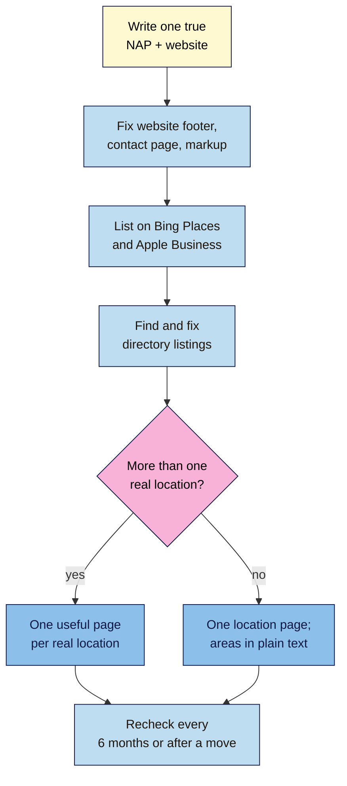

# M11.L05 — One Identity Everywhere: NAP, Citations, Local Pages, Schema, Bing and Apple
> After this lesson you can make your business's name, address, phone and website match everywhere it's listed, build one useful location page (not 20 copies), add basic LocalBusiness markup that matches your profile, and list the business on Bing and Apple Maps too.

**Time:** ~17 min reading + ~45 min hands-on + ~10 min exercise · **Level:** L2 Practitioner · **Prereqs:** M11.L04, M06.L03 · **Remediate to:** M11.L02
**Verified against:** Google Business Profile Help "Guidelines for representing your business on Google", "Tips to improve your local ranking on Google" and "Service-area businesses"; Google Search Central "Spam policies" (last updated 2026-08-28) and "Local business (LocalBusiness) structured data" (last updated 2026-09-08); Apple Support "Apple Business" guide and feature availability (2026-04-14); business.apple.com; a Microsoft Q&A community answer on Bing Places (2025-11-23), all on 2026-11-09.

> ⚠️ **Freshness flag:** Apple Business Connect is now called **Apple Business**, and its old apple.com URLs redirect. Bing Places' help site didn't load for us and its sign-up page is an app, so the Bing steps here come from a community answer, not Microsoft's docs. Check both dashboards before following any older guide.

## Learning objectives
1. **Audit** name, address, phone and URL across 10+ places and fix mismatches (non-negotiable #12). *(O1)*
2. **Plan** location pages that help people, avoiding doorway pages and city-list stuffing. *(O2)*
3. **Write** basic LocalBusiness JSON-LD that matches the profile, and list the business on Bing and Apple. *(O3)*

## Why it matters
Nila's tasting room moved last year. The Business Profile has the new address, but Justdial, Zomato, the Instagram bio, the website footer and an old blog post still show the old one. Two phone numbers float around too. Customers turn up at the wrong street. Search engines see two versions of one business and can't be sure which is right.

This is the course's twelfth non-negotiable: **one consistent identity** (same name, address, phone, URL and profiles everywhere). Google asks you to represent your business "as it's consistently represented and recognized in the real world across signage, stationery, and other branding". Prominence is partly "based on info like how many websites link to your business and how many reviews you have". Your website, listings and markup should all tell the same story.

## Core concept
**Plain version:** write down the one true version of your name, address, phone number and website (**NAP+W**). Make every listing match it: Google, Bing, Apple, directories, social profiles, your footer and your markup. Build one good page for each real location. Don't build a page for every town you'd like to rank in.

**Analogy:** your business card. If you hand out three versions with different phone numbers, people stop trusting any of them.

**Precise definitions:**
- **NAP:** name, address and phone number. An **industry term**, not a Google one; we add **W** for website URL.
- **Citation:** any mention of your business's NAP on another site: a directory (Justdial, Sulekha), a review site, a map app, a social profile, a local association. Also an **industry term**.
- **Location page:** a page on your site for one real place customers visit (the tasting room), with its own address, hours, map and directions.
- **Doorway page:** a page made to rank for a place or phrase that sends people elsewhere. Google calls this "doorway abuse" (Lesson 1.6).
- **LocalBusiness markup:** structured data (Lesson 1.5 introduced structured data) that describes a business's name, address, phone, hours and more.

### Where the identity shows up
| Place | Why it matters | Nila's check |
|---|---|---|
| Google Business Profile | The master copy (Lessons 11.2–11.3) | Already right |
| Website footer and contact page | Google reads your site too: it can "detect category information from your website and from mentions about your business throughout the web" | Footer still shows the old address ❌ |
| Bing Places | Bing Maps and services that use Bing's data | Not listed ❌ |
| Apple Business | Apple Maps, Siri, Wallet | Not listed ❌ |
| Directories your customers use | Justdial, Sulekha; Zomato or Swiggy if you serve food; TripAdvisor; IndiaMART (B2B) | Justdial has the old phone ❌ |
| Social profiles | Instagram, Facebook, LinkedIn | Instagram bio has the old address ❌ |
| Trade and local groups | Chamber of commerce, coffee board listings | Fine |

The directories are *observed practice*: places your customers already look, not proven ranking levers. A vendor survey says citations matter less for classic rankings than they used to, but more for AI answers (Whitespark, *observed practice*; it sells citation tools). Either way, a wrong address in a popular directory sends real people to the wrong street.

### Format rules for NAP
- **Name:** the real-world name, exactly as on the sign (Lesson 11.2). For chains: "All business locations within the same country must have the same name for all locations."
- **Address:** one format, written the same way everywhere (same building name, same street spelling, same PIN code).
- **Phone:** one main number in one format, with the country code: `+91 80 XXXX XXXX`. Google's markup docs say: "Be sure to include the country code and area code in the phone number."
- **Website:** one URL, the location page, with the same `https://` and trailing slash you use everywhere (Lesson 6.3: one canonical URL).

### Location pages: help people, not just rankings
Google's spam policies define the risk: "Doorway abuse is when sites or pages are created to rank for specific, similar search queries." Its examples include "Having multiple domain names or pages targeted at specific regions or cities that funnel users to one page". Keyword stuffing includes "Blocks of text that list cities and regions that a web page is trying to rank for" and "Lists of phone numbers without substantial added value".

| ✅ Good | ❌ Doorway or stuffing |
|---|---|
| Nila: one **tasting room** page with the address, hours, map, photos, parking, directions from Indiranagar metro, events | "Coffee in Koramangala", "Coffee in Whitefield"… 20 copies with only the area name swapped |
| Tomás (hybrid): a shop page plus one **delivery** page listing the areas served in plain text | A footer listing 40 towns "we serve" |
| Kavya: a studio page with the class timetable and how to get there | AI-written pages for every Chennai neighbourhood |

**Course rule of thumb:** add a separate area page only when you have truly different content for it (local projects, the team there, real testimonials from that area). Ask: "Would this page still be useful if Google didn't exist?" (Lesson 4.3). Near-copies also split signals between URLs; Lesson 6.3 covered why duplicates cause trouble.

Nila's online shop ships across India, but that doesn't make all of India a "service area": the shop isn't a local business. Only the tasting room is *(course inference from Google's definitions)*.

### LocalBusiness markup: the basics
Google: "With Local Business structured data, you can tell Google about business hours, different departments within a business, reviews (if your site captures reviews about other businesses), and more."
- **Required:** `name` and `address` ("The physical location of the business. Include as many properties as possible.").
- **Recommended:** `telephone`, `url` ("The fully-qualified URL of the specific business location. The URL must be a working link."), `geo`, `openingHoursSpecification`, `priceRange`.
- **Type:** "Use the most specific LocalBusiness sub-type possible": for example `CafeOrCoffeeShop` (Nila), `HardwareStore` (Tomás), `SportsActivityLocation` (Kavya; schema.org has no yoga-studio type).
- ⚠️ **No self-serving stars:** `aggregateRating` "is only recommended for sites that capture reviews about other local businesses". Nila must not mark up her own Google rating as stars on her own site.
- Breaking the guidelines can mean "Google may issue a manual action against it" (Lesson 9.5).

```json
{
  "@context": "https://schema.org",
  "@type": "CafeOrCoffeeShop",
  "name": "Nila Coffee Tasting Room",
  "address": {
    "@type": "PostalAddress",
    "streetAddress": "12, 100 Feet Road, Indiranagar",
    "addressLocality": "Bengaluru",
    "addressRegion": "KA",
    "postalCode": "560038",
    "addressCountry": "IN"
  },
  "telephone": "+91-80-0000-0000",
  "url": "https://nilacoffee.example/tasting-room/",
  "openingHoursSpecification": [{
    "@type": "OpeningHoursSpecification",
    "dayOfWeek": ["Tuesday","Wednesday","Thursday","Friday","Saturday","Sunday"],
    "opens": "09:00",
    "closes": "19:00"
  }]
}
```
*Illustrative address and phone.* It goes in a `<script type="application/ld+json">` tag on the tasting room page. Every value must match the profile and the footer exactly. Module 12 teaches how to validate it with the Rich Results Test and URL Inspection.

### Bing and Apple
- **Bing Places for Business** (bing.com/forbusiness): a Microsoft Q&A community answer says that if your Google profile is verified, "you can try importing it into Bing Places", and "The process could take up to two days" *(observed practice; not Microsoft documentation)*. You already have Bing Webmaster Tools from Lesson 1.8.
- **Apple Business** (business.apple.com): "Apple Business Connect is now Apple Business". It manages your **Place Card** on Apple Maps. Apple's feature list shows "Brand and Location Management" available in India, Portugal and Nigeria (as of 2026-11-09). Its Grow page also lists a "Virtual Business" option for online stores; Amara's online-only clients could check it *(not verified in detail)*.

## How it works


**In words:** write the one true name, address, phone and website. Fix your own site first (footer, contact page, markup), because you control it. List the business on Bing Places and Apple Business. Then find and fix directory listings. If you have more than one real location, give each one a useful page; otherwise build one location page and list the areas you serve in plain text. Recheck every 6 months, and straight after any move or phone change.

> **Under the hood: why your own site comes first.** Google builds a profile from crawled web content, "Licensed data from third parties", users' edits and the owner's details (Lesson 11.1). Your site is the one source you fully control, and others (directories, AI tools, data aggregators) often copy from it. Fixing the footer first stops the old address from spreading again *(observed practice)*.

## Hands-on walkthrough
You'll build a **NAP audit** tab and a location page plan. Nila's details are illustrative.

**Before you start: which steps apply to you?**
- **Path A (your own business):** audit your real listings and fix the ones you control.
- **Path B (practice):** audit Nila's made-up listings below.
- **Path C (client business):** audit, then send the client a fix list. Claiming listings needs their consent.

**Part A — NAP audit (20 min)**
1. In a new **NAP audit** tab, add columns: Source · URL · Name · Address · Phone · Website · Match? · Fix · Done.
2. Row 1 is the master copy from your Business Profile.
3. Search Google for your name with the old address, the old phone, and "[name] [city]". Add every listing you find (aim for 10+: website footer, contact page, Bing, Apple, Justdial, Sulekha, Zomato, TripAdvisor, Instagram, Facebook, a trade association).
4. Mark each field ✅ or ❌, and write the fix.
   > 🖼️ **Image prompt:** A spreadsheet "NAP audit" tab (1280×720) with 10 rows of sources, columns for name, address, phone and website, and red ❌ cells where details differ from the master row. Highlight the master row with a 3px #F9B2D7 outline; blur any personal details.
   > **Alt text:** A NAP audit sheet with ten listings compared against a master row, mismatches marked with red crosses.
   **Expected:** Path B: at least 4 mismatches (footer, Justdial phone, Instagram address, an old blog post).

**Part B — Location page and markup (15 min)**
1. Plan one location page: address, hours, map embed, real photos, directions from a landmark, parking, what to expect.
2. Write the LocalBusiness JSON-LD with the most specific type, and values copied from the master row.
3. Point the Business Profile's website link at this page (with the UTM tag from Lesson 11.3).
   **Expected:** a page outline and a JSON-LD block whose name, address, phone and URL match row 1 character for character.

**Part C — Bing and Apple (10 min)**
1. Path A/C: in Bing Places, look for the option to import from Google; otherwise add the business by hand.
2. Path A/C: in Apple Business, search for your place and claim or add it.
   **Expected:** both rows in the audit marked "submitted" with today's date. Path B: note the steps you'd take.

**Expected output:** a **NAP audit** tab with 10+ sources and fixes, a location page outline, a matching JSON-LD block, and Bing and Apple rows.

## When to use / when not to
**Do this** after verifying your profile, after any move, rename or phone change, and every 6 months.

**Don't** pay for mass directory submissions to hundreds of sites you've never heard of, build pages for towns you don't serve, use a different phone number in each directory, or mark up your own reviews as stars.

**The trade-off:** a careful NAP clean-up takes a few hours, and some directories are slow to update. Bulk submission services are faster but often create low-quality or wrong listings that are hard to remove *(observed practice)*.

## Use AI for this
**Example prompt:**
> "Here is my master NAP: [paste]. Here are 12 listings I copied from the web: [paste]. Make a table showing which fields differ from the master, character by character (spacing, abbreviations, PIN code, phone format). Don't guess missing values."

**What AI does well here:** spotting tiny differences ("Rd" vs "Road", a missing PIN digit) across many rows.
**Where it gets it wrong:** it invents listings or directories, writes JSON-LD with made-up properties, or suggests a page for every suburb.
**How to check:** open every listing yourself; compare the JSON-LD with Google's docs; apply the "useful without Google?" test to every page idea.

## Common mistakes
- **Fixing directories before your own site:** the old footer keeps spreading the wrong address.
- **Several phone numbers** (tracking numbers in every directory).
- **20 near-identical town pages,** or a block of town names in the footer.
- **Self-serving review stars** in LocalBusiness markup.
- **Markup that doesn't match** the profile (old hours, different name).
- **Forgetting Bing and Apple** because "everyone uses Google".
- **Links to dead `business.site` pages** in old listings (Lesson 11.3).

## Troubleshooting
| Symptom | Likely cause | Fix |
|---|---|---|
| Customers arrive at the old address | An old listing or the footer | Search for the old address in quotes; fix each source |
| Wrong phone shown in Maps | An edit from data Google trusts | Fix the profile and the website; check for suggested edits |
| Directory won't let you edit | Listing not claimed | Claim it with the business's consent, or contact the site |
| Location pages not indexed | Near-duplicates (Lesson 6.3) | Merge into one useful page, or add truly local content |
| Bing import fails | Profile not verified or a sync error | Add the business by hand; contact Bing Places support |
| Markup gives errors | Missing `address` or bad format | Fix it; Module 12 covers validation |

## Exercise
**Task:** finish your **NAP audit** tab, location page outline and JSON-LD (Parts A–C). Then answer these. All details are illustrative.
1. Nila's footer says "100 Ft Rd" and the profile says "100 Feet Road". Does it matter?
2. Tomás wants 30 pages: "Hardware store in Sintra", "Hardware store in Cascais"… each with the town name swapped. What does Google call this?
3. Nila's markup includes `aggregateRating` with her 4.7 stars from Google. What's wrong?
4. Kavya's studio has no "YogaStudio" type in schema.org. What should she use?
5. Which should Nila fix first: Justdial or her website footer? Why?
6. Amara's client is online-only and can't have a Business Profile. Is there any map listing they could look at?

**Expected outcome:** a completed audit, and these answers:
- **1** Probably not on its own, but one format everywhere avoids doubt. Pick one and use it everywhere (non-negotiable #12).
- **2** Doorway abuse: "pages targeted at specific regions or cities that funnel users to one page". One delivery page listing the areas is better.
- **3** `aggregateRating` "is only recommended for sites that capture reviews about other local businesses". Remove it.
- **4** The most specific type that fits, such as `SportsActivityLocation` (schema.org). Check Module 12 for validation.
- **5** The footer: she controls it, and others copy from it.
- **6** Apple Business lists a "Virtual Business" option for online stores (check the details); otherwise focus on a consistent website and social profiles.

**Stretch goal:** search your business name in Bing Maps and Apple Maps. Note what each shows and whether it matches row 1.

## Key takeaways
- One true name, address, phone and website, the same everywhere (non-negotiable #12).
- Fix your own site first, then Bing, Apple and the directories your customers use.
- One useful page per real location; no town-swap copies or footer city lists.
- LocalBusiness JSON-LD: most specific type, values that match the profile, no self-serving review stars.
- Recheck after any move or phone change, and every 6 months.

## Teach it back
Explain to a shop owner in 3 sentences why their address must be written the same way everywhere, and why 20 "near me" town pages are a bad idea.

## Glossary terms added
- NAP — added to `seo-101/glossary.md`
- Citation (local) — added to `seo-101/glossary.md`
- Location page — added to `seo-101/glossary.md`
- LocalBusiness markup — added to `seo-101/glossary.md`
- *Already in the glossary:* Structured data, Doorway abuse, Google Business Profile

## Further reading
*All checked 2026-11-09.*
- Google Business Profile Help — Guidelines for representing your business: https://support.google.com/business/answer/3038177
- Google Business Profile Help — Tips to improve your local ranking: https://support.google.com/business/answer/7091
- Google Search Central — Spam policies (doorway abuse, keyword stuffing): https://developers.google.com/search/docs/essentials/spam-policies
- Google Search Central — Local business structured data: https://developers.google.com/search/docs/appearance/structured-data/local-business
- Apple Support — Apple Business: https://support.apple.com/en-gb/guide/apple-business-connect/welcome/web
- Apple Support — Apple Business feature availability: https://support.apple.com/en-gb/guide/business/axmef1c47twq/web
- Microsoft Q&A — Importing a Google profile into Bing Places (community answer, 2025-11-23): https://learn.microsoft.com/en-gb/answers/questions/5632446/bing-places-manual-verification-needed-for-busines

> ⚠️ **May change:** Apple Business features and names, Bing Places steps, Google's markup fields. Recheck every 6 months.

## Refresher card
*Used by remediation when a learner fails a quiz twice on a later lesson that points back here.*
**NAP+W:** one true name, address, phone (with country code), website; same format everywhere (#12). **Order:** own site (footer, contact, markup) → Bing Places → Apple Business → directories customers use → socials. **Location pages:** one useful page per real place; no town-swap copies ("doorway abuse"), no city lists or phone lists ("keyword stuffing"). **LocalBusiness JSON-LD:** required `name`, `address`; recommended `telephone`, `url`, hours; most specific type; no self-serving `aggregateRating`; must match the profile. **Bing:** import from Google may work (community answer). **Apple:** Apple Business (formerly Business Connect); available in India, Portugal, Nigeria.
