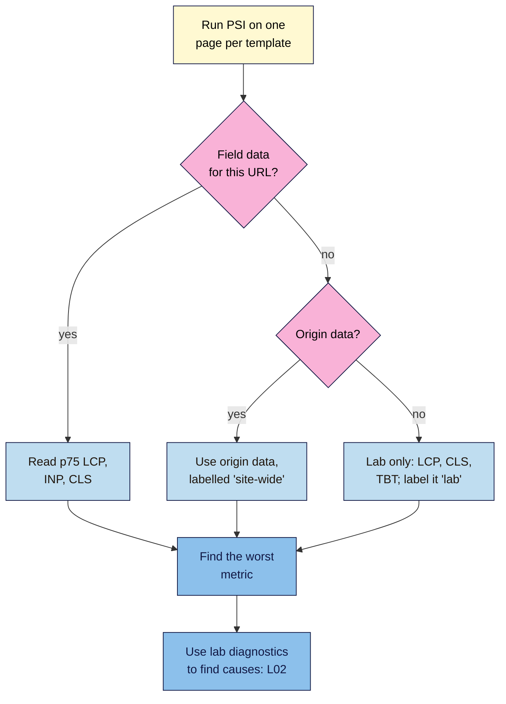

# M12.L01 — Core Web Vitals: Read Field Data First
> After this lesson you can explain what LCP, INP and CLS measure and what "good" means for each, tell real-user (field) data apart from a one-off test (lab data), and read PageSpeed Insights and Search Console for three page templates without chasing a perfect score.

**Time:** ~16 min reading + ~40 min hands-on + ~10 min exercise · **Level:** L3 Advanced · **Prereqs:** M10.L02, M04.L04 · **Remediate to:** M10.L02
**Verified against:** Google Search Central "Understanding Core Web Vitals and Google search results" (last updated 2025-12-10) and "Understanding page experience in Google Search results" (2026-09-22); web.dev "Web Vitals", "Largest Contentful Paint", "Interaction to Next Paint", "Cumulative Layout Shift" and "Why lab and field data can be different" (2022); PageSpeed Insights "About" (2024-10-21); Chrome UX Report methodology; Search Console Help "Core Web Vitals report", all on 2026-11-09. No Lighthouse or browser tests were run for this lesson.

> ⚠️ **Freshness flag:** INP replaced FID as a Core Web Vital in March 2024, so **any guide that still lists FID is out of date**. web.dev says "Stable Core Web Vitals metrics won't change more than once per year", with notice. Google's wording on how CWV relate to ranking was changed in December 2025. Recheck the thresholds before you teach them.

## Learning objectives
1. **Define** LCP, INP and CLS and their "good" thresholds at the 75th percentile. *(O1)*
2. **Distinguish** field data (CrUX) from lab data (Lighthouse), and explain "No data available". *(O2)*
3. **Read** PageSpeed Insights and the Search Console Core Web Vitals report for three page templates. *(O3)*

## Why it matters
Nila's developer sends a screenshot: "Performance 58 on mobile! We need a ₹60,000 speed project." Nila's friend says Google only cares about a "90+ score". Both are mixing up two things: a **lab score** from one simulated test, and **Core Web Vitals**, which measure what real visitors experience.

Google is clear on both sides. It recommends "good Core Web Vitals for success with Search", and says they "are used by our ranking systems". But it also says good results don't "guarantee that your pages will rank at the top", "trying to get a perfect score just for SEO reasons may not be the best use of your time", and "Google Search always seeks to show the most relevant content, even if the page experience is sub-par." So the job is to know what the real numbers are before spending money on fixes. Speed is part of non-negotiable #13 (a site that's fast enough, secure, mobile-friendly and valid).

## Core concept
**Plain version:** Core Web Vitals are three measures of how a page feels to real people: how fast the main content appears (**LCP**), how quickly the page reacts when you tap or type (**INP**), and whether things jump around while you read (**CLS**). Google judges them with **field data**: real Chrome users over the last 28 days. A **lab** test (the Performance score) is a single simulated run, useful for finding causes but not the thing Google measures.

**Analogy:** a restaurant. Field data is months of real diners' reviews. A lab test is a food critic eating there once on a quiet Tuesday. The critic helps you find the problem dish; the diners tell you whether there really is a problem.

**Precise definitions:**
- **LCP (Largest Contentful Paint):** loading. It "reports the render time of the largest image, text block, or video visible in the viewport". Often the hero image or the main heading.
- **INP (Interaction to Next Paint):** responsiveness to "click, tap, and keyboard interactions" across the visit. "The final INP value is the longest interaction observed, ignoring outliers." Scrolling and hovering don't count.
- **CLS (Cumulative Layout Shift):** visual stability; "the largest burst of layout shift scores for every unexpected layout shift" during the visit.
- **75th percentile:** the value that 75% of visits meet or beat. Google's guidance: "a good threshold to measure is the 75th percentile of page loads, segmented across mobile and desktop devices."
- **CrUX (Chrome UX Report):** Google's public dataset of real Chrome users' experience, which feeds PageSpeed Insights and Search Console.
- **TBT (Total Blocking Time):** a lab metric. Lab tools "cannot measure INP, as there is no user input", but TBT "is lab-measurable and is a proxy for INP".

### The thresholds
PageSpeed Insights uses these ranges (from its "About" page):

| Metric | ✅ Good | ⚠️ Needs improvement | ❌ Poor |
|---|---|---|---|
| **LCP** | 2.5 s or less | over 2.5 s up to 4 s | over 4 s |
| **INP** | 200 ms or less | over 200 ms up to 500 ms | over 500 ms |
| **CLS** | 0.1 or less | over 0.1 up to 0.25 | over 0.25 |

A page passes when it meets all three at the 75th percentile. Google's Search page words the targets as "less than 200 milliseconds" and "less than 0.1"; the tools treat exactly 200 ms or 0.1 as good. Use the tools' ranges.

### Field vs lab
| | Field data | Lab data |
|---|---|---|
| What | "data collected from the real users visiting your site" | "data collected in a controlled environment with predefined device and network settings" |
| Source | CrUX, "over the previous 28-day collection period" | Lighthouse, run once when you click Analyze |
| Measures | LCP, INP, CLS (what Google uses) | LCP, CLS, TBT and a 0–100 Performance score; **no INP** |
| Shape | "it's a distribution of numbers" | One run; changes each time |
| Best for | Is there a real problem? | Why is it slow? |

"Your lab data might indicate that your site performs great, but your field data suggests it needs improvement" (and the other way round). When they disagree, field data is the truth about users; lab data is the tool for finding causes.

### "No data available" is normal for small sites
CrUX only includes pages with enough real Chrome visits: "A page must be publicly discoverable to be considered", and "you cannot manually submit pages or origins". If a page lacks data, PSI "will fall back to origin-level granularity" (the whole site), and sometimes it shows no field data at all. Search Console says "No data available" when the property is new or "there is not enough data available in the CrUX report".

Nila, Kavya, Tomás and Amara's clients are all small sites, so expect this. Then you work from lab data, labelled as lab data, and fix the obvious causes (Lesson 12.2).

### The Search Console Core Web Vitals report
- It shows "real world usage data (sometimes called field data)", for indexed URLs.
- URLs are grouped into **URL groups** (similar pages, such as all product pages) with a status of **Poor**, **Need improvement** (Search Console's spelling) or **Good**.
- A group's status "is its most poorly performing metric": good LCP and CLS but poor INP means **Poor**.
- After fixing, click **Start Tracking** on the issue. Because field data covers 28 days, expect the check to take about a month *(observed practice; Google's help doesn't state a length)*.

## How it works

**In words:** run PageSpeed Insights on one page from each template. If the page has field data, read the 75th-percentile LCP, INP and CLS. If not, use the site-wide (origin) data and say so. If there's no field data at all, use the lab results (LCP, CLS and TBT as a clue for INP) and label them as lab. Find the worst metric, then use the lab diagnostics to find causes (Lesson 12.2).

> **Under the hood: why one score isn't the whole story.** Google's page experience guidance says "There is no single signal" and that its core ranking systems look at page experience alongside many other things. CWV are field measures at the 75th percentile, split by mobile and desktop. The Lighthouse Performance score is a weighted lab summary that doesn't include INP at all. So a 58 can sit beside a page that passes CWV, and a 95 beside one that fails *(the course's reading of the docs above)*. That's why we never report "the score" alone.

## Hands-on walkthrough
You'll build a **CWV** tab with field and lab results for three templates. Nila's figures are illustrative.

**Before you start: which steps apply to you?**
- **Path A (your own site):** use your pages and Search Console.
- **Path B (practice):** use your WordPress practice site (Module 5) or Nila's figures below; your practice site will show no field data.
- **Path C (client site):** use the client's pages; ask for Search Console access as a user.

**Part A — Pick three templates (5 min)**
1. In a new **CWV** tab, list one URL for each template: home, a product (or service) page, and a blog post. Templates matter because pages built the same way usually share problems.

**Part B — PageSpeed Insights (25 min)**
1. Run each URL on https://pagespeed.web.dev/ (mobile first, then desktop).
2. For each, record: **Field data?** (this URL / origin / none) · p75 LCP · p75 INP · p75 CLS · pass/fail · then lab LCP · lab CLS · TBT · Performance score · date.
   > 🖼️ **Image prompt:** A PageSpeed Insights mobile report (1280×900) showing the real-user Core Web Vitals section at the top (LCP, INP, CLS with the 75th-percentile values) and the lab Performance score below. Highlight the real-user section with a 3px #F9B2D7 outline; blur any personal details.
   > **Alt text:** A PageSpeed Insights report with the real-user Core Web Vitals section at the top highlighted and the lab score below.
3. Write one line per template: "Worst metric: … (field/lab, date)."
   **Expected (Nila, illustrative):** home: origin data only, LCP 3.1 s (needs improvement), INP 140 ms, CLS 0.02; product: no URL data, lab LCP 4.4 s, CLS 0.18, TBT 420 ms; brew guide: lab LCP 2.2 s, CLS 0.27 (an ad slot and an embed shifting the text).

**Part C — Search Console (10 min, Path A/C)**
1. Open **Core Web Vitals** under Experience. Note the mobile and desktop status counts and any URL group that's Poor or Need improvement, with its metric.
2. If it says "No data available", write that down with the date. That's a valid result.
   **Expected:** a dated line per device, or "No data available".

**Expected output:** a **CWV** tab with three templates × mobile/desktop: the data source, field values or "none", lab values, the worst metric, and the date.

## When to use / when not to
**Do this** before any speed project, after a theme or plugin change, and monthly for sites with field data.

**Don't** pay for a project to raise the Lighthouse score alone, compare one site's lab result with another's field data, report a single run as "our speed", or quote FID.

**The trade-off:** field data is the truth but slow (28 days) and missing for small sites; lab data is instant but only one simulated visit. Use field data to decide *whether* to act, and lab data to find *what* to fix.

## Use AI for this
**Example prompt:**
> "Here are PageSpeed Insights results for three templates: [paste the table, with field/lab labels]. For each, tell me the worst Core Web Vital, whether it's field or lab, and the 2–3 PSI diagnostics most likely linked to it. Don't invent numbers; if field data is missing, say so."

**What AI does well here:** turning a messy table into a clear summary, and explaining diagnostics in plain words.
**Where it gets it wrong:** it cites FID, quotes old thresholds, mixes up lab and field, treats the Performance score as a ranking factor, or invents numbers for missing field data.
**How to check:** compare every threshold with the table above, and every number with your sheet.

## Common mistakes
- **Chasing a Lighthouse 100** instead of passing CWV for real users.
- **Mixing lab and field** in one comparison (Lesson 10.2: lab vs lab, field vs field).
- **Testing only the home page:** product and post templates often differ.
- **Ignoring mobile:** most visits to small shops are on phones *(observed practice)*.
- **Quoting FID**, retired in March 2024.
- **Reading one PSI run as final:** lab results vary; run it two or three times and note the range.
- **Treating "No data available" as an error.**

## Troubleshooting
| Symptom | Likely cause | Fix |
|---|---|---|
| No field data in PSI | Not enough Chrome visits | Use origin data or lab data, labelled |
| CWV report says "No data available" | New property or too little CrUX data | Record it; use PSI lab per template |
| Lab score jumps between runs | Network and server variation | Run 2–3 times; record the median |
| Lab looks good, field is poor | Real users on slower phones and networks, or slow interactions after load | Trust field; test on a mid-range phone; look at INP causes |
| Search Console URL group Poor, but your page passes in PSI | The group's worst metric, or 28-day lag | Check the group's metric and sample URLs; wait for new data |
| A guide says "FID under 100 ms" | Out of date | Use INP thresholds |

## Exercise
**Task:** finish your **CWV** tab (Parts A–C). Then answer these. All figures are illustrative.
1. Nila's product page: field LCP 2.3 s, INP 180 ms, CLS 0.14. Pass or fail? Which metric?
2. The developer says "Performance 58 = Google will bury us." What's the correct reply?
3. Kavya's site has no field data anywhere. What should her report say?
4. Tomás's lab TBT is 900 ms. What does that hint at, and why can't the lab show INP?
5. A Search Console URL group has good LCP and CLS but INP of 320 ms. What's its status?
6. Amara's client guide says "aim for FID under 100 ms". What's wrong?

**Expected outcome:** a completed CWV tab, and these answers:
- **1** Fail: CLS 0.14 is over 0.1 (needs improvement). LCP and INP are good.
- **2** The Performance score is a lab summary, not a Core Web Vital. Check field data first; Google says a perfect score "just for SEO reasons may not be the best use of your time".
- **3** "No field data (CrUX) for this URL or origin as of <date>. Lab results: … These are one simulated test."
- **4** Long JavaScript tasks that may make taps slow; lab tools "cannot measure INP, as there is no user input".
- **5** Need improvement: the status "is its most poorly performing metric", and 320 ms is in that range.
- **6** INP replaced FID in March 2024. Use INP: 200 ms or less is good.

**Stretch goal:** run PSI on one competitor's equivalent template (Lesson 10.2), and compare field with field (or lab with lab), never across.

## Key takeaways
- LCP (loading) ≤2.5 s, INP (responsiveness) ≤200 ms, CLS (stability) ≤0.1, all at the 75th percentile.
- Field data (CrUX, 28 days) decides whether there's a problem; lab data helps find why.
- Lab tools can't measure INP; TBT is the clue.
- Small sites often have no field data: say so and work from labelled lab data.
- Search Console groups similar URLs; the worst metric sets the status.
- Good CWV help, but relevance comes first and a perfect score isn't the goal.

## Teach it back
Explain to a shop owner in 3 sentences the difference between "our speed score is 58" and "our pages pass Core Web Vitals", and which one Google uses.

## Glossary terms added
- LCP (Largest Contentful Paint) — added to `seo-101/glossary.md`
- INP (Interaction to Next Paint) — added to `seo-101/glossary.md`
- CLS (Cumulative Layout Shift) — added to `seo-101/glossary.md`
- CrUX (Chrome UX Report) — added to `seo-101/glossary.md`
- TBT (Total Blocking Time) — added to `seo-101/glossary.md`
- *Already in the glossary:* Core Web Vitals, Field data, Lab data

## Further reading
*All checked 2026-11-09.*
- Google Search Central — Understanding Core Web Vitals and Google search results: https://developers.google.com/search/docs/appearance/core-web-vitals
- Google Search Central — Understanding page experience: https://developers.google.com/search/docs/appearance/page-experience
- web.dev — Web Vitals: https://web.dev/articles/vitals
- web.dev — LCP: https://web.dev/articles/lcp · INP: https://web.dev/articles/inp · CLS: https://web.dev/articles/cls
- web.dev — Why lab and field data can be different (2022): https://web.dev/articles/lab-and-field-data-differences
- PageSpeed Insights — About: https://developers.google.com/speed/docs/insights/v5/about
- Chrome for Developers — CrUX methodology: https://developer.chrome.com/docs/crux/methodology
- Search Console Help — Core Web Vitals report: https://support.google.com/webmasters/answer/9205520

> ⚠️ **May change:** metrics and thresholds (at most yearly, with notice), Search Console labels, PSI's layout. Recheck web.dev's Web Vitals page every 6 months.

## Refresher card
*Used by remediation when a learner fails a quiz twice on a later lesson that points back here.*
**CWV:** LCP (largest image/text/video shown) ≤2.5 s · INP (longest click/tap/key response, ignoring outliers) ≤200 ms · CLS (largest burst of unexpected shifts) ≤0.1; poor = >4 s / >500 ms / >0.25; judged at p75, mobile and desktop separately; pass = all three. **Field** = CrUX real users, 28 days, decides; **lab** = Lighthouse, one run, finds causes, no INP (TBT is the proxy). **No data** = normal for small sites; use origin, then labelled lab. **Search Console:** URL groups; status = worst metric; "Need improvement"; Start Tracking after fixes. **Ranking:** CWV used, but relevance first; don't chase a perfect score. FID is retired (March 2024).
