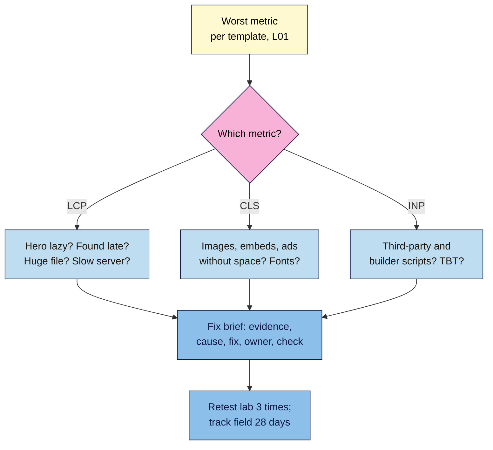

# M12.L02 — Fixing Core Web Vitals: Causes and Fix Briefs
> After this lesson you can trace a poor LCP, INP or CLS to its most likely cause, spot the classic mistakes in a page's HTML yourself, and write a short fix brief a developer or theme owner can act on, without rewriting any code yourself.

**Time:** ~16 min reading + ~45 min hands-on + ~10 min exercise · **Level:** L3 Advanced · **Prereqs:** M12.L01 · **Remediate to:** M12.L01
**Verified against:** web.dev "Optimize Largest Contentful Paint" (2025-03-31), "Optimize Interaction to Next Paint" (2025-09-02), "Optimize Cumulative Layout Shift" (2025-02-07) and "Browser-level image lazy loading" (2024-08-13); WordPress core dev notes "Lazy-loading images in 5.5" (2020-07-14) and "Image performance enhancements in WordPress 6.3" (2023-07-13), all on 2026-11-09. No Lighthouse or browser tests were run for this lesson.

> ⚠️ **Freshness flag:** WordPress has changed how it adds `loading="lazy"` and `fetchpriority` several times since 5.5, and themes, sliders and page builders can override it. **Check your own page's HTML; don't assume.** Browser support for newer tricks (like `fetchpriority`) is now wide, but recheck web.dev before relying on anything new.

## Learning objectives
1. **Diagnose** the likely cause of a poor LCP, INP or CLS from PageSpeed Insights' diagnostics and the page's HTML. *(O1)*
2. **Apply** the core fixes: never lazy-load the LCP image, set `fetchpriority`, give images and embeds space, handle fonts, cut heavy third-party scripts. *(O2)*
3. **Write** a fix brief a developer or theme owner can act on and verify. *(O3)*

## Why it matters
In Lesson 12.1, Nila's CWV tab showed three problems: the home page's LCP is slow, the product template's CLS is too high, and the brew-guide posts jump around when an embed loads. Her developer's answer to everything is "compress the images and install a speed plugin". Sometimes that helps. Often it doesn't, because the real cause is something else: a hero image told to load *late*, or a video box with no space saved for it.

You don't need to write code to fix this. You need to find the likely cause, describe the fix precisely, and say how you'll check it worked. That's a **fix brief**. It turns "make it faster" into a job someone can finish.

## Core concept
**Plain version:** each Core Web Vital has a few usual suspects. **Slow LCP:** the main image is found late, loaded late, or is huge. **Poor CLS:** images, ads or embeds without space reserved, or fonts swapping. **Poor INP:** too much JavaScript running when someone taps. Find which suspect it is, then write one clear brief per template.

**Analogy:** a car that won't start. "Buy a new car" is the developer's "speed plugin". A mechanic checks the battery, the fuel and the starter in order. You're the person who tells the mechanic exactly what the car does.

**Precise definitions:**
- **LCP image:** the image that is the largest visible element when the page loads (often the hero or the product photo).
- **Lazy loading:** delaying images until they're near the screen (`loading="lazy"`). Great below the fold; harmful for the LCP image.
- **`fetchpriority="high"`:** an HTML hint that tells the browser to fetch this image before less important ones.
- **Third-party script:** code loaded from another company's server: chat widgets, ad tags, social embeds, review widgets, tag managers.
- **Fix brief:** a short note for one template: the failing metric, the evidence, the likely cause, the proposed fix, the owner, and how you'll check it.

### LCP: where the time goes
web.dev splits LCP into four parts, with a rough target share for each ("these time breakdowns are guidelines, not strict rules"):

| Part | What it is | Rough share | Typical cause |
|---|---|---|---|
| Time to first byte | The server answering | ~40% | Slow hosting, no page cache |
| Resource load delay | Waiting before the image starts downloading | <10% | Image lazy-loaded, set in CSS or added by JavaScript |
| Resource load duration | Downloading the image | ~40% | Huge file, wrong format (Lesson 4.4) |
| Element render delay | Waiting to show it after download | <10% | Render-blocking CSS/JS, a slider's script |

Key rules from web.dev:
- "your LCP resource should be discoverable from the HTML source" (not added later by a slider's script or hidden in CSS).
- "Never lazy-load your LCP image, as that will always lead to unnecessary resource load delay, and will have a negative impact on LCP."
- Compressing alone can fail: it can "reduce the resource load duration, but it wouldn't actually improve LCP because the time would just shift to the element render delay". Find the slow part first.

**WordPress:** since 5.5, "WordPress will add loading="lazy" to all img tags that have width and height attributes present", and since 6.3 it "automatically adds the fetchpriority attribute with a value of "high"" to the image it thinks is the LCP image. Core tries to skip lazy loading for that first image, but **themes, sliders and page builders can override it** *(observed practice)*. That's why you check the HTML.

### CLS: give everything its space
web.dev: "The most common causes of a poor CLS are: Images without dimensions. Ads, embeds, and iframes without dimensions. Dynamically injected content such as ads, embeds, and iframes without dimensions. Web fonts."
- Add `width` and `height` to every ``: without them, "image dimensions default to 0×0 pixels" until the image loads, so the text below jumps.
- Reserve space for embeds and ad slots (a box with a set size or aspect ratio).
- "CLS often happens while the user scrolls through a page, when lazy-loaded content loads fully without space reserved for it."
- Fonts: a late web font can reflow text; `font-display: optional` "can avoid a re-layout" (a theme or developer setting).
- Don't push content down with banners or cookie bars that appear after load; overlay them instead *(observed practice)*.

### INP: less work when someone taps
An interaction has three parts: "The input delay", "The processing duration" and "The presentation delay". The input delay is often long tasks already running on the main thread. web.dev's advice to developers is to "Yield to the main thread often".

You won't write that code. Your job is to find the likely culprits and list them in the brief *(observed practice)*:
- third-party scripts (chat, review and social widgets, several analytics tags);
- page-builder and slider JavaScript on every page;
- heavy "add to cart" or filter scripts on product pages.

The lab clue is **TBT** (Lesson 12.1). PSI's diagnostics often name the scripts with the most blocking time.

### The fix brief
| Field | Nila's product template (illustrative) |
|---|---|
| Template + example URL | Product: `/shop/chikmagalur-medium-roast/` |
| Failing metric (field or lab, p75, date) | CLS 0.18 (lab; no field data), 2026-11-09 |
| Evidence | PSI "Avoid large layout shifts" points at the review widget and the product gallery |
| Likely cause (with source) | "Dynamically injected content … without dimensions" (web.dev) |
| Proposed fix | Reserve a fixed-height box for the review widget; add `width`/`height` to gallery images |
| Owner | Theme developer |
| How we'll check | PSI lab CLS ≤0.1 in 3 runs; Search Console Start Tracking (Path A) |
| Won't do | Install a second speed plugin |

## How it works

**In words:** start from each template's worst metric. For LCP, check whether the hero image is lazy-loaded, found late, huge, or waiting on a slow server. For CLS, check images, embeds and ads without reserved space, and fonts. For INP, look for heavy third-party and page-builder scripts, with TBT as the clue. Write one brief per template with the evidence, cause, fix, owner and check. After the fix, retest in the lab three times and track field data for 28 days.

> **Under the hood: why the browser can't find a hero in CSS.** The browser reads the HTML from the top and starts downloading images it sees in `` tags straight away. An image set as a CSS background, or added by a slider's JavaScript, is only discovered after the CSS or script has loaded and run. That's "resource load delay", and why web.dev wants the LCP image "discoverable from the HTML source" *(the course's summary of web.dev's guidance)*.

## Hands-on walkthrough
You'll check the hero image yourself and write three fix briefs in your **CWV** tab. Nila's details are illustrative.

**Before you start: which steps apply to you?**
- **Path A (your own site):** check and brief your three templates; fix only what you can safely change (for example, image settings), and send the rest to your developer.
- **Path B (practice):** use your WordPress practice site's home page and Nila's figures.
- **Path C (client site):** write the briefs; the client's developer makes the changes.

**Part A — The hero image check (15 min)**
1. Open the home page, right-click → **View Page Source** (or add `view-source:` before the URL).
2. Search (Ctrl/Cmd+F) for `` at all, or a CSS background or slider script?
   > 🖼️ **Image prompt:** A browser's View Source window (1280×720) showing a hero `` tag with `loading="lazy"` and no `width` or `height` attributes. Highlight `loading="lazy"` on the hero image with a 3px #F9B2D7 outline; blur any personal details.
   > **Alt text:** View Source showing a hero image tag with loading lazy and no width or height, with the lazy attribute highlighted.
   **Expected (Nila, illustrative):** the slider's first slide is ``, with no dimensions and no `fetchpriority`. That's two likely LCP causes and one CLS cause.

**Part B — Read PSI's diagnostics (15 min)**
1. Rerun PSI for each template. Under the diagnostics, note those linked to your failing metric (for example, the LCP element, "Avoid large layout shifts", long main-thread tasks, third-party code).
2. Note the LCP element PSI names. Is it the image you expected?
   **Expected:** for each template, 1–3 diagnostics matched to the failing metric.

**Part C — Three fix briefs (15 min)**
1. Copy the fix-brief table into your **CWV** tab, once per template.
2. Fill in every field. In "Likely cause", quote the web.dev cause. In "How we'll check", give the lab target and the field follow-up.
   **Expected:** three briefs. Nila's home page brief: "Remove `loading="lazy"` from the first slide, add `fetchpriority="high"`, `width` and `height`; or replace the slider with one static hero ``."

**Expected output:** a hero image check and three fix briefs (home, product, post) in your **CWV** tab.

## When to use / when not to
**Do this** when a template fails CWV in field data, or (for small sites) when lab results show an obvious cause such as a lazy hero or images without dimensions.

**Don't** stack speed plugins, delete useful features just to gain lab points, lazy-load everything, or chase small lab gains on pages that already pass in the field.

**The trade-off:** every widget has a cost. A chat widget or review carousel may help sales but slow interactions. Decide with the owner which ones earn their place, and load the rest only where they're needed *(observed practice)*.

## Use AI for this
**Example prompt:**
> "Here is the `<head>` and the first 60 lines of `<body>` from my home page: [paste]. Which image is most likely the LCP element? Is it lazy-loaded, missing width/height or fetchpriority, or discovered late (CSS background or script)? Answer only from the HTML I gave you."

**What AI does well here:** reading long HTML and pointing at the hero tag and its attributes.
**Where it gets it wrong:** it recommends lazy-loading everything, invents plugin settings, or writes code for your theme that breaks it.
**How to check:** confirm each finding in View Source, and test any change on a staging copy (a password-protected test site, Lesson 6.2) before going live.

## Common mistakes
- **Lazy-loading the hero image** (often through a slider or page-builder setting).
- **Compressing images when the delay is elsewhere** (server, discovery or render).
- **Missing `width` and `height`** on images, or no reserved space for embeds and ads.
- **Two or three speed plugins** fighting each other.
- **Writing "make it faster"** instead of a brief with a cause and a check.
- **Judging a fix on one lab run**, or claiming field improvement before 28 days.

## Troubleshooting
| Symptom | Likely cause | Fix |
|---|---|---|
| LCP element is a background image | Set in CSS, found late | Use an `` in the HTML for the hero |
| Hero still lazy after WordPress update | Theme or slider overrides core | Change the slider/theme setting, or replace the slider |
| CLS only when scrolling | Lazy content or embeds without reserved space | Reserve the space (fixed size or aspect ratio) |
| CLS when the page first loads | Late font, cookie bar or banner pushing content | Font setting; overlay banners instead of inserting them |
| High TBT, slow taps | Third-party or builder scripts | List scripts by blocking time; remove or delay non-essential ones |
| Lab improved, field didn't | Field covers 28 days | Wait; recheck after a month |

## Exercise
**Task:** finish your hero check and three fix briefs (Parts A–C). Then answer these. All details are illustrative.
1. Nila's hero is ``. Name three problems.
2. Her developer compressed the hero from 600 KB to 200 KB, but LCP didn't change. What might explain it?
3. Kavya's class timetable is an embedded calendar that pushes the page down as it loads. Which metric, and what fix?
4. Tomás's product pages have TBT 900 ms with a chat widget, a reviews carousel and two analytics tags. What goes in the brief?
5. A plugin offers to "lazy-load all images, including above the fold, for a better score". Accept?
6. Amara's client's blog title text jumps when the web font loads. Which metric, and what's one fix to suggest?

**Expected outcome:** three briefs, and these answers:
- **1** Lazy-loaded LCP image ("Never lazy-load your LCP image"), no `width`/`height` (CLS), no `fetchpriority="high"`.
- **2** The slow part was elsewhere: the time can "shift to the element render delay" (for example, a slider script or slow server). Check the four LCP parts.
- **3** CLS ("embeds, and iframes without dimensions"): reserve a fixed-height box for the calendar.
- **4** Metric INP (lab clue TBT 900 ms); list the scripts with the most blocking time; propose removing or delaying the ones that don't earn their place; check TBT in 3 runs and field INP after 28 days.
- **5** No: never lazy-load the LCP image; lazy-load only below the fold.
- **6** CLS; ask the developer about `font-display: optional` or a closely matched fallback font.

**Stretch goal:** check one competitor's hero image the same way (View Source only). Note what they do differently, without copying anything.

## Key takeaways
- LCP: make the hero an `` in the HTML, never lazy, with `fetchpriority="high"`; then look at file size and server speed.
- CLS: dimensions on every image, reserved space for embeds and ads, careful fonts.
- INP: fewer and lighter scripts, especially third-party ones; TBT is your lab clue.
- Find the slow part before fixing; compression alone may not help.
- Write a fix brief: metric, evidence, cause, fix, owner, check.

## Teach it back
Explain to a developer in 3 sentences why "compress the images" didn't fix LCP, and what you want checked instead.

## Glossary terms added
- LCP image — added to `seo-101/glossary.md`
- fetchpriority — added to `seo-101/glossary.md`
- Third-party script — added to `seo-101/glossary.md`
- Fix brief — added to `seo-101/glossary.md`
- *Already in the glossary:* Lazy loading, LCP, CLS, INP, TBT

## Further reading
*All checked 2026-11-09.*
- web.dev — Optimize Largest Contentful Paint: https://web.dev/articles/optimize-lcp
- web.dev — Optimize Interaction to Next Paint: https://web.dev/articles/optimize-inp
- web.dev — Optimize Cumulative Layout Shift: https://web.dev/articles/optimize-cls
- web.dev — Browser-level image lazy loading: https://web.dev/articles/browser-level-image-lazy-loading
- WordPress core — Image performance enhancements in WordPress 6.3: https://make.wordpress.org/core/2023/07/13/image-performance-enhancements-in-wordpress-6-3/
- WordPress core — Lazy-loading images in 5.5 (2020): https://make.wordpress.org/core/2020/07/14/lazy-loading-images-in-5-5/

> ⚠️ **May change:** WordPress image defaults, theme and builder behaviour, PSI diagnostic names. Recheck every 6 months.

## Refresher card
*Used by remediation when a learner fails a quiz twice on a later lesson that points back here.*
**LCP parts:** TTFB (~40%), load delay (<10%), load duration (~40%), render delay (<10%), guidelines only. **LCP fixes:** hero as `` in HTML ("discoverable from the HTML source"), never `loading="lazy"`, `fetchpriority="high"`, right size/format, faster server; compression alone may just shift time to render delay. **WordPress:** lazy by default since 5.5; auto `fetchpriority` since 6.3; themes/sliders can override, so check View Source. **CLS causes:** images without dimensions; ads/embeds/iframes without dimensions; injected content; web fonts. **INP:** input delay, processing, presentation; long tasks; third-party and builder scripts; TBT is the lab clue. **Fix brief:** template, metric (field/lab, date), evidence, cause (with source), fix, owner, check (3 lab runs + 28-day field).
