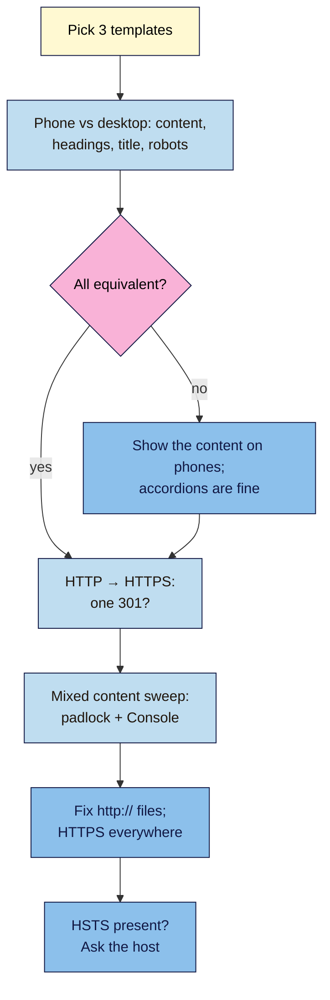

# M12.L03 — Mobile-First and HTTPS: The Secure, Mobile Baseline
> After this lesson you can check that your phone pages carry the same content, headings, titles and robots tags as desktop, find and fix mixed content, confirm HTTP goes to HTTPS in one redirect, and explain HSTS well enough to know when to ask your host about it.

**Time:** ~14 min reading + ~35 min hands-on + ~10 min exercise · **Level:** L3 Advanced · **Prereqs:** M12.L02, M06.L05 · **Remediate to:** M06.L05
**Verified against:** Google Search Central "Mobile site and mobile-first indexing best practices" (last updated 2025-12-10), the Search Central documentation updates log (December 1, 2023 entry), "Mobile-first indexing has landed" (blog, 2023-10-31), "Site moves with URL changes" (2026-08-20), "HTTPS as a ranking signal" (blog, 2014-08-07) and "Indexing HTTPS pages by default" (blog, 2015-12-17); Search Console Help "HTTPS report"; web.dev "What is mixed content?" (2019-09-07); MDN "Strict-Transport-Security", all on 2026-11-09. No browser or Lighthouse tests were run for this lesson.

> ⚠️ **Freshness flag:** Google removed the **Mobile-Friendly Test** and the **Mobile Usability report** in December 2023. Tutorials that send you there are out of date. The HTTPS blog posts quoted here are from 2014 and 2015; they explain history, not today's weighting.

## Learning objectives
1. **Check** mobile and desktop parity for content, headings, titles, meta descriptions and robots tags. *(O1)*
2. **Find** and fix mixed content, and confirm HTTP → HTTPS is a single 301. *(O2)*
3. **Explain** HSTS as a concept, and why its preload list is hard to undo. *(O3)*

## Why it matters
Two of Google's page experience questions are "Are your pages served in a secure fashion?" and "Does your content display well on mobile devices?" They're also part of non-negotiable #13. Most sites pass the basics now, because themes are responsive and hosts give free certificates. The problems hide in details:
- Nila's theme hides the brewing-ratio table on phones "to keep it clean". **Google indexes the phone version**, so the table might as well not exist.
- Her product pages load bean photos from an old `http://` image server. The padlock warns, and browsers may block them.
- Tomás's host goes `http://` → `https://` → `www` → trailing slash: three hops for every old link (Lesson 6.5).

Each is quick to find and fix once you know where to look.

## Core concept
**Plain version:** Google reads your site **as a phone**: "Google uses the mobile version of a site's content, crawled with the smartphone agent, for indexing and ranking." So everything important must be on the phone version, not just desktop. Every page should load over HTTPS, with everything on it (images, scripts, fonts) also over HTTPS, and old `http://` addresses should reach the HTTPS page in one 301.

**Analogy:** a shop with a front door (mobile) and a side door (desktop). Google only ever comes through the front door. If the best shelves are only visible from the side, Google never sees them.

**Precise definitions:**
- **Mobile parity:** the phone version has the same main content, headings, title, meta description, structured data and robots tags as desktop. The design can differ.
- **Mixed content:** an HTTPS page that loads some files over plain HTTP. "There are two types of mixed content: active and passive."
- **Passive mixed content:** "images, video, and audio". It can be tampered with but can't take over the page.
- **Active mixed content:** scripts, stylesheets, iframes. "Attacks on active mixed content let an attacker do almost anything to the page."
- **HSTS (HTTP Strict-Transport-Security):** a response header that "informs browsers that the host should only be accessed using HTTPS".

### Mobile-first: what must match
Google's list (mobile-first best practices):
| Check | Google's words |
|---|---|
| Content | "Make sure that content is the same on desktop and mobile" |
| Accordions and tabs | Allowed: "just make sure that the content is equivalent to the desktop site, since indexing on your site comes from the mobile site" |
| Headings | "Use the same clear and meaningful headings on the mobile site" |
| Title and meta description | "equivalent across both versions" |
| Robots tags | "Use the same robots meta tags on the mobile and desktop site." |
| Lazy loading | "Don't lazy-load primary content upon user interaction." |
| Design | "Google recommends Responsive Web Design" (Lesson 2.10) |

Since 2023, Google says "a mobile web page now needed to be as complete as the corresponding desktop version." For a responsive WordPress site, the HTML is the same on both, so parity issues come from CSS or theme settings that **hide** or **remove** content on phones, or from plugins that serve a separate mobile version *(observed practice)*.

**Tools now:** URL Inspection in Search Console (**Crawled as** and the live test screenshot, Lesson 2.10), the Rich Results Test (it tests as a smartphone by default) and your own phone. Not the Mobile-Friendly Test: it's gone.

### HTTPS: what to check
1. **Every page on HTTPS**, with a valid certificate. The Search Console **HTTPS report** "shows how many indexed URLs on your site are HTTP vs HTTPS". "Ideally your site should have no HTTP URLs in the report." Reasons it lists include "HTTPS has invalid certificate" and HTTP pages marked canonical ("you should declare the HTTPS as the canonical page").
2. **One hop:** `http://example.com/page` → `https://example.com/page` in a single 301 (Lesson 6.5). Google's site-move guide lists "URL changes from HTTP to HTTPS" as a site move.
3. **No mixed content:** "Most browsers now block mixed content for security reasons." Fix the `http://` URLs in the theme, widgets and old posts (a search-and-replace on the database, done carefully or by your host).
4. **Internal links, canonicals and sitemaps** all use `https://` (Lessons 6.3, 6.4).

How much does HTTPS help rankings? Google's 2014 post called it "a very lightweight signal—affecting fewer than 1% of global queries". It's a baseline for trust and security more than a ranking lever *(dated source; course reading)*.

### HSTS: understand it, don't switch it on blind
- HSTS tells browsers to use HTTPS only, even if someone types `http://`. In 2015 Google suggested "redirecting your HTTP site to your HTTPS version and by implementing the HSTS header on your server".
- **Preload** (being built into browsers' lists) needs a `max-age` of "at least 31536000 (1 year)" and `includeSubDomains`. That applies to every subdomain, including an old `shop.` or `mail.` site that might not have HTTPS.
- MDN: "To disable HSTS, set max-age=0", but browsers that saw the old header keep it until it expires, and removing a domain from preload lists takes a long time *(observed practice)*.
- **Course rule of thumb:** check whether your host already sends HSTS (DevTools → Network → the page → Headers). If it doesn't, ask your host before adding it. Never add preload on a whim.

## How it works

**In words:** for three templates, compare the phone and desktop versions: content, headings, title and robots tags. If something's missing on phones, bring it back (accordions are fine). Check that the `http://` address reaches the HTTPS page in one 301. Sweep pages for mixed content using the padlock and the browser console, and fix any `http://` files. Finally, check whether HSTS is already sent, and ask your host before changing it.

> **Under the hood: why hidden-on-mobile content disappears from Google.** Googlebot Smartphone renders the page at a phone's screen size. Content removed from the phone version (by a mobile plugin or a separate mobile site) isn't in what Google indexes. Content that's in the HTML but tucked into an accordion or tab is fine, since Google's doc allows it if it's "equivalent". The risky case is content that only arrives after a tap ("Don't lazy-load primary content upon user interaction") *(course reading of Google's mobile-first doc)*.

## Hands-on walkthrough
You'll build a **Mobile + HTTPS** tab. Nila's details are illustrative.

**Before you start: which steps apply to you?**
- **Path A (your own site):** check your pages and Search Console's HTTPS report.
- **Path B (practice):** check your WordPress practice site and use Nila's findings below.
- **Path C (client site):** check, then send fixes to the client or their host.

**Part A — Mobile parity (15 min)**
1. For three templates (home, product or service, post), open each on your phone and on desktop (or use DevTools device mode).
2. Compare: main content (anything missing on the phone?), H1 and H2s, title, meta description, robots meta tag (View Source on both if a separate mobile version is served), structured data.
3. Path A/C: run **URL Inspection** on one page; note **Crawled as** and look at the live test screenshot.
   **Expected (Nila, illustrative):** the brew-ratio table is set to "hide on mobile" in the page builder. Fix: show it on all devices, perhaps in an accordion.

**Part B — HTTPS sweep (15 min)**
1. Type each template's address with `http://`. Does it land on `https://` in one hop? (Use a redirect checker or the Network tab from Lesson 6.5.)
2. Open each page on HTTPS. Check the padlock, then DevTools → **Console** for "Mixed Content" warnings. List each `http://` file and whether it's passive (image) or active (script).
   > 🖼️ **Image prompt:** Chrome DevTools Console (1280×720) showing a yellow "Mixed Content" warning for an `http://` image on an HTTPS product page. Highlight the warning line with a 3px #F9B2D7 outline; blur any personal details.
   > **Alt text:** Browser console showing a mixed content warning for an http image loaded on an https page, with the warning highlighted.
3. Path A/C: open the Search Console **HTTPS** report; note the count of HTTP URLs and any reasons.
   **Expected:** a list of mixed-content files with fixes. Nila: three bean photos on `http://img.nilacoffee.example` → change to HTTPS (or move them into the media library).

**Part C — HSTS check (5 min)**
1. DevTools → **Network** → reload → click the page → **Headers**. Is there a `strict-transport-security` header? Note its value.
   **Expected:** "present: max-age=…" or "not present: ask host". No changes made.

**Expected output:** a **Mobile + HTTPS** tab: parity results for 3 templates, redirect hops, mixed-content list, HTTPS report notes (Path A/C) and the HSTS status.

## When to use / when not to
**Do this** after a theme change, a move to HTTPS, a new CDN or image server, and in every audit.

**Don't** hide important content on phones, serve a separate stripped-down mobile site, load files over `http://`, or add HSTS preload without your host's advice.

**The trade-off:** a lighter phone page feels faster, but removing content removes it from Google too. Make it compact with accordions and good design, not by deleting it.

## Use AI for this
**Example prompt:**
> "Here are the Console warnings and the `<head>` from my HTTPS page: [paste]. List each mixed-content URL, say whether it's active or passive, and suggest the HTTPS fix. Don't suggest adding HSTS headers."

**What AI does well here:** sorting long warning lists and spotting `http://` URLs in HTML.
**Where it gets it wrong:** it may recommend the retired Mobile-Friendly Test, tell you to add HSTS preload, or write server rules that create redirect loops.
**How to check:** recheck the Console after each fix, test the redirect with a checker, and ask your host about server headers.

## Common mistakes
- **"Hide on mobile"** settings on important blocks.
- **Different titles or robots tags** on a separate mobile version.
- **Old `http://` image or script URLs** in themes, widgets and old posts.
- **Redirect chains** from HTTP to HTTPS to www to a slash.
- **HTTP canonicals or sitemap entries** after moving to HTTPS.
- **Adding HSTS preload** without checking every subdomain.
- **Using the Mobile-Friendly Test** (removed in 2023).

## Troubleshooting
| Symptom | Likely cause | Fix |
|---|---|---|
| Content missing in URL Inspection screenshot | Hidden or removed on mobile | Show it on all devices |
| Padlock warning on some pages | Mixed content | Fix `http://` files to `https://` |
| Image missing on HTTPS page | Browser blocked mixed content | Serve it over HTTPS |
| HTTP URLs in the HTTPS report | HTTP canonicals, links or sitemaps | Update them to HTTPS; one 301 |
| "HTTPS has invalid certificate" | Expired or wrong certificate | Ask the host to renew or fix it |
| A subdomain stops loading after HSTS | `includeSubDomains` on a non-HTTPS subdomain | Fix that subdomain's HTTPS; ask the host |

## Exercise
**Task:** finish your **Mobile + HTTPS** tab (Parts A–C). Then answer these. All details are illustrative.
1. Nila's brew-ratio table is hidden on phones but visible on desktop. Does Google see it? What's the fix?
2. Kavya's mobile pages put the FAQ in an accordion; desktop shows it open. Problem?
3. Tomás's old `http://` links go through three redirects. What should he ask his host?
4. An HTTPS product page loads an `http://` script for a reviews widget. Active or passive? What happens?
5. A freelancer wants to add `Strict-Transport-Security: max-age=63072000; includeSubDomains; preload` today. What should Amara's client ask first?
6. A guide says "test your page in Google's Mobile-Friendly Test". What should you use instead?

**Expected outcome:** a completed tab, and these answers:
- **1** Probably not: Google indexes the mobile version. Show the table on phones (an accordion is fine).
- **2** No: accordions are allowed if the content is "equivalent to the desktop site".
- **3** One 301 from `http://` to the final HTTPS address (Lesson 6.5).
- **4** Active: browsers block it, so the widget breaks; "Attacks on active mixed content let an attacker do almost anything to the page." Load it over HTTPS.
- **5** Does every subdomain work on HTTPS? Who manages the header? It's hard to undo, and preload needs `includeSubDomains`.
- **6** URL Inspection (Crawled as, live test screenshot), the Rich Results Test, or your own phone.

**Stretch goal:** open your site on a slow phone connection (or DevTools throttling). Note the first thing that's hard to read or tap.

## Key takeaways
- Google indexes the phone version: same content, headings, title, meta and robots tags; design can differ.
- Accordions and tabs are fine; hidden or tap-to-load primary content isn't.
- HTTPS everywhere: valid certificate, one-hop 301 from HTTP, no mixed content, HTTPS in canonicals and sitemaps.
- HSTS forces HTTPS in browsers; preload is hard to undo, so ask your host first.
- The Mobile-Friendly Test is gone; use URL Inspection, the Rich Results Test and real phones.

## Teach it back
Explain to a shop owner in 3 sentences why hiding a table on phones can hide it from Google, and what to do instead.

## Glossary terms added
- Mobile parity — added to `seo-101/glossary.md`
- Mixed content — added to `seo-101/glossary.md`
- HSTS — added to `seo-101/glossary.md`
- *Already in the glossary:* Mobile-first indexing, Responsive design, HTTP and HTTPS, URL Inspection

## Further reading
*All checked 2026-11-09.*
- Google Search Central — Mobile site and mobile-first indexing best practices: https://developers.google.com/search/docs/crawling-indexing/mobile/mobile-sites-mobile-first-indexing
- Google Search Central blog — Mobile-first indexing has landed (2023-10-31): https://developers.google.com/search/blog/2023/10/mobile-first-is-here
- Search Console Help — HTTPS report: https://support.google.com/webmasters/answer/11396518
- Google Search Central — Site moves with URL changes: https://developers.google.com/search/docs/crawling-indexing/site-move-with-url-changes
- Google Search Central blog — HTTPS as a ranking signal (2014): https://developers.google.com/search/blog/2014/08/https-as-ranking-signal
- Google Search Central blog — Indexing HTTPS pages by default (2015): https://developers.google.com/search/blog/2015/12/indexing-https-pages-by-default
- web.dev — What is mixed content? (2019): https://web.dev/articles/what-is-mixed-content
- MDN — Strict-Transport-Security: https://developer.mozilla.org/en-US/docs/Web/HTTP/Reference/Headers/Strict-Transport-Security

> ⚠️ **May change:** Search Console reports and labels, browser handling of mixed content. Recheck every 6 months.

## Refresher card
*Used by remediation when a learner fails a quiz twice on a later lesson that points back here.*
**Mobile-first:** Google indexes the mobile version (smartphone agent). Same content, headings, title, meta, robots tags, structured data; accordions/tabs fine if equivalent; no primary content that loads only on tap; responsive recommended. **Tools:** URL Inspection (Crawled as, screenshot), Rich Results Test (smartphone), real phones; the Mobile-Friendly Test was removed in 2023. **HTTPS:** valid certificate; one 301 from HTTP; HTTPS canonicals, links, sitemaps; HTTPS report "no HTTP URLs" ideal. **Mixed content:** passive (images, video, audio) vs active (scripts, CSS, iframes, far worse); browsers block it. **HSTS:** browsers use HTTPS only; preload needs 1-year max-age + includeSubDomains; hard to undo; ask the host.
