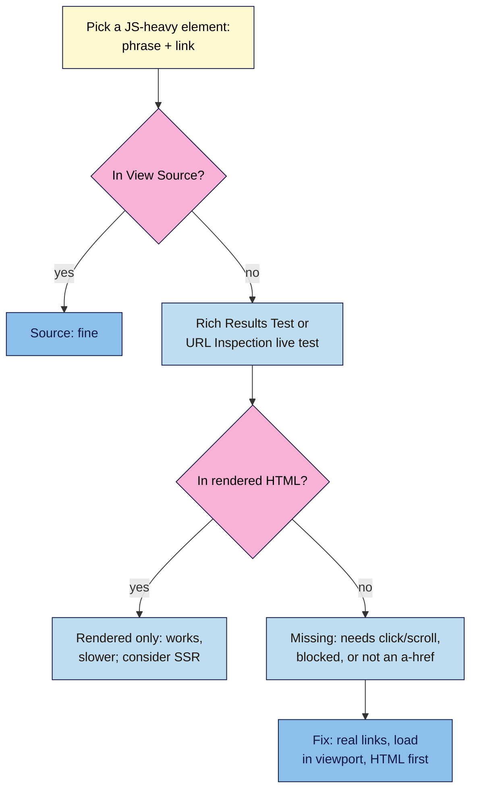

# M12.L04 — JavaScript SEO: What Google Renders
> After this lesson you can compare what your server sends (source HTML) with what Google sees after running JavaScript (rendered HTML), spot the JavaScript traps that hide content or links from Google, and talk sensibly with a developer about server-side, static and client-side rendering.

**Time:** ~16 min reading + ~40 min hands-on + ~10 min exercise · **Level:** L3 Advanced · **Prereqs:** M12.L03, M01.L04 · **Remediate to:** M01.L04
**Verified against:** Google Search Central "Understand JavaScript SEO basics" (last updated 2026-03-04), "Fix lazy-loaded content" (2025-12-10), "Dynamic rendering as a workaround" (2025-12-10), "Make your links crawlable" (2025-12-10) and "AI optimization guide" (2026-07-10); Search Console Help "URL Inspection tool"; web.dev "Rendering on the Web" (2026-01-05), all on 2026-11-09. No browser tests were run for this lesson.

> ⚠️ **Freshness flag:** Google's docs say the URL Inspection tool's **View crawled page** shows "the raw HTML returned", while many SEOs report it shows the page after JavaScript runs. Google hasn't settled this in writing, so this lesson uses a check that works either way (View Source vs the live test or Rich Results Test). Tool labels may change.

## Learning objectives
1. **Compare** source HTML with rendered HTML using View Source and a Google testing tool. *(O1)*
2. **Spot** JavaScript traps: links without `<a href>`, content that needs a click or scroll, `noindex` removed by script. *(O2)*
3. **Choose** a sensible rendering approach (server-side, static or client-side), knowing that dynamic rendering is a workaround. *(O3)*

## Why it matters
In Lesson 1.4 you learned that Google renders pages "using a recent version of Chrome", and the exercise said: if text is missing from View Source, it's probably added by JavaScript, and "you'll test it later". This is later.

Most WordPress pages send their content as HTML, so JavaScript rarely hides it. But the risky bits are the ones people add for looks: Nila's "Next guide →" button built from a ``, a "Load more steps" button on her brew guides, a reviews slider, a page-builder tab. Tomás's shop filters run on JavaScript. If Google can't see a link, it can't follow it; if it can't see text, it can't rank it.

## Core concept
**Plain version:** Google first reads the HTML your server sends (the **source**). Then, when it has capacity, it runs the JavaScript and reads the result (the **rendered HTML**), and "Google also uses the rendered HTML to index the page." Content and links that only appear after a click, a scroll or a permission prompt never show up, because "Google Search does not interact with your page". And links must be real `<a href="…">` links.

**Analogy:** a flat-pack wardrobe. The source is the box of parts; the rendered page is the built wardrobe. Google builds most wardrobes, but later, and it never opens a drawer to see what's inside.

**Precise definitions:**
- **Source HTML:** what the server sends; what you see with View Source (Ctrl/Cmd+U).
- **Rendered HTML:** the page after the browser (or Google's renderer) has run JavaScript.
- **Rendering:** running a page's JavaScript to build the final page. Google's renderer is "a headless Chromium".
- **Server-side rendering (SSR):** "Rendering an app on the server to send HTML, rather than JavaScript, to the client."
- **Client-side rendering (CSR):** "Rendering an app in a browser, using JavaScript to modify the DOM."
- **Static rendering:** pages built as HTML files ahead of time (common with static site generators).
- **Dynamic rendering:** serving bots a pre-rendered version and people the JavaScript version. Google calls it "a workaround and not a long-term solution".

### How Google handles JavaScript
"Googlebot queues all pages with a 200 HTTP status code for rendering, unless a robots meta tag or header tells Google not to index the page." The page may wait "a few seconds, but it can take longer". Then "a headless Chromium renders the page and executes the JavaScript", finds links again, and indexes the rendered HTML.

Two consequences:
- **Server-side or pre-rendering still helps:** "it makes your website faster for users and crawlers, and not all bots can run JavaScript." Google says it can process JavaScript content "as long as it isn't blocked", but other crawlers may not *(observed practice; AI crawlers are covered in Modern SEO 101)*.
- **The `noindex` trap:** "When Google encounters the noindex tag, it may skip rendering and JavaScript execution", so a script that removes `noindex` after load may not work. "If you do want the page indexed, don't use a noindex tag in the original page code." (Non-negotiable #7: indexable when it should be.)

### The traps
| Trap | Why it fails | Fix |
|---|---|---|
| Link without `<a href>`: ``, `<a routerLink="…">`, `<a onclick="goto(…)">` | "Generally, Google can only crawl your link if it's an <a> HTML element … with an href attribute." The others are "Not recommended (but Google may still attempt to parse this)" | `<a href="/brew-guides/french-press/">French press guide</a>` |
| `href="javascript:…"` | Not a URL Google can follow (Lesson 2.5) | A real URL in `href` |
| Content behind "Load more" or a tab that fetches on click | "Google Search does not interact with your page" | Put it in the HTML, or load it when it's "visible in the viewport" |
| Infinite scroll with no pages | Google won't scroll | "Support paginated loading": each chunk gets its own URL |
| `#fragment` URLs for different content | "don't use fragments to load different page content" | Real URLs with the History API |
| `noindex` in source, removed by JS | Google "may skip rendering" | Remove `noindex` from the source |
| Canonical changed by JS | "The best way to set the canonical URL is to use HTML" | One canonical in the source |
| Blocked JS or CSS in robots.txt | Google can't render (Lesson 6.2) | Allow them |

Links added by JavaScript are fine "as long as" they use proper `<a href>` markup. If JavaScript inserts anchor text, Google says to "use the URL Inspection Tool to make sure it's present in the rendered HTML".

### The source vs rendered check
| Tool | What you get | Who can use it |
|---|---|---|
| **View Source** | The source HTML | Anyone |
| **URL Inspection → Test live URL → View tested page** | Rendered HTML and a screenshot ("A screenshot of the rendered page is available only in a live test") | Search Console owners (Path A/C) |
| **Rich Results Test → View tested page** | Rendered HTML and a screenshot | Anyone, for public pages |
| Browser DevTools → Elements | Your browser's rendered page (not Google's) | Anyone |

Pick a phrase and a link from the part you're worried about. Is it in View Source? In the rendered HTML from a Google tool? Record **source / rendered only / missing**. "Rendered only" usually works for Google, but it's slower and fragile; "missing" is a problem.

### Choosing a rendering approach
| Approach | Good for | Watch out |
|---|---|---|
| Server-side or static HTML (most WordPress pages) | Content, products, posts | Plugins that load content by script |
| Client-side app (React, Vue, Angular single-page apps) | Logged-in tools, dashboards | Content and links must still appear in rendered HTML; real URLs |
| Hybrid (SSR + hydration) | Modern frameworks | web.dev encourages "server-side rendering or static rendering over a full rehydration approach" |
| Dynamic rendering | Old sites already using it | "not a recommended solution"; don't start new builds with it |

Google says dynamic rendering isn't cloaking ("Googlebot generally doesn't consider dynamic rendering as cloaking"), but recommends "server-side rendering, static rendering, or hydration as a solution."

## How it works

**In words:** pick a phrase and a link from the element you're worried about. If they're in View Source, you're fine. If not, check the rendered HTML in the Rich Results Test or a URL Inspection live test. If they're there, Google can usually see them, though it's slower; consider server-side rendering for important content. If they're missing, the content needs a click or scroll, is blocked, or the link isn't a real `<a href>`. Fix it so the content and links are in the HTML.

> **Under the hood: why links matter twice.** Google finds pages by following links (Lesson 1.4). It parses links in the source, then again "for links again" after rendering. A `` with a click handler is a button to a person but no link at all to a crawler, so the page it points to may only be found through the sitemap, and it gets none of the internal-link signals (Lesson 6.5) *(course reading of Google's docs)*.

## Hands-on walkthrough
You'll fill in a **JS rendering check** tab. Nila's details are illustrative.

**Before you start: which steps apply to you?**
- **Path A (your own site):** use URL Inspection's live test and the Rich Results Test.
- **Path B (practice):** use the Rich Results Test on your practice site, and Nila's findings.
- **Path C (client site):** run the checks and send findings to the developer.

**Part A — Find the risky elements (10 min)**
1. On one page per template, list elements that might use JavaScript: sliders, tabs, "Load more", related-posts widgets, reviews carousels, filters, menus.
2. For each, write one phrase of text and one link it contains.

**Part B — Source vs rendered (20 min)**
1. View Source and search for each phrase and link URL. Record yes/no.
2. Run the page in the **Rich Results Test** (https://search.google.com/test/rich-results) → **View tested page** → **HTML**. Search again. Path A/C: also run **URL Inspection → Test live URL → View tested page**, and look at the screenshot.
   > 🖼️ **Image prompt:** The Rich Results Test "View tested page" panel (1280×800) with the HTML tab open and a search box finding a phrase in the rendered HTML. Highlight the found phrase with a 3px #F9B2D7 outline; blur any personal details.
   > **Alt text:** The Rich Results Test's tested-page HTML view with a searched phrase found and highlighted.
3. Record each as **source**, **rendered only** or **missing**.
   **Expected (Nila, illustrative):** recipe steps 1–3 in source; steps 4–9 missing (they load after "Load more steps"); "Next: French press guide" is a ``, so missing as a link; reviews carousel rendered only.

**Part C — Check the head (10 min)**
1. In View Source, find the robots meta tag and canonical. Then check them in the rendered HTML.
2. If source says `noindex` but the rendered page doesn't, flag it: Google may never see the change.
   **Expected:** one line per page: "robots: index (source and rendered); canonical: same in both."

**Expected output:** a **JS rendering check** tab: each risky element, its phrase and link, the source/rendered/missing result, and a fix for every "missing".

## When to use / when not to
**Do this** when a page uses sliders, tabs, "Load more", filters, or a JavaScript framework; after a redesign; and when Search Console shows pages "Crawled - currently not indexed" with thin-looking content.

**Don't** rebuild a working WordPress site in a JavaScript framework "for SEO", start a new project with dynamic rendering, or assume a link works because it's clickable.

**The trade-off:** JavaScript makes rich interfaces easy, but every piece of important content or navigation that depends on it is something Google must render later, and other crawlers may skip. Keep content and links in the HTML; use JavaScript for extras *(course rule of thumb)*.

## Use AI for this
**Example prompt:**
> "Here is the HTML for my 'related guides' block: [paste]. List every element a user can click to go to another page. For each, is it an <a> element with an href? If not, rewrite it as a crawlable link, keeping the same text and URL."

**What AI does well here:** spotting ``, `routerLink` and `javascript:` links in a block of HTML, and rewriting them.
**Where it gets it wrong:** it may claim Google "can't run JavaScript at all", suggest dynamic rendering, or rewrite code in a way that breaks your theme.
**How to check:** confirm each fix in View Source and the Rich Results Test's rendered HTML.

## Common mistakes
- **Links as `` or `
` with click handlers**, or `href="javascript:…"`.
- **"Load more" and tabs** that fetch content only on click.
- **Infinite scroll** without paginated URLs.
- **`noindex` in the template**, removed by a script.
- **Blocking JS or CSS** in robots.txt.
- **Checking only in your own browser**, which runs JavaScript perfectly and clicks for you.
- **Choosing dynamic rendering** for a new build.

## Troubleshooting
| Symptom | Likely cause | Fix |
|---|---|---|
| Text in browser, not in View Source | Added by JavaScript | Check rendered HTML in a Google tool |
| Missing in rendered HTML too | Needs a click or scroll, or resources blocked | Load in the viewport; allow JS/CSS; put it in HTML |
| Pages found only via sitemap | Navigation links aren't `<a href>` | Use real links |
| Page not indexed despite JS removing `noindex` | Google skipped rendering | Remove `noindex` from source |
| Screenshot blank or broken | Script errors or blocked files | Check the tool's JavaScript console output and resources |
| `#!` or `#/` URLs | Fragment-based routing | Real URLs with the History API |

## Exercise
**Task:** finish your **JS rendering check** tab (Parts A–C). Then answer these. All details are illustrative.
1. Nila's "Next: French press guide" is ``. Will Google follow it? Fix?
2. Brew-guide steps 4–9 load after a "Load more steps" click. Does Google index them?
3. Tomás's developer put `<meta name="robots" content="noindex">` in the template and removes it with JavaScript on live pages. Problem?
4. Kavya's timetable page loads classes with JavaScript, and they appear in the Rich Results Test's rendered HTML but not in View Source. Is that OK?
5. An agency proposes dynamic rendering for Amara's client's new site. What should she say?
6. A phrase is in your browser's DevTools Elements panel. Does that prove Google sees it?

**Expected outcome:** a completed tab, and these answers:
- **1** Probably not: links should be `<a>` elements "with an href attribute". Use `<a href="/brew-guides/french-press/">French press guide</a>`.
- **2** No: "Google Search does not interact with your page." Put all steps in the HTML (or load them in the viewport).
- **3** Google "may skip rendering" when it sees `noindex`, so pages may stay out. Remove `noindex` from the source.
- **4** Usually yes (Google indexes rendered HTML), but it's slower and other crawlers may miss it; server-rendering the timetable is safer.
- **5** It's "a workaround and not a long-term solution"; prefer server-side or static rendering.
- **6** No: that's your browser's render. Check View Source and a Google tool.

**Stretch goal:** run one competitor's JavaScript-heavy page through the Rich Results Test and compare its source and rendered HTML. Note one thing they do well.

## Key takeaways
- Google renders JavaScript with headless Chromium, but later, and it never clicks or scrolls.
- Important content and links belong in the HTML; links must be `<a href="…">`.
- Check source (View Source) vs rendered (Rich Results Test or URL Inspection live test).
- Never rely on JavaScript to remove `noindex` or set canonicals.
- Prefer server-side or static rendering; dynamic rendering is only a workaround.

## Teach it back
Explain to a designer in 3 sentences why a "Next guide" button made from a `` can stop Google finding the next page, and how to fix it.

## Glossary terms added
- Source HTML — added to `seo-101/glossary.md`
- Rendered HTML — added to `seo-101/glossary.md`
- Server-side rendering (SSR) — added to `seo-101/glossary.md`
- Client-side rendering (CSR) — added to `seo-101/glossary.md`
- Dynamic rendering — added to `seo-101/glossary.md`
- *Already in the glossary:* URL Inspection, Rendering

## Further reading
*All checked 2026-11-09.*
- Google Search Central — Understand JavaScript SEO basics: https://developers.google.com/search/docs/crawling-indexing/javascript/javascript-seo-basics
- Google Search Central — Fix lazy-loaded content: https://developers.google.com/search/docs/crawling-indexing/javascript/lazy-loading
- Google Search Central — Make your links crawlable: https://developers.google.com/search/docs/crawling-indexing/links-crawlable
- Google Search Central — Dynamic rendering as a workaround: https://developers.google.com/search/docs/crawling-indexing/javascript/dynamic-rendering
- Search Console Help — URL Inspection tool: https://support.google.com/webmasters/answer/9012289
- web.dev — Rendering on the Web: https://web.dev/articles/rendering-on-the-web
- Google Search Central — AI optimization guide: https://developers.google.com/search/docs/fundamentals/ai-optimization-guide

> ⚠️ **May change:** Google's rendering details, URL Inspection labels, framework advice. Recheck every 6 months.

## Refresher card
*Used by remediation when a learner fails a quiz twice on a later lesson that points back here.*
**Pipeline:** 200 pages queued for render (unless noindex) → headless Chromium runs JS → links parsed again → rendered HTML indexed. **Never interacts:** no clicks, scrolls, permissions; load content in the viewport; paginate infinite scroll. **Links:** `<a href="…">` only; span/onclick/routerLink/`javascript:` not recommended. **noindex:** Google may skip rendering; never rely on JS to remove it; canonical in HTML. **Check:** View Source (source) vs Rich Results Test or URL Inspection live test (rendered + screenshot); record source / rendered only / missing. **Approaches:** SSR or static preferred; CSR needs real URLs (History API, no fragments); dynamic rendering = workaround, not recommended, not cloaking.
